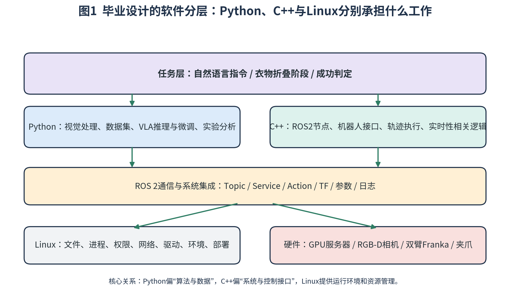
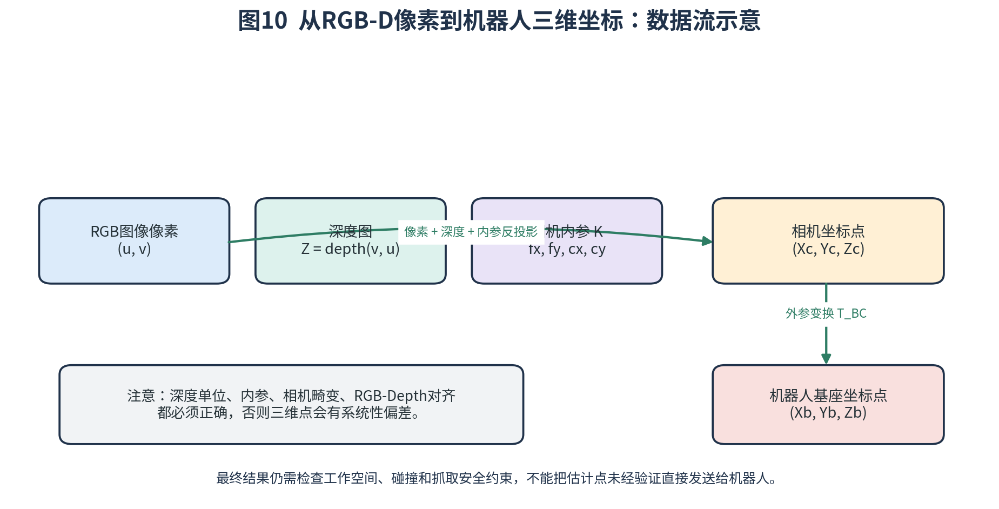
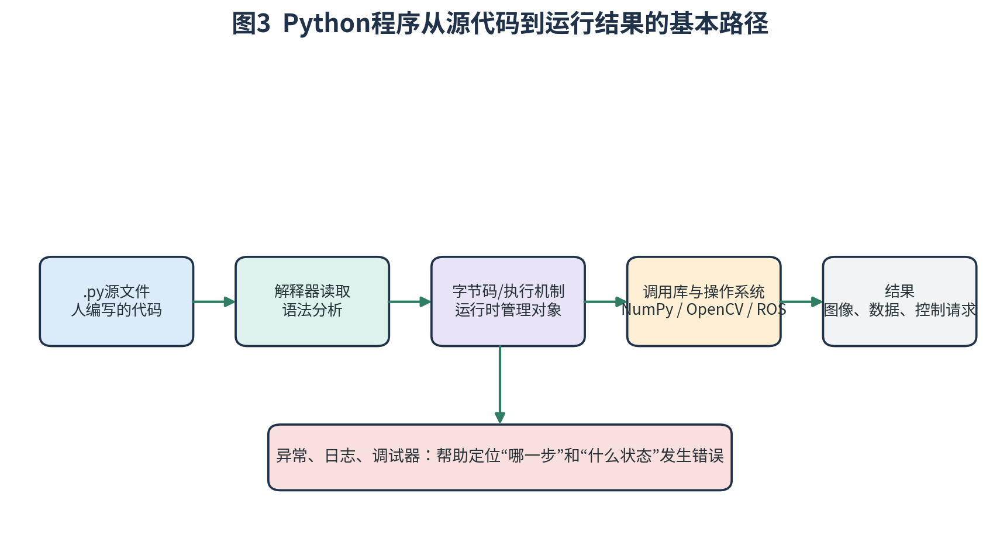
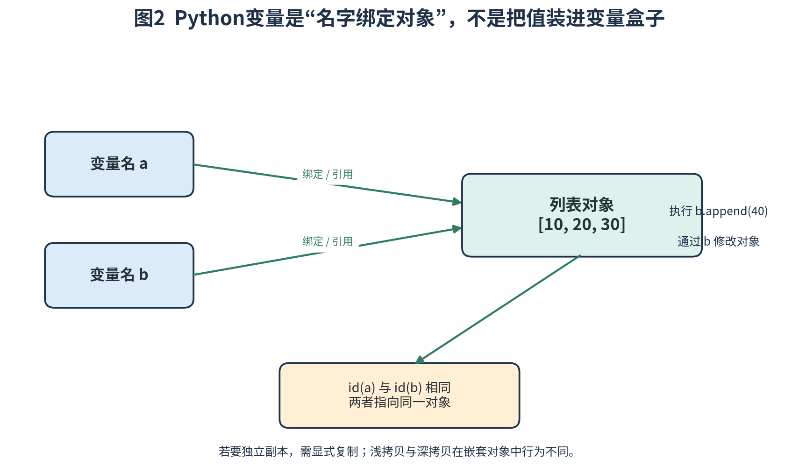
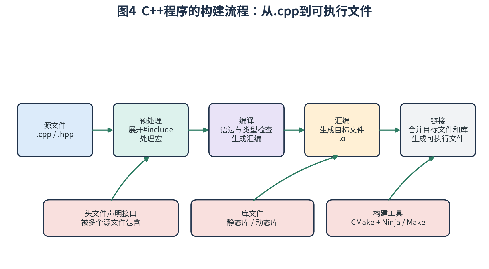
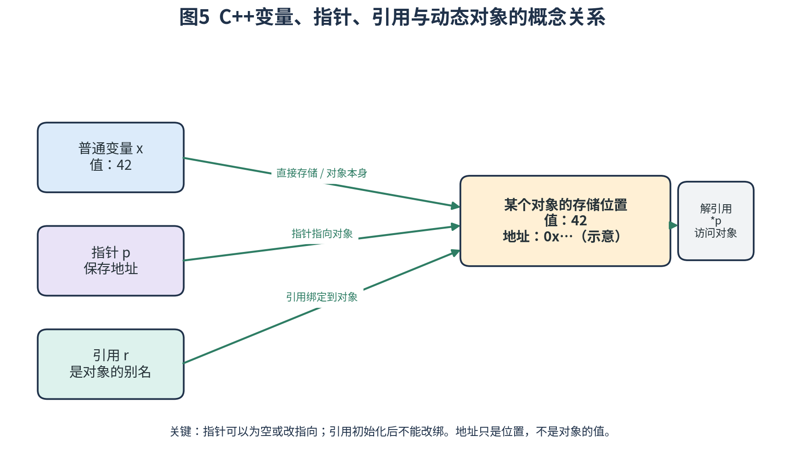
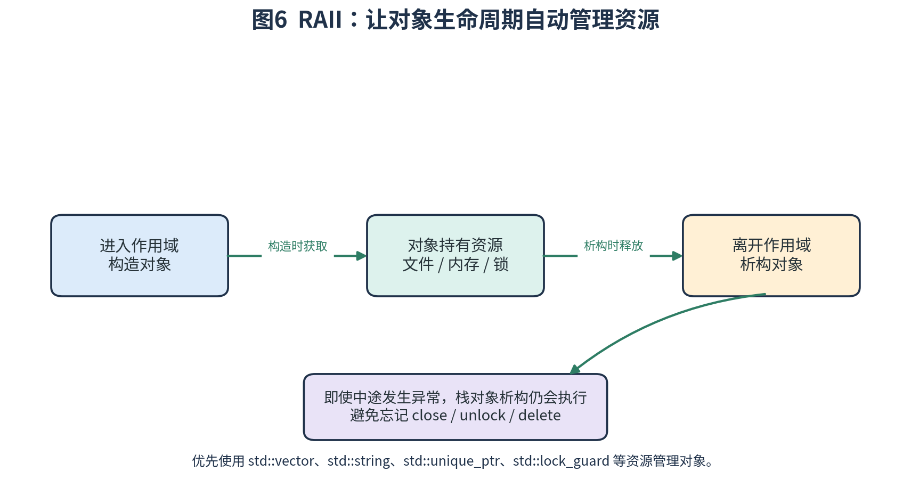
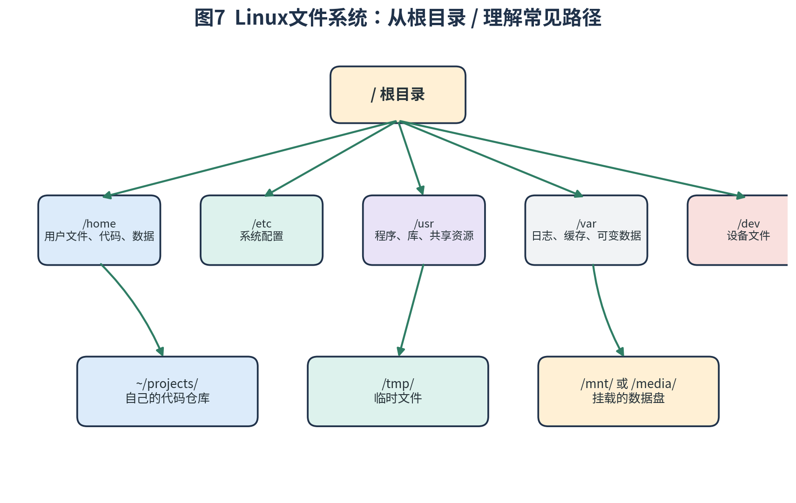
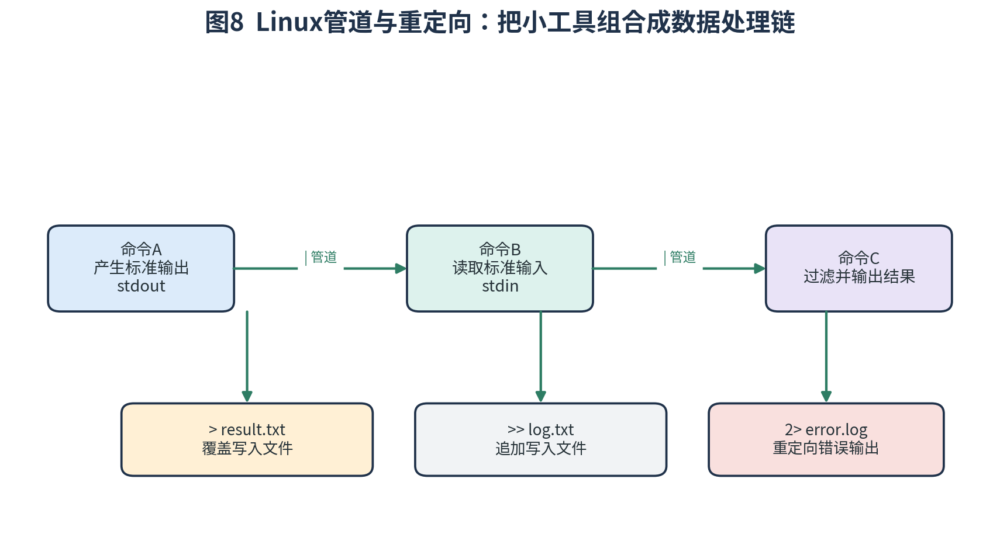
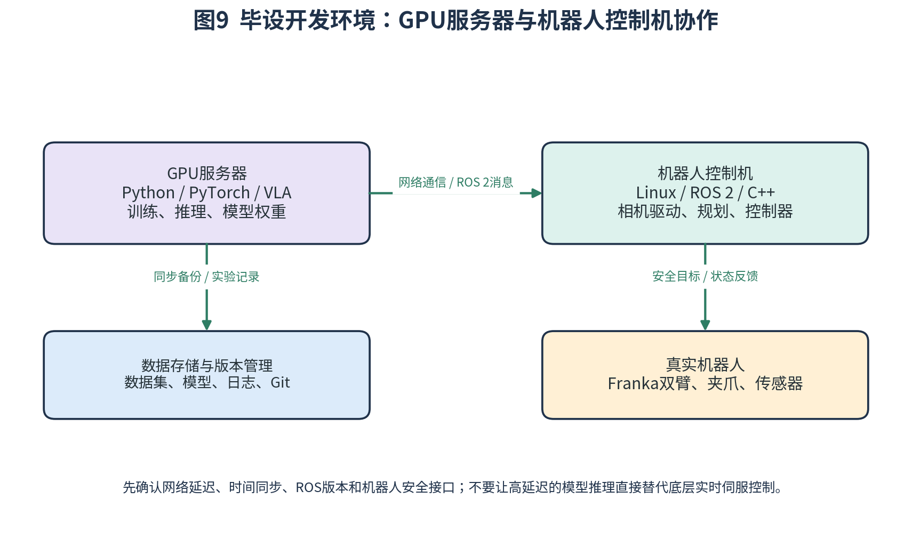

# Python、C++ 与 Linux 基础学习笔记

## ——面向“基于 VLA 模型的双臂机器人衣物折叠系统设计与实现”

> 适用对象：自动化专业本科生  
> 学习目标：为后续 ROS 2、Franka 双臂控制、RGB-D 视觉、PyTorch、VLA 模型部署与微调打下可实际使用的编程和系统基础。  
> 使用建议：按章节学习，边看边运行代码。不要只背语法；每学完一个知识点，都要把它放进“读取相机数据—处理数据—生成目标—控制机器人—记录实验”的完整流程中理解。

---

## 目录

- [0. 如何使用这份笔记](#0-如何使用这份笔记)
- [1. 三种基础技术在毕业设计中的分工](#1-三种基础技术在毕业设计中的分工)
- [2. 编程前必须补齐的数学与计算机基础](#2-编程前必须补齐的数学与计算机基础)
- [3. Python 基础](#3-python-基础)
- [4. C++ 基础](#4-c-基础)
- [5. Linux 基础](#5-linux-基础)
- [6. Python、C++、Linux 如何协同完成机器人任务](#6-python-c-linux-如何协同完成机器人任务)
- [7. 面向毕业设计的三个小型实战项目](#7-面向毕业设计的三个小型实战项目)
- [8. 常见错误、调试方法与工程习惯](#8-常见错误调试方法与工程习惯)
- [9. 学习路线、验收标准与练习题](#9-学习路线验收标准与练习题)
- [10. 术语表](#10-术语表)
- [11. 推荐教材与官方资料](#11-推荐教材与官方资料)

---

# 0. 如何使用这份笔记

这份笔记不是 Python、C++ 或 Linux 的百科全书，而是围绕你的毕业设计筛选出来的“必须会、经常用、值得理解”的内容。目标不是让你成为语言专家，而是让你能够独立搭建开发环境、编写算法程序、阅读机器人代码、调试程序，并把算法接到机器人系统上。

## 0.1 学习完成后应达到什么水平

| 模块 | 最低要求 | 毕设中需要完成的事情 |
|---|---|---|
| Python | 能独立编写多文件程序，读写数据，处理异常 | RGB-D 数据处理、数据集制作、模型推理与训练、实验分析 |
| NumPy | 能处理向量、矩阵和批量数组 | 相机坐标反投影、位姿数据处理、动作数组处理 |
| C++ | 能看懂类、指针、引用、STL 和工程构建 | 阅读/编写 ROS 2 节点、使用机器人控制接口、处理轨迹数据 |
| Linux | 能通过终端管理文件、进程、权限、网络和环境 | 配置 GPU 服务器、运行程序、连接机器人控制机、定位运行错误 |
| 数学基础 | 能理解矩阵乘法、坐标变换、插值与误差 | 从相机像素得到三维点，将目标转换到机器人坐标系 |

## 0.2 建议的学习方式

每个知识点按照四步学习：

1. **先理解概念**：知道它解决什么问题，为什么需要它。
2. **再看最小示例**：理解代码每一行的输入、处理和输出。
3. **自己修改示例**：改变参数、输入和边界条件，观察结果。
4. **迁移到课题**：尝试把例子改成相机数据、机器人状态或实验记录。

不要只复制代码后看到“运行成功”就结束。要能解释：数据是什么类型、程序什么时候创建对象、函数返回什么、错误发生时如何定位。

## 0.3 版本选择原则

开发环境的版本必须服从实验室已有机器人平台、ROS 2 发行版和驱动的兼容要求。不要为了追求最新版本而随意升级系统 Python、C++ 编译器、CUDA 或机器人驱动。

建议先记录实际环境：

```bash
# 操作系统版本
cat /etc/os-release

# Python 版本
python3 --version

# C++ 编译器版本
g++ --version

# CMake 版本
cmake --version

# GPU 状态（安装 NVIDIA 驱动后）
nvidia-smi

# ROS 2 环境（已安装并 source 后）
echo "$ROS_DISTRO"
```

**重要原则：先确认实验室现有版本，再创建隔离环境。** ROS 2 对操作系统、Python 和系统库有版本要求；机器人控制机不要随意升级到与驱动不兼容的软件组合。

---

# 1. 三种基础技术在毕业设计中的分工

Python、C++ 和 Linux 并不是三个互不相干的学习任务。它们在机器人项目中承担不同职责。



## 1.1 Python：更适合算法、数据和模型开发

Python 语法相对简洁，生态中有大量科学计算和人工智能库。你的课题中，Python 通常用于：

- 使用 OpenCV 读取、显示和处理 RGB 图像。
- 使用 NumPy 处理深度图、点云数组、坐标和矩阵。
- 使用 PyTorch 加载视觉网络、VLA 模型并运行推理。
- 处理示范轨迹，制作训练数据集。
- 绘制训练曲线、成功率统计和实验结果图。
- 编写模型服务或 ROS 2 Python 节点。

可以把 Python 理解为算法研究和快速试验的主要工具。

## 1.2 C++：更适合系统接口、机器人软件和性能敏感模块

C++ 能提供更明确的内存与对象生命周期控制，性能也较适合许多机器人底层软件。你的课题中可能使用 C++：

- 编写 ROS 2 C++ 节点。
- 调用 Franka 或其他机器人控制接口。
- 处理机械臂状态、关节状态和轨迹数据。
- 编写控制器、执行器和硬件接口。
- 与 MoveIt 2、Eigen 等 C++ 生态库协作。

不要求你一开始就能从零开发复杂控制器，但必须能够读懂常见 C++ 工程并进行修改、编译和调试。

## 1.3 Linux：整个项目的运行环境

Linux 负责管理硬件、进程、内存、文件、权限和网络。你会在 Linux 中：

- 通过 SSH 连接 GPU 服务器和机器人控制机。
- 安装依赖、配置环境变量和编译工具。
- 启动 ROS 2 节点、相机驱动和模型推理程序。
- 检查 CPU、内存、GPU、磁盘和网络状态。
- 查找程序日志、定位崩溃原因。
- 记录和备份实验数据。

## 1.4 一个完整任务会如何经过这三种技术

例如，机器人收到“把桌面上的毛巾对折”的命令：

1. Linux 启动相机驱动、ROS 2、模型推理服务和机器人控制程序。
2. Python 接收图像，进行衣物感知，调用 VLA 模型生成目标或动作。
3. Python 通过 ROS 2 消息或其他约定接口将动作目标发送给机器人系统。
4. C++ 节点接收目标，检查数据有效性，交给规划器或控制器。
5. 控制器驱动双臂和夹爪执行。
6. 相机再次采集图像，Python 分析折叠结果。
7. Linux 负责保存日志、图像、机器人状态和模型输出。

学习三种技术时，始终要把它们放回这个流程中理解。

---

# 2. 编程前必须补齐的数学与计算机基础

自动化专业已经学过高等数学、线性代数和控制理论，但在写程序时还需要把数学符号转换成数组和算法。

## 2.1 数据、变量与类型

程序处理的所有信息最终都要以计算机能够存储的形式表示。常见数据包括：

- 整数：计数、索引、像素坐标。
- 浮点数：距离、角度、速度、时间、置信度。
- 布尔值：抓取是否成功、夹爪是否闭合。
- 字符串：任务指令、文件路径、日志文本。
- 数组：图像、深度图、点云、机器人状态序列。

### 位与字节

计算机用二进制位表示数据。一个 bit 只有 0 或 1；通常 8 bit 组成 1 byte。图像文件、模型权重和实验数据都由大量字节组成。

例如一张宽 640、高 480、每像素 3 个颜色通道、每通道 1 byte 的 RGB 图像，不考虑文件压缩与额外元数据时，需要的原始内存约为：

$$
640\times480\times3=921600\text{ bytes}
$$

约为 0.88 MiB。若同时保存 RGB、深度图、多个时间帧和中间特征，内存使用量会迅速增加。

### 浮点数与误差

计算机中的浮点数只能近似表示很多实数。十进制的某些小数不能用有限位二进制精确表示，因此不应使用直接相等比较来判断两个浮点结果是否相同。

不推荐：

```python
if measured_distance == target_distance:
    print("完全相等")
```

推荐：

```python
epsilon = 1e-6
if abs(measured_distance - target_distance) < epsilon:
    print("误差在容许范围内")
```

机器人控制中还要区分数值误差、传感器误差、标定误差和控制跟踪误差，它们不是同一种误差。

## 2.2 向量：表示位置、方向和速度

三维空间中的一个点可以用三个坐标表示：

$$
\mathbf p=
\begin{bmatrix}
x\\y\\z
\end{bmatrix}
$$

例如，机器人夹爪在某个坐标系下的位置可以表示为一个三维向量。三维速度也可以写成向量：

$$
\mathbf v=
\begin{bmatrix}
v_x\\v_y\\v_z
\end{bmatrix}
$$

### 向量加减

若两个点或位移向量为：

$$
\mathbf a=\begin{bmatrix}a_x\\a_y\\a_z\end{bmatrix},\qquad
\mathbf b=\begin{bmatrix}b_x\\b_y\\b_z\end{bmatrix}
$$

则：

$$
\mathbf a+\mathbf b=
\begin{bmatrix}a_x+b_x\\a_y+b_y\\a_z+b_z\end{bmatrix}
$$

在机器人中，两个位移向量相加可以得到连续位移；但两个“绝对位置点”不能在所有语境下简单当作普通位移相加。要先确认变量表示的是点还是向量。

### 向量长度

三维向量的欧氏范数为：

$$
\|\mathbf a\|_2=\sqrt{a_x^2+a_y^2+a_z^2}
$$

若两个空间点分别为 \(\mathbf p_1\) 和 \(\mathbf p_2\)，它们之间的距离为：

$$
d=\|\mathbf p_2-\mathbf p_1\|_2
$$

可以用它计算抓取点与目标位置的距离，或统计折叠边缘之间的偏差。

### 点积与夹角

向量点积定义为：

$$
\mathbf a^T\mathbf b=a_xb_x+a_yb_y+a_zb_z
$$

也可以表示为：

$$
\mathbf a^T\mathbf b=\|\mathbf a\|\|\mathbf b\|\cos\theta
$$

因此，当向量都非零时：

$$
\cos\theta=\frac{\mathbf a^T\mathbf b}{\|\mathbf a\|\|\mathbf b\|}
$$

这可以用于计算衣物边缘方向与期望折叠方向的夹角。

## 2.3 矩阵：表示线性变换和批量数据

矩阵是一个按行、列组织的数值表。二维图像、深度图、机器人关节状态、神经网络权重都可以使用矩阵或高维数组表示。

例如：

$$
A=\begin{bmatrix}
1&2&3\\
4&5&6
\end{bmatrix}
$$

该矩阵有 2 行、3 列，形状为 2×3。

### 矩阵乘法为什么要求维度匹配

设矩阵：

$$
A\in\mathbb R^{m\times n},\qquad B\in\mathbb R^{n\times k}
$$

矩阵乘积存在，结果形状为：

$$
C=AB\in\mathbb R^{m\times k}
$$

其元素由 A 的第 i 行与 B 的第 j 列点积得到：

$$
C_{ij}=\sum_{r=1}^{n}A_{ir}B_{rj}
$$

**理解方式：** 左矩阵的一行与右矩阵的一列配对相乘，再将乘积相加。内侧维度必须相等，外侧维度决定结果形状。

这也是为什么 NumPy 中两个数组做矩阵乘法时，需要检查形状。

```python
import numpy as np

A = np.array([[1, 2, 3],
              [4, 5, 6]])       # shape: (2, 3)

B = np.array([[1, 0],
              [0, 1],
              [1, 1]])          # shape: (3, 2)

C = A @ B
print(C)
print(C.shape)                  # (2, 2)
```

注意：`A * B` 通常是逐元素乘法，而 `A @ B` 才表示矩阵乘法。两者含义不同。

## 2.4 三维坐标系和齐次变换的基础

机器人有多个坐标系：世界坐标系、机器人基座坐标系、末端坐标系、相机坐标系等。同一个空间点，在不同坐标系下的数值通常不同。



### 从像素和深度得到相机坐标

针孔相机模型中，内参矩阵为：

$$
K=\begin{bmatrix}
f_x&0&c_x\\
0&f_y&c_y\\
0&0&1
\end{bmatrix}
$$

其中：

- \(f_x,f_y\)：以像素为单位的焦距参数。
- \(c_x,c_y\)：主点坐标。
- \((u,v)\)：图像像素坐标。
- \(Z\)：该像素对应的深度。

针孔模型的投影关系为：

$$
u=f_x\frac{X}{Z}+c_x,\qquad v=f_y\frac{Y}{Z}+c_y
$$

将关系反过来，可以得到：

$$
X=\frac{(u-c_x)Z}{f_x},\qquad
Y=\frac{(v-c_y)Z}{f_y},\qquad Z=Z
$$

这就是 RGB-D 图像中由像素和深度恢复相机三维坐标的基础公式。真实设备还要考虑深度单位、无效深度、相机畸变、深度与彩色图对齐等问题。

### 为什么需要齐次坐标

普通三维点使用三个坐标；齐次坐标在后面增加一个分量：

$$
\tilde{\mathbf p}=\begin{bmatrix}x\\y\\z\\1\end{bmatrix}
$$

这样就可以用一个 4×4 矩阵同时表示旋转和平移：

$$
T=\begin{bmatrix}
R&t\\
0&1
\end{bmatrix}
$$

其中 \(R\) 是 3×3 旋转矩阵，\(t\) 是 3×1 平移向量。

若点在相机坐标系 C 中，要求转换到机器人基座坐标系 B：

$$
{}^B\tilde{\mathbf p}={}^BT_C\,{}^C\tilde{\mathbf p}
$$

两个变换相乘表示连续变换：

$$
{}^AT_C={}^AT_B\,{}^BT_C
$$

变换方向、矩阵左右顺序和坐标系上下标必须保持一致，不能凭记忆随意交换。

### 刚体变换的逆

若：

$$
T=\begin{bmatrix}R&t\\0&1\end{bmatrix}
$$

且 R 是正交旋转矩阵，那么：

$$
R^{-1}=R^T
$$

因此：

$$
T^{-1}=\begin{bmatrix}R^T&-R^Tt\\0&1\end{bmatrix}
$$

这在把机器人坐标转换回相机坐标、检查外参方向时很有用。

## 2.5 轨迹插值与时间

机器人执行一个目标位置时，通常不能只给一个终点，还要考虑从起点怎样连续到达终点。

### 线性插值

已知起点 \(q_0\)、终点 \(q_1\)，定义归一化时间：

$$
s=\frac{t-t_0}{t_1-t_0},\qquad 0\leq s\leq1
$$

线性插值为：

$$
q(t)=(1-s)q_0+sq_1
$$

对时间求导：

$$
\dot q(t)=\frac{q_1-q_0}{t_1-t_0}
$$

其优点是简单；缺点是起点和终点的速度可能突然变化，因此实际机器人控制要结合规划器、速度与加速度限制，不能仅依靠随意插值就执行机械臂。

### 均方根误差

若有 N 个测量值和目标值，误差为：

$$
e_i=x_i-\hat x_i
$$

均方根误差为：

$$
RMSE=\sqrt{\frac{1}{N}\sum_{i=1}^{N}e_i^2}
$$

它常用于评价折叠边缘位置误差、轨迹跟踪误差等。需要保证被比较的数据定义、坐标系和单位一致。

## 2.6 数学知识和编程实现之间的对应关系

| 数学对象 | Python / NumPy | C++ / Eigen | 课题场景 |
|---|---|---|---|
| 标量 | `float`、`np.float32` | `double`、`float` | 深度、角度、时间 |
| 向量 | `np.array([x,y,z])` | `Eigen::Vector3d` | 三维位置、速度 |
| 矩阵 | `np.ndarray` | `Eigen::MatrixXd` | 相机内参、变换矩阵 |
| 四元数 | SciPy Rotation 等 | `Eigen::Quaterniond` | 末端姿态 |
| 时间序列 | list / ndarray | `std::vector` | 关节状态与示范轨迹 |
| 误差统计 | NumPy / pandas | Eigen / 自定义算法 | 轨迹误差、折叠偏差 |

---

# 3. Python 基础

# 3.1 Python 是什么，程序如何运行

Python 是一种高级编程语言，具有动态类型、自动内存管理和丰富的标准库。你会在算法实验和模型开发中频繁使用它。



一般流程如下：

1. 编写 `.py` 源文件。
2. Python 解释器读取并解析代码。
3. 运行时执行代码，并管理变量、对象和内存。
4. 程序调用标准库、第三方库和操作系统能力。
5. 得到图像、文件、数据或机器人控制请求。

先检查 Python：

```bash
python3 --version
which python3
```

运行文件：

```bash
python3 hello.py
```

最小程序：

```python
print("Hello, robot!")
```

## 3.2 变量与基本数据类型

变量可以理解为“指向某个对象的名字”。Python 不要求在定义变量时提前声明固定类型，但对象本身具有类型。

```python
robot_name = "Franka"       # str，字符串
arm_count = 2                # int，整数
control_rate = 100.0         # float，浮点数
camera_ready = True          # bool，布尔值
unknown_value = None         # NoneType，表示当前没有值
```

常用类型：

| 类型 | 示例 | 用途 |
|---|---|---|
| `int` | `2` | 机械臂数量、索引、计数 |
| `float` | `0.25` | 距离、角度、速度 |
| `bool` | `True` | 状态标志 |
| `str` | `"fold towel"` | 任务指令、文件名 |
| `list` | `[0.1, 0.2, 0.3]` | 可变序列 |
| `tuple` | `(640, 480)` | 固定组合数据 |
| `dict` | `{"x": 0.1}` | 键值映射 |
| `set` | `{1, 2, 3}` | 不重复元素集合 |

查看类型：

```python
x = 3.5
print(type(x))
```

类型转换：

```python
pixel_u = int(320.8)       # 320
confidence = float("0.95")
message = str(123)
```

转换前需要检查输入是否合理。例如深度图中的无效值不能简单地直接转换成有效距离。

## 3.3 Python的对象引用与可变对象

这是 Python 初学者很容易理解错的地方。



看下面的代码：

```python
a = [10, 20, 30]
b = a

b.append(40)
print(a)  # [10, 20, 30, 40]
print(b)  # [10, 20, 30, 40]
```

为什么修改 b 会影响 a？因为 `a` 和 `b` 都绑定到了同一个列表对象，而不是两个独立列表。

可以验证对象身份：

```python
print(a is b)       # True
print(id(a), id(b))
```

如果需要创建浅拷贝：

```python
b = a.copy()
```

如果列表内部还嵌套其他可变对象，并且希望递归复制，可以使用：

```python
import copy
b = copy.deepcopy(a)
```

**在机器人项目中的意义：** 多个函数可能共享同一个动作数组或状态字典。如果某个函数原地修改了数据，其他模块也可能看到变化。数据共享要明确，关键数据必要时进行复制。

### 可变对象和不可变对象

常见可变对象：`list`、`dict`、`set`、多数 NumPy 数组。常见不可变对象：`int`、`float`、`bool`、`str`、`tuple`。

不要把“变量名能重新绑定”理解成“对象一定可变”。例如字符串不能原地修改，但变量名可以重新绑定到另一个字符串。

## 3.4 运算符

### 算术运算

```python
a = 7
b = 2
print(a + b)   # 9
print(a - b)   # 5
print(a * b)   # 14
print(a / b)   # 3.5
print(a // b)  # 3，整除
print(a % b)   # 1，取余
print(a ** b)  # 49，幂
```

### 比较运算

```python
x = 0.25
print(x > 0.1)
print(x <= 0.5)
print(x == 0.25)
print(x != 0.3)
```

### 逻辑运算

```python
camera_ready = True
robot_enabled = False

if camera_ready and robot_enabled:
    print("可以进入下一阶段")
```

常用逻辑运算：`and`、`or`、`not`。

注意：`==` 比较值是否相等；`is` 比较是否为同一个对象。不要使用 `is` 判断两个数值是否相等。

## 3.5 条件语句

条件语句用于让程序根据状态选择不同路径。

```python
grasp_success = True
cloth_visible = True

if not cloth_visible:
    print("重新采集图像")
elif not grasp_success:
    print("重新定位抓取点")
else:
    print("进入折叠阶段")
```

机器人任务天然具有状态分支，例如：视觉识别失败、抓取失败、执行成功和安全停止。条件语句是任务逻辑的基础。

## 3.6 循环

### for循环

```python
joint_positions = [0.1, -0.2, 0.3, 0.0, 0.5, -0.1, 0.2]

for index, position in enumerate(joint_positions):
    print(index, position)
```

`enumerate` 可以同时获取索引和值。

### while循环

```python
attempt = 0
max_attempts = 3

while attempt < max_attempts:
    print("执行尝试", attempt + 1)
    attempt += 1
```

在机器人软件中，`while` 常用于持续读取状态或运行一个循环任务。但真实控制循环必须有明确退出条件、时间策略和安全检查，不能写成无法停止的死循环。

### break和continue

- `break`：立即退出循环。
- `continue`：跳过本次循环剩余部分，进入下一轮。

## 3.7 列表、元组、字典和集合

### 列表 list

有序、可变，适合保存按顺序排列的数据。

```python
waypoints = [
    [0.3, 0.1, 0.2],
    [0.4, 0.1, 0.2],
    [0.4, 0.2, 0.2],
]

waypoints.append([0.5, 0.2, 0.2])
first_point = waypoints[0]
```

索引从 0 开始：第一个元素是 `list[0]`，最后一个元素可以用 `list[-1]`。

### 元组 tuple

有序、不可变，适合保存不希望被意外修改的组合值。

```python
image_size = (640, 480)
width, height = image_size
```

### 字典 dict

通过键访问值，适合描述具有名称的数据。

```python
robot_state = {
    "left_arm": [0.1, 0.2, 0.3],
    "right_arm": [0.0, -0.1, 0.2],
    "gripper_left": 0.04,
    "gripper_right": 0.04,
}

left_position = robot_state["left_arm"]
```

使用 `get` 可以避免键不存在时直接报错：

```python
camera_info = {"width": 640, "height": 480}
frame_rate = camera_info.get("fps", 30)
```

### 集合 set

集合中元素不重复，可用于去重或成员判断。

```python
completed_tasks = {"detect", "grasp"}
print("grasp" in completed_tasks)
```

## 3.8 函数：把重复逻辑封装起来

函数可以把一段有明确输入和输出的逻辑独立出来。

```python
def calculate_distance(point_a, point_b):
    dx = point_a[0] - point_b[0]
    dy = point_a[1] - point_b[1]
    dz = point_a[2] - point_b[2]
    return (dx * dx + dy * dy + dz * dz) ** 0.5

p1 = [0.0, 0.0, 0.0]
p2 = [0.3, 0.4, 0.0]
print(calculate_distance(p1, p2))
```

函数设计建议：

- 一项函数尽量完成一个明确任务。
- 参数名称表达清楚含义。
- 返回值结构稳定。
- 对无效输入给出异常或明确错误状态。
- 避免通过大量全局变量在函数之间传递数据。

### 参数类型提示

```python
def clamp(value: float, low: float, high: float) -> float:
    """将 value 限制在 [low, high] 范围内。"""
    if low > high:
        raise ValueError("low 不能大于 high")
    return max(low, min(value, high))
```

类型提示能提升可读性，并帮助 IDE 和静态检查工具发现错误；Python 默认不会仅凭类型提示自动强制检查所有运行时数据。

### 默认参数的陷阱

不要把可变对象直接作为默认参数：

```python
# 不推荐
# def add_point(point, points=[]):
#     points.append(point)
#     return points

# 推荐
def add_point(point, points=None):
    if points is None:
        points = []
    points.append(point)
    return points
```

原因是默认参数对象通常在函数定义时创建，多个函数调用可能共享同一个列表。

## 3.9 面向对象：类、对象和方法

面向对象适合把“数据”和“操作这些数据的函数”组织在一起。

```python
class Gripper:
    def __init__(self, name: str, max_width: float):
        self.name = name
        self.max_width = max_width
        self.width = max_width

    def open(self):
        self.width = self.max_width

    def close_to(self, target_width: float):
        if not 0.0 <= target_width <= self.max_width:
            raise ValueError("夹爪宽度超出范围")
        self.width = target_width

left_gripper = Gripper("left", 0.08)
left_gripper.close_to(0.03)
print(left_gripper.width)
```

解释：

- `class Gripper` 定义类。
- `__init__` 是初始化方法。
- `self` 指当前对象。
- 属性保存对象状态。
- 方法定义对象可以执行的操作。

真实机器人夹爪控制需要调用驱动接口。上面的例子只是模拟对象，不会驱动物理设备。

### 继承和组合

继承描述“是一种”的关系；组合描述“拥有一个”的关系。工程中不应为了使用面向对象而过度继承。比如一个 `RobotSystem` 可以组合相机、感知器、规划器和控制器，比把所有功能塞进一个巨大类更容易维护。

## 3.10 模块、包和导入

当程序变大时，应将代码拆成多个文件。

示例目录：

```text
cloth_project/
├── main.py
├── perception/
│   ├── __init__.py
│   └── detector.py
├── geometry/
│   ├── __init__.py
│   └── transform.py
└── utils/
    ├── __init__.py
    └── logger.py
```

在 `main.py` 中：

```python
from geometry.transform import pixel_to_camera
from perception.detector import detect_cloth
```

注意：文件名不要和常用标准库或第三方库重名，例如不要将自己的文件命名为 `json.py`、`numpy.py`、`torch.py`，否则容易造成导入冲突。

## 3.11 文件读写

### 读取文本

```python
from pathlib import Path

path = Path("data/experiment.txt")
text = path.read_text(encoding="utf-8")
print(text)
```

### 写入文本

```python
from pathlib import Path

output_path = Path("results/summary.txt")
output_path.parent.mkdir(parents=True, exist_ok=True)
output_path.write_text("experiment completed\n", encoding="utf-8")
```

### JSON保存结构化数据

```python
import json
from pathlib import Path

record = {
    "task": "fold_towel",
    "success": True,
    "duration_seconds": 12.8,
}

path = Path("results/record.json")
path.parent.mkdir(parents=True, exist_ok=True)
path.write_text(json.dumps(record, ensure_ascii=False, indent=2), encoding="utf-8")
```

JSON适合保存配置和简单结构化结果；大型图像、点云和高频机器人轨迹通常需要更合适的数据存储格式，不要把所有图像二进制数据直接塞进 JSON 文本。

## 3.12 异常处理

异常是运行期间发生的问题，例如文件不存在、输入类型不正确、网络连接失败。

```python
from pathlib import Path

config_path = Path("config.yaml")

try:
    config_text = config_path.read_text(encoding="utf-8")
except FileNotFoundError:
    print(f"配置文件不存在：{config_path}")
except PermissionError:
    print(f"没有权限读取：{config_path}")
```

一般原则：

- 只捕获你能够处理的异常类型。
- 不要使用空的 `except:` 把所有错误吞掉。
- 记录足够上下文，便于定位发生了什么。
- 机器人控制程序遇到关键状态异常时应进入安全处理流程，而不是继续执行未知动作。

## 3.13 日志 logging

比频繁使用 `print` 更适合长期项目。

```python
import logging

logging.basicConfig(
    level=logging.INFO,
    format="%(asctime)s %(levelname)s %(name)s: %(message)s",
)

logger = logging.getLogger("cloth_perception")
logger.info("相机已启动")
logger.warning("检测到无效深度")
logger.error("标定文件加载失败")
```

日志等级常见为 DEBUG、INFO、WARNING、ERROR、CRITICAL。开发时可以使用 DEBUG，正常运行时通常使用 INFO 或更高等级。

## 3.14 虚拟环境与依赖管理

不同项目可能需要不同版本的 Python 包。虚拟环境可以隔离项目依赖，减少互相影响。

在项目根目录：

```bash
python3 -m venv .venv
source .venv/bin/activate
python -m pip install --upgrade pip
python -m pip install numpy opencv-python
```

查看安装包：

```bash
python -m pip list
```

导出依赖：

```bash
python -m pip freeze > requirements.txt
```

在另一个兼容环境中安装：

```bash
python -m pip install -r requirements.txt
```

退出虚拟环境：

```bash
deactivate
```

**注意：** ROS 2 的 Python 包和系统解释器可能有特殊依赖关系。不要在未确认环境兼容性时，直接用一个随意建立的虚拟环境替换 ROS 2 正在使用的 Python 环境。

## 3.15 NumPy：机器人数据处理中最重要的 Python 库之一

NumPy 提供多维数组和高效数值运算。图像、深度数据、点云和轨迹常常以数组形式处理。

### 创建数组

```python
import numpy as np

position = np.array([0.3, 0.1, 0.2], dtype=np.float64)
identity = np.eye(3)
zeros = np.zeros((480, 640), dtype=np.float32)
ones = np.ones((2, 7), dtype=np.float32)
```

### 数组形状与维度

```python
image = np.zeros((480, 640, 3), dtype=np.uint8)
print(image.shape)  # (480, 640, 3)
print(image.ndim)   # 3
print(image.dtype)  # uint8
```

图像常见维度解释：高、宽、通道数。深度图常见形状为高×宽。模型可能要求通道在前或通道在后，需要按模型输入规范转换。

### 索引与切片

```python
pixel = image[100, 200]        # 第100行、第200列的像素
region = image[50:150, 80:180] # 截取一个区域
```

### 向量运算

```python
p1 = np.array([0.0, 0.0, 0.0])
p2 = np.array([0.3, 0.4, 0.0])

vector = p2 - p1
distance = np.linalg.norm(vector)
print(vector, distance)
```

### 矩阵乘法

```python
R = np.eye(3)
t = np.array([0.1, 0.2, 0.3])
p_camera = np.array([0.4, 0.2, 0.5])

p_base = R @ p_camera + t
print(p_base)
```

上例中的 R 和 t 是示意数值。真实使用时必须来自正确标定的坐标变换。

### 广播与逐元素计算

```python
points = np.array([
    [0.0, 0.0, 0.0],
    [0.1, 0.0, 0.0],
    [0.2, 0.0, 0.0],
])
translation = np.array([0.0, 0.1, 0.2])
translated_points = points + translation
```

这里将同一个平移向量加到每一行。广播可以减少 Python 层循环，但必须确认数组形状符合预期。

### 为什么要注意 dtype

- `uint8` 常用于 8 位图像像素，范围通常是 0 到 255。
- `float32` 常用于深度数据、神经网络输入和较大数值数组。
- `float64` 常用于精度要求较高的几何计算。

将负值写入无符号整数数组可能发生截断或回绕等非预期结果。做几何计算前通常应将图像深度或坐标转换到适当浮点类型。

## 3.16 面向毕业设计的 Python 示例：像素和深度转换为相机三维点

```python
from __future__ import annotations
import numpy as np


def pixel_to_camera(
    u: int,
    v: int,
    depth_image: np.ndarray,
    fx: float,
    fy: float,
    cx: float,
    cy: float,
    depth_scale: float = 1.0,
) -> np.ndarray:
    """将像素(u,v)和深度图转换为相机坐标系下的XYZ点。

    depth_scale 用于把深度图原始单位转换为米。
    例如原始单位为毫米时，可按数据定义设置为 0.001。
    """
    if depth_image.ndim != 2:
        raise ValueError("depth_image 必须是二维深度图")
    height, width = depth_image.shape
    if not (0 <= u < width and 0 <= v < height):
        raise IndexError("像素坐标超出图像范围")
    if fx <= 0 or fy <= 0 or depth_scale <= 0:
        raise ValueError("相机焦距和深度比例必须为正数")

    raw_depth = float(depth_image[v, u])
    z = raw_depth * depth_scale
    if not np.isfinite(z) or z <= 0:
        raise ValueError("该像素深度无效")

    x = (u - cx) * z / fx
    y = (v - cy) * z / fy
    return np.array([x, y, z], dtype=np.float64)
```

理解这个示例的关键：

1. 深度图的数组索引通常是 `[v, u]`，不是 `[u, v]`。
2. 相机内参必须来自相机标定或驱动提供的数据。
3. 深度单位必须明确，不能把毫米误当成米。
4. 无效深度不能直接拿去控制机械臂。
5. 这个函数输出的是相机坐标系下的点，还没有转换到机器人基座坐标系。

## 3.17 Python中的程序效率与常见数据处理习惯

### 不要无意义地逐像素写 Python 循环

对大图像逐像素使用 Python `for` 循环通常比较慢。优先学习 NumPy 向量化运算、OpenCV 内置函数和适合的批量操作。

不推荐的思路：每个像素都进入 Python 循环，再单独做一次相同计算。

更合适的思路：让 NumPy/OpenCV 在底层批量处理数组。

### 时间测量

```python
import time

start = time.perf_counter()
# 在这里执行待测程序
elapsed = time.perf_counter() - start
print(f"耗时：{elapsed * 1000:.2f} ms")
```

测量时应区分冷启动时间、模型加载时间、单帧推理时间、消息传输时间和机器人实际执行时间。

### 单元测试的基本意识

把纯函数与设备接口分开。比如 `pixel_to_camera()` 可以在没有真实相机的情况下用模拟数据测试；真实机器人动作则必须在受控条件下测试。

---

# 4. C++ 基础

# 4.1 为什么机器人软件中仍然大量使用 C++

C++ 是编译型、静态类型语言，能够在编译阶段检查许多类型错误，也允许开发者更明确地管理对象和资源的生命周期。机器人中间件、驱动、控制器和许多高性能几何库大量使用 C++。

你的目标不是一开始就写出复杂的模板库，而是能读懂并修改常见现代 C++ 工程。

## 4.2 C++程序如何变成可执行文件



典型流程：

1. **预处理**：处理 `#include`、宏等。
2. **编译**：检查语法与类型，并生成汇编代码。
3. **汇编**：生成目标文件。
4. **链接**：将目标文件和所需库组合成可执行文件。

### 最小程序

文件 `hello.cpp`：

```cpp
#include <iostream>

int main() {
    std::cout << "Hello, robot!" << std::endl;
    return 0;
}
```

编译和运行：

```bash
g++ -std=c++17 -Wall -Wextra -O2 hello.cpp -o hello
./hello
```

参数含义：

- `-std=c++17`：选择 C++17 语言标准。
- `-Wall -Wextra`：启用常见警告。
- `-O2`：优化编译。
- `-o hello`：指定输出程序名称。

调试时可以用调试构建和调试器，不应只依赖优化后的程序。

## 4.3 基本类型和变量

```cpp
#include <iostream>
#include <string>

int main() {
    int arm_count = 2;
    double depth_m = 0.532;
    float confidence = 0.95f;
    bool camera_ready = true;
    std::string task = "fold towel";

    std::cout << task << ", arms=" << arm_count << '\n';
    return 0;
}
```

常见类型：

| 类型 | 含义 | 使用例子 |
|---|---|---|
| `int` | 整数 | 次数、索引 |
| `float` | 单精度浮点数 | 部分图像数值 |
| `double` | 双精度浮点数 | 距离、角度、位姿计算 |
| `bool` | 布尔值 | 状态标志 |
| `char` | 字符 | 单个字符 |
| `std::string` | 字符串 | 任务名和路径 |
| `std::size_t` | 无符号大小类型 | 容器长度和索引 |

工程中涉及几何计算时，常使用 `double`。具体精度还要服从相关库和机器人接口的定义。

## 4.4 常量、自动类型推导和作用域

```cpp
const double pi = 3.141592653589793;
auto camera_width = 640;
auto depth_scale = 0.001;
```

- `const` 表示通过该名字不能修改对象。
- `auto` 让编译器根据初始化表达式推导类型。
- 变量只在所属作用域内有效，离开作用域后局部对象生命周期结束。

不要为了少写几个字符而过度使用 `auto`。当类型对理解程序很重要时，应让类型清晰可读。

## 4.5 条件、循环和函数

### 条件语句

```cpp
if (camera_ready && robot_enabled) {
    std::cout << "system ready\n";
} else {
    std::cout << "system not ready\n";
}
```

### for循环

```cpp
#include <vector>
#include <iostream>

int main() {
    std::vector<double> joints{0.1, -0.2, 0.3, 0.0};
    for (std::size_t i = 0; i < joints.size(); ++i) {
        std::cout << i << ": " << joints[i] << '\n';
    }
}
```

### 范围for循环

```cpp
for (double joint : joints) {
    std::cout << joint << '\n';
}
```

如果只读取元素，可以考虑使用常量引用：

```cpp
for (const double& joint : joints) {
    std::cout << joint << '\n';
}
```

### 函数

```cpp
double distance3d(double x1, double y1, double z1,
                  double x2, double y2, double z2) {
    const double dx = x2 - x1;
    const double dy = y2 - y1;
    const double dz = z2 - z1;
    return std::sqrt(dx * dx + dy * dy + dz * dz);
}
```

使用 `std::sqrt` 前需要包含 `<cmath>`。

## 4.6 值传递、引用和常量引用

函数参数可以按值传递，也可以通过引用访问原对象。

### 值传递

```cpp
void change_value(double x) {
    x = 10.0;
}
```

函数得到一个值副本，修改副本不会改变调用者的原变量。

### 引用传递

```cpp
void change_value(double& x) {
    x = 10.0;
}
```

引用可以理解为对象的别名，修改引用会修改原对象。

### 常量引用

```cpp
void print_position(const std::vector<double>& position) {
    for (double value : position) {
        std::cout << value << ' ';
    }
}
```

常量引用通常用于避免复制较大的对象，同时限制函数通过该引用修改对象。

选择原则：

- 小型基础类型（如 `int`、`double`）通常按值传递。
- 较大的对象只读时，通常考虑 `const T&`。
- 明确需要修改调用者对象时，考虑 `T&`。
- 指针通常用于表达可为空、需要重新指向或特定所有权语义的场景；不要随意使用裸指针管理资源。

## 4.7 指针和引用：C++必须真正理解的内容



### 指针

指针变量保存一个对象的地址：

```cpp
int value = 42;
int* pointer = &value;

std::cout << value << '\n';      // 对象的值
std::cout << pointer << '\n';    // 地址（具体显示形式由环境决定）
std::cout << *pointer << '\n';  // 解引用，访问指向对象
```

符号含义：

- `&value`：取对象地址。
- `int*`：指向 int 的指针类型。
- `*pointer`：解引用，访问指针所指对象。

指针可以为空：

```cpp
int* pointer = nullptr;
if (pointer != nullptr) {
    std::cout << *pointer;
}
```

对空指针或悬空指针解引用会导致未定义行为。

### 引用

```cpp
int value = 42;
int& reference = value;
reference = 100;
std::cout << value << '\n';  // 100
```

引用必须在定义时绑定到对象，之后不能改为引用另一个对象。

### 指针与引用对比

| 对比 | 指针 | 引用 |
|---|---|---|
| 是否可以为空 | 可以为 `nullptr` | 正常引用必须绑定对象 |
| 是否可以改指向 | 可以 | 不能重新绑定 |
| 是否需要解引用 | 通常需要 `*` | 使用方式像原对象 |
| 适用场景 | 可选对象、地址传递、特定接口 | 明确存在的对象别名、函数参数 |

### 什么时候容易出错

- 指针没有初始化就使用。
- 对象已经销毁，但指针仍然保存旧地址。
- 返回局部变量的引用或指针。
- 容器扩容后仍然使用已失效的元素指针或引用。
- 多个指针都以为自己拥有同一个资源，并重复释放。

## 4.8 栈、堆和对象生命周期

概念上，程序有不同的存储区域。初学时可以先用以下方式理解：

- 自动存储期对象通常随作用域进入而创建，离开作用域而销毁。
- 动态分配对象由动态内存管理机制创建，必须确保其生命周期被正确管理。
- 静态存储期对象在程序运行期间持续存在。

例如：

```cpp
void example() {
    int local_value = 10;  // 自动存储期对象

    std::vector<double> trajectory(100); // vector对象本身在当前作用域，内部数据由容器管理
}
```

初学时不要把“栈/堆”理解成所有变量的绝对固定位置规则。C++真正规定的是对象的存储期、生命周期和资源管理语义，编译器实现可能有优化。

## 4.9 STL：标准模板库

你至少需要熟悉以下容器和工具。

### std::vector

动态数组，机器人轨迹、关节数据和点序列经常使用。

```cpp
#include <vector>

std::vector<double> joint_positions;
joint_positions.push_back(0.1);
joint_positions.push_back(0.2);
joint_positions.push_back(0.3);
```

访问元素：

```cpp
double first = joint_positions.at(0);
```

`at()` 可以进行边界检查；`operator[]` 通常不进行边界检查。对外部数据索引要特别注意范围。

### std::array

固定长度数组：

```cpp
#include <array>

std::array<double, 7> joints{};
joints[0] = 0.1;
```

如果机械臂关节数量固定，`std::array` 表达固定长度数据会比较直观。

### std::string

字符串：

```cpp
#include <string>

std::string instruction = "fold towel";
```

### std::map / std::unordered_map

键值映射：

```cpp
#include <unordered_map>
#include <string>

std::unordered_map<std::string, double> metrics;
metrics["success_rate"] = 0.92;
```

### std::optional

表达一个结果可能存在，也可能不存在。需要 C++17 或更新标准。

```cpp
#include <optional>
#include <iostream>

std::optional<double> find_depth(bool valid) {
    if (!valid) {
        return std::nullopt;
    }
    return 0.52;
}
```

相比用一个特殊数字表示“无效”，`std::optional` 能更清晰表达可选结果。

## 4.10 类、对象、构造函数和析构函数

```cpp
#include <string>
#include <utility>

class CameraStatus {
public:
    explicit CameraStatus(std::string camera_name)
        : name_(std::move(camera_name)), ready_(false) {}

    void set_ready(bool ready) {
        ready_ = ready;
    }

    bool is_ready() const {
        return ready_;
    }

private:
    std::string name_;
    bool ready_;
};
```

重要概念：

- `public`：类外部可以访问的接口。
- `private`：类内部实现细节。
- 构造函数：对象创建时调用，负责建立有效初始状态。
- `const` 成员函数：表示该函数不会通过普通成员访问修改对象状态。
- 初始化列表：在成员构造时初始化成员，通常优于在函数体中先默认构造再赋值。
- `explicit`：避免某些不希望发生的隐式类型转换。

类的价值在于维护状态一致性。例如，一个机器人接口类可以负责连接状态、关节状态读取和安全命令入口，而不应让任意模块随意修改内部状态。

## 4.11 RAII：资源获取即初始化

这是现代 C++ 非常重要的工程思想。



RAII 的核心是：资源在对象构造时获取，在对象析构时释放。这样可以利用 C++ 的作用域和对象生命周期管理文件、内存、锁等资源。

**资源不只包括内存**，还包括文件句柄、网络连接、互斥锁和设备资源等。

例如：

```cpp
#include <fstream>
#include <string>
#include <stdexcept>

void save_log(const std::string& message) {
    std::ofstream file("experiment.log", std::ios::app);
    if (!file) {
        throw std::runtime_error("无法打开日志文件");
    }
    file << message << '\n';
} // file离开作用域时自动关闭
```

不推荐在现代 C++ 项目中随意使用裸 `new` 和 `delete` 管理对象。优先用标准容器和智能指针。

### 智能指针

`std::unique_ptr`：独占所有权，一个对象在某个时刻由一个主要所有者负责管理。

```cpp
#include <memory>

auto data = std::make_unique<double>(0.5);
```

`std::shared_ptr`：共享所有权，通过引用计数管理对象生命周期。

```cpp
#include <memory>

auto data = std::make_shared<double>(0.5);
auto another_owner = data;
```

`std::weak_ptr`：不增加共享所有权的观察者，常用于打破 `shared_ptr` 循环引用。

不要因为“智能指针安全”就到处使用 `shared_ptr`。能明确独占所有权时，优先考虑 `unique_ptr`；只需要临时访问时，常用引用或非拥有指针表达。

## 4.12 const正确性

`const` 能表达“这个接口不应该修改该对象”，有助于减少副作用。

```cpp
void print_state(const std::vector<double>& state);
```

上面表示函数以引用方式接收向量，但不应通过这个引用修改向量内容。

注意 `const` 和指针组合的不同含义：

```cpp
const int* p1 = nullptr;  // 不能通过 p1 修改所指 int
int* const p2 = nullptr;  // p2 本身不能改指向（此示例初始化空指针只作类型说明）
const int* const p3 = nullptr; // 指针和所指内容都不能通过该名字修改
```

初学时先掌握函数参数中的 `const T&` 和局部常量即可。

## 4.13 错误处理与异常

```cpp
#include <stdexcept>

if (sample_count <= 0) {
    throw std::invalid_argument("sample_count 必须大于0");
}
```

调用方可以捕获：

```cpp
try {
    // 调用可能抛出异常的函数
} catch (const std::exception& error) {
    std::cerr << "发生异常：" << error.what() << '\n';
}
```

机器人软件的错误处理要特别谨慎：如果目标位姿非法、通信丢失或状态不可信，不应该继续发送未经检查的运动命令。错误处理需要与机器人驱动和安全机制配合。

## 4.14 Lambda表达式

Lambda 是可以在代码中定义的小型函数对象，常用于排序、回调和算法。

```cpp
#include <algorithm>
#include <vector>

std::vector<double> errors{0.03, 0.01, 0.02};
std::sort(errors.begin(), errors.end(),
          [](double a, double b) {
              return a < b;
          });
```

Lambda 也可能捕获外部变量。对捕获变量的生命周期要有意识，尤其不能让异步回调长期持有已经销毁对象的引用。

## 4.15 C++中的数学计算：Eigen基础

Eigen 是常用的 C++ 线性代数库，在机器人、视觉和几何计算中经常见到。

示例：

```cpp
#include <Eigen/Dense>
#include <iostream>

int main() {
    Eigen::Vector3d p_camera(0.4, 0.2, 0.5);
    Eigen::Matrix3d R = Eigen::Matrix3d::Identity();
    Eigen::Vector3d t(0.1, 0.0, 0.2);

    Eigen::Vector3d p_base = R * p_camera + t;
    std::cout << p_base.transpose() << '\n';
}
```

这里只用单位旋转矩阵作示例。真实变换必须使用标定或机器人模型中的变换。

你需要会：

- 创建 `Vector3d`、`Matrix3d`、`Matrix4d`。
- 访问和赋值元素。
- 进行矩阵乘法和向量变换。
- 理解转置、逆矩阵、范数。
- 使用四元数或旋转矩阵表示姿态。

## 4.16 C++多文件工程与头文件

推荐结构：

```text
robot_app/
├── CMakeLists.txt
├── include/
│   └── robot_app/
│       └── geometry.hpp
└── src/
    ├── geometry.cpp
    └── main.cpp
```

头文件 `geometry.hpp`：

```cpp
#pragma once

#include <Eigen/Dense>

namespace robot_app {
Eigen::Vector3d transform_point(
    const Eigen::Matrix3d& rotation,
    const Eigen::Vector3d& translation,
    const Eigen::Vector3d& point);
}
```

源文件 `geometry.cpp`：

```cpp
#include "robot_app/geometry.hpp"

namespace robot_app {
Eigen::Vector3d transform_point(
    const Eigen::Matrix3d& rotation,
    const Eigen::Vector3d& translation,
    const Eigen::Vector3d& point) {
    return rotation * point + translation;
}
}
```

### 最小CMake示例

```cmake
cmake_minimum_required(VERSION 3.16)
project(robot_app LANGUAGES CXX)

set(CMAKE_CXX_STANDARD 17)
set(CMAKE_CXX_STANDARD_REQUIRED ON)
set(CMAKE_CXX_EXTENSIONS OFF)

find_package(Eigen3 REQUIRED)

add_executable(robot_app
    src/main.cpp
    src/geometry.cpp
)

target_include_directories(robot_app PRIVATE include)
target_link_libraries(robot_app PRIVATE Eigen3::Eigen)
target_compile_options(robot_app PRIVATE -Wall -Wextra)
```

构建：

```bash
cmake -S . -B build -DCMAKE_BUILD_TYPE=Release
cmake --build build -j
./build/robot_app
```

调试构建：

```bash
cmake -S . -B build-debug -DCMAKE_BUILD_TYPE=Debug
cmake --build build-debug -j
```

CMake 负责描述项目如何配置和构建；Make 或 Ninja 等工具执行具体构建任务。

## 4.17 C++并发的入门概念

机器人系统中经常存在多个任务：相机数据接收、状态发布、轨迹执行和日志记录。

并发程序常见问题包括：

- 数据竞争：多个线程同时访问共享数据，至少一个线程写入且没有正确同步。
- 死锁：线程互相等待对方持有的锁。
- 生命周期错误：线程仍在使用对象，但对象已经销毁。
- 实时性误解：使用线程不等于自动满足实时控制要求。

基础互斥锁示例：

```cpp
#include <mutex>
#include <vector>

std::mutex state_mutex;
std::vector<double> latest_state;

void update_state(const std::vector<double>& new_state) {
    std::lock_guard<std::mutex> lock(state_mutex);
    latest_state = new_state;
}
```

`std::lock_guard` 是 RAII 风格锁管理对象，离开作用域时自动释放锁。初学阶段先理解互斥、共享数据和生命周期，不要过早自行设计复杂的多线程控制架构。

## 4.18 面向毕业设计的C++练习：轨迹线性插值

该示例只用于理解轨迹数据计算，不是可直接用于真实Franka控制的完整控制器。

```cpp
#include <array>
#include <cstddef>
#include <stdexcept>

using JointVector = std::array<double, 7>;

JointVector interpolate(
    const JointVector& q0,
    const JointVector& q1,
    double alpha) {
    if (alpha < 0.0 || alpha > 1.0) {
        throw std::out_of_range("alpha 必须位于 [0, 1]");
    }

    JointVector result{};
    for (std::size_t i = 0; i < result.size(); ++i) {
        result[i] = (1.0 - alpha) * q0[i] + alpha * q1[i];
    }
    return result;
}
```

它对应的数学表达式是：

$$
q(\alpha)=(1-\alpha)q_0+\alpha q_1
$$

当归一化时间从 0 变化到 1 时，轨迹从起点逐渐到达终点。实际机器人执行前还必须处理关节限位、速度、加速度、碰撞、控制器要求和安全停止等问题。

---

# 5. Linux 基础

# 5.1 Linux是什么

Linux 是一个操作系统内核。常见 Linux 发行版会将内核、系统工具、软件包管理器、库和桌面或服务器组件组合在一起。你的 GPU 服务器和机器人控制计算机很可能运行某种 Linux 发行版。

可以把操作系统理解成应用程序和硬件之间的管理层：应用程序通过系统调用请求文件访问、内存、进程、网络和设备等资源。

## 5.2 Linux的文件系统结构



Linux 使用一棵以 `/` 为根的文件系统目录树。常见目录：

| 路径 | 主要用途 |
|---|---|
| `/` | 根目录 |
| `/home` | 普通用户文件和项目 |
| `/root` | root 用户的主目录 |
| `/etc` | 系统配置 |
| `/usr` | 系统程序、库和共享资源 |
| `/var` | 日志、缓存及可变数据 |
| `/tmp` | 临时文件 |
| `/dev` | 设备文件 |
| `/proc` | 内核和进程信息的虚拟文件系统 |
| `/sys` | 设备和内核相关信息 |
| `/mnt`、`/media` | 常见挂载点 |

### 绝对路径和相对路径

- 绝对路径从 `/` 开始，例如 `/home/user/robot_project`。
- 相对路径相对于当前工作目录，例如 `./src/main.cpp`。
- `.` 表示当前目录。
- `..` 表示上一级目录。
- `~` 通常表示当前用户主目录。

查看当前路径：

```bash
pwd
```

## 5.3 最常用的文件和目录命令

```bash
# 查看当前目录内容
ls

# 详细显示，包括隐藏文件
ls -lah

# 切换目录
cd ~/projects

# 返回上一级
cd ..

# 创建目录
mkdir -p cloth_project/data/raw

# 创建空文件
 touch notes.txt

# 复制文件
cp config.yaml config_backup.yaml

# 复制目录
cp -r project project_backup

# 移动或重命名
mv old_name.txt new_name.txt

# 删除文件（不可轻易恢复）
rm notes.txt

# 删除目录及其内容（危险，先确认路径）
rm -r old_directory
```

`rm -rf` 非常危险，不要在不确定当前路径和目标路径时使用。特别不要将变量为空时的删除命令直接执行。

### 查看文件内容

```bash
cat file.txt       # 全部输出
less file.txt      # 分页查看
head -n 20 log.txt # 前20行
tail -n 50 log.txt # 最后50行
tail -f log.txt   # 持续跟踪日志追加内容
```

## 5.4 查找文件与内容

```bash
# 在当前目录中按名字查找
find . -name "*.py"

# 在文本中搜索关键字
grep -n "ERROR" experiment.log

# 递归搜索目录中的关键字
grep -Rni "camera" ./config

# 只看匹配文件名（若系统安装ripgrep，也可用rg）
rg -l "TODO" .
```

常见组合：

```bash
find . -name "*.yaml" -o -name "*.yml"
grep -Rni "frame_id" src/
```

查找时尽量缩小范围，不要无意义地从整个根目录搜索。

## 5.5 Shell、命令参数与环境变量

Shell 是用户与操作系统交互的命令解释环境。常见有 Bash、Zsh 等。

例如：

```bash
python3 train.py --config configs/train.yaml --epochs 20
```

这里：

- `python3` 是命令。
- `train.py` 是程序文件。
- `--config`、`--epochs` 是命令行参数。
- 后面的字符串是参数值。

环境变量是进程运行时可以读取的键值信息。

```bash
# 查看某个变量
echo "$HOME"
echo "$PATH"

# 临时设置变量
export MY_PROJECT=/home/user/cloth_project

# 使用变量
cd "$MY_PROJECT"
```

`PATH` 告诉 Shell 到哪些目录寻找可执行命令。若程序已经安装但系统提示找不到命令，可能是没有安装，也可能是路径没有配置正确。

查看某条命令来自哪里：

```bash
which python3
which g++
type -a python3
```

## 5.6 管道与输入输出重定向



进程常用的标准输入、标准输出和标准错误分别是：

- 标准输入 stdin：默认文件描述符 0。
- 标准输出 stdout：默认文件描述符 1。
- 标准错误 stderr：默认文件描述符 2。

重定向：

```bash
# 覆盖写入
python3 train.py > train.log

# 追加写入
python3 train.py >> train.log

# 将错误输出写入 error.log
python3 train.py 2> error.log

# 标准输出和标准错误都写入同一个文件
python3 train.py > run.log 2>&1
```

管道：

```bash
ps aux | grep python
```

前一个命令的标准输出成为后一个命令的标准输入。管道可以把许多小工具组合起来。

例如：

```bash
# 统计日志中 ERROR 出现的行数
grep -c "ERROR" experiment.log

# 查看最近日志中的错误
tail -n 500 experiment.log | grep -i "error"
```

## 5.7 Linux权限

Linux 文件权限主要涉及：

- 用户所有者 user。
- 用户组 group。
- 其他用户 others。
- 读取 r、写入 w、执行 x。

查看权限：

```bash
ls -l
```

可能看到类似：

```text
-rwxr-xr-- 1 user robot 12000 Nov 11 20:00 run.sh
```

最前面的权限字符串可以按所有者、组、其他用户分成三组。

### 数字权限为什么是 755、644

权限通常用三位八进制数表示：

- 读取 r 对应 4。
- 写入 w 对应 2。
- 执行 x 对应 1。

每组权限是这三项相加：

$$
7=4+2+1\quad\text{表示 rwx}
$$

$$
5=4+1\quad\text{表示 r-x}
$$

$$
4=4\quad\text{表示 r--}
$$

因此：

```bash
chmod 755 run.sh
chmod 644 config.yaml
```

通常 `755` 表示所有者可读写执行，组和其他用户可读、可执行；`644` 表示所有者可读写，组和其他用户只读。

不要对整个系统目录随意执行 `chmod -R 777`。这会造成严重的权限与安全问题。

### sudo

`sudo` 允许经过授权的用户以更高权限执行命令。安装软件或修改系统配置时可能需要它，但不应该把所有命令都加上 `sudo`。

不要将不理解的网络命令直接以管理员身份执行。对安装、删除、格式化、权限修改等操作，先确认命令目标。

## 5.8 进程与任务管理

进程是正在运行的程序实例。一个 Python 脚本启动后会成为进程；ROS 2 节点通常也作为进程运行。

查看进程：

```bash
ps aux
ps aux | grep python
```

动态查看资源：

```bash
top
# 如果安装了 htop，也可以使用
htop
```

结束进程：

```bash
kill <PID>
```

`kill` 默认发送温和的终止信号，请优先使用。强制结束：

```bash
kill -9 <PID>
```

`kill -9` 不给进程正常清理资源的机会，不要当作默认选择。

### 前台、后台与作业控制

```bash
# 后台运行
python3 train.py > train.log 2>&1 &

# 查看当前shell作业
jobs

# 将最近作业切回前台
fg
```

长时间 GPU 训练、远程会话任务可以使用 `tmux` 或 `screen`，避免终端连接断开后影响任务管理。实际服务器上还应确认实验室对于后台任务和 GPU 资源使用的约定。

## 5.9 包管理与软件安装

Ubuntu 常见的软件包管理工具是 apt：

```bash
# 更新本地软件包索引
sudo apt update

# 安装软件包
sudo apt install build-essential cmake git

# 查找软件包
apt search eigen

# 查看已安装包
apt list --installed | grep cmake
```

`apt update` 更新软件包索引，不等于将所有软件升级。`apt upgrade` 会升级系统中可升级的软件包。机器人控制机执行系统升级前，必须确认不会破坏驱动和中间件兼容性。

## 5.10 SSH：远程连接GPU服务器

SSH 是远程安全登录和执行命令的常用工具。

```bash
ssh username@server_ip
```

更推荐配置密钥登录。基本流程：

```bash
# 在本地创建密钥（如果还没有）
ssh-keygen -t ed25519

# 将公钥安装到服务器（具体方式按服务器权限配置）
ssh-copy-id username@server_ip

# 登录
ssh username@server_ip
```

私钥文件应当保密，不要发给其他人，也不要上传到代码仓库。公钥可以部署到服务器，但要确认目标主机身份，避免连接错误服务器。

### 文件传输

```bash
# 本地文件发送到服务器
scp model_config.yaml username@server_ip:~/project/config/

# 同步目录（先检查源与目标路径）
rsync -avP ./dataset/ username@server_ip:~/dataset/
```

对大规模实验数据，建议使用实验室规定的数据存储和备份策略，避免把唯一副本放在临时目录。

## 5.11 网络基础

查看网络接口：

```bash
ip addr
```

测试网络连通：

```bash
ping server_ip
```

查看端口和监听进程：

```bash
ss -tulpn
```

常见网络问题：

- IP 地址错误。
- 不在同一网段或路由不可达。
- 防火墙阻止端口。
- 服务未启动。
- ROS 2 网络环境配置不一致。
- 两台机器的时间或域名解析存在问题。

连接失败时不要直接归因于 ROS 2。先分层排查网络、端口、进程和应用配置。

## 5.12 磁盘、内存、CPU和GPU状态

### 磁盘空间

```bash
df -h
```

查看某个目录大小：

```bash
du -sh ~/dataset
```

### 内存

```bash
free -h
```

### CPU与进程

```bash
top
```

### NVIDIA GPU

```bash
nvidia-smi
```

重点看：GPU 型号、显存占用、利用率、运行进程和温度等信息。

如果 VLA 推理显存不足，不要只反复重启程序。先检查是否有其他进程占用 GPU、模型是否加载了不必要的精度或批量，以及输入图像尺寸和上下文设置是否合理。

## 5.13 服务、系统日志和设备信息

```bash
# 查看服务状态
systemctl status <service_name>

# 查看系统日志
journalctl -xe

# 查看最近日志
journalctl -n 100

# 查看内核消息
dmesg | tail -n 50
```

如果相机、GPU 或 USB 设备启动失败，系统日志通常比反复运行程序更有助于定位问题。

## 5.14 编写简单的Shell脚本

文件 `check_environment.sh`：

```bash
#!/usr/bin/env bash
set -euo pipefail

echo "===== OS ====="
cat /etc/os-release

echo "===== Python ====="
python3 --version

echo "===== C++ compiler ====="
g++ --version | head -n 1

echo "===== CMake ====="
cmake --version | head -n 1

echo "===== GPU ====="
if command -v nvidia-smi >/dev/null 2>&1; then
    nvidia-smi
else
    echo "nvidia-smi not found"
fi
```

运行：

```bash
chmod +x check_environment.sh
./check_environment.sh
```

解释：

- 第一行指定脚本解释器。
- `set -e`：命令返回失败状态时退出。
- `set -u`：使用未定义变量时退出。
- `set -o pipefail`：管道中的失败状态不会被简单忽略。

这是一个小型环境检查脚本。真实项目中还可以扩展为记录 ROS 版本、CUDA 版本、网络状态和存储空间。

---

# 6. Python、C++、Linux 如何协同完成机器人任务



## 6.1 两台计算机的常见分工

实验室可能采用两机或多机架构：

**GPU服务器**主要负责：

- VLA 模型加载、推理和微调。
- 数据集处理。
- 训练过程和模型权重保存。
- 实验统计和可视化。

**机器人控制机**主要负责：

- 相机驱动和机器人驱动。
- ROS 2 节点、TF 和控制器。
- 运动规划、碰撞检查和安全相关逻辑。
- 接收动作目标并执行。

不一定所有实验室都采用这种划分。有些平台会把 GPU 和机器人控制部署在同一台机器上。应遵循导师和设备平台的实际架构。

## 6.2 重要的软件边界

建议将系统分成以下模块：

1. `camera_driver`：相机驱动与图像发布。
2. `cloth_perception`：衣物检测、分割和关键点估计。
3. `vla_inference`：模型输入预处理、推理和动作后处理。
4. `task_planner`：任务阶段管理和动作编排。
5. `motion_planning`：运动规划与碰撞检测。
6. `dual_arm_control`：机器人底层控制接口。
7. `experiment_logger`：记录图像、动作、状态和结果。

模块间接口至少要明确：

- 消息或函数输入类型。
- 数据单位和坐标系。
- 时间戳。
- 有效性标志。
- 错误状态。
- 超时和停止条件。

## 6.3 不要让VLA直接承担所有底层控制

模型推理时间会变化，也可能发生通信延迟、输出异常和识别失败。更稳妥的系统一般采用分层结构：

- 高层策略：理解语言、判断任务阶段、生成动作目标或动作片段。
- 中层规划：将动作目标转换成满足机器人约束的轨迹。
- 底层控制：由机器人控制器进行稳定跟踪，并处理必要的安全约束。

这并不是说任何 VLA 都不能输出连续控制动作，而是工程中应把学习策略和实时、安全控制边界设计清楚。尤其真实双臂平台上，必须遵守设备控制接口及实验室安全规范。

---

# 7. 面向毕业设计的三个小型实战项目

建议完成下面三个练习。它们分别覆盖 Python、C++ 和 Linux，而且能直接迁移到后续 ROS 2 和机器人实验。

## 项目一：Python——读取一帧RGB-D数据并计算三维点

### 目标

理解数组、图像索引、数据类型、相机内参、异常处理和坐标变换。

### 需要完成

1. 使用 NumPy 创建一张模拟深度图。
2. 从指定像素读取深度。
3. 使用针孔模型计算相机坐标。
4. 检查深度是否有效。
5. 将结果保存到 JSON 文件。

### 模拟测试代码

```python
import json
from pathlib import Path
import numpy as np

# 创建一张模拟深度图，单位为米
height, width = 480, 640
depth = np.full((height, width), 0.6, dtype=np.float32)

# 相机内参（示意值，真实实验要使用实际标定参数）
fx, fy = 600.0, 600.0
cx, cy = 320.0, 240.0

u, v = 350, 260
z = float(depth[v, u])

if not np.isfinite(z) or z <= 0:
    raise ValueError("无效深度")

x = (u - cx) * z / fx
y = (v - cy) * z / fy
point_camera = [x, y, z]

result = {
    "pixel": [u, v],
    "point_camera_m": point_camera,
    "note": "模拟数据，不能直接用于机器人运动",
}

output_path = Path("results/rgbd_point.json")
output_path.parent.mkdir(parents=True, exist_ok=True)
output_path.write_text(json.dumps(result, indent=2), encoding="utf-8")
print(result)
```

### 自我检查

- 为什么深度图访问顺序是 `[v, u]`？
- 为什么要明确深度单位？
- 为什么相机三维坐标不等于机器人基座坐标？
- 如果某像素深度是 0，应该怎样处理？

## 项目二：C++——保存双臂关节目标并进行数据插值

### 目标

练习固定数组、函数、常量引用、边界检查和基本工程编译。

```cpp
#include <array>
#include <cmath>
#include <iostream>
#include <stdexcept>

using JointVector = std::array<double, 7>;

JointVector interpolate(
    const JointVector& start,
    const JointVector& goal,
    double alpha) {
    if (!std::isfinite(alpha) || alpha < 0.0 || alpha > 1.0) {
        throw std::invalid_argument("alpha 必须是 [0, 1] 内的有限数值");
    }

    JointVector output{};
    for (std::size_t i = 0; i < output.size(); ++i) {
        output[i] = (1.0 - alpha) * start[i] + alpha * goal[i];
    }
    return output;
}

int main() {
    JointVector start{0.0, -0.2, 0.1, -1.5, 0.0, 1.2, 0.5};
    JointVector goal {0.1, -0.1, 0.2, -1.4, 0.1, 1.1, 0.6};

    const auto middle = interpolate(start, goal, 0.5);
    for (double q : middle) {
        std::cout << q << ' ';
    }
    std::cout << '\n';
    return 0;
}
```

### 自我检查

- 为什么参数使用 `const JointVector&`？
- 为什么返回值使用固定长度数组？
- 为什么 `alpha` 必须限制在 0 和 1 之间？
- 为什么这个插值程序还不能直接作为真实机器人控制器？

## 项目三：Linux——建立实验记录、日志和备份流程

### 目标

学会目录管理、权限、重定向、进程查看和数据备份。

```bash
# 建立项目数据目录
mkdir -p ~/cloth_vla/{data/raw,data/processed,logs,checkpoints,results}

# 创建实验日志
LOG_FILE=~/cloth_vla/logs/environment.log

{
    echo "===== date ====="
    date
    echo "===== os ====="
    cat /etc/os-release
    echo "===== python ====="
    python3 --version
    echo "===== compiler ====="
    g++ --version | head -n 1
    echo "===== gpu ====="
    if command -v nvidia-smi >/dev/null 2>&1; then nvidia-smi; fi
} > "$LOG_FILE" 2>&1

# 查看日志
less "$LOG_FILE"

# 查看当前Python任务
ps aux | grep '[p]ython'

# 查看磁盘空间
df -h
```

### 自我检查

- 为什么实验日志要带时间信息？
- 为什么原始数据和处理后的数据建议分开保存？
- 为什么需要备份模型权重和配置文件？
- 远程训练时终端关闭，程序会不会受到影响？怎样管理长任务？

---

# 8. 常见错误、调试方法与工程习惯

## 8.1 Python常见错误

| 错误 | 常见原因 | 排查方向 |
|---|---|---|
| `ModuleNotFoundError` | 当前 Python 环境没有安装模块，或导入路径错误 | 检查 `which python`、虚拟环境和包安装位置 |
| `IndexError` | 数组索引越界 | 打印 shape，检查索引范围 |
| `TypeError` | 类型不符合操作要求 | 查看输入 `type()` 和接口定义 |
| `ValueError` | 值的格式或范围不正确 | 检查数据内容和转换过程 |
| `FileNotFoundError` | 路径不存在或当前目录错误 | 使用绝对路径，打印 `Path.cwd()` |
| `KeyError` | 字典中不存在指定键 | 检查键名，必要时用 `get()` |
| `CUDA out of memory` | GPU显存不足 | 查看 `nvidia-smi`、模型大小、批量和输入尺寸 |

调试基本方法：

```python
print(type(data))
print(data.shape if hasattr(data, "shape") else None)
print(data.dtype if hasattr(data, "dtype") else None)
```

对于复杂程序，使用 IDE 调试器或 `pdb` 设置断点，不要只靠大量 `print`。

## 8.2 C++常见错误

| 错误/现象 | 常见原因 | 排查方向 |
|---|---|---|
| 编译错误 | 类型、语法、头文件或声明不匹配 | 从第一条错误开始看 |
| undefined reference | 链接阶段缺少实现或库 | 检查源文件和链接配置 |
| segmentation fault | 非法内存访问 | 检查指针、引用、数组越界和生命周期 |
| double free | 同一资源被重复释放 | 检查所有权，优先使用 RAII |
| dangling reference | 引用指向已销毁对象 | 检查对象生命周期和返回值 |
| vector下标错误 | 索引超过容器长度 | 检查 `size()`，必要时使用 `at()` |
| 运行结果异常 | 未初始化变量、数据竞争、数值错误 | 使用调试器、日志和测试 |

### 编译器警告很重要

尽量保留常见警告：

```bash
g++ -std=c++17 -Wall -Wextra -Wpedantic source.cpp -o app
```

警告不一定是程序错误，但可能指出潜在问题。不要习惯性地关闭所有警告。

### 调试器基本命令

安装并使用 gdb：

```bash
g++ -g -O0 source.cpp -o app
gdb ./app
```

在 gdb 中常用：

```text
break main
run
next
step
print variable_name
backtrace
continue
quit
```

- `break`：设置断点。
- `run`：运行。
- `next`：执行下一行，不进入函数内部。
- `step`：进入函数。
- `print`：查看变量。
- `backtrace`：查看调用栈。

## 8.3 Linux常见问题

| 现象 | 可能原因 | 排查命令 |
|---|---|---|
| `command not found` | 程序未安装或 PATH 不包含位置 | `which`、`echo $PATH` |
| `Permission denied` | 权限不足或文件不可执行 | `ls -l`、`chmod` |
| 磁盘写满 | 数据、日志、模型占满存储 | `df -h`、`du -sh` |
| GPU不可用 | 驱动或容器环境问题 | `nvidia-smi` |
| SSH连接失败 | 地址、网络、认证或服务问题 | `ping`、`ssh -v`、`ss` |
| 程序占用GPU | 其他任务尚未结束 | `nvidia-smi`、`ps` |
| 相机设备打不开 | 权限、驱动、设备占用 | `lsusb`、`dmesg`、`groups` |

## 8.4 建议使用的工程目录

```text
bimanual_cloth_vla/
├── README.md
├── requirements.txt
├── configs/
├── scripts/
├── python/
│   ├── perception/
│   ├── dataset/
│   ├── vla/
│   └── evaluation/
├── cpp/
│   ├── include/
│   ├── src/
│   └── CMakeLists.txt
├── ros2_ws/
│   └── src/
├── data/
│   ├── raw/
│   └── processed/
├── logs/
├── checkpoints/
└── results/
```

不要把大型数据集和模型权重不加区分地提交到普通 Git 仓库。代码、配置、数据和模型需要有清晰的管理策略。

## 8.5 Git虽然不是本章主线，但必须会用

最基本命令：

```bash
git init
git status
git add .
git commit -m "add initial project structure"
git log --oneline
git branch
git switch -c feature/perception
```

建议：每完成一个可以运行的阶段，就提交一次。不要等到全部开发结束才第一次使用 Git。

---

# 9. 学习路线、验收标准与练习题

这部分对应你前面制定的毕业设计学习安排。建议先用 3—4 周集中建立基础，再持续在 ROS 2、视觉、模型和机器人实验中复习。

## 9.1 第一周：Python基础

| 时间 | 学习主题 | 必须完成的练习 |
|---|---|---|
| 第1天 | 变量、类型、运算符 | 编写机器人参数计算程序 |
| 第2天 | 条件、循环 | 写一个抓取任务状态判断流程 |
| 第3天 | list、dict、tuple | 保存左右臂状态和任务配置 |
| 第4天 | 函数与异常 | 写三维点距离函数并做输入检查 |
| 第5天 | 类、模块 | 建立相机与夹爪模拟类 |
| 第6天 | 文件、JSON、日志 | 保存一次模拟实验记录 |
| 第7天 | NumPy基础 | 实现向量、矩阵和三维坐标计算 |

**第一周验收：** 不看教程，独立写一个 Python 程序，输入相机内参、像素位置和深度，计算相机三维点，并把结果保存成文件。

## 9.2 第二周：Linux基础

| 时间 | 学习主题 | 必须完成的练习 |
|---|---|---|
| 第1天 | 目录和文件操作 | 建立毕设目录结构 |
| 第2天 | 查找、管道、重定向 | 从实验日志中筛选错误信息 |
| 第3天 | 权限和用户 | 理解 `chmod`、`sudo` 和所有者 |
| 第4天 | 进程和资源 | 查看Python进程、内存和磁盘 |
| 第5天 | 软件安装与环境变量 | 安装编译工具，检查PATH |
| 第6天 | SSH和文件传输 | 连接服务器、传输一个小文件 |
| 第7天 | Shell脚本 | 编写一键环境信息收集脚本 |

**第二周验收：** 能独立通过 SSH 登录实验服务器，检查 GPU、Python、编译器和磁盘状态，并保存成日志。

## 9.3 第三周：C++基础

| 时间 | 学习主题 | 必须完成的练习 |
|---|---|---|
| 第1天 | 类型、变量、条件和循环 | 读取并计算关节数组 |
| 第2天 | 函数、值传递、引用 | 实现三维距离和插值函数 |
| 第3天 | 指针和内存 | 能解释指针、引用和生命周期 |
| 第4天 | vector、array、string | 保存轨迹和状态数据 |
| 第5天 | 类和对象 | 编写模拟夹爪类 |
| 第6天 | RAII和智能指针 | 理解对象离开作用域后的资源释放 |
| 第7天 | CMake和调试 | 建立多文件工程并编译运行 |

**第三周验收：** 独立建立一个 C++ 多文件工程，使用 `std::array` 保存七维关节向量，写一个插值函数，使用 CMake 编译成功。

## 9.4 第四周：综合练习与查漏补缺

完成三个实战项目，并尝试将其改成自己的代码。

- Python：RGB-D 像素到三维坐标。
- C++：双臂关节轨迹数据结构与插值。
- Linux：数据目录、实验日志与环境检查。

完成后，再进入 ROS 2 学习。不要把这三周当作一次性任务；以后在 ROS 2、OpenCV、PyTorch 和机器人实验中还会不断使用这些基础。

## 9.5 自测题

### Python

1. Python 中 `a = b` 是否必然表示复制出一个新列表？为什么？
2. `list` 和 `tuple` 的区别是什么？
3. 为什么不推荐用可变列表作为函数默认参数？
4. NumPy 中 `A * B` 和 `A @ B` 有什么区别？
5. 深度图是二维数组时，为什么通常通过 `[v, u]` 访问像素？
6. 虚拟环境解决什么问题？为什么 ROS 2 环境不能随意隔离？

### C++

1. 指针和引用的区别是什么？
2. `const T&` 为什么常用于函数参数？
3. 什么是悬空指针？
4. `std::vector` 和 `std::array` 适合什么场景？
5. RAII 的核心思想是什么？
6. 为什么应该优先使用智能指针和标准容器，而不是手工 `new/delete`？
7. CMake、编译器和链接器分别做什么？

### Linux

1. `/home`、`/etc`、`/var` 分别通常存放什么？
2. `>` 和 `>>` 的区别是什么？
3. `chmod 755` 表示什么？
4. `ps`、`top`、`nvidia-smi` 分别可以帮助检查什么？
5. SSH 的私钥为什么不能公开？
6. `kill -9` 为什么不应该作为默认结束程序的方法？
7. 当磁盘空间不足时，应该先使用什么命令定位占用？

## 9.6 自测题参考答案

1. `a = b` 通常只是让两个名字绑定到同一个对象；是否复制要看显式复制操作。
2. `list` 可变，`tuple` 不可变；两者都保持顺序。
3. 默认参数对象通常在函数定义时创建，多个调用可能共享同一可变对象。
4. `*` 通常逐元素相乘，`@` 表示矩阵乘法。
5. 图像数组的第一维通常是行/纵坐标 v，第二维是列/横坐标 u。
6. 虚拟环境隔离包依赖；ROS 2 可能依赖系统 Python、系统库和特定发行版，需遵守官方与实验室环境要求。
7. 指针保存地址、可空且可改指向；引用是对象别名，初始化后不能改绑。
8. `const T&` 避免复制大对象，同时表达只读意图。
9. 悬空指针是指向对象生命周期已经结束或地址已失效位置的指针。
10. vector 长度可动态变化；array 长度在编译期固定。
11. RAII 把资源获取和对象构造绑定，把资源释放和析构绑定。
12. 标准容器和智能指针自动管理资源，能降低泄漏、重复释放和异常路径遗漏的风险。
13. `/home` 常放用户数据，`/etc` 常放系统配置，`/var` 常放日志和可变数据。
14. `>` 覆盖写入，`>>` 追加写入。
15. `755` 表示所有者 rwx、组 r-x、其他用户 r-x。
16. `ps` 查看进程，`top` 动态查看系统资源，`nvidia-smi` 检查 NVIDIA GPU 状态。
17. 私钥用于身份认证，泄漏可能让他人冒充用户登录。
18. `kill -9` 不能让进程正常清理资源；先尝试正常终止。
19. `df -h` 查看文件系统总体空间，`du -sh` 查看目录占用。

---

# 10. 术语表

| 术语 | 中文理解 | 本课题中的例子 |
|---|---|---|
| Interpreter | 解释器 | Python 解释器 |
| Compiler | 编译器 | g++ |
| Runtime | 运行时 | Python运行时、C++运行时库 |
| Variable | 变量 | 当前抓取点坐标 |
| Object | 对象 | 相机状态对象、轨迹对象 |
| Reference | 引用 | C++函数参数引用 |
| Pointer | 指针 | 保存对象地址 |
| Lifetime | 生命周期 | 机器人状态对象何时创建/销毁 |
| RAII | 资源获取即初始化 | 自动关闭文件、释放资源 |
| STL | C++标准模板库 | vector、array、string |
| Eigen | C++线性代数库 | 向量、矩阵、四元数 |
| Shell | 命令解释器 | Bash |
| Process | 进程 | 正在运行的模型推理程序 |
| Thread | 线程 | 并行执行的任务 |
| Environment variable | 环境变量 | PATH、ROS_DISTRO |
| Pipe | 管道 | `ps aux \| grep python` |
| Redirect | 重定向 | 将程序输出保存到日志 |
| SSH | 安全远程登录 | 连接 GPU 服务器 |
| Virtual environment | 虚拟环境 | 隔离 Python 包 |
| Build system | 构建系统 | CMake |
| Debugger | 调试器 | gdb |
| Array shape | 数组形状 | RGB图像的 H×W×C |
| dtype | 数组元素类型 | uint8、float32 |
| Homogeneous transform | 齐次变换 | 相机坐标转换到机器人基座坐标 |
| Intrinsic | 相机内参 | fx、fy、cx、cy |
| Extrinsic | 外参 | 相机与机器人坐标系之间的位姿关系 |

---

# 11. 推荐教材与官方资料

以下资料应当作为查阅手册和配套学习材料，不需要在短时间内全部读完。

## 11.1 Python

1. [Python 官方教程](https://docs.python.org/3/tutorial/)：变量、数据结构、控制流、函数、模块、异常、类、文件和虚拟环境。
2. [Python 标准库文档](https://docs.python.org/3/library/)：需要时查找 `pathlib`、`json`、`logging`、`argparse`、`subprocess` 等模块。
3. [NumPy 官方学习资料](https://numpy.org/learn/)：数组创建、索引、广播、矩阵运算和数据类型。
4. [OpenCV 官方文档](https://docs.opencv.org/)：后续计算机视觉学习时使用。
5. [PyTorch Tutorials](https://pytorch.org/tutorials/)：后续模型部署、数据加载和训练时使用。

建议教材：

- 《Python编程：从入门到实践》：适合从语法到小项目练习。
- 《流畅的Python》：基础完成后再读，重点关注迭代器、生成器、数据模型和类型提示。

## 11.2 C++

1. [cppreference](https://en.cppreference.com/)：查询标准库、语言语法、容器、智能指针和生命周期。
2. [C++ Core Guidelines](https://isocpp.github.io/CppCoreGuidelines/CppCoreGuidelines)：学习现代 C++ 的接口、资源管理、异常安全和并发建议。
3. [CMake 官方教程](https://cmake.org/cmake/help/latest/guide/tutorial/)：从简单工程开始学习构建。
4. [Eigen 官方文档](https://eigen.tuxfamily.org/dox/)：学习向量、矩阵和几何计算。

建议教材：

- 《C++ Primer》：语法、类、对象、STL 和资源管理。
- 《Effective Modern C++》：基础完成后学习现代 C++ 习惯。

## 11.3 Linux

1. [GNU Bash 手册](https://www.gnu.org/software/bash/manual/)：Shell语法、变量、管道和脚本。
2. [Linux man-pages](https://www.kernel.org/doc/man-pages/)：查询命令和系统接口。
3. [Ubuntu Server 文档](https://ubuntu.com/server/docs)：服务器管理、网络和系统服务。
4. [OpenSSH 文档](https://www.openssh.com/manual.html)：SSH客户端和服务器使用。

建议教材：

- 《鸟哥的 Linux 私房菜：基础学习篇》：中文系统学习 Linux 基础。
- 《The Linux Command Line》：命令行实践，适合结合终端练习。

## 11.4 与毕业设计衔接的下一阶段文档

完成本笔记后，下一步建议按以下顺序学习：

1. ROS 2 官方教程：节点、Topic、Service、Action、参数、TF2、Launch、Rosbag。
2. MoveIt 2：机器人模型、运动规划、Planning Scene 和碰撞检测。
3. Franka ROS 2 与机器人官方接口：平台连接、状态读取、控制接口和安全要求。
4. RGB-D 相机文档：驱动、对齐、内参、深度单位、点云和标定。
5. PyTorch、OpenVLA、RDT 等模型文档：理解输入输出格式、动作空间、数据集和微调流程。

---

# 学习结束自检：你现在是否具备继续学习 ROS 2 的基础？

在进入 ROS 2 前，至少确认以下事项：

- [ ] 能独立创建 Python 虚拟环境并安装包。
- [ ] 能使用 NumPy 创建向量、矩阵并进行矩阵乘法。
- [ ] 能理解 Python 对象引用、可变对象和函数参数。
- [ ] 能编写带异常处理和日志的 Python 程序。
- [ ] 能用 C++ 编写函数、类、vector 和 array。
- [ ] 能解释指针、引用、const 和对象生命周期。
- [ ] 能理解 RAII，并知道为什么不应随意手工管理内存。
- [ ] 能使用 CMake 构建一个多文件 C++ 程序。
- [ ] 能通过 Linux 终端管理文件、权限、进程和日志。
- [ ] 能通过 SSH 连接服务器并检查 GPU 状态。
- [ ] 能从 RGB-D 像素和深度计算相机坐标系下的三维点。
- [ ] 能解释相机坐标和机器人基座坐标为什么需要外参变换。

如果这些内容大部分能够独立完成，就可以进入 ROS 2 和 Franka 平台学习。若某项不熟练，不必停下所有学习；在后续项目中继续补齐即可。

**最重要的学习原则：每学一个知识点，都要能说出它在双臂机器人衣物折叠系统中具体用在哪里。**
