# ROS 2 机器人操作系统：面向双臂 Franka 衣物折叠毕业设计的详细学习笔记

> **适用对象：** 自动化专业本科生；目标项目为“基于 VLA 模型的双臂机器人衣物折叠系统设计与实现”。  
> **学习目标：** 不只是会输入 `ros2` 命令，而是理解 ROS 2 的通信原理、数据流、坐标系、机器人描述、控制器、运动规划和系统集成，能够独立搭建、调试和扩展一个双臂机器人 ROS 2 工程。  
> **版本说明：** 本笔记以 ROS 2 Jazzy 的稳定使用方式作为主要代码示例。版本选择部分根据 2026-11-11 可查到的官方项目状态单独说明。请优先服从实验室已有的 Franka、MoveIt 2、相机和驱动版本组合，不要为了追新版本而破坏已验证环境。

---

## 如何使用这份笔记

建议按章节顺序学习，但每个章节都要配套一个小实验。ROS 2 属于“边学原理、边搭系统”的技术，仅看概念很难真正掌握。

推荐学习顺序：

1. 先理解 ROS 2 的整体架构、节点、话题、服务和动作。
2. 再学习 QoS、Executor、参数、Launch 和工作空间。
3. 然后重点学习 TF2 和坐标变换，这是 RGB-D 相机与机械臂连接的核心。
4. 学习 URDF/Xacro、ros2_control 和 MoveIt 2，理解机器人模型、控制器和规划器的边界。
5. 最后按照本课题的双臂系统架构，把相机、感知、VLA、任务规划、双臂运动和数据记录连接起来。

### 目录

- [第 1 章 ROS 2 是什么](#第-1-章-ros-2-是什么)
- [第 2 章 ROS 2 软件架构与通信底层](#第-2-章-ros-2-软件架构与通信底层)
- [第 3 章 Node、Topic、Service、Action 和 Parameter](#第-3-章-node-topic-serviceaction-和-parameter)
- [第 4 章 QoS：通信质量策略](#第-4-章-qos通信质量策略)
- [第 5 章 Executor、回调组与并发](#第-5-章-executor回调组与并发)
- [第 6 章 ROS 2 工作空间、Package 与 Colcon](#第-6-章-ros-2-工作空间package-与-colcon)
- [第 7 章 Python 与 C++ 节点开发](#第-7-章-python-与-c-节点开发)
- [第 8 章 Launch、参数和 YAML 配置](#第-8-章-launch参数和-yaml-配置)
- [第 9 章 TF2 与机器人坐标系](#第-9-章-tf2-与机器人坐标系)
- [第 10 章 RGB-D 相机到机器人抓取点的坐标转换](#第-10-章-rgb-d-相机到机器人抓取点的坐标转换)
- [第 11 章 URDF、Xacro 与 SRDF](#第-11-章-urdfxacro-与-srdf)
- [第 12 章 ros2_control 与机器人底层控制](#第-12-章-ros2_control-与机器人底层控制)
- [第 13 章 MoveIt 2 运动规划](#第-13-章-moveit-2-运动规划)
- [第 14 章 双臂机器人 ROS 2 系统架构](#第-14-章-双臂机器人-ros-2-系统架构)
- [第 15 章 ROS 2 与 VLA 模型如何连接](#第-15-章-ros-2-与-vla-模型如何连接)
- [第 16 章 rosbag2、日志与实验数据管理](#第-16-章-rosbag2日志与实验数据管理)
- [第 17 章 调试方法与常见问题](#第-17-章-调试方法与常见问题)
- [第 18 章 面向毕业设计的项目实践路线](#第-18-章-面向毕业设计的项目实践路线)
- [第 19 章 必须掌握的知识总结与自测](#第-19-章-必须掌握的知识总结与自测)
- [附录 A 常用 ROS 2 命令速查](#附录-a-常用-ros-2-命令速查)
- [附录 B 重要术语表](#附录-b-重要术语表)
- [附录 C 官方文档与建议阅读资料](#附录-c-官方文档与建议阅读资料)

---

# 第 1 章 ROS 2 是什么

## 1.1 为什么机器人需要操作系统框架

先想象你的毕业设计现场：桌面上放着一块毛巾，顶部 RGB-D 相机观察毛巾，GPU 服务器运行 VLA 模型，左右两台 Franka 机械臂负责抓取和折叠。系统至少包含：

- 相机驱动：采集 RGB 图像、深度图、相机内参。
- 视觉感知：分割衣物、找角点、估计抓取位置。
- VLA 模型：结合图像、语言和机器人状态生成动作或子目标。
- 任务规划：判断当前是展开、抓取、拉伸、折叠还是验证阶段。
- 运动规划：计算机械臂从当前位置到目标位置的无碰撞轨迹。
- 底层控制：按照轨迹控制关节或末端执行器。
- 数据记录：保存图像、关节状态、动作、时间戳和实验结果。

如果每个程序各自运行、各自定义接口，就会出现大量重复工作：图像格式不统一、坐标系不统一、动作指令无法对接、系统启动顺序复杂、出错难以定位。

ROS 2 提供一套通用的软件通信和组件组织框架。它使不同程序能够使用统一的消息接口交换数据，并提供参数、服务、动作、坐标变换、节点生命周期、日志、工具链等机制。

**可以把 ROS 2 理解为机器人软件系统的“通信骨架和工程框架”，而不是一个直接替代所有控制算法的黑盒。**

## 1.2 ROS 2 不等于什么

需要区分几个概念：

| 名称 | 本质 | 在课题中的作用 |
|---|---|---|
| Ubuntu/Linux | 操作系统 | 运行驱动、ROS 2、模型程序 |
| ROS 2 | 机器人软件中间件与开发框架 | 节点通信、接口、系统组织 |
| DDS | 数据分发中间件标准及实现 | ROS 2 常见通信底层 |
| MoveIt 2 | 机器人运动规划框架 | IK、路径规划、碰撞检查 |
| ros2_control | 机器人控制框架 | 管理硬件接口和控制器 |
| libfranka/FCI | Franka 硬件通信与控制接口 | 与 Franka 机器人进行实时交互 |
| PyTorch | 深度学习框架 | 训练和运行 VLA / 感知模型 |
| OpenVLA / RDT 等 | 机器人策略模型 | 根据观察和指令预测机器人动作 |

ROS 2 本身不是实时操作系统。普通 ROS 2 节点会受到操作系统调度、线程、网络、DDS 和计算负载的影响。对 Franka 这类机械臂，实时控制环应交由经过验证的硬件接口和控制器实现；VLA 不应被当作高频伺服控制器。

## 1.3 ROS 1 与 ROS 2 的主要区别

| 对比项 | ROS 1 | ROS 2 |
|---|---|---|
| 通信架构 | 依赖 ROS Master 的中心化发现 | 基于 DDS/中间件的分布式发现 |
| 通信机制 | TCPROS/UDPROS 等 | DDS / RMW 抽象层 |
| QoS | 机制有限 | 可配置可靠性、历史、持久性等 QoS |
| 实时支持 | 设计上较弱 | 提供更有利于实时系统的架构工具，但仍需正确配置系统 |
| 多平台与部署 | 以 Linux 为主 | 更重视跨平台、容器和分布式部署 |
| 生命周期节点 | 无统一标准机制 | 提供 Lifecycle Node |
| 构建工具 | catkin | ament + colcon |

ROS 2 并不意味着“自动实时”或“自动安全”。是否满足实时要求，取决于内核、驱动、线程优先级、内存分配、控制周期、网络、控制器实现和硬件接口等完整链路。

## 1.4 你的课题中 ROS 2 处于什么位置

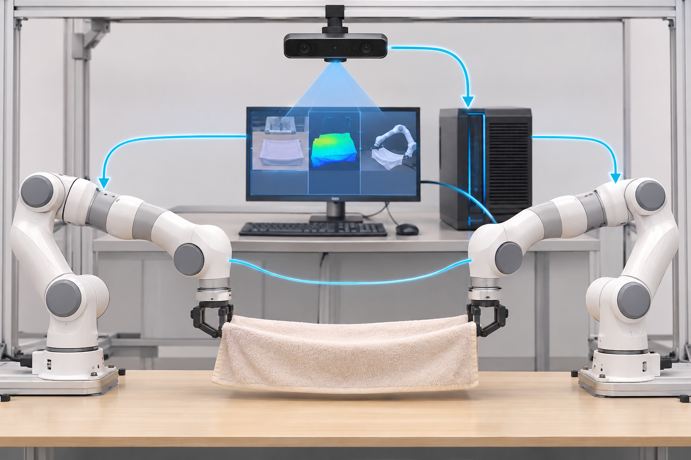

从图中可以看到：相机、GPU 服务器、左右机械臂不是由一个巨型程序包办，而是通过相互独立的功能模块协作。ROS 2 负责连接这些模块，但“衣物如何识别”“如何折叠”“VLA 如何学习”仍然需要你实现相应算法。

建议记住以下分层：

1. **感知层：** 相机驱动、图像处理、深度处理、衣物关键点。
2. **决策层：** VLA、任务状态机、任务调度。
3. **规划层：** MoveIt 2、逆运动学、碰撞检测、轨迹生成。
4. **控制层：** ros2_control、Franka 硬件接口、夹爪控制。
5. **基础设施层：** DDS、TF2、参数、Launch、日志和数据记录。

---

# 第 2 章 ROS 2 软件架构与通信底层

## 2.1 节点（Node）

节点是 ROS 2 中最基本的运行单元。通常一个节点负责一类相对独立的功能。

例如：

- `camera_driver`：相机驱动节点。
- `cloth_perception`：衣物感知节点。
- `vla_bridge`：VLA 推理接口节点。
- `task_manager`：任务状态机。
- `experiment_logger`：实验记录节点。

节点可以是独立进程，也可以通过组件机制组合在同一进程中。不要把“节点”简单等同于“一个独立可执行文件”，更准确地说，它是 ROS 2 图中的通信和计算实体。

节点通常拥有：

- 发布者 Publisher。
- 订阅者 Subscription。
- 服务客户端和服务端。
- 动作客户端和动作服务端。
- 参数 Parameter。
- 定时器 Timer。
- 回调函数 Callback。

## 2.2 ROS Graph（计算图）

运行时，ROS 2 系统中存在多个节点以及它们之间的通信关系。通过命令可以检查这些关系：

```bash
ros2 node list
ros2 topic list
ros2 service list
ros2 action list
ros2 node info /cloth_perception
```

对毕业设计而言，建议你在每个阶段都画出系统节点图。节点图不是装饰图，它能帮助定位：谁产生数据、谁消费数据、谁控制机器人、哪个模块拥有最终动作权限。

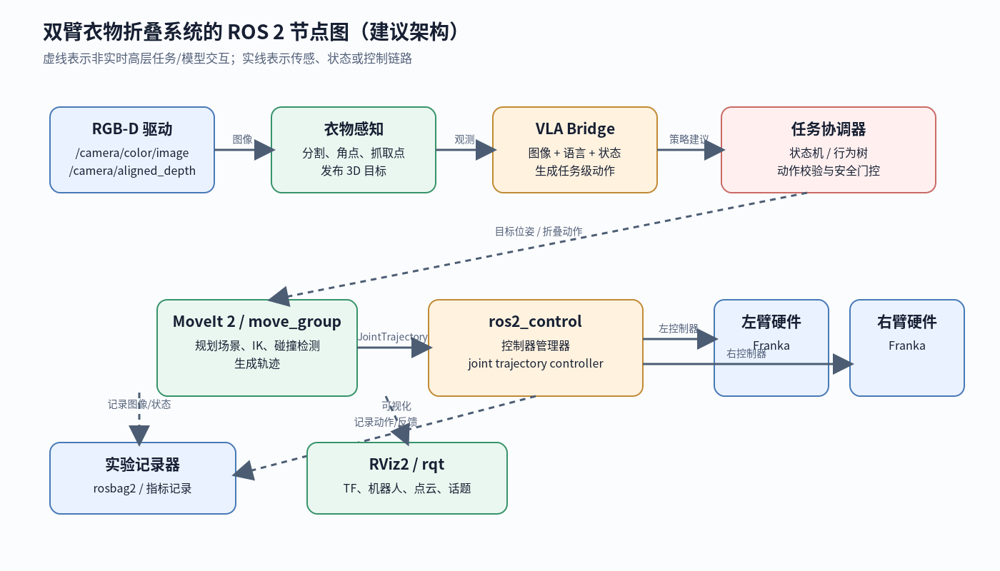

推荐的初期命名空间：

```text
/camera
/cloth_perception
/vla
/task_manager
/left_arm
/right_arm
/experiment_logger
```

左右臂必须区分命名空间和 TF frame，不能让两个机器人都发布名为 `joint_states` 或 `base_link` 的同名资源而没有隔离。真实系统中通常使用 namespace、frame prefix 或机器人描述中的唯一名称实现隔离。

## 2.3 ROS 2 的分层通信结构

ROS 2 的应用程序一般使用客户端库：

- `rclcpp`：C++ 客户端库。
- `rclpy`：Python 客户端库。

客户端库调用 `rcl` 公共层，再经 RMW（ROS Middleware Interface，中间件抽象接口）连接具体的 DDS 实现或其他中间件实现。

简化结构如下：

```text
你的 Python / C++ 节点
          │
     rclpy / rclcpp
          │
          rcl（公共客户端层）
          │
     RMW（中间件抽象层）
          │
     DDS 实现 / 网络传输
          │
      其他 ROS 2 节点
```

**为什么需要 RMW？**

不同 DDS 实现的底层 API、发现机制和配置方式并不完全一样。ROS 2 通过 RMW 把应用层接口与底层通信实现隔离开，使 ROS 2 节点尽可能不需要直接依赖某个 DDS 厂商的 API。

常见的 DDS 实现包括 Fast DDS、Cyclone DDS 等。不同项目、不同发行版的默认实现可能不同。实际部署时，特别是 GPU 服务器和机器人控制计算机跨机器通信时，要统一检查 RMW 实现、DDS 配置、网络接口和防火墙。

## 2.4 DDS 的基本思想

DDS 是数据分发服务（Data Distribution Service）。其核心思想是以数据为中心，通过发布者与订阅者进行分布式数据交换。

用一个简单例子理解：相机节点持续发布 `/camera/color/image_raw`，衣物感知节点订阅这个话题。发布者不必知道具体有哪些订阅者，只需按照主题和消息类型发布数据。

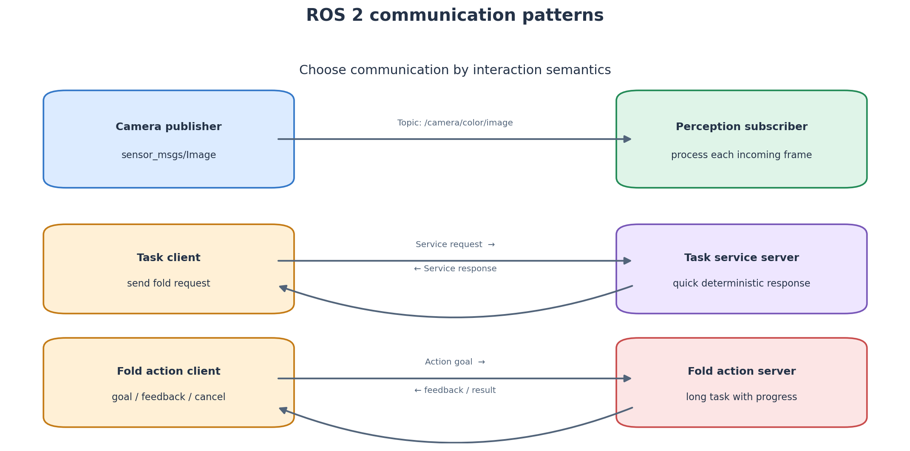

ROS 2 的通信不是简单的“函数调用”。一个节点发出的消息经过中间件、网络（如果跨机器）、接收端中间件和订阅回调，才进入另一个节点的业务逻辑。

### 2.4.1 序列化与反序列化

节点发送消息时，需要把内存中的消息对象转换成可传输的数据表示，这个过程称为序列化（Serialization）；接收端再将数据还原为消息对象，称为反序列化（Deserialization）。

如果消息大小为 $S$，链路带宽为 $B$，理想情况下仅传输时间至少为：

$$
T_{tx} \geq \frac{S}{B}
$$

实际总延迟还包括序列化、队列等待、网络转发、反序列化和回调调度：

$$
T_{total}=T_{ser}+T_{queue}+T_{net}+T_{deser}+T_{callback}
$$

这解释了为什么大图像、点云和高频机器人状态不能不加设计地全部广播给所有节点。

### 2.4.2 话题发现

DDS 节点会进行参与者发现，并根据话题名称、类型和 QoS 兼容性建立数据通信。ROS 2 命令 `ros2 topic list` 能显示 ROS 图中可见的话题，但“话题列表中存在”不等于“消息一定能收到”。还需要检查类型、QoS、网络和实际发布频率。

---

## 2.5 节点生命周期与组件化（进阶但很实用）

### 2.5.1 Lifecycle Node

普通节点通常在创建后就开始工作；Lifecycle Node（托管节点）允许外部管理器按照明确状态控制节点启动、配置、激活、停用和清理。典型状态包括：

- `Unconfigured`：节点已创建，但尚未完成资源配置。
- `Inactive`：资源已配置，但暂不执行主要工作。
- `Active`：节点开始正常发布/处理数据。
- `Finalized`：节点已经结束，不能再恢复到正常工作状态。

常见转换过程：

```text
Unconfigured --configure--> Inactive
Inactive --activate--> Active
Active --deactivate--> Inactive
Inactive --cleanup--> Unconfigured
任意可用状态 --shutdown--> Finalized
```

例如相机节点在 `configure` 时打开设备、加载标定参数；在 `activate` 时开始发布图像；在 `deactivate` 时停止数据流；在 `cleanup` 时释放资源。这样可以避免系统尚未准备好时就开始执行任务。

并不是每个节点都必须做成 Lifecycle Node。初学阶段先掌握普通 Node；后续在多设备系统中，再学习生命周期管理。节点进入 Active 也不代表机械臂硬件一定处于可运动状态，仍要单独检查驱动与控制器状态。

### 2.5.2 组件化（Composition）

ROS 2 可以将满足组件接口的节点加载到同一个进程中，称为 Composition。优点是减少进程间通信和序列化开销；缺点是组件共享进程生命周期，一个组件崩溃可能影响同一容器中的其他组件，调试隔离也会更复杂。

对于你的项目，相机、视觉、VLA、机器人控制初期建议先分进程部署，便于观察和排错；当数据量和性能成为瓶颈时，再考虑把部分节点组件化，或使用共享内存传输。

---

# 第 3 章 Node、Topic、Service、Action 和 Parameter

这是 ROS 2 最重要的基本概念。一定要真正理解它们的适用场景。

## 3.1 Topic（话题）：持续的数据流

Topic 采用发布—订阅（Publish/Subscribe）模式，适合连续产生的数据。

你的课题中常见的话题：

| 话题示例 | 消息类型示例 | 发布者 | 订阅者 |
|---|---|---|---|
| `/camera/color/image_raw` | `sensor_msgs/msg/Image` | 相机 | 感知、记录 |
| `/camera/aligned_depth_to_color/image_raw` | `sensor_msgs/msg/Image` | 相机 | 三维定位、记录 |
| `/camera/color/camera_info` | `sensor_msgs/msg/CameraInfo` | 相机 | 三维重建、标定 |
| `/joint_states` | `sensor_msgs/msg/JointState` | 状态广播器 | RViz、MoveIt、记录 |
| `/tf` | `tf2_msgs/msg/TFMessage` | TF 广播器 | TF 缓冲区 |
| `/cloth/keypoints` | 自定义消息 | 感知节点 | 任务规划、VLA |
| `/vla/observation` | 自定义消息 | 数据汇总节点 | VLA 节点 |

Topic 特点：

- 发送方和接收方相互解耦。
- 可以一对多，也可以多对多（需设计清楚）。
- 适合图像、传感器状态、关节状态、点云等。
- 消息通常是异步传递的。
- 不适合直接表达需要明确完成结果和取消操作的长任务。

### 3.1.1 Publisher 与 Subscriber 的关系

发布者把消息写入对应话题；订阅者注册回调函数，当消息到达并被 Executor 调度时执行回调。回调不一定在消息到达的同一瞬间执行，因此需要理解队列、调度和处理耗时。

### 3.1.2 一个 Python 发布者

```python
import rclpy
from rclpy.node import Node
from std_msgs.msg import String

class StatusPublisher(Node):
    def __init__(self):
        super().__init__('status_publisher')
        self.publisher_ = self.create_publisher(String, '/system/status', 10)
        self.timer = self.create_timer(1.0, self.publish_status)
        self.counter = 0

    def publish_status(self):
        msg = String()
        msg.data = f'ROS 2 system running: {self.counter}'
        self.publisher_.publish(msg)
        self.get_logger().info(f'Published: {msg.data}')
        self.counter += 1

def main(args=None):
    rclpy.init(args=args)
    node = StatusPublisher()
    try:
        rclpy.spin(node)
    except KeyboardInterrupt:
        pass
    finally:
        node.destroy_node()
        rclpy.shutdown()

if __name__ == '__main__':
    main()
```

这里 `10` 是 QoS history depth 的简写形式，不是“每秒发送10条”。完整 QoS 设计见第 4 章。

### 3.1.3 一个 Python 订阅者

```python
import rclpy
from rclpy.node import Node
from std_msgs.msg import String

class StatusSubscriber(Node):
    def __init__(self):
        super().__init__('status_subscriber')
        self.subscription = self.create_subscription(
            String,
            '/system/status',
            self.status_callback,
            10
        )

    def status_callback(self, msg: String):
        self.get_logger().info(f'Received: {msg.data}')

def main(args=None):
    rclpy.init(args=args)
    node = StatusSubscriber()
    try:
        rclpy.spin(node)
    except KeyboardInterrupt:
        pass
    finally:
        node.destroy_node()
        rclpy.shutdown()

if __name__ == '__main__':
    main()
```

测试：

```bash
ros2 run <package_name> status_publisher
ros2 run <package_name> status_subscriber
ros2 topic list
ros2 topic echo /system/status
ros2 topic hz /system/status
ros2 topic info /system/status --verbose
```

## 3.2 Service（服务）：一次请求、一次响应

Service 采用 Request/Response 模式，适用于短时、明确、需要回答的操作。

例如：

- 请求感知节点重新计算一次衣物关键点。
- 请求任务节点清空当前任务状态。
- 请求标定节点保存当前标定参数。
- 查询系统是否处于 Ready 状态。

Service 的核心逻辑：

$$
Request \xrightarrow{Client} Server \xrightarrow{} Response
$$

服务通常适合短操作。如果请求可能运行几秒到几十秒，期间需要反馈进度、支持取消，就更适合 Action。

### 3.2.1 内置服务示例

```bash
ros2 service list
ros2 service type /some_service
ros2 interface show std_srvs/srv/Trigger
```

`std_srvs/srv/Trigger` 的请求部分为空，响应部分包含 `success` 和 `message`。实际项目可以用它实现简单触发，但如果需要传入衣物编号、目标折叠类型、超时时间等，应设计自定义接口。

### 3.2.2 Python 服务端示意

```python
from std_srvs.srv import Trigger
from rclpy.node import Node
import rclpy

class ResetServer(Node):
    def __init__(self):
        super().__init__('reset_server')
        self.srv = self.create_service(Trigger, '/task/reset', self.handle_reset)

    def handle_reset(self, request, response):
        # 实际工程中在这里清理任务状态、缓存和未完成目标
        response.success = True
        response.message = 'Task state reset'
        return response

def main(args=None):
    rclpy.init(args=args)
    node = ResetServer()
    try:
        rclpy.spin(node)
    finally:
        node.destroy_node()
        rclpy.shutdown()

if __name__ == '__main__':
    main()
```

注意：Service 回调里不要直接执行长时间阻塞的机器人运动。应该返回明确响应，或把长任务交给 Action / 状态机。

## 3.3 Action（动作）：有目标、有反馈、可取消的长任务

机器人操作常常不是瞬间完成的。比如“将毛巾对折”可能包括：观察、找角点、移动左臂、移动右臂、夹紧、抬起、拉展、移动到折叠目标、放下、验证等步骤。

这种任务具有：

- Goal：目标，例如执行一次毛巾对折。
- Feedback：进度，例如当前处于 `GRASPING` 或 `FOLDING` 阶段。
- Result：最终成功、失败或超时结果。
- Cancel：用户或安全逻辑取消正在执行的任务。

因此，Action 比普通 Service 更适合机械臂运动任务。

### 3.3.1 Action 的生命周期

```text
客户端发送 Goal
       │
服务器接收并接受 / 拒绝 Goal
       │
服务器执行任务，周期性发布 Feedback
       │
可能收到 Cancel 请求
       │
任务结束：Succeeded / Aborted / Canceled
       │
返回 Result
```

对于毕业设计，可以定义类似 `FoldCloth.action` 的接口：

```text
# Goal
string instruction
string cloth_type
float32 timeout_sec
---
# Result
bool success
string message
float32 duration_sec
---
# Feedback
string stage
float32 progress
```

然后通过 `ros2 interface show <package_name>/action/FoldCloth` 检查生成后的接口。

### 3.3.2 自定义 Action 接口包如何创建

可将自定义接口单独放在一个 `ament_cmake` 包中，例如：

```bash
cd ~/cloth_ws/src
ros2 pkg create cloth_interfaces --build-type ament_cmake
mkdir -p cloth_interfaces/action
```

在 `cloth_interfaces/action/FoldCloth.action` 中保存前面定义的 Goal、Result、Feedback 三段内容。`CMakeLists.txt` 的核心配置可写为：

```cmake
cmake_minimum_required(VERSION 3.8)
project(cloth_interfaces)

find_package(ament_cmake REQUIRED)
find_package(rosidl_default_generators REQUIRED)

rosidl_generate_interfaces(${PROJECT_NAME}
  "action/FoldCloth.action"
)

ament_export_dependencies(rosidl_default_runtime)
ament_package()
```

在 `package.xml` 中声明接口生成依赖：

```xml
<buildtool_depend>ament_cmake</buildtool_depend>
<build_depend>rosidl_default_generators</build_depend>
<exec_depend>rosidl_default_runtime</exec_depend>
<member_of_group>rosidl_interface_packages</member_of_group>
```

然后编译并 source：

```bash
cd ~/cloth_ws
colcon build --packages-select cloth_interfaces
source install/setup.bash
ros2 interface show cloth_interfaces/action/FoldCloth
```

**建议：** 自定义消息/服务/动作接口放在独立的 `cloth_interfaces` 包中。这样感知节点、VLA Bridge 和任务节点都依赖同一份接口定义，不必互相复制消息文件。

### 3.3.3 一个 Action Server（Python 简化示例）

假设已经创建并编译了 `cloth_interfaces/action/FoldCloth`。下面展示 Action Server 的基本结构。真实项目中，执行回调应调用任务状态机，而不是在回调里直接写死全部机械臂轨迹。

```python
import asyncio
import rclpy
from rclpy.node import Node
from rclpy.action import ActionServer, CancelResponse, GoalResponse
from cloth_interfaces.action import FoldCloth

class FoldActionServer(Node):
    def __init__(self):
        super().__init__('fold_action_server')
        self._server = ActionServer(
            self,
            FoldCloth,
            '/cloth/fold',
            execute_callback=self.execute_callback,
            goal_callback=self.goal_callback,
            cancel_callback=self.cancel_callback,
        )

    def goal_callback(self, goal_request):
        # 真实项目需检查系统是否 Ready、指令是否合法
        if not goal_request.instruction.strip():
            return GoalResponse.REJECT
        return GoalResponse.ACCEPT

    def cancel_callback(self, goal_handle):
        # 真实项目应将取消信号传给任务状态机和安全停止逻辑
        return CancelResponse.ACCEPT

    async def execute_callback(self, goal_handle):
        feedback = FoldCloth.Feedback()
        result = FoldCloth.Result()
        stages = ['PERCEIVE', 'PLAN', 'GRASP', 'FOLD', 'VERIFY']

        for index, stage in enumerate(stages, start=1):
            if goal_handle.is_cancel_requested:
                goal_handle.canceled()
                result.success = False
                result.message = 'Canceled by client'
                result.duration_sec = 0.0
                return result

            feedback.stage = stage
            feedback.progress = index / len(stages)
            goal_handle.publish_feedback(feedback)
            await asyncio.sleep(0.2)  # 仅用于演示；真实任务由异步子系统推进

        goal_handle.succeed()
        result.success = True
        result.message = 'Demo task completed'
        result.duration_sec = 1.0
        return result

def main(args=None):
    rclpy.init(args=args)
    node = FoldActionServer()
    try:
        rclpy.spin(node)
    finally:
        node.destroy_node()
        rclpy.shutdown()

if __name__ == '__main__':
    main()
```

这个例子是接口结构演示，并没有控制真实机器人。真实系统需处理 Action 接受后的异常、超时、规划失败、硬件故障、取消过程以及停止后的安全状态。

### 3.3.4 一个 Action Client 的调用思路

```python
from rclpy.action import ActionClient
from cloth_interfaces.action import FoldCloth

# 在 Node 子类中初始化：
# self._client = ActionClient(self, FoldCloth, '/cloth/fold')

async def send_fold_goal(self, instruction: str):
    goal = FoldCloth.Goal()
    goal.instruction = instruction
    goal.cloth_type = 'towel'
    goal.timeout_sec = 30.0

    await self._client.wait_for_server()
    send_future = self._client.send_goal_async(
        goal,
        feedback_callback=self.feedback_callback
    )
    goal_handle = await send_future

    if not goal_handle.accepted:
        self.get_logger().warn('Fold goal rejected')
        return

    result_future = goal_handle.get_result_async()
    wrapped_result = await result_future
    self.get_logger().info(
        f"success={wrapped_result.result.success}, "
        f"message={wrapped_result.result.message}"
    )

def feedback_callback(self, feedback_msg):
    feedback = feedback_msg.feedback
    self.get_logger().info(
        f'{feedback.stage}: {feedback.progress:.0%}'
    )
```

Action Client 需要正确集成到节点异步执行模型中；不要在普通回调中阻塞等待 Action 完成，否则可能造成死锁或阻塞其他回调。

### 3.3.5 Topic、Service、Action 怎么选

| 场景 | 推荐机制 | 原因 |
|---|---|---|
| 相机持续发布图像 | Topic | 连续数据流 |
| 获取当前关节状态 | Topic | 周期状态流 |
| 查询一个参数或状态 | Service | 短请求响应 |
| 触发一次重新标定 | Service 或 Action | 看操作耗时和是否需要反馈 |
| 执行毛巾折叠 | Action | 长任务、进度、取消、结果 |
| 机器人轨迹执行 | Action | 目标轨迹有执行状态与结果 |
| 更新简单运行参数 | Parameter | 节点配置项 |

**记忆方法：** 连续流用 Topic；短问答用 Service；持续执行且要反馈、可取消的任务用 Action；配置项用 Parameter。

## 3.4 Parameter（参数）

参数是节点的运行时配置，不是高频数据通道。

适合做参数的内容：

- 相机图像分辨率。
- 感知阈值。
- VLA 服务地址。
- 运动速度缩放因子。
- 抓取高度偏置。
- 日志等级。
- 是否使用仿真硬件。

不应该把每一帧的相机图像或每个控制周期的关节命令放在 Parameter 中。

示例：

```python
class PerceptionNode(Node):
    def __init__(self):
        super().__init__('cloth_perception')
        self.declare_parameter('confidence_threshold', 0.65)
        self.declare_parameter('use_depth', True)

        threshold = self.get_parameter('confidence_threshold').value
        use_depth = self.get_parameter('use_depth').value
        self.get_logger().info(
            f'threshold={threshold}, use_depth={use_depth}'
        )
```

运行时查看和修改：

```bash
ros2 param list
ros2 param get /cloth_perception confidence_threshold
ros2 param set /cloth_perception confidence_threshold 0.70
ros2 param dump /cloth_perception
```

参数动态修改时，需要考虑线程安全以及参数变化是否会影响当前执行任务。例如机械臂已经在运动时，不应无条件改变速度、限位或坐标补偿参数。

---

# 第 4 章 QoS：通信质量策略

## 4.1 为什么需要 QoS

考虑相机每秒发布30帧图像。如果网络短暂拥堵，有一些图像无法及时到达。对于实时感知，过时的图像通常没有价值；对于标定结果或静态地图，数据反而希望能够保留。

这说明不同类型数据对通信的要求不一样。ROS 2 用 QoS（Quality of Service）描述发布者和订阅者的通信策略。

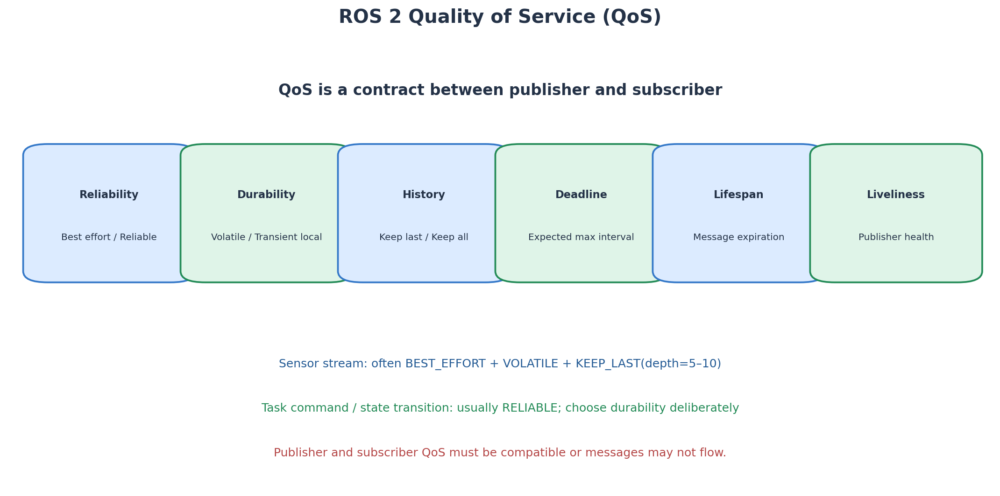

## 4.2 QoS 常见策略

### 4.2.1 Reliability（可靠性）

- `RELIABLE`：尽可能确保消息可靠送达，必要时重传，但可能带来延迟。
- `BEST_EFFORT`：尽力发送，不保证每条消息都送达，通常延迟更低。

相机实时图像通常可以考虑 Best Effort；重要任务状态或配置结果通常需要 Reliable。具体还要和驱动发布端的 QoS 匹配。

### 4.2.2 Durability（持久性）

- `VOLATILE`：订阅者加入之前发布的历史数据不需要保留。
- `TRANSIENT_LOCAL`：发布者保留一部分历史数据，新订阅者加入时可以收到。

静态 TF 通常使用适合晚加入订阅者接收的持久性策略；实时图像通常不需要保留历史数据。

### 4.2.3 History 与 Depth（历史策略和队列深度）

- `KEEP_LAST(N)`：只保留最近 N 条消息。
- `KEEP_ALL`：在资源限制允许的情况下保留历史消息。

相机图像常使用 `KEEP_LAST`，Depth 根据带宽、延迟和处理速度设置。如果感知节点处理速度跟不上图像发布速度，队列过大可能导致处理的都是过时画面。

### 4.2.4 Deadline（截止时间）

描述预期消息更新间隔。如果发布端没有在约定时间内更新，可以触发事件或状态判断。它不是自动保证实时性的魔法参数。

### 4.2.5 Lifespan（消息寿命）

消息超过指定寿命后可以被丢弃，适合对时效敏感的数据。

### 4.2.6 Liveliness（活跃性）

用于检测发布者是否仍然活跃。

## 4.3 QoS 兼容性

Publisher 和 Subscriber 的 QoS 必须兼容，否则可能出现：

- 话题存在，但订阅回调没有数据。
- 相机驱动正常运行，但图像订阅者一直没有输出。
- 静态 TF 晚启动的节点无法得到期望数据。

排查时：

```bash
ros2 topic info /camera/color/image_raw --verbose
ros2 topic hz /camera/color/image_raw
ros2 topic echo /camera/color/image_raw --once
```

在 Python 中显式定义传感器 QoS：

```python
from rclpy.qos import QoSProfile
from rclpy.qos import ReliabilityPolicy
from rclpy.qos import HistoryPolicy
from rclpy.qos import DurabilityPolicy

sensor_qos = QoSProfile(
    history=HistoryPolicy.KEEP_LAST,
    depth=5,
    reliability=ReliabilityPolicy.BEST_EFFORT,
    durability=DurabilityPolicy.VOLATILE,
)
```

实际使用时建议优先检查驱动文档和发布端 QoS，而不是机械地把所有图像订阅都设成 Best Effort。

## 4.4 对本课题的 QoS 建议

| 数据 | 初步建议 | 理由 |
|---|---|---|
| RGB 图像 | Sensor Data QoS / Best Effort | 新帧通常比旧帧更重要 |
| Depth 图像 | 与对应相机驱动一致 | 必须保证图像和深度时间关系 |
| CameraInfo | Reliable 或驱动给定 QoS | 内参更新频率低，数据应稳定获取 |
| JointState | 参考机器人驱动 QoS | 关节状态应及时且连续 |
| TF `/tf` | 使用 TF 约定 | 动态变换按时间更新 |
| TF `/tf_static` | 静态变换持久化 | 晚启动订阅者也需要静态关系 |
| 任务状态 | Reliable | 状态丢失可能导致任务逻辑错误 |
| Action 通信 | 使用 Action 默认机制并核对配置 | 需要状态、反馈和结果 |

---

# 第 5 章 Executor、回调组与并发

## 5.1 什么是 Callback

订阅者收到消息后，并不是直接在 DDS 网络线程中执行所有业务代码，而是将可执行的回调交给 Executor 调度。定时器到期、服务请求到来、动作反馈等也会触发回调。

**Callback 是事件到来时被执行的函数；Executor 负责调度这些回调。**

## 5.2 SingleThreadedExecutor

单线程 Executor 一次处理一个回调。优点是逻辑简单、不容易出现多线程数据竞争；缺点是一个耗时回调会阻塞其他回调。

例如，感知回调处理一帧图像需要300 ms，而相机每33 ms发布一帧。单线程下，图像回调可能越积越多，任务状态和服务响应也可能被拖延。

## 5.3 MultiThreadedExecutor

多线程 Executor 能让多个回调并发执行。但并发不是免费的：共享变量、模型对象、缓存和任务状态可能同时被多个线程读写。

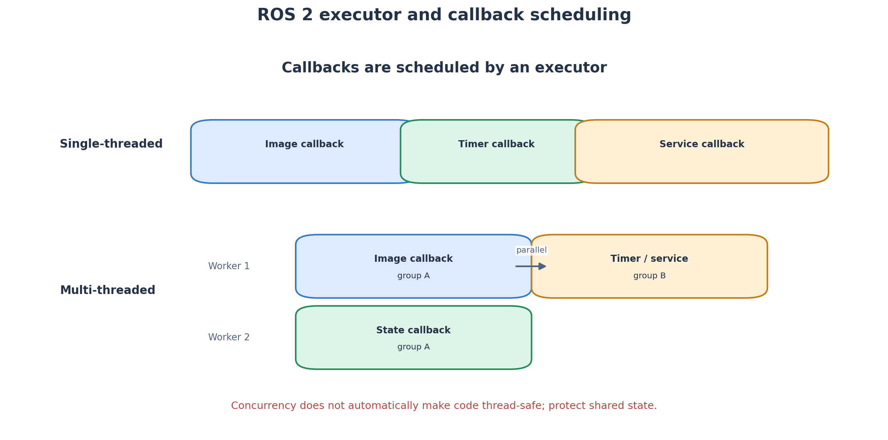

## 5.4 Callback Groups

常见回调组：

- `MutuallyExclusiveCallbackGroup`：同一组中的回调不并行执行。
- `ReentrantCallbackGroup`：允许同一组中的回调并发执行，但需要自行保证线程安全。

设计思路：

- 任务状态机的关键状态更新可放在互斥组中，避免同时修改。
- 图像处理和统计等独立任务可以设计并发回调，但模型对象是否线程安全必须确认。
- 对机器人动作的最终授权应由单一任务管理逻辑统一管理，避免两个回调同时下发互相冲突的轨迹。

## 5.5 延迟与控制频率

若某个回调平均耗时为 $T_c$，其理论最大处理频率约为：

$$
f_{max}\approx\frac{1}{T_c}
$$

例如回调耗时 0.1 s，则单线程串行处理能力约为10 Hz（忽略调度和传输开销）。若数据发布频率远高于处理频率，就需要调整队列策略、降低图像频率、缩小分辨率或使用独立工作线程。

对毕业设计，建议采用多速率分层：

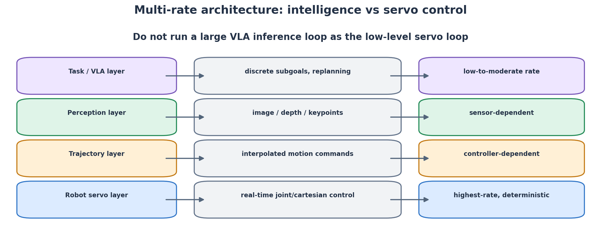

- VLA/任务层：产生高层子目标，不追求伺服频率。
- 感知层：按相机帧率或系统需要处理图像。
- 轨迹层：由规划和轨迹执行模块管理。
- 伺服层：使用机器人驱动和经过验证的控制器，以设备要求的实时频率运行。

**不要在图像订阅回调中直接执行耗时的 VLA 推理，再在同一个回调中阻塞等待机械臂运动完成。** 推荐把数据收集、推理、动作规划和运动执行拆成独立组件，并通过 Action/状态机进行协调。

---

# 第 6 章 ROS 2 工作空间、Package 与 Colcon

## 6.1 什么是 Workspace

ROS 2 工作空间是组织一组软件包的目录。一个典型工作空间：

```text
ros2_ws/
├── src/       # 源代码包
├── build/     # 构建中间文件
├── install/   # 安装结果、环境脚本、可执行文件
└── log/       # 构建日志
```

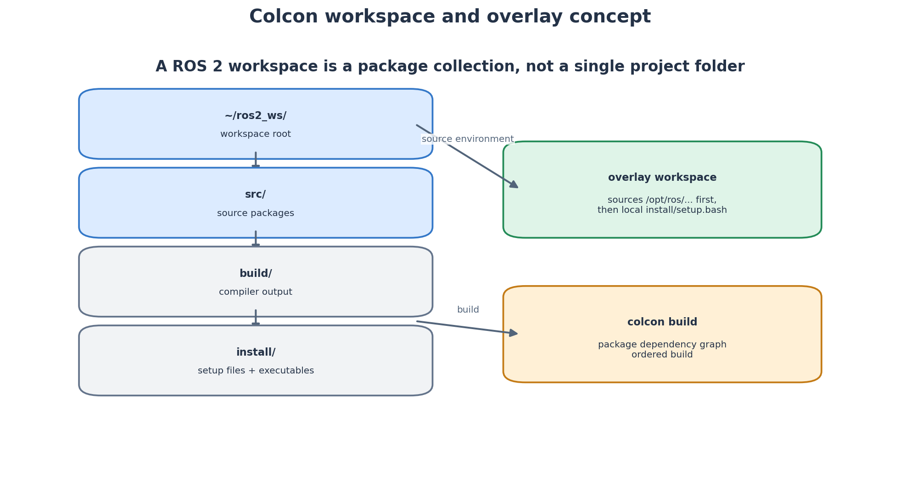

创建工作空间：

```bash
mkdir -p ~/ros2_ws/src
cd ~/ros2_ws
```

## 6.2 Package（软件包）

Package 是 ROS 2 代码复用、依赖管理和构建的基本单位。一个 Python 包和一个 C++ 包的目录结构会有所区别。

创建 Python 包：

```bash
cd ~/ros2_ws/src
ros2 pkg create cloth_perception --build-type ament_python \
  --dependencies rclpy sensor_msgs std_msgs
```

创建 C++ 包：

```bash
ros2 pkg create dual_arm_tools --build-type ament_cmake \
  --dependencies rclcpp sensor_msgs geometry_msgs
```

Package 中常见文件：

- `package.xml`：包名、版本、维护者、依赖关系和构建类型。
- `setup.py`：Python 包的安装和可执行入口配置。
- `CMakeLists.txt`：C++ 包的构建规则。
- `src/`：C++ 源码。
- `include/`：C++ 头文件。
- `launch/`：Launch 文件。
- `config/`：YAML 参数和控制器配置。
- `urdf/`：机器人描述文件。
- `msg/`、`srv/`、`action/`：自定义消息、服务和动作接口。

## 6.3 Colcon 构建

`colcon` 是 ROS 2 常用的构建工具。它会分析包依赖顺序并构建工作空间中的包。

```bash
cd ~/ros2_ws
colcon build
```

开发时常用：

```bash
colcon build --symlink-install
```

`--symlink-install` 会尽可能使用符号链接，修改 Python 源文件或资源文件时通常更方便；但修改 C++ 代码仍然需要重新编译。

只构建一个包：

```bash
colcon build --packages-select cloth_perception
```

构建指定包及其依赖：

```bash
colcon build --packages-up-to cloth_perception
```

查看测试：

```bash
colcon test
colcon test-result --verbose
```

## 6.4 Source 环境

ROS 2 系统安装后，需要 source 系统环境：

```bash
source /opt/ros/jazzy/setup.bash
```

编译工作空间后，再 source 工作空间 overlay：

```bash
source ~/ros2_ws/install/setup.bash
```

Overlay 的意思是：在系统 ROS 2 的基础上，叠加自己的工作空间包。常见错误是忘记 source 工作空间，导致 `ros2 run` 找不到刚编译的包。

检查包是否可见：

```bash
ros2 pkg list | grep cloth_perception
ros2 pkg prefix cloth_perception
```

## 6.5 rosdep 依赖安装

如果源码包声明了依赖，可以通过 rosdep 帮助安装系统依赖：

```bash
sudo rosdep init       # 一台系统通常只需初始化一次
rosdep update
cd ~/ros2_ws
rosdep install --from-paths src --ignore-src -r -y
```

`rosdep` 解析 package.xml 中的依赖并尝试安装对应系统包。某些闭源驱动、厂商 SDK 或特殊版本依赖可能需要手动处理。

## 6.6 建议的毕业设计工作空间

```text
~/cloth_ws/
├── src/
│   ├── cloth_interfaces/      # 自定义 msg / srv / action
│   ├── cloth_perception/      # 衣物识别与关键点
│   ├── cloth_task_manager/    # 任务状态机
│   ├── vla_bridge/            # VLA 通信接口
│   ├── dual_arm_bringup/      # 系统启动文件
│   ├── dual_arm_description/  # 双臂 URDF / Xacro / SRDF
│   ├── dual_arm_control/      # 自定义控制辅助程序
│   └── experiment_logger/    # 结果记录
├── build/
├── install/
└── log/
```

建议模型训练代码和 ROS 2 工作空间分开管理：VLA 可以放在 Python 独立虚拟环境或容器中；通过清晰的 ROS 2 消息/Action 接口与机器人系统连接。

---

# 第 7 章 Python 与 C++ 节点开发

## 7.1 什么时候用 Python，什么时候用 C++

| 任务 | 建议语言 | 理由 |
|---|---|---|
| VLA 推理与微调 | Python | PyTorch、Transformers 生态 |
| 图像算法原型 | Python | OpenCV、NumPy 调试方便 |
| 任务状态机 | Python 或 C++ | 视实时性、项目结构决定 |
| 高性能图像处理 | C++ | 减少开销、便于集成已有库 |
| 硬件接口和控制器 | C++ | ROS 2 控制器及硬件接口主要采用 C++ |
| 数据分析与实验绘图 | Python | NumPy、Pandas、Matplotlib |

不要因为 C++ 看起来“底层”就把所有节点都用 C++ 重写。项目应该根据接口、依赖和性能要求分配语言。

## 7.2 消息类型

ROS 2 的消息是带有明确字段定义的数据结构。例如：

- `std_msgs/msg/String`：字符串。
- `geometry_msgs/msg/PoseStamped`：带时间戳和坐标系的位姿。
- `geometry_msgs/msg/Point`：三维点。
- `sensor_msgs/msg/Image`：图像。
- `sensor_msgs/msg/CameraInfo`：相机内参等信息。
- `sensor_msgs/msg/JointState`：关节名称、位置、速度、力矩。
- `trajectory_msgs/msg/JointTrajectory`：关节轨迹。
- `control_msgs/action/FollowJointTrajectory`：关节轨迹动作接口。

使用：

```bash
ros2 interface list
ros2 interface show geometry_msgs/msg/PoseStamped
ros2 interface show sensor_msgs/msg/JointState
ros2 interface show trajectory_msgs/msg/JointTrajectory
```

## 7.3 为什么 PoseStamped 很重要

对于机器人而言，一个三维点或末端位姿必须有坐标系和时间信息。`PoseStamped` 一般包含：

- `header.stamp`：时间戳。
- `header.frame_id`：坐标系名称。
- `pose.position`：位置。
- `pose.orientation`：四元数姿态。

例如：

```text
frame_id = "base_link"
position = (0.42, 0.18, 0.25)
orientation = (x, y, z, w)
```

这个目标的含义是：“在 base_link 坐标系下，末端应到达该位置和姿态。”如果 `frame_id` 错了，数值即使看似合理，也可能让机械臂移动到完全错误的位置。

## 7.4 自定义接口设计

如果自定义 `ClothKeypoints.msg`，可以考虑：

```text
std_msgs/Header header
uint32 image_width
uint32 image_height
geometry_msgs/PointStamped[] keypoints
float32[] confidence
string[] labels
```

设计接口时遵循：

1. 变量名称要表达物理含义。
2. 位置必须明确坐标系。
3. 数据要附时间戳。
4. 单位必须明确（m、rad、s）。
5. 置信度范围和无效值规则要统一。
6. 不要把本来可以结构化的多维数据全部塞进字符串。

---

# 第 8 章 Launch、参数和 YAML 配置

## 8.1 为什么需要 Launch

实际机器人系统有多个节点，手动开十几个终端容易出错。Launch 文件可以一次启动多个节点、传入参数、设置命名空间、重映射话题，并组织启动顺序。

例如一次启动：

- RGB-D 相机驱动。
- 双臂机器人驱动。
- TF 和 robot_state_publisher。
- MoveIt 2。
- 衣物感知。
- VLA Bridge。
- Task Manager。
- RViz。

## 8.2 Python Launch 文件示例

```python
from launch import LaunchDescription
from launch_ros.actions import Node


def generate_launch_description():
    perception_node = Node(
        package='cloth_perception',
        executable='cloth_perception_node',
        name='cloth_perception',
        output='screen',
        parameters=[{'confidence_threshold': 0.65}],
        remappings=[
            ('image', '/camera/color/image_raw'),
            ('depth', '/camera/aligned_depth_to_color/image_raw'),
        ],
    )

    task_node = Node(
        package='cloth_task_manager',
        executable='task_manager',
        name='task_manager',
        output='screen',
    )

    return LaunchDescription([
        perception_node,
        task_node,
    ])
```

启动：

```bash
ros2 launch <package_name> bringup.launch.py
```

## 8.3 参数 YAML 示例

```yaml
cloth_perception:
  ros__parameters:
    confidence_threshold: 0.65
    use_depth: true
    max_keypoints: 8

vla_bridge:
  ros__parameters:
    inference_timeout_sec: 3.0
    request_queue_size: 1
    use_compressed_image: true

cloth_task_manager:
  ros__parameters:
    max_retries: 2
    fold_tolerance_m: 0.02
    dry_run: true
```

这只是示例参数，必须由节点实际声明或支持，不能把 YAML 中写出的参数当成节点一定会使用的参数。

## 8.4 Namespace 与 Remapping

Namespace 用于给节点及其相对名称添加命名空间前缀。Remapping 用于修改名称。

例如左右臂分别使用：

```text
/left_arm/joint_states
/right_arm/joint_states
/left_arm/follow_joint_trajectory
/right_arm/follow_joint_trajectory
```

但具体 Franka 启动文件如何创建 namespace、控制器名称和 TF 前缀，必须跟随对应版本的官方配置。不要只在 ROS 命令行中改了话题名称，却没有同步改 URDF、controller YAML、MoveIt SRDF 和 TF frame。

---

# 第 9 章 TF2 与机器人坐标系

**这部分是你毕业设计里最值得投入时间的 ROS 2 基础。** 因为视觉算法得到的是相机坐标系中的衣物位置，而机器人只能在机器人控制链所理解的坐标系中执行目标。

## 9.1 为什么机器人需要多个坐标系

机器人系统涉及多个参考坐标系：

- `world`：实验室或工作台的全局参考系。
- `table`：桌面坐标系。
- `camera_link`：相机机身参考系。
- `camera_color_optical_frame`：相机光学坐标系。
- `left_base`：左机械臂基座坐标系。
- `right_base`：右机械臂基座坐标系。
- `left_tool0` / `right_tool0`：左右臂法兰或工具参考系。
- `left_tcp` / `right_tcp`：左右夹爪的工具中心点。

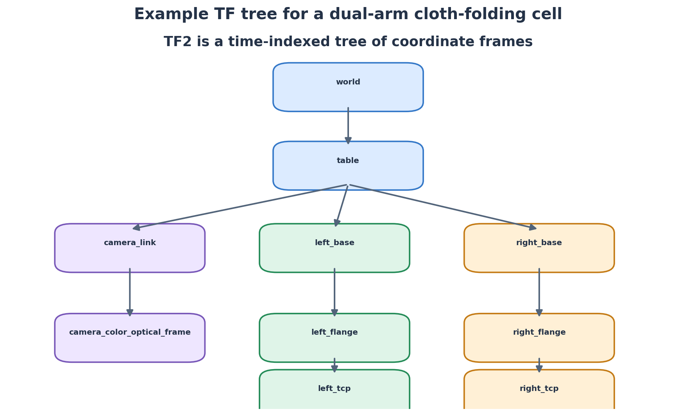

TF2 管理这些坐标系之间的带时间戳变换。它不仅是“记录一组矩阵”，还需要处理不同时间的变换查询。

## 9.2 齐次变换矩阵

刚体在三维空间中的位姿包含旋转和平移。用旋转矩阵 $R$ 与平移向量 $t$ 表示：

$$
T=\begin{bmatrix}
R & t\\
0_{1\times3} & 1
\end{bmatrix}
\in SE(3)
$$

其中：

$$
R\in SO(3),\qquad t\in\mathbb{R}^3
$$

齐次坐标下，一个点写为：

$$
{}^{B}\bar{p}=\begin{bmatrix}x_B\\y_B\\z_B\\1\end{bmatrix}
$$

如果 $T^A_B$ 表示“把 B 坐标系中的坐标转换到 A 坐标系”，那么：

$$
{}^{A}\bar{p}=T^{A}_{B}\,{}^{B}\bar{p}
$$

注意记号：上标 A 表示目标坐标系，下标 B 表示源坐标系。只要全篇定义一致，就不会在矩阵乘法中弄错方向。

## 9.3 旋转矩阵和平移矩阵

绕 X 轴旋转角度 $\alpha$：

$$
R_x(\alpha)=
\begin{bmatrix}
1&0&0\\
0&\cos\alpha&-\sin\alpha\\
0&\sin\alpha&\cos\alpha
\end{bmatrix}
$$

绕 Y 轴旋转角度 $\beta$：

$$
R_y(\beta)=
\begin{bmatrix}
\cos\beta&0&\sin\beta\\
0&1&0\\
-\sin\beta&0&\cos\beta
\end{bmatrix}
$$

绕 Z 轴旋转角度 $\gamma$：

$$
R_z(\gamma)=
\begin{bmatrix}
\cos\gamma&-\sin\gamma&0\\
\sin\gamma&\cos\gamma&0\\
0&0&1
\end{bmatrix}
$$

纯平移向量为 $t=[t_x,t_y,t_z]^T$ 时：

$$
T_t=\begin{bmatrix}
1&0&0&t_x\\
0&1&0&t_y\\
0&0&1&t_z\\
0&0&0&1
\end{bmatrix}
$$

纯旋转和平移可以组合成齐次变换，但要注意乘法次序。矩阵相乘一般不满足交换律：

$$
T_1T_2\neq T_2T_1
$$

直观理解：先转再平移，与先平移再转，结果通常不同。

## 9.4 坐标变换的复合

假设已知：

- 从相机坐标系 C 转换到桌面坐标系 T：$T^T_C$。
- 从桌面坐标系 T 转换到机器人基座 B：$T^B_T$。

那么从相机直接转换到机器人基座：

$$
T^B_C=T^B_T T^T_C
$$

点坐标转换：

$$
{}^B p=T^B_T T^T_C {}^C p
$$

这就是为什么 TF2 可以把多段关系连起来，自动查询两个坐标系之间的变换。

## 9.5 齐次变换的逆

设：

$$
T=\begin{bmatrix}R&t\\0&1\end{bmatrix}
$$

因为旋转矩阵满足正交性：

$$
R^{-1}=R^T
$$

因此：

$$
T^{-1}=\begin{bmatrix}R^T&-R^Tt\\0&1\end{bmatrix}
$$

注意，逆变换的平移不是简单的 $-t$，而是 $-R^Tt$。

## 9.6 四元数

三维姿态常使用四元数表达：

$$
q=(x,y,z,w)
$$

单位四元数满足：

$$
x^2+y^2+z^2+w^2=1
$$

四元数优点：

- 避免欧拉角在某些姿态附近的万向节锁问题。
- 插值通常比直接插值欧拉角更稳定。
- ROS 2 几何消息中的 orientation 使用四元数。

ROS 消息常用字段顺序是 `x, y, z, w`。某些数学库构造函数的参数顺序可能不同，使用 Eigen、tf2 或其他库时要仔细检查。

## 9.7 TF2 的树结构规则

1. 每个 child frame 在同一棵 TF 树中只能有一个 parent。
2. 不应形成闭环。
3. 变换必须带有正确的时间戳。
4. frame 名称必须统一。
5. 静态和动态变换要区分。

`/tf` 主要发布动态变换；`/tf_static` 用于静态变换。比如相机固定在实验台上时，相机相对于桌面/世界的固定变换可以用静态变换发布；机械臂各关节之间的变换随关节运动而变化，需要动态 TF。

## 9.8 TF2 常用命令

```bash
ros2 run tf2_tools view_frames
ros2 run tf2_ros tf2_echo base_link camera_color_optical_frame
```

如果命令名或节点参数在具体发行版中有变化，以对应版本 TF2 文档为准。

## 9.9 Python 查询变换示例

```python
import rclpy
from rclpy.node import Node
from tf2_ros import Buffer, TransformListener
from rclpy.duration import Duration

class TfLookupNode(Node):
    def __init__(self):
        super().__init__('tf_lookup_node')
        self.tf_buffer = Buffer()
        self.tf_listener = TransformListener(self.tf_buffer, self)
        self.timer = self.create_timer(1.0, self.lookup)

    def lookup(self):
        try:
            transform = self.tf_buffer.lookup_transform(
                'base_link',                 # target frame
                'camera_color_optical_frame',# source frame
                rclpy.time.Time(),           # latest available transform
                timeout=Duration(seconds=0.2)
            )
            t = transform.transform.translation
            q = transform.transform.rotation
            self.get_logger().info(
                f't=({t.x:.3f}, {t.y:.3f}, {t.z:.3f}), '
                f'q=({q.x:.3f}, {q.y:.3f}, {q.z:.3f}, {q.w:.3f})'
            )
        except Exception as exc:
            self.get_logger().warn(f'TF lookup failed: {exc}')

def main(args=None):
    rclpy.init(args=args)
    node = TfLookupNode()
    try:
        rclpy.spin(node)
    finally:
        node.destroy_node()
        rclpy.shutdown()

if __name__ == '__main__':
    main()
```

## 9.10 时间戳的重要性

假设相机在时刻 $t_1$ 观测到衣物，而机械臂在时刻 $t_2$ 已经运动到新位置。如果用 $t_2$ 的变换去解释 $t_1$ 的观测，就可能产生坐标误差。

所以：

- 图像消息要保留采集时间戳。
- 点云、关键点和位姿消息要继承正确时间戳。
- TF 查询尽量使用观测对应的时间，而不是无条件取最新变换。
- 多相机融合时要考虑时间同步。

---

# 第 10 章 RGB-D 相机到机器人抓取点的坐标转换

这一章把数学推导和毕业设计直接联系起来。

## 10.1 任务：把图像中的衣物角点变成机器人能抓取的三维目标

视觉算法输出图像像素点：

$$
(u,v)
$$

深度相机给出该像素的深度：

$$
Z=d(u,v)
$$

但机器人不能直接执行像素坐标。需要依次完成：

1. 像素坐标转相机三维坐标。
2. 相机坐标转机器人基座坐标。
3. 将点转换为末端抓取位姿目标。
4. 交给 MoveIt 2 或控制器验证可达性并执行。

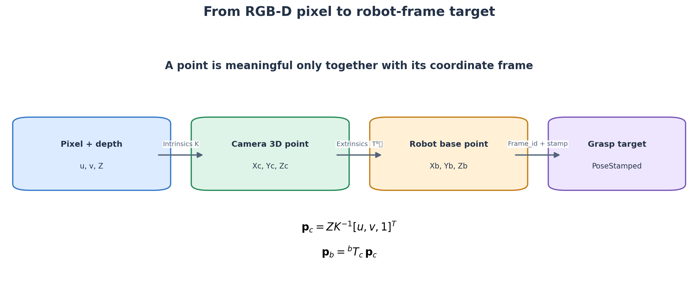

## 10.2 相机内参矩阵

针孔相机模型的内参矩阵：

$$
K=\begin{bmatrix}
f_x&0&c_x\\
0&f_y&c_y\\
0&0&1
\end{bmatrix}
$$

其中：

- $f_x,f_y$：以像素为单位的焦距参数。
- $c_x,c_y$：主点坐标。
- $(u,v)$：图像像素位置。
- $Z$：该像素对应的深度。

在理想针孔模型下：

$$
u=f_x\frac{X}{Z}+c_x
$$

$$
v=f_y\frac{Y}{Z}+c_y
$$

移项得到：

$$
X=\frac{(u-c_x)Z}{f_x}
$$

$$
Y=\frac{(v-c_y)Z}{f_y}
$$

因此像素点在相机坐标系下的三维位置为：

$$
{}^C p=
\begin{bmatrix}
(u-c_x)Z/f_x\\
(v-c_y)Z/f_y\\
Z
\end{bmatrix}
$$

矩阵形式：

$$
{}^C p=ZK^{-1}
\begin{bmatrix}u\\v\\1\end{bmatrix}
$$

注意：深度图中的深度单位可能是米，也可能是毫米或由驱动参数缩放后的整数值。必须检查相机驱动和消息编码，不能把毫米当米使用。

## 10.3 相机光学坐标系方向

ROS 相机驱动通常使用 optical frame 约定：

- X：向图像右侧。
- Y：向图像下方。
- Z：朝相机前方。

这与很多机器人基坐标系“Z 轴向上”的直觉不同。不能看到相机点云坐标就直接把 X、Y、Z 当成机器人基座的方向。

## 10.4 外参变换

如果相机固定在桌面上，经过标定可以得到相机相对于机器人基座的变换：

$$
T^B_C=\begin{bmatrix}R^B_C&t^B_C\\0&1\end{bmatrix}
$$

则相机坐标系点转换到机器人基座：

$$
\begin{bmatrix}{}^B p\\1\end{bmatrix}
=T^B_C
\begin{bmatrix}{}^C p\\1\end{bmatrix}
$$

展开：

$$
{}^B p=R^B_C{}^C p+t^B_C
$$

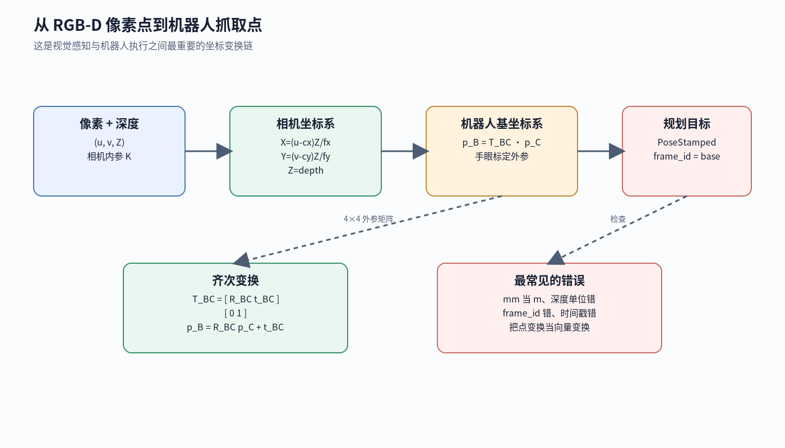

## 10.5 手眼标定问题

若相机固定在工作台上，通常称为 Eye-to-Hand；若相机安装在机械臂末端附近，通常称为 Eye-in-Hand。

手眼标定的目标是估计相机与机器人之间的刚体变换。常见经典形式为：

$$
A_i X = X B_i
$$

其中 $X$ 是待求的手眼变换，$A_i$ 和 $B_i$ 来自机器人在不同姿态下的运动关系或标定板相对相机的观测关系。通过多个不同姿态构造方程并求解 $X$。

要点：

- 采集多个姿态，不能只采集一个姿态。
- 姿态变化要有足够的旋转多样性。
- 标定板检测质量会影响结果。
- 机器人基座、工具坐标系、相机坐标系的定义要一致。
- 标定后应使用已知空间点做独立验证，而不是只看求解器输出。

对于桌面固定相机，实验室也可能使用标定板直接建立 world/table 与 camera 的关系。以实际硬件布置和导师指定标定方案为准。

## 10.6 误差传播的直观理解

三维抓取误差来自多个部分：像素定位误差、深度误差、相机内参误差、手眼外参误差和机器人运动误差。

若像素坐标存在小误差 $\delta u$，深度近似不变，则：

$$
\delta X\approx\frac{Z}{f_x}\delta u
$$

例如距离相机越远，同样一个像素误差造成的实际横向位置误差通常越大。

深度方向误差直接影响 Z，同时也通过投影关系影响 X、Y：

$$
\delta X\approx\frac{u-c_x}{f_x}\delta Z
$$

因此衣物边界抓取点应考虑：相机是否能稳定观察、深度是否缺失、是否存在反光/黑色织物/软性褶皱导致的深度噪声。

## 10.7 RGB 与 Depth 的时间同步

RGB 图像和 Depth 图像通常由同一相机或相关传感器流提供，但它们的消息到达时间、曝光时间和发布频率不一定完全一致。如果用时间上错开的深度图去反投影 RGB 图像中的关键点，衣物或相机一旦移动，就会出现空间错位。

工程上要优先使用相机驱动提供的 aligned depth（对齐到彩色相机坐标系的深度图），并检查：

- RGB 与 Depth 是否具有相同图像尺寸或明确的对齐关系。
- `header.stamp` 是否一致或在允许时间差内。
- 两路图像是否使用相同的参考坐标系。
- 相机节点是否已经完成相机内部同步或对齐。

若来自不同传感器，可使用 `message_filters` 的 ExactTime 或 ApproximateTime 同步策略。ApproximateTime 允许一定时间差，但容差不能设置得过大。假设 RGB 时间戳为 $t_R$、Depth 时间戳为 $t_D$，同步条件可抽象写为：

$$
|t_R-t_D|\leq\Delta t_{max}
$$

其中 $\Delta t_{max}$ 由相机帧率、运动速度和可接受定位误差决定。若机器人/衣物在采集期间基本静止，容差可以相对宽松；若正在快速移动，应更严格。

## 10.8 PoseStamped 的实践规范

输出目标时，不要只发布三个浮点数。建议发布带 `header.frame_id` 的 `PoseStamped`，并且：

- 明确是 `base_link`、`world` 还是其他 frame。
- 位置使用米。
- 姿态使用归一化四元数。
- 带有对应的采集/计算时间戳。
- 对低置信度目标设置拒绝或复检逻辑。
- 对衣物角点附近加上安全偏置和夹爪姿态约束。

---

# 第 11 章 URDF、Xacro 与 SRDF

## 11.1 URDF 是什么

URDF（Unified Robot Description Format）用于描述机器人的运动学结构、连杆、关节、视觉几何、碰撞几何、惯性参数等。

简单理解：URDF 告诉 ROS 2 “机器人由哪些刚体和关节组成，它们如何连接、如何运动”。

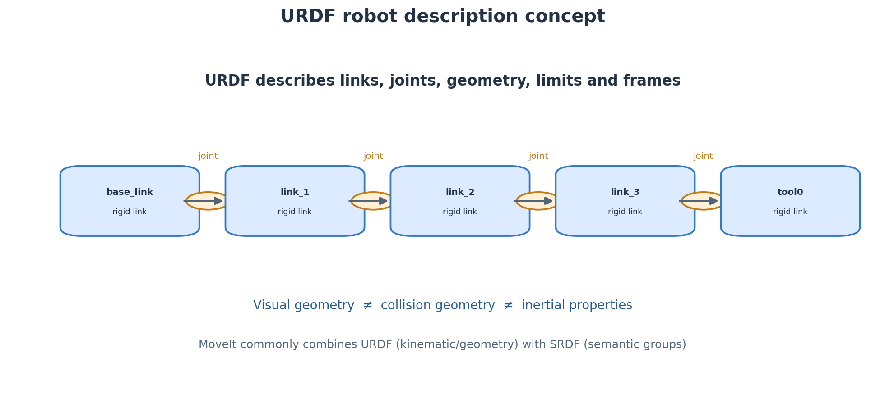

## 11.2 Link（连杆）

Link 表示机器人中的一个刚体。常见内容：

- visual：视觉外观，用于 RViz 等可视化。
- collision：碰撞几何，用于碰撞检测。
- inertial：质量、质心、惯性张量，用于动力学和仿真相关计算。

visual 和 collision 不一定使用相同网格。视觉模型可以很精细，碰撞模型往往简化以提高计算效率。

## 11.3 Joint（关节）

Joint 描述两个 link 之间的连接和允许运动类型。

常见类型：

- `fixed`：固定关节。
- `revolute`：有限角度转动关节。
- `continuous`：连续转动关节。
- `prismatic`：移动关节。
- `floating`：六自由度浮动关节。
- `planar`：平面运动关节。

关节通常包含 parent、child、origin、axis、limit 等字段。

## 11.4 URDF 中的坐标关系

每个 Joint 的 `origin` 描述 child link 相对于 parent link 的固定安装变换；如果是活动关节，则再叠加由关节变量决定的运动变换。

例如单个转动关节可写成：

$$
T_{parent}^{child}(q)=T_{origin}T_{axis}(q)
$$

整条机械臂链路通过多个变换相乘，得到末端位姿。这与机器人学中的正运动学是一致的。

## 11.5 Xacro

Xacro 是 URDF 的宏工具，用于减少重复描述。双臂机器人特别适合使用 Xacro，因为左右机械臂的结构相似，只是名称、基座位姿、命名空间和控制器不同。

例如用参数区分左右臂：

```xml
<xacro:arg name="prefix" default="left_" />
```

具体 Xacro 写法需要根据项目宏定义和 Franka 官方描述包来实现，不能只在某几个 link 上改 prefix 而遗漏 joint 名称和 ros2_control 资源名。

## 11.6 SRDF

SRDF（Semantic Robot Description Format）提供机器人语义信息，常用于 MoveIt 2：

- Planning Group：规划组，如左臂、右臂、双臂整体。
- End Effector：末端执行器定义。
- Named State：命名姿态，如 home、ready。
- Disabled Collision：允许忽略的特定碰撞对。
- Virtual Joint：机器人与世界的虚拟连接。

URDF 描述“结构和物理/运动学属性”；SRDF 描述“规划层如何理解和组织机器人”。两者不是替代关系。

## 11.7 双臂配置的特别注意

双臂系统至少要确保：

1. 左右臂所有 link 和 joint 名称唯一。
2. 左右臂基座位姿相对于 world/table 正确。
3. 左右夹爪 TCP 定义一致且经过实际测量。
4. 左右手的 joint state 和控制器接口名称不冲突。
5. SRDF 中包含正确的左臂、右臂和可选双臂规划组。
6. Planning Scene 能检测左臂与右臂之间的碰撞。
7. 机器人底座、桌面、相机支架等环境障碍物要正确加入场景。

---

# 第 12 章 ros2_control 与机器人底层控制

## 12.1 ros2_control 解决什么问题

不同机器人的硬件接口不同，但控制器希望使用相对统一的接口。ros2_control 将硬件访问与控制器逻辑分离。

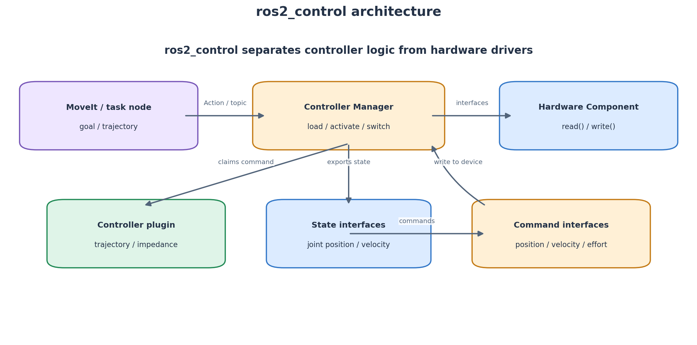

典型架构：

```text
MoveIt / 任务节点
       │ 发送轨迹或控制目标
       ▼
Controller Manager
       │ 管理控制器与资源接口
       ├── Controller A
       ├── Controller B
       └── Hardware Component
                │ read() / write()
                ▼
          实际机器人硬件
```

## 12.2 Hardware Interface

硬件组件向框架暴露两类接口：

- State Interfaces：读取当前状态，例如关节位置、速度、力矩。
- Command Interfaces：向硬件写入目标，例如位置、速度、力矩。

抽象地写成：

$$
\text{State}(t)=\{q(t),\dot q(t),\tau(t),\ldots\}
$$

$$
\text{Command}(t)=\{q_d(t),\dot q_d(t),\tau_d(t),\ldots\}
$$

具体支持哪些接口，取决于硬件插件和驱动。不能假设某一款机械臂支持所有控制模式。

## 12.3 Controller Manager

Controller Manager 负责加载、配置、激活、停用和切换控制器，同时管理控制器对 command/state interfaces 的资源申请。

常见命令：

```bash
ros2 control list_controllers
ros2 control list_hardware_components
ros2 control list_hardware_interfaces
```

不同发行版和控制器管理器版本的 CLI 细节可能不同，遇到命令差异时以对应版本 `ros2 control -h` 和官方文档为准。

## 12.4 常见控制器

- `joint_state_broadcaster`：发布关节状态。
- `joint_trajectory_controller`：执行关节轨迹。
- `forward_command_controller`：转发给定的关节命令。
- `gripper_controllers`：夹爪相关控制器。
- 机器人厂商提供的专用控制器：如 Franka 的关节阻抗、笛卡尔阻抗等示例控制器，具体名称由版本和配置决定。

## 12.5 JointTrajectory 的数学含义

关节轨迹可以表示为：

$$
q_d(t)=\begin{bmatrix}q_{d,1}(t)&\cdots&q_{d,n}(t)\end{bmatrix}^T
$$

每个轨迹点通常包含位置，也可以包含速度、加速度和时间。控制器根据轨迹点进行时间插值，并把期望状态传给硬件接口。

### 12.5.1 三次多项式插值

在时间区间 $[0,T]$ 内，使用：

$$
q(t)=a_0+a_1t+a_2t^2+a_3t^3
$$

给定边界条件：

$$
q(0)=q_0,\quad q(T)=q_f
$$

$$
\dot q(0)=v_0,\quad \dot q(T)=v_f
$$

先求导：

$$
\dot q(t)=a_1+2a_2t+3a_3t^2
$$

由初始条件：

$$
a_0=q_0,\quad a_1=v_0
$$

剩下两个系数由终点位置和速度条件求得。令：

$$
\Delta q=q_f-q_0-v_0T
$$

$$
\Delta v=v_f-v_0
$$

则：

$$
a_2=\frac{3\Delta q-\Delta vT}{T^2}
$$

$$
a_3=\frac{\Delta vT-2\Delta q}{T^3}
$$

三次插值可保证位置和速度连续，但加速度不一定在段与段之间连续。

### 12.5.2 五次多项式插值

若希望指定起点和终点的位置、速度、加速度，可使用：

$$
q(t)=a_0+a_1t+a_2t^2+a_3t^3+a_4t^4+a_5t^5
$$

六个边界条件决定六个系数。它能让轨迹在连接点处实现更高阶连续性，适合需要更平滑运动的情况。

注意：插值平滑不等于一定安全。还必须限制关节位置、速度、加速度、jerk、力矩以及与环境的碰撞。

## 12.6 Franka 与 ros2_control

Franka 控制通常涉及：

- FCI（Franka Control Interface）。
- libfranka（底层 C++ 库）。
- franka_ros2（ROS 2 集成）。
- franka_hardware（硬件接口）。
- franka_example_controllers 等控制器示例。
- Franka 描述和 MoveIt 配置包。

**重要边界：** ROS 2 中的任务节点不应该绕过官方硬件保护逻辑直接向机器人发送不受约束的任意命令。应按实验室已验证的 Franka 软件栈、控制器和安全规范执行。

## 12.7 控制模式的理解

### 位置控制

控制目标是关节位置或末端目标位置，由下层控制器跟踪。

### 速度控制

控制目标是速度。要注意积分误差、速度限幅和停止策略。

### 力矩/阻抗控制

阻抗控制常用来描述末端在接触环境时的动态柔顺行为。理想质量-弹簧-阻尼模型可以写为：

$$
M_d\ddot e+D_d\dot e+K_de=F_{ext}
$$

其中：

- $e=x-x_d$：末端位置误差。
- $M_d$：期望惯性矩阵。
- $D_d$：期望阻尼矩阵。
- $K_d$：期望刚度矩阵。
- $F_{ext}$：外部接触力。

该式表达的是“外力作用下，末端产生符合设定质量、阻尼、刚度的偏差”。衣物操作存在接触和牵拉，因此柔顺控制值得了解；但具体参数和控制模式必须由导师和机器人平台配置决定，不要直接将书本公式写成未经验证的控制器。

---

# 第 13 章 MoveIt 2 运动规划

## 13.1 MoveIt 2 是什么

MoveIt 2 是 ROS 2 机器人操作和运动规划框架。它把机器人描述、运动学求解、规划场景、碰撞检测、规划算法和轨迹执行连接起来。

**MoveIt 2 不是电机控制器。** 它主要负责“从当前状态到目标状态，规划一条可行轨迹”，再把轨迹交给控制器执行。

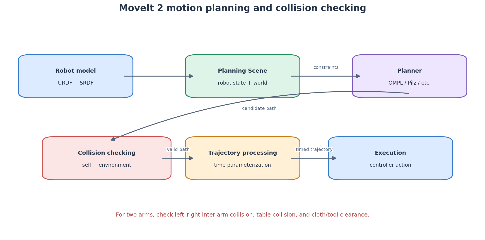

## 13.2 MoveIt 2 的关键模块

- Robot Model：机器人运动学与结构模型。
- Planning Group：选择规划哪些关节。
- Kinematics：逆运动学求解。
- Planning Scene：机器人当前状态和环境模型。
- Collision Checking：自碰撞、环境碰撞检查。
- Motion Planner：规划算法。
- Time Parameterization：为路径分配时间、速度和加速度。
- Trajectory Execution：将轨迹发送给控制器。

## 13.3 运动规划的数学抽象

机器人状态用关节变量表示：

$$
q=[q_1,q_2,\ldots,q_n]^T
$$

起点和终点：

$$
q_{start},\quad q_{goal}
$$

规划目标是在配置空间中寻找一条路径：

$$
\sigma:[0,1]\rightarrow\mathcal{C}
$$

满足：

$$
\sigma(0)=q_{start},\qquad \sigma(1)=q_{goal}
$$

并且路径上的机器人状态不能违反关节限制和碰撞约束：

$$
\sigma(s)\in\mathcal{C}_{free},\quad s\in[0,1]
$$

其中 $\mathcal{C}_{free}$ 表示无碰撞、满足约束的配置空间。

规划算法通常先寻找几何路径，再进行时间参数化。路径规划回答“从哪里经过”；时间参数化回答“在什么时间、以什么速度到达”。

## 13.4 逆运动学

已知期望末端位姿 $T_d$，求关节变量 $q$：

$$
FK(q)=T(q)\approx T_d
$$

一般机械臂逆运动学可能存在多个解、无解或奇异位形。MoveIt 通过配置的运动学插件完成求解。你需要理解输入是目标末端位姿、输出是一组关节配置，并检查：

- 解是否在关节限位内。
- 末端姿态是否符合夹爪抓取需求。
- 是否接近奇异区域。
- 是否发生自碰撞或环境碰撞。

## 13.5 Planning Scene

Planning Scene 是规划时对“机器人现在是什么状态、环境里有什么”的统一描述。

需要加入的环境物体：

- 桌面。
- 机器人底座。
- 相机和支架。
- 可能存在的实验台边缘。
- 禁止机械臂进入的区域。

柔性衣物的碰撞建模比较复杂。本科毕设初期可以先把衣物抓取点和目标点转化为末端约束，使用桌面和机器人碰撞模型保护基础运动；后续再根据任务需要加入简化布料几何或局部障碍物。

## 13.6 双臂规划的难点

双臂不是两个单臂规划器简单叠加。至少有四类碰撞：

1. 左臂自身碰撞。
2. 右臂自身碰撞。
3. 左臂与右臂之间碰撞。
4. 机械臂与桌面、支架、相机、衣物或夹具之间碰撞。

如果两个规划器各自认为自己的轨迹安全，但没有共享场景或相互检查，就可能在执行时发生左右臂相撞。

建议先做左右臂独立运动，再做双臂同步目标；逐步增加共享 Planning Scene、组合规划组和相互碰撞检查。

## 13.7 MoveIt 2 的典型学习实验

1. 在 RViz 中显示机器人模型。
2. 读取当前关节状态。
3. 使用一个 Planning Group 规划到命名姿态。
4. 规划到一个末端 Pose 目标。
5. 在 Planning Scene 中加入桌面 box。
6. 验证目标轨迹是否避开桌面。
7. 加入第二条机械臂。
8. 检查左右机械臂的自碰撞与互碰撞。
9. 仿真或 Fake Hardware 中验证轨迹执行。
10. 确认安全后再迁移到真实硬件。

---

# 第 14 章 双臂机器人 ROS 2 系统架构

## 14.1 推荐的功能分解

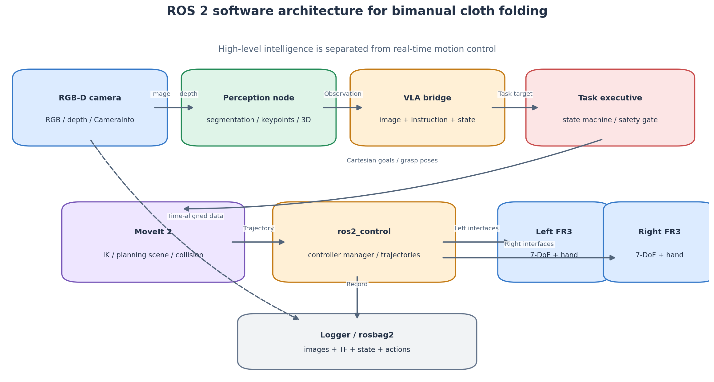

为了便于工程开发，建议拆成这些功能包：

| 包名 | 责任 | 输入 | 输出 |
|---|---|---|---|
| `camera_driver` | 相机驱动 | 相机硬件 | RGB、Depth、CameraInfo |
| `cloth_perception` | 衣物感知 | RGB、Depth | 分割、关键点、3D 目标 |
| `vla_bridge` | VLA 推理通信 | 图像、指令、状态 | 高层动作/子目标 |
| `cloth_task_manager` | 任务状态机 | 用户任务、感知、VLA | 阶段目标、执行授权 |
| `dual_arm_description` | 机器人模型 | Xacro、SRDF | Robot Model / TF |
| `motion_planning` | 运动规划 | 末端目标、机器人状态 | 轨迹 |
| `dual_arm_control` | 控制衔接 | 轨迹/控制目标 | 机器人执行 |
| `experiment_logger` | 记录与评价 | 各模块数据 | rosbag、CSV、指标 |

## 14.2 左右臂命名空间

一个概念性命名：

```text
/left_arm/joint_states
/right_arm/joint_states
/left_arm/controller_manager
/right_arm/controller_manager
/left_arm/follow_joint_trajectory
/right_arm/follow_joint_trajectory
```

这只是建议的逻辑命名。Franka 官方启动文件的实际命名要通过启动后 `ros2 topic list`、`ros2 action list`、`ros2 control list_controllers` 和 `ros2 node list` 确认。

## 14.3 两种双臂动作组织方式

### 方式 A：左右臂分别规划和执行

Task Manager 同时发出左臂和右臂的目标，由两个规划和执行接口分别处理。

优点：容易从现有单臂系统扩展。缺点：需要额外处理同步、同时开始、同时结束和互相避碰问题。

### 方式 B：将双臂视为一个组合规划组

把左右臂所有关节作为一个联合状态：

$$
q_{dual}=\begin{bmatrix}q_L\\q_R\end{bmatrix}
$$

若左右臂各 7 个关节，则：

$$
q_{dual}\in\mathbb{R}^{14}
$$

规划器可在组合空间中同时考虑两臂状态和碰撞约束。优点是有机会统一规划；缺点是配置更复杂，搜索空间更大，且具体机器人模型和规划插件要支持这种使用方式。

## 14.4 双臂同步的时间问题

两臂的轨迹可写为：

$$
q_L(t),\qquad q_R(t)
$$

真正协同要求两者在同一时间基准下执行。若左臂先抓、右臂后抓，可能导致毛巾滑脱或受力不均。对于抓取、拉展等阶段，任务逻辑需要定义：

- 左右臂什么时候到位。
- 是否都确认夹爪闭合。
- 是否等两臂都 Ready 后一起开始拉展。
- 如果一侧失败，另一侧如何安全停止或保持。
- 任务取消时两侧如何进入安全状态。

动作同步不仅是“两个节点一起发命令”，还涉及时间戳、控制器接受目标的时刻和执行反馈。

## 14.5 任务状态机

衣物折叠适合使用显式状态机，而不是把全部步骤堆在一个回调里。

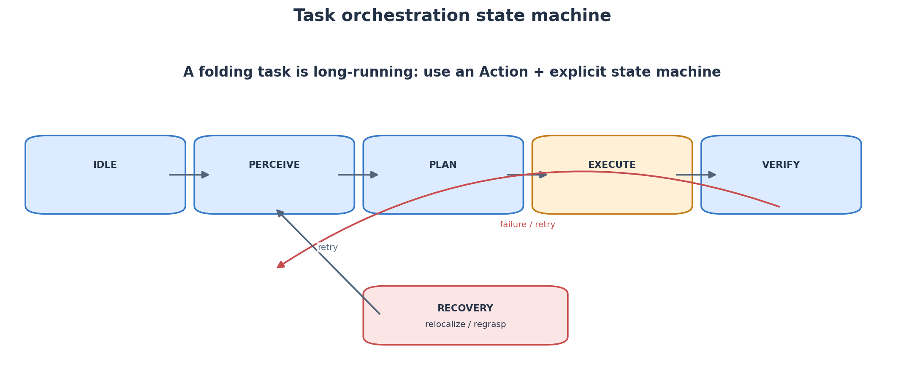

示例状态：

```text
IDLE
  ↓ 接收折叠指令
PERCEIVE
  ↓ 获得有效衣物状态
PLAN
  ↓ 轨迹与碰撞检查通过
MOVE_TO_PREGRASP
  ↓ 双臂到达
GRASP
  ↓ 确认夹持
LIFT_AND_SPREAD
  ↓ 衣物状态满足条件
FOLD
  ↓ 双臂完成折叠动作
RELEASE
  ↓ 松开夹爪
VERIFY
  ├── 成功 → SUCCEEDED
  └── 失败 → RECOVERY / ABORTED
```

每个状态都要定义：进入条件、执行动作、超时、成功条件、失败条件、取消后的行为。

## 14.6 任务安全门控

VLA 输出的动作是模型预测，不等于安全指令。建议在 VLA 和底层执行之间设置 Safety Gate：

- 检查目标是否在工作空间范围内。
- 检查关节限位。
- 检查速度、加速度和 jerk 限制。
- 检查路径碰撞。
- 检查左右臂目标是否冲突。
- 检查当前机器人状态是否允许新任务。
- 检查图像和 TF 是否过期。
- 检查急停、保护停机和控制器状态。

只有通过验证的动作才可以交给规划器/控制器。安全门控不能代替硬件急停和实验室安全措施。

---

# 第 15 章 ROS 2 与 VLA 模型如何连接

## 15.1 不要让 VLA 直接替代所有控制模块

推荐数据流：

```text
RGB-D 相机
   ↓
感知节点：图像、深度、关键点、机器人状态
   ↓
VLA Bridge：组织 observation 和 instruction
   ↓
VLA 推理服务器：返回动作或动作块
   ↓
动作解析与 Safety Gate
   ↓
Task Manager：决策当前子任务
   ↓
MoveIt 2：IK、碰撞检测、轨迹规划
   ↓
ros2_control / Franka 控制接口
   ↓
左右机械臂执行
   ↓
相机再次观察，验证结果
```

## 15.2 观察 Observation 的组织

VLA 输入通常不是一张孤立图像，而是由多个信息组成。对于你的项目，可定义概念性观察：

$$
o_t=\{I_t^{RGB},D_t,q_t,\dot q_t,g_t,l\}
$$

其中：

- $I_t^{RGB}$：当前 RGB 图像。
- $D_t$：深度图或点云。
- $q_t$：左右臂关节状态。
- $\dot q_t$：关节速度。
- $g_t$：左右夹爪状态。
- $l$：语言任务指令。

注意：实际 OpenVLA、OFT、RDT 或 π0 的输入格式并不完全一样，不能把上面的概念式直接当作某个模型的 API。需要按具体模型的数据预处理和输入 schema 实现。

## 15.3 动作 Action 的设计

动作可能是：

- 末端位姿增量。
- 关节位置目标。
- 夹爪开合命令。
- 动作块（多个连续时间步动作）。
- 任务级离散技能，如 `grasp_left_corner`。

对双臂任务，一种概念动作表示为：

$$
a_t=\begin{bmatrix}a_{L,t}\\a_{R,t}\end{bmatrix}
$$

如果左右臂各采用 7 维末端动作，则动作可以是 14 维，但是否直接让模型输出14维、是否拆分成左右两个 head、是否先预测高层目标再由传统控制器执行，都必须结合预训练模型结构、数据集格式和实验目标决定。

**重要：** 模型输出动作必须经过尺度反归一化、坐标系转换、单位检查、限幅、碰撞检测和机器人状态检查。动作向量中每个维度的单位和含义必须在数据采集、训练、推理、执行全链路一致。

## 15.4 VLA 推理延迟

如果 VLA 推理耗时为 $T_{VLA}$，模型每次生成一段动作块长度为 $H$，动作执行频率为 $f_a$，则动作块覆盖时间为：

$$
T_{chunk}=\frac{H}{f_a}
$$

如果：

$$
T_{VLA}>T_{chunk}
$$

则模型可能来不及在动作块执行完之前生成下一块，系统会出现等待、停顿或动作不连续。因此要考虑：

- 减少输入图像分辨率或视觉 Token 数量。
- 使用动作分块。
- 预取下一段动作，但要保留安全验证。
- 采用低频高层规划 + 高频底层轨迹跟踪。
- 对模型推理设置超时和失败策略。
- 记录每次推理延迟的均值、P95 和最大值，而不只记录平均值。

## 15.5 VLA Bridge 的职责

Bridge 节点负责：

1. 接收经过时间同步的图像和状态。
2. 转换为模型要求的数据格式。
3. 调用模型推理服务或本地模型。
4. 解析模型动作输出。
5. 将动作转换为统一的内部接口。
6. 返回推理时间、置信度（如果模型有）和错误状态。

Bridge 不应直接越过任务管理器和安全检查，把模型输出无限制地发送到硬件。

---

# 第 16 章 rosbag2、日志与实验数据管理

## 16.1 为什么必须记录数据

毕业设计的实验结论需要可以追溯。仅保存最终的视频，无法回答：

- 失败时的衣物图像是什么？
- 机器人当时的关节状态是什么？
- VLA 输出了哪个动作？
- TF 是否正确？
- 模型推理耗时多少？
- 控制器是否接受了轨迹？
- 是感知错误、动作预测错误还是执行偏差？

所以建议所有核心实验都记录 rosbag2，并额外保存结构化 CSV/JSON 指标。

## 16.2 rosbag2 常用命令

录制：

```bash
ros2 bag record -o fold_trial_001 \
  /camera/color/image_raw \
  /camera/aligned_depth_to_color/image_raw \
  /camera/color/camera_info \
  /joint_states \
  /tf /tf_static \
  /cloth/keypoints \
  /task/state
```

查看信息：

```bash
ros2 bag info fold_trial_001
```

回放：

```bash
ros2 bag play fold_trial_001
```

实际话题要根据系统运行结果调整。图像数据量很大，录制前检查磁盘空间、压缩配置和需要记录的话题，避免把所有高频话题无差别录制。

## 16.3 实验记录表

建议每次实验至少记录：

| 字段 | 说明 |
|---|---|
| trial_id | 实验唯一编号 |
| date_time | 日期和开始时间 |
| cloth_type | 毛巾、T恤等 |
| initial_pose | 初始位置、旋转和褶皱条件 |
| method | 规则法、ACT、OpenVLA 等 |
| checkpoint | 模型权重版本 |
| seed | 随机种子（如适用） |
| success | 是否成功 |
| duration_sec | 总耗时 |
| alignment_error | 边缘对齐误差 |
| retry_count | 重试次数 |
| failure_reason | 感知、抓取、碰撞、滑脱等 |
| bag_path | rosbag 文件路径 |

## 16.4 评价指标的定义

折叠成功率：

$$
SR=\frac{N_{success}}{N_{total}}\times100\%
$$

平均执行时间：

$$
\bar T=\frac{1}{N}\sum_{i=1}^{N}T_i
$$

若左右边缘关键点分别为 $p_i^L$ 与 $p_i^R$，某种对齐误差可定义为：

$$
e_{align}=\frac{1}{M}\sum_{i=1}^{M}\left\|p_i^L-p_i^R\right\|_2
$$

上式只是一个可选定义。具体应根据折叠任务几何结构选择关键点、对应关系和容差，不能在不同衣物之间直接比较不一致的指标。

建议失败原因至少分为：

- 感知失败：衣物分割或关键点错误。
- 定位失败：深度缺失或坐标变换错误。
- 规划失败：目标不可达或碰撞。
- 抓取失败：未夹到目标位置或滑脱。
- 协同失败：左右臂时序/受力不协调。
- 动作失败：模型输出不合理或执行偏差。
- 验证失败：动作完成但衣物折叠结果不满足标准。

---

# 第 17 章 调试方法与常见问题

## 17.1 节点找不到

检查：

```bash
source /opt/ros/$ROS_DISTRO/setup.bash
source ~/ros2_ws/install/setup.bash
ros2 pkg list | grep <package_name>
ros2 pkg executables <package_name>
```

常见原因：未 source 工作空间、包未成功编译、setup.py 没注册入口、包名或可执行名称不一致。

## 17.2 Topic 列表有话题，但 echo 没数据

依次检查：

1. 发布节点是否真的在运行。
2. 话题名称是否正确，包括 namespace 和 remapping。
3. Publisher 和 Subscriber 消息类型是否一致。
4. QoS 是否兼容。
5. 跨机器时 ROS_DOMAIN_ID、网络接口、防火墙是否正确。
6. 回调是否因异常或阻塞没有执行。

## 17.3 TF Lookup Extrapolation Error

通常说明查询时间与 TF 缓冲区中可用数据时间范围不匹配。

检查：

- 消息时间戳是否正确。
- 是否混用了系统时间和仿真时间。
- TF 发布频率是否正常。
- 查询的时间是否超出缓存。
- 节点是否使用一致的 `use_sim_time` 设置。

不要简单地把超时时间无限增大来掩盖时间同步问题。

## 17.4 RViz 看不到机器人

检查：

- `robot_description` 是否正确加载。
- `robot_state_publisher` 是否运行。
- `joint_states` 是否有数据。
- Fixed Frame 是否设置为 TF 树中存在的 frame。
- URDF 中 mesh 文件路径是否能找到。
- 左右臂 frame 名称是否冲突。

## 17.5 MoveIt 规划失败

可能原因：

- 目标位姿在工作空间外。
- 逆运动学无解。
- 关节限位设置不合理。
- Planning Scene 中障碍物与目标冲突。
- 当前机器人状态无效或过期。
- 规划组关节名称错误。
- 规划时间太短或采样配置不合适。
- 双臂相互碰撞。

先在 RViz 里使用简单命名姿态测试，再逐渐增加复杂目标，不要一开始就用 VLA 目标排查所有问题。

## 17.6 双臂控制互相覆盖

常见原因：

- 左右控制器名字或 namespace 冲突。
- 两臂使用相同 TF frame 名称。
- joint names 没有前缀或唯一化。
- 两个节点向同一控制器发送目标。
- 资源接口被多个控制器同时占用。

建议分别启动、分别确认状态和动作接口，再一起启动。

## 17.7 真实机器人不响应

必须先检查：

- 急停/保护停止状态。
- 机器人网络 IP 与控制 PC 网络配置。
- FCI 是否启用。
- libfranka 与机器人系统版本兼容性。
- 实时内核和权限设置。
- 控制器是否激活。
- 是否存在残留的其他控制程序占用接口。

不要在真实机器人上通过反复发送未知命令来“试试看”。应先在 Fake Hardware / 仿真中确认命令格式和控制流程。

## 17.8 安全注意事项

1. 第一次运行先使用仿真或 Fake Hardware。
2. 真实运行前清空工作区域，确认急停位置。
3. 初始速度和加速度设置为低值，并经导师确认。
4. 机械臂运动区域内不要放置无关物品。
5. 不要让 VLA 输出直接成为未经检查的关节/力矩命令。
6. 保护停机、碰撞和超时应有明确恢复逻辑。
7. 任何时候都不能把软件日志里的“成功”当成实际硬件安全的证明。

---

# 第 18 章 面向毕业设计的项目实践路线

这一章是把知识转化成实际能力的学习任务。建议按阶段验收，不要跳级。

## 阶段 1：ROS 2 基本通信（2—4 天）

目标：掌握 Node、Topic、Service。

任务：

- 建立 Python 包 `ros2_basics`。
- 写一个周期发布状态的节点。
- 写一个订阅节点。
- 写一个 Trigger 服务。
- 通过命令行查看 topic/service。

验收：不看教程可以从零创建包并跑通发布—订阅。

## 阶段 2：QoS、参数和 Launch（3—5 天）

任务：

- 修改 QoS 参数。
- 模拟发布频率和订阅处理速度不匹配。
- 建立 YAML 参数文件。
- 编写 Launch 同时启动两个节点。
- 从命令行修改一个参数。

验收：能解释为什么 topic 可能存在但订阅收不到消息。

## 阶段 3：TF2 坐标树（4—7 天）

任务：

- 建立 `world → table → camera` 静态变换。
- 建立一个模拟的 `base_link → tool0` 变换。
- 使用 `view_frames` 查看 TF 树。
- 使用 Python 查询相机到机器人基座的变换。
- 手工用齐次矩阵验证一个点的变换结果。

验收：能清楚说明 $T^A_B$ 的方向，能完成多段矩阵连乘。

## 阶段 4：相机数据进入 ROS 2（3—6 天）

任务：

- 启动 RGB-D 相机驱动。
- 使用 `ros2 topic list` 找到 RGB、Depth、CameraInfo。
- 用 RViz 或 rqt_image_view 检查图像。
- 读取图像并找到一个像素点。
- 使用内参和深度将像素转为相机三维坐标。
- 通过 TF2 转换到机器人基座坐标系。

验收：能将相机中的已知标定点转换到机器人坐标系，并用实测位置验证误差。

## 阶段 5：机器人模型、ros2_control 与 MoveIt 2（1—3 周）

任务：

- 加载 Franka 官方机器人描述。
- 在 RViz 查看机械臂。
- 查看关节状态和控制器。
- 在 Fake Hardware 中执行一段安全轨迹。
- 使用 MoveIt 2 规划到简单目标。
- 加入桌面碰撞物体。

验收：能解释规划器、控制器、硬件接口之间的关系。

## 阶段 6：双臂集成（1—3 周）

任务：

- 分别启动左臂、右臂。
- 检查两臂 namespace、joint name 和 TF frame。
- 规划左右臂各自轨迹。
- 加入相互碰撞检查。
- 设计双臂同步抓取状态机。

验收：Fake Hardware 或仿真中能稳定实现双臂同步到位，且路径没有互相碰撞。

## 阶段 7：接入 VLA 与衣物操作（持续迭代）

任务：

- 定义统一的 Observation 消息/数据结构。
- 定义动作表示与坐标系。
- 通过 VLA Bridge 调用模型。
- 在安全门控后生成末端目标。
- 让 MoveIt 2 规划和执行。
- 用视觉验证折叠结果。
- 用 rosbag2 记录完整实验。

验收：系统可以从自然语言任务指令开始，完成一次可重复的衣物折叠流程，并且能对失败进行记录和分析。

---

# 第 19 章 必须掌握的知识总结与自测

## 19.1 必须熟记的核心知识

| 知识点 | 必须达到的程度 |
|---|---|
| Node | 能独立创建、运行、调试节点 |
| Topic | 能设计 publisher/subscriber 和消息类型 |
| Service | 能编写请求—响应服务 |
| Action | 能设计长任务目标、反馈、结果和取消 |
| QoS | 能解释可靠性、持久性、历史深度及兼容性 |
| Executor | 能解释回调调度、阻塞和线程安全 |
| Colcon | 能建立工作空间、编译、source、管理依赖 |
| Launch | 能用一个 launch 启动多个节点 |
| TF2 | 能看懂 TF 树、查询和组合坐标变换 |
| CameraInfo | 能使用内参将像素和深度转换为三维点 |
| URDF/SRDF | 能区分机器人结构描述与规划语义描述 |
| ros2_control | 能说明硬件接口、Controller Manager 和控制器的关系 |
| MoveIt 2 | 能完成 IK、路径规划、场景碰撞检查和轨迹执行 |
| rosbag2 | 能记录与回放实验数据 |

## 19.2 自测题

**题 1：** 相机以30 Hz发布图像，感知节点以10 Hz处理图像。为什么可能积累延迟？怎样缓解？

**题 2：** 为什么“将毛巾对折”适合使用 Action，而不只是 Service？

**题 3：** Topic 名称存在，但订阅端收不到图像，应该检查哪些因素？

**题 4：** `PoseStamped` 为什么比只传递 `[x,y,z]` 更适合机器人？

**题 5：** 若已知 $T^B_C$ 和 $T^C_P$，怎样得到点 P 在 B 坐标系中的位置？

**题 6：** 为什么 camera optical frame 与 robot base frame 的轴方向不能想当然地认为相同？

**题 7：** URDF 和 SRDF 分别描述什么？

**题 8：** ros2_control 中 State Interface 与 Command Interface 有什么区别？

**题 9：** MoveIt 2 为什么不能代替 Franka 的底层控制接口？

**题 10：** 左右臂分别规划都没有自碰撞，为什么仍然可能互相碰撞？

**题 11：** VLA 推理需要300 ms，为什么不适合直接承担1 kHz 伺服控制？

**题 12：** 为什么实验中要同时记录图像、TF、关节状态、动作和时间戳？

## 19.3 自测参考答案

1. 因为消息生成速度高于处理速度，队列中会留下旧帧；可减少队列深度、跳帧、缩小图像、加速感知或分离线程。实时感知很多时候更关心最新帧。
2. 对折是长时间任务，需要反馈进度、返回结果，并且在失败或安全事件时可以取消。
3. 检查发布者状态、话题名称、消息类型、QoS、节点回调、网络与 ROS_DOMAIN_ID。
4. 它附带坐标系和时间戳，避免把没有参考系的数字直接用于机器人控制。
5. 使用矩阵连乘：$T^B_P=T^B_C T^C_P$，然后 $^B\bar p=T^B_P{}^P\bar p$。
6. 相机 optical frame 采用相机光学坐标约定，机器人 base frame 按机器人模型定义，方向不同，需要 TF 转换。
7. URDF 描述连杆、关节和几何/运动结构；SRDF 提供 MoveIt 使用的规划组、末端执行器、语义状态等。
8. State Interface 是读取硬件状态；Command Interface 是向硬件/控制器写入目标。
9. MoveIt 2 主要负责规划，不负责替代实时硬件通信和底层安全控制。
10. 因为左臂与右臂之间的碰撞没有被单臂规划考虑，必须使用共享场景或联合碰撞检查。
11. 300 ms 约为3.3 Hz，远低于1 kHz；延迟和抖动都不能满足高频伺服环的实时性要求。
12. 因为需要将观察、变换、决策和执行按时间对应起来，才能复现并定位系统失败原因。

---

# 附录 A 常用 ROS 2 命令速查

## 环境与版本

```bash
printenv | grep ROS
echo $ROS_DISTRO
which ros2
ros2 doctor --report
```

## 节点

```bash
ros2 node list
ros2 node info /node_name
ros2 run package_name executable_name
```

## Topic

```bash
ros2 topic list
ros2 topic info /topic_name --verbose
ros2 topic echo /topic_name
ros2 topic hz /topic_name
ros2 topic bw /topic_name
ros2 topic type /topic_name
```

## Service

```bash
ros2 service list
ros2 service type /service_name
ros2 service call /service_name package/srv/Type "{}"
```

## Action

```bash
ros2 action list
ros2 action info /action_name
```

## Interface

```bash
ros2 interface list
ros2 interface show package/msg/MessageName
ros2 interface show package/srv/ServiceName
ros2 interface show package/action/ActionName
```

## 参数

```bash
ros2 param list
ros2 param get /node parameter_name
ros2 param set /node parameter_name value
ros2 param dump /node
```

## 包和工作空间

```bash
ros2 pkg list
ros2 pkg executables package_name
ros2 pkg prefix package_name
colcon build --symlink-install
colcon test
colcon test-result --verbose
```

## TF 与 RViz

```bash
ros2 run tf2_tools view_frames
ros2 run tf2_ros tf2_echo base_link tool0
rviz2
```

## ros2_control

```bash
ros2 control list_controllers
ros2 control list_hardware_components
ros2 control list_hardware_interfaces
```

## rosbag2

```bash
ros2 bag record -o bag_name /topic_a /topic_b
ros2 bag info bag_name
ros2 bag play bag_name
```

---

# 附录 B 重要术语表

| 英文 | 中文 | 含义 |
|---|---|---|
| Node | 节点 | ROS 2 图中的功能实体 |
| Topic | 话题 | 发布—订阅数据流 |
| Publisher | 发布者 | 发送消息 |
| Subscriber | 订阅者 | 接收消息 |
| Service | 服务 | 请求—响应 |
| Action | 动作 | 可反馈、可取消的长任务 |
| Parameter | 参数 | 节点配置 |
| QoS | 服务质量 | 通信可靠性、历史等策略 |
| DDS | 数据分发服务 | ROS 2 常用通信中间件标准 |
| RMW | ROS 中间件接口 | 隔离客户端库与底层中间件 |
| Executor | 执行器 | 调度回调 |
| Callback | 回调 | 事件发生时执行的函数 |
| TF2 | 坐标变换库 | 管理坐标系和时间变换 |
| URDF | 统一机器人描述格式 | 机器人结构、关节和几何描述 |
| Xacro | XML 宏 | 生成/复用 URDF |
| SRDF | 语义机器人描述格式 | MoveIt 规划组和语义信息 |
| Colcon | 构建工具 | 构建 ROS 2 工作空间 |
| rosdep | 依赖工具 | 安装包依赖 |
| ros2_control | 控制框架 | 管理硬件接口和控制器 |
| MoveIt 2 | 运动规划框架 | 运动学、规划和碰撞检测 |
| Planning Scene | 规划场景 | 当前机器人状态和环境模型 |
| FCI | Franka 控制接口 | Franka 研究机器人接口 |
| TCP | 工具中心点 | 末端工具参考点 |
| Eye-to-Hand | 手外相机 | 相机固定于环境 |
| Eye-in-Hand | 手眼相机 | 相机安装在机械臂末端 |
| Action Chunking | 动作分块 | 一次预测多个连续动作 |
| rosbag2 | 数据包记录工具 | 记录和回放 ROS 2 话题 |

---

# 附录 C 官方文档与建议阅读资料

> 官方文档会更新，下载教程、驱动和代码时请选择与你实际 ROS 2 发行版一致的分支。以下链接以官方项目为主。

## C.1 ROS 2 基础

- [ROS 2 Documentation](https://docs.ros.org/)
- [ROS 2 Jazzy Tutorials](https://docs.ros.org/en/jazzy/Tutorials.html)
- [ROS 2 Lyrical Documentation](https://docs.ros.org/en/lyrical/)
- [REP-2000: ROS 2 Variants, Releases and Target Platforms](https://www.ros.org/reps/rep-2000.html)
- [ROS 2 Concepts](https://docs.ros.org/en/jazzy/Concepts.html)
- [ROS 2 QoS Concepts](https://docs.ros.org/en/jazzy/Concepts/Intermediate/About-Quality-of-Service-Settings.html)
- [ROS 2 TF2 Tutorials](https://docs.ros.org/en/jazzy/Tutorials/Intermediate/Tf2/Tf2-Main.html)
- [ROS 2 Launch Tutorials](https://docs.ros.org/en/jazzy/Tutorials/Intermediate/Launch/Launch-Main.html)
- [ROS 2 Parameters](https://docs.ros.org/en/jazzy/Concepts/Basic/About-Parameters.html)

## C.2 ROS 2 控制与 MoveIt

- [ros2_control Documentation](https://control.ros.org/jazzy/doc/ros2_control/doc/index.html)
- [joint_trajectory_controller](https://control.ros.org/jazzy/doc/ros2_controllers/joint_trajectory_controller/doc/userdoc.html)
- [MoveIt 2 Documentation](https://moveit.picknik.ai/)
- [MoveIt 2 Getting Started](https://moveit.picknik.ai/main/doc/tutorials/getting_started/getting_started.html)
- [MoveIt Planning Scene](https://moveit.picknik.ai/main/api/html/planning_scene_overview.html)

## C.3 Franka

- [Franka Control Interface Documentation](https://frankarobotics.github.io/docs/)
- [franka_ros2 GitHub](https://github.com/frankarobotics/franka_ros2)
- [Franka Robot Specifications](https://frankarobotics.github.io/docs/robot_specifications.html)
- [Franka Real-Time Kernel Setup](https://frankarobotics.github.io/docs/doc/libfranka/docs/real_time_kernel.html)

## C.4 RGB-D 相机

- [RealSense ROS 2 Wrapper](https://github.com/realsenseai/realsense-ros)
- [RealSense SDK Documentation](https://dev.realsenseai.com/)

## C.5 书籍建议

1. **《Programming Robots with ROS 2》**：偏工程实践，适合学习 ROS 2 程序组织。
2. **《A Concise Introduction to Robot Programming with ROS 2》**：适合快速建立 ROS 2 工程概念。
3. **《Modern Robotics: Mechanics, Planning, and Control》**：不是 ROS 2 教材，但对理解 TF、运动学、轨迹规划和 MoveIt 2 非常重要。
4. ROS 2 官方教程应作为版本和 API 的最终依据，书籍中的旧命令需要按 Jazzy/实际发行版调整。

## C.6 版本选择：你的项目应该安装哪个 ROS 2 版本？

截至 **2026-11-11**，ROS 2 已进入 Lyrical Luth 发行周期。新版本并不自动等于你的毕业设计最适合的版本，因为 Franka、MoveIt 2、RealSense、Ubuntu、CUDA 和实验室现有代码必须形成兼容组合。

目前公开资料中可见的几个关键事实：

- `franka_ros2` 仓库当前安装说明以 ROS 2 Jazzy 为基础，并提供 Jazzy 分支安装步骤。
- Franka 官方文档单独列出 `franka_ros2: Jazzy` 文档入口。
- RealSense ROS 2 Wrapper 的当前仓库列出了多个 ROS 2 发行版支持，包含 Jazzy、Kilted 和 Lyrical；具体相机 SDK 和 wrapper tag 仍需匹配。
- MoveIt 2 的 Getting Started 文档仍建议初学者优先采用 Ubuntu 24.04 + ROS 2 Jazzy 的稳定组合。

**因此，对刚开始本课题、硬件为 Franka + RGB-D、还要使用 MoveIt 2 的本科项目，建议先确认实验室已有环境；如果没有既有约束，优先和导师讨论 Ubuntu 24.04 + ROS 2 Jazzy，而不是自行升级到 Lyrical。** 只有当 Franka 驱动、MoveIt 2、相机驱动和依赖包均明确支持且经过实验室验证时，才考虑更新版本。

版本核对步骤：

1. 确认 Franka 机器人具体型号和系统版本。
2. 查询实验室使用的 libfranka 版本。
3. 查询 `franka_ros2` 分支和对应文档。
4. 查询 MoveIt 2 对应发行版的二进制包和配置。
5. 查询 RGB-D 型号对应 RealSense SDK 与 wrapper 版本。
6. 确认 GPU 驱动、CUDA、PyTorch 与 ROS 2 Python 环境不会互相污染。
7. 固定版本，记录到 `environment.md`，不要在毕业设计中途随意升级。

---

## 最后：本章学习完成的判断标准

当你可以不看教程，独立做到下面这些事，才算真正掌握了本项目所需要的 ROS 2 基础：

- 从零建立 ROS 2 工作空间并编译自己的 Python/C++ 包。
- 能用 Topic 传递相机和关节状态，用 Action 表达衣物折叠长任务。
- 能解释 QoS 不兼容、回调阻塞、Executor 和线程安全问题。
- 能建立并检查 TF 树，完成相机点到机器人基座点的转换。
- 能读取 Franka 的机器人状态，理解 ros2_control 的接口和控制器。
- 能使用 MoveIt 2 做规划、碰撞检查和轨迹执行。
- 能把 VLA 模型封装成 ROS 2 节点，并让其输出经过安全检查后进入运动规划链路。
- 能用 rosbag2 记录一次完整实验，并根据数据定位失败原因。

**最终记住：ROS 2 的学习目标不是把命令背下来，而是能够清楚地回答“谁产生数据、数据是什么、在哪个坐标系、通过什么接口传递、由谁决策、由谁规划、由谁执行、如何验证结果”。**
