# VLA模型与机器人具身智能：原理、数学推导与双臂衣物折叠实践笔记

> **适用对象：** 自动化专业本科生；研究方向为基于VLA模型的双臂机器人衣物折叠。  
> **面向平台：** 双臂Franka类机械臂、夹爪、RGB-D相机、ROS 2、GPU服务器。具体型号、软件版本、控制接口和安全限制必须以实验室真实平台为准。  
> **笔记目标：** 从“理解VLA是什么”进阶到“能够读懂论文、处理示范数据、适配动作空间、运行模型、把动作安全地交给双臂机器人，并通过实验评价系统”。  
> **公式约定：** 本文所有数学公式均采用独立的 LaTeX 数学块 `$$ ... $$`，适用于常见 Markdown + MathJax / KaTeX 渲染器。  
> **配图说明：** 图片保存在同级目录 `images/` 中。请将本文 Markdown 文件与图片目录一起解压、移动或保存，否则相对路径图片会失效。

---

## 阅读前说明：怎么使用这份笔记

VLA 与具身智能不是单一算法，而是一整套系统能力。学习时不要只背模型名称，应该始终围绕下面五个问题：

1. **机器人看到了什么？** 图像、深度、关节状态、夹爪状态、语言指令如何表示？
2. **机器人理解了什么？** 模型如何把视觉、语言和机器人状态关联起来？
3. **机器人准备做什么？** 动作究竟表示成离散 Token、末端位姿、关节角，还是一段动作序列？
4. **机器人如何安全地做？** 预测动作怎样经过坐标变换、逆运动学、轨迹规划和安全检查？
5. **如何判断做得好不好？** 成功率、对齐误差、执行时间、泛化能力和失败恢复如何测量？

建议按以下顺序学习：

- **第一遍：** 阅读第 1—6 章，建立具身智能、机器人学习、Transformer 和 VLA 的整体认识。
- **第二遍：** 阅读第 7—12 章，理解动作表示、模仿学习、ACT、扩散策略、Flow Matching 和模型微调。
- **第三遍：** 阅读第 13—19 章，重点理解双臂动作、柔性物体、数据采集、部署、安全和实验评价。
- **第四遍：** 跟着第 20—22 章完成代码练习、论文阅读和毕设落地。

**最重要的学习原则：每学习一个概念，都要追问它在“相机—模型—双臂机器人—衣物”链路中处于什么位置。**

# 第一部分：具身智能与机器人学习基础

## 1. 什么是具身智能（Embodied Intelligence）

### 1.1 从传统人工智能到具身智能

传统人工智能往往在数字空间中处理输入和输出。例如：

- 图像分类：输入图片，输出类别。
- 目标检测：输入图片，输出目标框和类别。
- 语言模型：输入文字，输出文字。
- 图像生成：输入文本或图像条件，输出图像。

这些系统可以在数字空间中完成计算，但它们不一定需要真正与物理世界交互。

具身智能强调：智能体拥有一个物理载体（身体或机器人平台），通过传感器获取环境信息，通过决策和控制改变环境，并根据行动结果继续调整行为。

例如，双臂机器人折叠毛巾时：

1. 相机观察桌面，获得毛巾图像和深度。
2. 机器人估计毛巾的位置、轮廓、角点和褶皱。
3. 系统判断应该抓取哪两个位置。
4. 左右机械臂协同接近、抓取和拉展。
5. 机器人观察毛巾是否被拉平。
6. 如果毛巾滑落或姿态变化，就重新感知并规划。

这不是一次性的“输入图片—输出答案”，而是一个持续的物理交互过程。

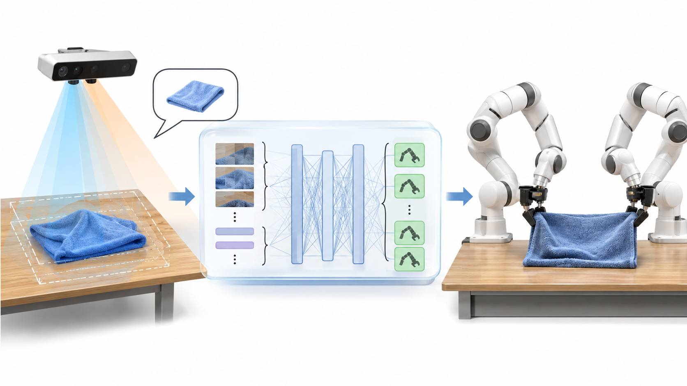

### 1.2 具身智能的三个核心要素

**（1）身体（Embodiment）**  
身体决定智能体能做什么。机械臂的自由度、工作空间、夹爪形状、关节速度、末端精度和传感器配置，都会限制可执行动作。

**（2）环境交互（Interaction）**  
智能体必须面对真实环境中的不确定性。例如衣物可能被遮挡、滑动、拉伸、褶皱，也可能在抓取时同时抓住多层布料。

**（3）闭环反馈（Closed-loop Feedback）**  
执行动作后继续观察结果，不能只依赖最开始的一张图片预测完整轨迹。

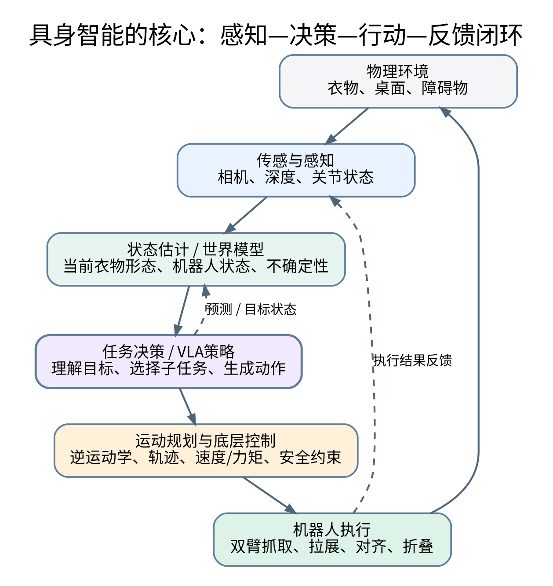

### 1.3 为什么“有身体”会改变学习问题

假设模型预测抓取点有 1 cm 的误差。对图像分类而言，这个误差可能没有影响；对机器人而言，1 cm 可能意味着：

- 夹爪没有碰到衣物边缘；
- 夹到了布料中间而不是角点；
- 机械臂与桌面发生接触；
- 左右夹爪抓取位置不对称，拉展后衣物发生旋转。

因此机器人策略除了“语义上正确”，还必须满足：

- **几何可行性：** 目标在机器人可达工作空间内。
- **运动可行性：** 关节角、速度、加速度不超过限制。
- **碰撞安全性：** 不与桌面、另一只机械臂或环境障碍物碰撞。
- **接触合理性：** 夹爪能接触到目标且不容易滑脱。
- **时间可行性：** 模型推理延迟和控制周期能够配合。

### 1.4 具身智能的基本闭环模型

可以将具身智能抽象为：

$$
\text{观测 } o_t \rightarrow \text{状态估计 } b_t \rightarrow \text{策略 } \pi_\theta \rightarrow \text{动作 } a_t \rightarrow \text{环境状态变化}
$$

其中：

- $o_t$：时刻 $t$ 的观测，如图像、深度、关节状态。
- $b_t$：对当前环境状态的估计或信念状态。
- $\pi_\theta$：由参数 $\theta$ 表示的机器人策略。
- $a_t$：机器人在该时刻执行的动作。

执行后，环境状态发生变化，机器人再采集新观测：

$$
o_{t+1} \sim P(o_{t+1}\mid s_{t+1}), \qquad s_{t+1}\sim P(s_{t+1}\mid s_t,a_t)
$$

这两条关系分别描述观测生成和状态转移。真实机器人中，环境状态通常无法被完全观测，因此要使用图像、深度、机器人状态等信息估计它。

### 1.5 本课题中的具身智能体现在哪里

你的机器人并不是在“识别毛巾”这么简单，而是需要：

- 从图像理解毛巾在桌面的空间形态；
- 从语言指令理解目标任务；
- 结合Franka双臂的身体结构选择可执行动作；
- 通过夹爪和机械臂与衣物发生物理接触；
- 根据衣物变形后的新图像调整动作。

这就是从多模态理解走向物理行动的过程。

---

## 2. 机器人学习问题：MDP、POMDP、策略与价值

VLA 模型可以看成一种机器人策略，但在理解策略之前，需要先理解机器人学习问题的数学形式。

### 2.1 马尔可夫决策过程（MDP）

MDP（Markov Decision Process）通常由五元组表示：

$$
\mathcal{M}=(\mathcal{S},\mathcal{A},\mathcal{P},r,\gamma)
$$

各符号含义：

| 符号 | 含义 | 衣物折叠中的例子 |
|---|---|---|
| $\mathcal{S}$ | 状态空间 | 衣物形状、左右臂关节角、夹爪状态 |
| $\mathcal{A}$ | 动作空间 | 两臂末端移动、关节运动、夹爪开合 |
| $\mathcal{P}$ | 状态转移概率 | 抓取后衣物会如何变形、是否滑落 |
| $r$ | 奖励函数 | 完成对折、对齐误差小、无碰撞 |
| $\gamma$ | 折扣因子 | 对未来奖励的重视程度 |

MDP 的核心假设是：给定当前状态和动作，下一状态与更早的历史条件独立。

$$
P(s_{t+1}\mid s_t,a_t,s_{t-1},\ldots)=P(s_{t+1}\mid s_t,a_t)
$$

状态价值函数定义为从状态 $s$ 开始，之后按策略行动所能获得的期望累计折扣奖励：

$$
V^\pi(s)=\mathbb{E}_\pi\left[\sum_{k=0}^{\infty}\gamma^k r_{t+k}\mid s_t=s\right]
$$

动作价值函数表示在状态 $s$ 下先采取动作 $a$，之后继续遵循策略所能获得的期望回报：

$$
Q^\pi(s,a)=\mathbb{E}_\pi\left[\sum_{k=0}^{\infty}\gamma^k r_{t+k}\mid s_t=s,a_t=a\right]
$$

**直观理解：** 机器人不是只问“这一步动作看起来对不对”，还要考虑这个动作对后续步骤有没有帮助。例如抓取点虽然能抓到衣物，但如果抓取后无法形成适合对折的姿态，整个动作就不是好动作。

### 2.2 为什么真实机器人更接近 POMDP

真实机器人一般无法直接看到完整状态。相机只能观察到可见表面，无法直接知道衣物背面、内部褶皱、夹爪与布料间的真实接触状态。因此可以用 POMDP（Partially Observable MDP）建模：

$$
\mathcal{P}=(\mathcal{S},\mathcal{A},\mathcal{T},\mathcal{O},\mathcal{Z},r,\gamma)
$$

其中：

- $\mathcal{O}$：观测空间。
- $\mathcal{Z}(o\mid s)$：状态 $s$ 下获得观测 $o$ 的概率。
- $\mathcal{T}(s'\mid s,a)$：状态转移模型。

因为真实状态不可直接得到，系统可维护一个信念状态（belief）：

$$
b_t(s)=P(s_t=s\mid o_{1:t},a_{1:t-1})
$$

它表示在已有历史观测和动作下，当前真实状态可能是什么。

完整的贝叶斯更新可写为：

$$
b_{t+1}(s')=\eta\, Z(o_{t+1}\mid s')\sum_s T(s'\mid s,a_t)b_t(s)
$$

其中 $\eta$ 是归一化系数。

**本课题中的对应：** 机器人不一定需要显式计算完整概率分布，但必须意识到“图像检测结果不是绝对真实状态”。例如衣物角点置信度低、深度缺失、夹爪可能滑脱时，系统应该重新观察、换抓取点或停止动作，而不是盲目执行。

### 2.3 策略（Policy）是什么

策略就是从观测或状态到动作的映射。

确定性策略：

$$
a_t=\pi_\theta(o_t,l_t,q_t)
$$

随机策略：

$$
a_t\sim \pi_\theta(a\mid o_t,l_t,q_t)
$$

这里：

- $o_t$：视觉观测；
- $l_t$：语言指令；
- $q_t$：机器人自身状态；
- $a_t$：动作。

策略是机器人学习系统最重要的对象。VLA 模型本质上就是利用视觉和语言条件生成机器人动作的策略模型。

### 2.4 模仿学习与强化学习有什么区别

| 比较项 | 模仿学习（IL） | 强化学习（RL） |
|---|---|---|
| 主要数据 | 人类或专家示范 | 与环境交互获得的轨迹和奖励 |
| 训练目标 | 学习示范者的动作规律 | 最大化累计奖励 |
| 典型算法 | BC、ACT、Diffusion Policy | PPO、SAC、DQN 等 |
| 优点 | 真实机器人上更容易利用示范 | 可以尝试超越示范策略 |
| 难点 | 示范分布外容易失败 | 奖励设计、探索、安全成本高 |

对于你的本科毕设，**优先学习模仿学习和预训练VLA的微调**。强化学习可作为后续研究拓展，不建议一开始就把它设为主线。

---

# 第二部分：VLA 模型基础

## 3. VLA 是什么：从 VLM 到 VLA

### 3.1 三个概念不要混淆

**视觉语言模型（VLM, Vision-Language Model）**：输入图像和文字，输出文字、描述或其他语义结果。例如回答“图中哪一件是蓝色毛巾”。

**机器人策略模型（Robot Policy）**：根据机器人观测和状态预测机器人动作，输出通常与具体机器人平台和动作空间有关。

**视觉语言动作模型（VLA, Vision-Language-Action）**：把视觉、语言和机器人动作统一到一个模型或统一的策略体系中，模型既理解任务，也能预测用于机器人操作的动作。

可以这样记：

- VLM 主要回答“看到了什么、是什么意思”。
- Robot Policy 主要回答“机器人下一步怎么动”。
- VLA 尝试把“看懂任务”和“生成机器人动作”连接起来。

### 3.2 VLA 的一般数学形式

设：

- $I_t$：当前相机图像；
- $L$：自然语言指令；
- $Q_t$：机器人状态；
- $A_{t:t+H-1}$：未来 $H$ 步动作序列。

VLA 可以学习如下条件分布：

$$
\pi_\theta(A_{t:t+H-1}\mid I_t,L,Q_t)
$$

如果模型一次只输出当前动作，则有：

$$
\pi_\theta(a_t\mid I_t,L,Q_t)
$$

前一种形式称为动作块（Action Chunk）预测，后一种形式可以看作单步动作预测。

### 3.3 VLA 为什么比普通视觉分类模型复杂

图像分类只需要把输入映射到类别：

$$
f_\theta(I)\rightarrow y
$$

VLA 则需要处理：

$$
f_\theta(I,L,Q)\rightarrow A
$$

动作 $A$ 不仅有语义，还具有物理意义。例如：

- 位置量有单位，通常是米；
- 角度量可能使用弧度；
- 夹爪开合有方向和范围；
- 关节量受到机械结构限制；
- 动作必须满足执行频率和安全约束。

因此 VLA 需要同时解决语义理解、跨模态对齐、动作表示和机器人控制适配。

### 3.4 一个双臂衣物折叠例子

语言输入：

> 将桌面上的蓝色毛巾展开，然后沿中线对折。

视觉输入：

- RGB图像：观察颜色、轮廓和纹理；
- 深度图：估计毛巾表面高度；
- 多视角图像：降低遮挡影响。

机器人状态：

- 左臂关节角；
- 右臂关节角；
- 左右夹爪状态；
- 末端执行器位置与姿态。

模型可能输出：

- 目标抓取区域；
- 左右臂末端目标；
- 夹爪开合；
- 未来一段时间的动作序列。

注意：有些VLA直接预测连续动作，有些输出离散动作Token，有些采用扩散或流模型生成动作。不同模型的输出定义不能混为一谈。

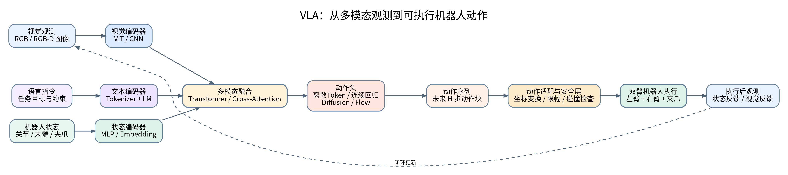

---

## 4. VLA 的整体结构：视觉、语言、状态、融合与动作头

大多数VLA可以从功能上拆成五个部分：

1. 视觉编码器；
2. 语言编码器；
3. 机器人状态编码器（并非所有模型都采用相同设计）；
4. 多模态融合主干；
5. 动作预测头。

### 4.1 视觉编码器

视觉编码器将图像变成向量或视觉Token。

常见方案包括：

- CNN：通过卷积提取局部特征；
- ViT：把图像切成Patch，再通过Transformer建模全局关系；
- 多视觉编码器融合：组合语义特征和空间特征。

图像大小为 $H\times W\times C$，Patch 尺寸为 $P\times P$ 时，Patch 数量为：

$$
N=\frac{H}{P}\times\frac{W}{P}
$$

把每个Patch展平并经过线性映射，可得到视觉Token：

$$
z_i=W_p\,\operatorname{vec}(x_i)+e_i^{pos}
$$

其中 $W_p$ 是Patch投影矩阵，$e_i^{pos}$ 是位置编码。

**理解：** 图像不再只是像素矩阵，而被转换成模型可以处理的特征序列。

### 4.2 语言编码器

语言指令首先经过Tokenizer，被切分成Token ID，再通过Embedding映射成向量。

$$
L=(w_1,w_2,\ldots,w_n)
$$

$$
E_L=[e(w_1),e(w_2),\ldots,e(w_n)]
$$

例如“将毛巾对折”会被切成若干Token。Token不一定等于一个汉字或一个单词，具体由Tokenizer决定。

语言模型提供的是上下文语义，例如“对折”意味着需要确定折叠方向、目标边缘和动作次序。

### 4.3 机器人状态编码器

如果模型接收机器人状态，通常要把状态向量转换成特征。

例如左右臂关节位置：

$$
q_t=[q_t^L,q_t^R]
$$

末端位姿：

$$
x_t=[p_t^L,R_t^L,p_t^R,R_t^R]
$$

通过线性层或MLP编码：

$$
z_q=\operatorname{MLP}(q_t)
$$

机器人状态能帮助模型理解当前机械臂处于什么位置，避免只根据图片预测动作而忽略机械臂自身状态。

### 4.4 多模态融合

图像、语言、机器人状态必须进入同一个决策过程。融合方式可能包括：

- 拼接Token后送入统一Transformer；
- Cross-Attention，让一种模态查询另一种模态；
- 视觉语言模型主干加动作头；
- 通过条件归一化、FiLM等机制注入任务信息。

拼接形式可以表示为：

$$
Z=[Z_I;Z_L;Z_Q]
$$

经过多层融合网络：

$$
H=\operatorname{Transformer}(Z)
$$

再由动作头得到：

$$
\hat A=\operatorname{ActionHead}(H)
$$

### 4.5 动作预测头

动作头的设计决定模型如何把内部特征变成可执行动作。主要有：

1. 离散Token预测：将动作量化为离散符号；
2. 连续回归：直接预测位置、角度、夹爪等数值；
3. 动作序列生成：一次预测未来多步动作；
4. 扩散式生成：从噪声逐渐去噪得到动作序列；
5. 流匹配生成：学习从简单分布到动作分布的连续变换。

后面第 7—10 章会详细推导这些方式。

---

## 5. Transformer：VLA 常用的核心结构

### 5.1 为什么需要 Transformer

图像、语言和动作都是序列或特征集合。Transformer擅长建模不同位置Token之间的关系。

例如“抓住毛巾左上角”这句话：

- “抓住”表示操作意图；
- “毛巾”指向视觉中的目标区域；
- “左上角”指向空间位置关系。

模型需要让语言Token与视觉Token之间建立联系。Attention就是建立这种联系的重要机制。

### 5.2 Query、Key、Value 的直观理解

可以把Attention理解成“根据当前问题，从所有信息中取出相关内容”。

- Query：当前Token想查询什么；
- Key：每个Token提供什么索引特征；
- Value：每个Token真正携带的内容。

设输入特征矩阵为 $X$：

$$
Q=XW_Q,\qquad K=XW_K,\qquad V=XW_V
$$

其中 $W_Q,W_K,W_V$ 是可学习的投影矩阵。

### 5.3 缩放点积注意力推导

首先计算Query与Key之间的相似度：

$$
S=QK^T
$$

如果直接使用较大的点积，数值可能随特征维度增加而变大，Softmax容易进入梯度较小的区域。因此除以维度平方根：

$$
S=\frac{QK^T}{\sqrt{d_k}}
$$

对每一行做Softmax得到注意力权重：

$$
A=\operatorname{Softmax}\left(\frac{QK^T}{\sqrt{d_k}}\right)
$$

最后对Value加权求和：

$$
\operatorname{Attention}(Q,K,V)=AV
$$

合并就是：

$$
\boxed{\operatorname{Attention}(Q,K,V)=\operatorname{Softmax}\left(\frac{QK^T}{\sqrt{d_k}}\right)V}
$$

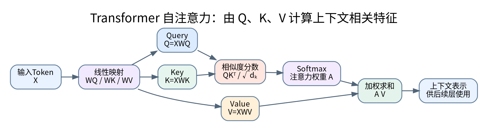

### 5.4 多头注意力

单个Attention只在一种投影子空间中计算相关性。多头注意力用多组参数并行计算：

$$
\operatorname{head}_i=\operatorname{Attention}(QW_i^Q,KW_i^K,VW_i^V)
$$

拼接各个头并经过线性层：

$$
\operatorname{MultiHead}(Q,K,V)=\operatorname{Concat}(head_1,\ldots,head_h)W^O
$$

直观上，不同注意力头可能学习不同的关系，例如：

- 语言中的“毛巾”对应图像中的衣物区域；
- “左侧”对应空间区域；
- 当前机械臂状态对应动作限制；
- 当前任务阶段对应下一步动作。

这只是便于理解的解释，不代表每个注意力头都能被人工严格赋予一种语义。

### 5.5 Self-Attention 与 Cross-Attention

**Self-Attention：** Q、K、V来自同一组Token，主要用于建模同一模态内部关系。

**Cross-Attention：** Q来自一个模态，K和V来自另一个模态。例如语言Token作为Query，视觉Token作为Key和Value，让语言主动检索图像信息。

Cross-Attention可表示为：

$$
\operatorname{CrossAttn}(Q_L,K_I,V_I)=\operatorname{Softmax}\left(\frac{Q_LK_I^T}{\sqrt{d_k}}\right)V_I
$$

其中下标 $L$ 表示语言，$I$ 表示图像。

### 5.6 Transformer Encoder 常见结构

一个典型Transformer层包括：

1. Multi-Head Self-Attention；
2. 残差连接和LayerNorm；
3. Feed Forward Network；
4. 再次残差连接和LayerNorm。

简化表达：

$$
H'=\operatorname{LayerNorm}(H+\operatorname{MHA}(H))
$$

$$
H_{out}=\operatorname{LayerNorm}(H'+\operatorname{FFN}(H'))
$$

### 5.7 因果掩码与自回归生成

语言模型常使用因果Mask，使第 $t$ 个Token只能看见当前位置之前的Token：

$$
M_{ij}=\begin{cases}
0,&j\le i\\
-\infty,&j>i
\end{cases}
$$

动作Token若采用自回归生成，也可以逐个预测：

$$
p(a_{1:T}\mid o,l)=\prod_{t=1}^{T}p(a_t\mid a_{<t},o,l)
$$

优点是结构清晰，缺点是长序列推理可能较慢，而且前面Token预测错误会影响后续Token。

### 5.8 位置编码为什么重要

Transformer本身不天然知道Token顺序，因此需要位置信息。常见方法包括绝对位置编码、相对位置编码和旋转位置编码等。

机器人动作序列尤其需要时间顺序：先抓取，再抬升，再拉展，不能随意交换。

---

## 6. 多模态对齐：为什么图像和语言能互相理解

### 6.1 什么是跨模态对齐

视觉特征和语言特征来自不同数据结构：图像是像素，语言是Token序列。模型要学习它们之间的语义关系。

例如：

- 图像里有一块蓝色毛巾；
- 文本说“抓取蓝色毛巾左上角”；
- 模型需要把“蓝色毛巾”与图像区域对应起来，再理解“左上角”的空间关系。

### 6.2 对比学习的基本思想

一种典型多模态对齐方法是对比学习。假设图像编码器和文本编码器输出向量：

$$
v_i=f_I(I_i),\qquad t_i=f_L(L_i)
$$

归一化之后，利用余弦相似度：

$$
sim(v_i,t_j)=\frac{v_i^Tt_j}{\|v_i\|\|t_j\|}
$$

让匹配的图文对相似度更高，不匹配的图文对相似度更低。

一种InfoNCE形式的损失为：

$$
\mathcal{L}_{I\rightarrow T}=-\frac{1}{N}\sum_{i=1}^{N}\log\frac{\exp(sim(v_i,t_i)/\tau)}{\sum_{j=1}^{N}\exp(sim(v_i,t_j)/\tau)}
$$

其中 $\tau$ 是温度参数。

### 6.3 语义对齐不等于动作正确

这是理解VLA时必须牢记的一点。

模型可能正确识别“毛巾”和“左上角”，但预测出的抓取点仍可能：

- 不在真实布料上；
- 位于机器人不可达区域；
- 造成左右机械臂路径交叉；
- 无法形成稳定夹持；
- 导致折叠方向错误。

因此，语义对齐只是VLA成功的一部分。还需要动作学习、机器人适配和安全执行。

---

# 第三部分：动作表示与策略学习

## 7. 机器人动作如何表示

这是本课题最容易出现“看懂模型、却不能部署”的地方。动作空间不统一，模型就不能直接跨机器人使用。

### 7.1 关节空间动作

对于一条有 $n$ 个关节的机械臂，关节位置向量为：

$$
q=[q_1,q_2,\ldots,q_n]^T
$$

关节动作可以表示为：

- 目标关节角；
- 关节角增量；
- 关节速度；
- 关节力矩。

例如关节位置增量：

$$
a_t^{joint}=q_{t+1}^{target}-q_t
$$

优点：直接对应机器人关节控制接口。  
缺点：模型需要理解关节结构和具体机器人构型，跨机器人迁移困难。

### 7.2 末端执行器动作

也可以直接让策略预测末端执行器（End-Effector, EEF）的目标位置和姿态。

末端位姿通常写为：

$$
T_{EE}=\begin{bmatrix}R&p\\0&1\end{bmatrix}
$$

其中 $R$ 为旋转矩阵，$p=[x,y,z]^T$ 为平移向量。

末端动作可以是绝对目标：

$$
a_t=[p_{t+1}^{target},R_{t+1}^{target},g_{t+1}]
$$

也可以是相对增量：

$$
\Delta p_t=p_{t+1}-p_t
$$

姿态增量要注意旋转空间的数学性质，不能简单把所有旋转都当作普通欧氏向量处理。工程上常见欧拉角增量、轴角、四元数或旋转矩阵相关表示，必须与数据集和控制接口保持一致。

### 7.3 常见的单臂7维动作

在一些机器人策略和数据集中，单臂末端动作可以采用7维形式：

$$
a_t=[\Delta x,\Delta y,\Delta z,\Delta\phi,\Delta\theta,\Delta\psi,g]
$$

上式的第二个 $\Delta y$ 代表偏航角（为了避免符号混淆，工程代码中通常直接命名为 yaw），最后一维 $g$ 表示夹爪状态或开合指令。

更清晰的记法是：

$$
a_t=[\Delta x,\Delta y,\Delta z,\Delta\phi,\Delta\theta,\Delta\psi,g]
$$

这里的7维只是常见示例，不是所有VLA都统一使用这种定义。尤其要检查：

- 前三维是绝对位置还是相对增量；
- 位置单位是米还是其他单位；
- 姿态是欧拉角、轴角还是其他表示；
- 姿态相对哪个坐标系；
- 夹爪值是二值、连续宽度还是归一化数值。

### 7.4 双臂动作空间

如果左右两只机械臂分别采用7维末端动作，那么联合动作可以写成：

$$
a_t^{dual}=[a_t^L,a_t^R]\in\mathbb{R}^{14}
$$

其中：

$$
a_t^L=[\Delta p_t^L,\Delta\omega_t^L,g_t^L]
$$

$$
a_t^R=[\Delta p_t^R,\Delta\omega_t^R,g_t^R]
$$

这只是便于理解的示意。真实Franka系统如果使用7个关节角加夹爪宽度，则每条臂的状态和动作维度可能与末端动作不同。**不要看到“Franka是7自由度”就认为VLA动作一定是7维；自由度、末端动作维度、夹爪状态维度是不同概念。**

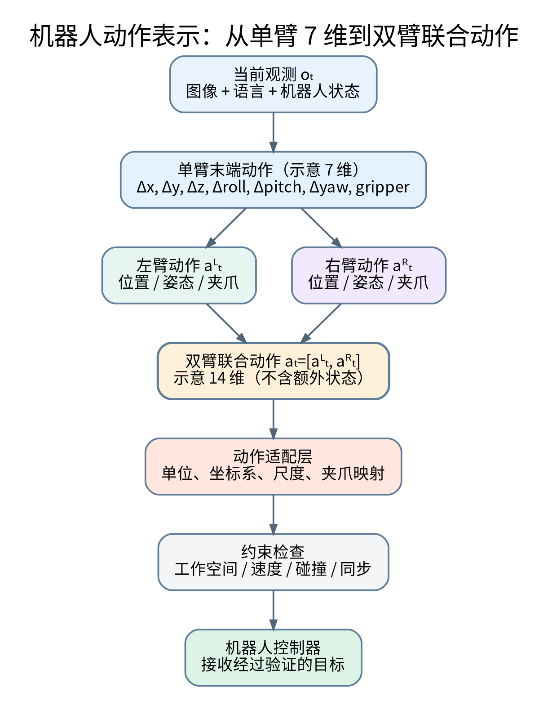

### 7.5 绝对动作与相对动作

绝对动作告诉机器人“去哪里”：

$$
a_t^{abs}=x_{target}
$$

相对动作告诉机器人“相对当前位置移动多少”：

$$
a_t^{rel}=x_{target}-x_t
$$

相对动作更容易表达连续微调，但会依赖当前状态；绝对动作语义直接，但坐标系和标定误差可能造成偏差。

### 7.6 动作归一化

不同维度的动作尺度差异很大，例如位置是米、旋转是弧度、夹爪可能是0到1。直接混合训练容易让数值尺度大的维度主导损失。

常见标准化：

$$
\tilde a_i=\frac{a_i-\mu_i}{\sigma_i+\epsilon}
$$

其中 $\mu_i$ 和 $\sigma_i$ 是训练数据该维度的均值与标准差。

推理后必须反归一化：

$$
a_i=\tilde a_i(\sigma_i+\epsilon)+\mu_i
$$

如果训练和部署的归一化统计不一致，机器人可能出现动作幅度错误、移动过大或几乎不动的情况。

### 7.7 双臂联合动作的额外难点

双臂动作不仅是把两个单臂向量拼起来，还需要考虑：

- 左右臂动作的时间同步；
- 左右夹爪是否在同一任务阶段；
- 两只手之间的相对位姿；
- 双臂是否会互相碰撞；
- 两臂抓取点是否能共同产生合适的衣物张力；
- 单臂失误时另一只手如何处理。

可引入左右末端之间的相对位姿：

$$
T_{LR}=(T_{WL})^{-1}T_{WR}
$$

其中 $T_{WL}$ 和 $T_{WR}$ 分别是左右末端相对于世界坐标系的位姿。

对衣物操作而言，保持某种相对关系可能比单独预测左右末端绝对位置更重要。

---

## 8. 行为克隆（Behavior Cloning, BC）

### 8.1 行为克隆的思想

行为克隆是一种监督学习式模仿学习方法：给模型大量观测和专家动作，让模型学会在类似观测下输出类似动作。

数据集写作：

$$
D=\{(o_i,l_i,q_i,a_i)\}_{i=1}^{N}
$$

训练目标是让策略预测动作接近专家动作：

$$
\pi_\theta(o_i,l_i,q_i)\approx a_i
$$

### 8.2 从监督学习目标推导行为克隆损失

假设模型输出连续动作：

$$
\hat a_i=\pi_\theta(o_i,l_i,q_i)
$$

最常用的平方误差损失：

$$
\mathcal{L}_{MSE}(\theta)=\frac{1}{N}\sum_{i=1}^{N}\|\hat a_i-a_i\|_2^2
$$

也可以使用L1损失：

$$
\mathcal{L}_{L1}(\theta)=\frac{1}{N}\sum_{i=1}^{N}\|\hat a_i-a_i\|_1
$$

MSE对较大误差惩罚更强，L1对异常值相对不那么敏感。

如果模型输出概率分布，则最大似然目标为：

$$
\mathcal{L}_{NLL}(\theta)=-\frac{1}{N}\sum_{i=1}^{N}\log \pi_\theta(a_i\mid o_i,l_i,q_i)
$$

### 8.3 为什么BC有效

- 不需要手工设计复杂奖励函数；
- 可以直接利用人类遥操作或专家轨迹；
- 训练过程稳定，容易构建基线；
- 对固定场景、固定任务较有效。

### 8.4 BC 的分布偏移问题（Covariate Shift）

BC在专家示范分布上训练，但部署时模型自己的小错误会把机器人带到专家示范很少覆盖的状态。

举例：

1. 示范数据中的夹爪总是正对毛巾边缘；
2. 模型执行时偏了2厘米；
3. 下一帧图像与示范数据不同；
4. 模型仍然按熟悉的示范动作预测；
5. 误差进一步扩大。

这是机器人模仿学习中的误差累积问题。

在某些理论条件下，逐步策略误差可能导致随时间长度增长的较大累计偏差。具体上界依赖任务假设，不能把某个统一公式当作所有机器人任务的精确结论。

### 8.5 如何缓解分布偏移

- 数据覆盖更多初始位置和失败状态；
- 执行中持续重新观察；
- 采集模型容易失败的状态并补充示范；
- 使用DAgger等交互式数据收集思想；
- 采用动作块与滚动时域控制；
- 设置失败检测和恢复策略。

**本课题建议：** 不只采集“完美成功”的衣物折叠轨迹。也要记录部分褶皱、偏移、滑脱前后的状态，以及恢复过程。前提是这些数据由安全、可重复的实验流程获得。

---

## 9. 动作分块（Action Chunking）与 ACT

### 9.1 为什么单步动作预测可能不够

如果机器人每次只预测一个动作：

$$
\hat a_t=\pi_\theta(o_t)
$$

那么每执行一步都要重新推理。问题包括：

- 模型推理开销大；
- 相邻时刻预测可能抖动；
- 单步动作难以表达一段连贯的操作意图；
- 相机和机器人状态存在通信与时延。

动作分块让模型一次预测未来多个动作：

$$
\hat A_t=[\hat a_t,\hat a_{t+1},\ldots,\hat a_{t+H-1}]
$$

其中 $H$ 是动作块长度。

### 9.2 ACT 的基本思想

ACT（Action Chunking with Transformers）使用Transformer预测未来一段动作序列。其核心优点是：动作具有时间连续性，并且可以通过一个动作块学习多个时间步之间的关联。

训练目标可以简化写为：

$$
\mathcal{L}_{chunk}=\frac{1}{NH}\sum_{i=1}^{N}\sum_{k=0}^{H-1}\|\hat a_{i+k}-a_{i+k}\|_1
$$

具体ACT实现还会涉及潜变量建模和KL正则项等设计；上式只表示动作块监督的基本思想，不等同于完整论文目标函数。

### 9.3 动作块长度的影响

- $H$ 太小：动作连贯性和推理效率提升有限；
- $H$ 太大：预测误差可能在长时间内累积，且对突然变化的环境响应变慢；
- 中等 $H$：在连续执行和反馈灵活性之间折中。

动作块长度必须结合控制频率、任务速度和模型推理时间实验确定。

### 9.4 重叠动作块与时间集成

若模型每隔一段时间重新预测动作块，不同预测块可能对同一未来时刻给出不同动作。可以对重叠预测进行加权平均或时间集成：

$$
\hat a_t=\frac{\sum_j w_j\hat a_t^{(j)}}{\sum_j w_j}
$$

其中 $\hat a_t^{(j)}$ 是第 $j$ 次推理对时刻 $t$ 的预测，$w_j$ 是融合权重。

### 9.5 ACT 对你的课题有什么价值

衣物折叠由一系列连续动作组成：接近、抓取、抬升、拉展、移动、释放。动作分块可以帮助模型形成更连贯的动作片段。

但动作块并不意味着模型可以在整段执行过程中不看环境。建议仍采用滚动时域控制：执行一部分动作后重新获取观测，再决定下一段动作。

---

## 10. Diffusion Policy 与 Flow Matching

这两类生成式策略很重要，因为机器人动作往往不是唯一答案。例如毛巾可以从多个角点抓取，左右手也可能有不同的协同轨迹。

### 10.1 为什么动作分布可能是多峰的

给定同一张图片和任务指令，可能存在多种可行动作：

- 从左上角和右上角抓取；
- 从靠近边缘的位置抓取；
- 先拉平再对折，或先调整角点再拉平。

如果简单用MSE回归，多个不同动作的均值可能不是一个有效动作。生成式策略希望表达更复杂的动作条件分布。

### 10.2 Diffusion Policy 的基本思想

扩散策略把动作序列看成一个需要逐步去噪的样本。

设真实动作块为 $A_0$，逐渐向其中加入高斯噪声：

$$
q(A_k\mid A_0)=\mathcal{N}(\sqrt{\bar\alpha_k}A_0,(1-\bar\alpha_k)I)
$$

等价重参数化：

$$
A_k=\sqrt{\bar\alpha_k}A_0+\sqrt{1-\bar\alpha_k}\,\epsilon,\qquad \epsilon\sim\mathcal{N}(0,I)
$$

其中 $k$ 是扩散时间步，$\bar\alpha_k$ 由噪声调度表决定。

模型接收带噪动作、时间步和观测条件，预测噪声：

$$
\hat\epsilon=\epsilon_\theta(A_k,k,o,l,q)
$$

常见训练目标：

$$
\mathcal{L}_{diff}=\mathbb{E}_{A_0,\epsilon,k}\left[\|\epsilon-\epsilon_\theta(A_k,k,o,l,q)\|_2^2\right]
$$

推理时从随机噪声开始，反复执行去噪更新，最终得到动作块。

### 10.3 为什么扩散策略适合机器人动作

- 能表达多个可行动作模式；
- 可以生成连续的高维动作序列；
- 对复杂、连续、存在多解的操作任务有吸引力；
- 可以结合视觉条件和机器人状态。

缺点是推理可能需要多步去噪，实时性要通过模型大小、采样步数和部署优化来评估。

### 10.4 Flow Matching 的基本思想

Flow Matching 学习一个时间相关的向量场，把简单的初始分布连续变换成目标动作分布。

为了直观理解，设真实动作样本为 $A_0$，噪声样本为 $\epsilon$。构造一条线性插值路径：

$$
A_t=(1-t)A_0+t\epsilon,\qquad t\in[0,1]
$$

这条路径的速度为：

$$
\frac{dA_t}{dt}=\epsilon-A_0
$$

模型学习条件向量场：

$$
v_\theta(A_t,t,o,l,q)
$$

可以使用如下回归目标：

$$
\mathcal{L}_{FM}=\mathbb{E}\left[\|v_\theta(A_t,t,o,l,q)-(\epsilon-A_0)\|_2^2\right]
$$

在这个定义下，$t=1$ 是噪声端，$t=0$ 是数据端。生成时从噪声端沿着反向时间方向积分到数据端。实际论文实现可能采用不同路径、时间定义和条件注入方式，阅读具体方法时必须以原文为准。

### 10.5 Diffusion 与 Flow Matching 的区别

| 对比维度 | Diffusion Policy | Flow Matching |
|---|---|---|
| 核心思想 | 学习逐步去噪过程 | 学习连续概率流的速度场 |
| 训练目标 | 常见为噪声预测损失 | 常见为向量场回归损失 |
| 生成方式 | 迭代去噪采样 | 数值积分求解ODE或近似过程 |
| 主要关注 | 多模态动作生成 | 连续流变换与较高效生成潜力 |
| 机器人案例 | Diffusion Policy | π0 类VLA路线采用Flow Matching思想 |

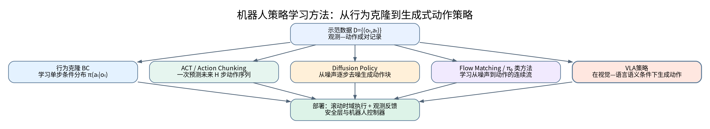

### 10.6 本课题怎么选

- 若需要快速做出传统学习基线：先做BC或ACT。
- 若动作多模态很明显：可以研究Diffusion Policy。
- 若采用π0路线：重点研究Flow Matching和动作Chunk生成。
- 若采用OpenVLA-OFT：重点研究连续动作表示、并行解码和动作分块。

不要一开始同时实现全部生成式方法。先以导师指定模型和硬件适配难度为主。

---

# 第四部分：代表性 VLA 与机器人基础模型

## 11. 重要模型与论文路线

### 11.1 RT-2：VLA 的代表性早期工作

RT-2 的核心思想是将预训练视觉语言模型与机器人数据结合，让模型不仅理解网络图文语义，还能输出机器人动作。

它的重要启发：

1. 视觉语言预训练中包含丰富的语义知识；
2. 机器人动作可以被设计成模型能够预测的Token；
3. 将互联网视觉语言数据与机器人操作数据结合，有助于提高语义泛化。

需要理解：RT-2是理解VLA思想的重要论文，但并不意味着它是你可以直接下载并驱动Franka双臂的现成控制器。

### 11.2 OpenVLA：开源VLA的重要基线

OpenVLA 是开源视觉语言动作模型。其论文报告模型规模为约7B参数，并在约97万条真实机器人示范上训练。它结合了Llama 2语言模型以及DINOv2和SigLIP视觉特征。论文还研究了LoRA微调和量化部署。具体配置和代码版本应以官方仓库为准。

OpenVLA值得学习的原因：

- 有公开论文、代码、权重和微调示例；
- 能帮助你理解视觉语言模型如何转成机器人策略；
- 可以作为研究VLA微调流程的基线；
- 适合学习数据集组织、动作Token和部署流程。

但必须注意：OpenVLA训练数据里的机器人平台、动作空间和你的Franka双臂平台不一定相同。模型权重能够加载，不代表动作输出可以直接给Franka执行。

### 11.3 OpenVLA-OFT：优化微调与双臂演示

OpenVLA-OFT研究如何更有效地微调VLA。其关键设计包括：

- 并行动作解码；
- Action Chunking；
- 连续动作表示；
- L1回归目标；
- 使用FiLM等设计改善语言条件注入（具体变体需看论文）。

它对你的价值很大，因为其项目展示了将优化后的VLA方案应用于ALOHA双臂机器人的实验。

需要明确：ALOHA的硬件、动作定义、标定和Franka并不相同。可以借鉴算法与数据流程，但不能直接假设模型能跨硬件无缝运行。

### 11.4 RDT-1B：面向双臂操作的扩散基础模型

RDT-1B 是基于Diffusion Transformer的机器人操作基础模型，重点面向不同机器人动作空间和双臂操作。官方项目页介绍了多机器人数据预训练、统一动作空间和双臂数据微调。

值得重点理解：

- 为什么双臂操作动作分布更复杂；
- 不同机器人动作空间如何映射到统一表示；
- 为什么需要动作块；
- 噪声动作块如何被逐步去噪；
- 机器人自身状态如何作为条件输入。

RDT-1B对你的双臂课题具有较强参考价值，但部署前仍需检查模型支持的机器人配置、数据格式、动作归一化和控制接口。

### 11.5 π0 与 π0.5：Flow Matching 和开放世界泛化

π0 将预训练视觉语言模型与Flow Matching结合，用于生成机器人动作。论文展示了多种机器人平台和任务，并包含衣物折叠相关任务。

π0.5进一步研究通过异构任务、混合多模态示例和语义子任务等方式增强真实环境中的泛化能力。

学习重点：

- Flow Matching怎样生成动作；
- 预训练VLM提供什么能力；
- 多机器人数据如何混合；
- 高层语义任务与低层动作如何衔接；
- 长时序操作为什么需要子任务分解与反馈。

### 11.6 模型对照表

| 模型/方法 | 核心特点 | 对双臂衣物折叠的参考价值 | 主要注意事项 |
|---|---|---|---|
| RT-2 | VLM与机器人动作Token结合 | 理解VLA思想 | 不作为默认部署首选 |
| OpenVLA | 开源VLA、预训练与微调 | VLA基础模型候选 | 必须适配动作空间 |
| OpenVLA-OFT | 并行解码、动作块、连续动作 | 双臂应用参考 | 依赖相应数据格式与实现 |
| RDT-1B | Diffusion Transformer、双臂、统一动作空间 | 双臂候选模型 | 需核验Franka兼容性和算力 |
| π0 | VLM + Flow Matching | 衣物操作与通用操作参考 | 部署、权重和动作适配需核验 |
| π0.5 | 更广泛的开放世界泛化和任务条件 | 长时序任务参考 | 数据和系统复杂度较高 |
| ACT | 动作块模仿学习 | 双臂基线与数据学习 | 语言泛化能力有限，需额外条件设计 |
| Diffusion Policy | 条件扩散动作生成 | 连续动作、多模态基线 | 推理速度与采样步数需评估 |

### 11.7 你的课题应该怎么选模型

建议采用“一个主模型 + 一个传统学习基线 + 一个安全规则基线”：

- **主模型：** 优先按导师任务书要求确定。如果要求OpenVLA，就围绕OpenVLA/OFT进行适配；若导师允许比较双臂模型，可以把RDT-1B列为候选。
- **学习基线：** ACT或Diffusion Policy二选一，避免重复投入。
- **规则基线：** 基于视觉关键点和几何轨迹完成固定毛巾折叠。

最终选型不能只看论文成功率，还要看：

1. 是否能获得可运行代码和权重；
2. GPU显存是否满足推理和微调；
3. 是否支持你能采集的数据格式；
4. 是否支持双臂动作或可以修改动作头；
5. 动作能否映射到Franka控制接口；
6. 推理延迟能否满足闭环控制需求；
7. 导师是否认可该模型作为课题主线。

---

# 第五部分：模型训练、微调与数据

## 12. VLA 训练目标与损失函数

### 12.1 离散动作Token的交叉熵损失

如果动作被量化为Token序列：

$$
A=(a_1,a_2,\ldots,a_T)
$$

自回归模型预测每个Token的概率：

$$
p_\theta(a_t\mid a_{<t},o,l)
$$

交叉熵损失：

$$
\mathcal{L}_{CE}=-\sum_{t=1}^{T}\log p_\theta(a_t^{*}\mid a_{<t}^{*},o,l)
$$

其中 $a_t^*$ 是专家动作Token。

**优点：** 与语言模型的Token预测目标统一。  
**缺点：** 连续控制量要经过量化，量化精度和Token数量会影响表达能力与推理开销。

### 12.2 连续动作回归损失

如果模型直接预测连续动作：

$$
\hat A=f_\theta(o,l,q)
$$

L1损失：

$$
\mathcal{L}_{L1}=\frac{1}{TH}\sum_{t=1}^{T}\sum_{h=1}^{H}|\hat a_{t,h}-a_{t,h}^{*}|
$$

L2损失：

$$
\mathcal{L}_{L2}=\frac{1}{TH}\sum_{t=1}^{T}\sum_{h=1}^{H}(\hat a_{t,h}-a_{t,h}^{*})^2
$$

如果不同动作维度物理量不同，最好在归一化空间训练，并在部署前反归一化。

### 12.3 多任务训练

若数据集含多个任务，可以为每个样本提供任务语言指令：

$$
D=\bigcup_{k=1}^{K}D_k
$$

模型优化总体损失：

$$
\mathcal{L}(\theta)=\sum_{k=1}^{K}\lambda_k\mathcal{L}_k(\theta)
$$

其中 $\lambda_k$ 用来平衡不同任务的损失权重。

对于衣物折叠，可以把任务划分为：

- 展开毛巾；
- 抓取指定边角；
- 双臂拉展；
- 沿中线对折；
- 检查折叠结果；
- 发生滑脱后重新抓取。

### 12.4 多模态辅助损失

除了动作损失，也可以在研究中加入辅助目标：

- 关键点位置损失；
- 衣物分割损失；
- 子任务分类损失；
- 状态估计损失。

例如关键点回归损失：

$$
\mathcal{L}_{kp}=\frac{1}{N}\sum_{i=1}^{N}\|\hat p_i-p_i^*\|_2^2
$$

组合损失：

$$
\mathcal{L}=\lambda_a\mathcal{L}_{action}+\lambda_k\mathcal{L}_{kp}+\lambda_s\mathcal{L}_{stage}
$$

具体是否加入辅助目标，取决于所使用模型的训练架构和毕业设计工作量。

---

## 13. LoRA 与参数高效微调

### 13.1 为什么需要微调

预训练模型虽然有较强的通用语义能力，但可能不了解：

- 你的Franka机械臂坐标系；
- 你的夹爪开合定义；
- 你的相机视角；
- 你的衣物材质和桌面环境；
- 你希望完成的具体折叠流程。

微调就是利用目标机器人数据，让预训练模型适应新任务、新动作空间和新环境。

### 13.2 全量微调的问题

如果模型参数量很大，全量更新所有参数会带来较高显存和计算成本，也可能破坏预训练中已有的通用表示。

### 13.3 LoRA 的数学原理

假设线性层权重矩阵为：

$$
W_0\in\mathbb{R}^{d_{out}\times d_{in}}
$$

普通全量微调会直接更新 $W_0$。LoRA冻结原权重，只学习低秩增量：

$$
W'=W_0+\Delta W
$$

$$
\Delta W=BA
$$

其中：

$$
A\in\mathbb{R}^{r\times d_{in}},\qquad B\in\mathbb{R}^{d_{out}\times r}
$$

$r$ 是低秩维度，通常远小于输入和输出维度。

带缩放因子的形式：

$$
W'=W_0+\frac{\alpha}{r}BA
$$

训练时冻结 $W_0$，只训练 $A$ 和 $B$。

### 13.4 LoRA 为什么能节省资源

原始矩阵参数量：

$$
N_{full}=d_{out}d_{in}
$$

LoRA新增参数量：

$$
N_{LoRA}=r(d_{in}+d_{out})
$$

例如当输入输出维度都很大，而秩 $r$ 较小时，新增可训练参数显著减少。

### 13.5 LoRA 适合你的场景吗

如果基模型结构允许LoRA，并且动作头、视觉编码器和语言主干可以合理冻结或部分训练，那么LoRA适合做毕设第一轮适配。

建议至少比较：

- 冻结主干，只训练动作头；
- 对部分Transformer层使用LoRA；
- 训练动作头 + LoRA；
- 数据量允许时再考虑部分全量微调。

不要只看训练Loss下降，还要检查真实机器人任务成功率、动作平滑性和未见初始状态的表现。

---

## 14. 机器人示范数据：采什么、怎么存、如何检查

### 14.1 一个训练样本应该包含什么

一条时间同步样本建议至少包含：

| 字段 | 说明 | 示例 |
|---|---|---|
| timestamp | 时间戳 | ROS时间或统一时钟 |
| observation.images | RGB图像 | 顶视相机、侧视相机 |
| observation.depth | 深度图 | 与RGB对齐的深度 |
| observation.state | 机器人状态 | 左右臂关节、末端位姿 |
| action | 专家动作 | 左右臂目标或动作增量 |
| language | 语言任务 | “将毛巾沿中线对折” |
| task_stage | 任务阶段 | 抓取、拉展、折叠 |
| success | 任务结果 | 成功/失败 |
| failure_reason | 失败原因 | 滑脱、抓偏、碰撞等 |

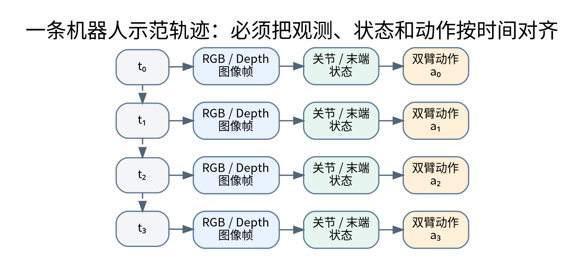

### 14.2 为什么时间同步如此重要

假设图像时间戳是 $t_I$，机器人状态时间戳是 $t_Q$，动作时间戳是 $t_A$。理想情况是：

$$
t_I\approx t_Q\approx t_A
$$

如果图像和动作时间错位，模型可能学到错误映射。例如图像显示毛巾尚未被抓取，标签却记录了已经拉展的动作。

同步误差：

$$
\Delta t=\max(t_I,t_Q,t_A)-\min(t_I,t_Q,t_A)
$$

需要设定合理阈值并在预处理时检查。具体阈值取决于相机帧率、机器人控制频率和任务速度。

### 14.3 Episode 与时间步

一次从初始化到完成或失败的操作称为Episode。

$$
\tau=(o_0,a_0,o_1,a_1,\ldots,o_T)
$$

数据集由多个Episode构成：

$$
D=\{\tau_1,\tau_2,\ldots,\tau_N\}
$$

每个Episode应具有清晰的开始和结束条件，避免把多个无关操作拼接在一起。

### 14.4 数据采集应该覆盖什么变化

对毛巾折叠至少考虑：

- 初始平移位置：中央、偏左、偏右；
- 初始旋转角度：不同方向摆放；
- 初始形态：平整、轻微褶皱、局部卷曲；
- 材质：厚薄、柔软程度和摩擦特性；
- 光照：适当亮度变化；
- 遮挡：手臂遮挡、衣物局部重叠；
- 执行状态：成功、抓偏、滑脱、恢复。

### 14.5 数据量应该怎么确定

不要迷信一个固定的示范条数。数据量需求取决于：

- 任务复杂度；
- 模型规模；
- 预训练数据与当前机器人之间的差异；
- 动作空间维度；
- 数据多样性；
- 示范质量；
- 环境变化程度。

建议先采少量高质量数据做端到端流程验证，再逐步增加数据。实验记录至少保存每轮数据量、成功轨迹比例、动作统计、训练配置和验证结果。

### 14.6 数据质量检查清单

- [ ] 图像、深度、状态与动作的时间戳对应。
- [ ] 丢帧和空图像已被检测。
- [ ] 关节角、末端位姿和夹爪数值在合理范围。
- [ ] 所有角度单位明确（弧度或角度）。
- [ ] 位置单位明确（米或毫米）。
- [ ] 动作参考坐标系已记录。
- [ ] 动作绝对量或相对量定义明确。
- [ ] 夹爪开合方向、数值范围明确。
- [ ] 失败轨迹有标签，而不是错误地当作成功示范。
- [ ] 训练集和验证集按Episode划分，避免相邻帧泄漏。

### 14.7 LeRobot / RLDS 等数据格式

机器人学习领域存在多种数据格式。OpenVLA项目支持RLDS格式的数据工作流；Hugging Face LeRobot提供机器人数据集格式、录制和训练工具，并支持ACT、π0等策略。

你的项目不一定要直接使用某个格式，但要保证：

- 元数据中能描述机器人类型和动作语义；
- 每个Episode的时间顺序明确；
- 视频和状态、动作能对齐；
- 训练代码可以无歧义地读取；
- 将来能够复现训练和评估。

---

# 第六部分：双臂协同、机器人坐标与衣物操作

## 15. 双臂协同操作基础

### 15.1 双臂为什么不是两个单臂简单相加

双臂协同需要处理两条机械臂之间的关系。即使两臂各自轨迹都可行，也可能出现：

- 两臂相互碰撞；
- 两夹爪抓到衣物不合适的位置；
- 两臂运动速度不一致；
- 一只手先拉，另一只手还未抓稳；
- 两臂拉力方向相反或张力过大。

所以双臂策略应关注联合状态和联合动作。

### 15.2 左右臂的联合状态

假设每条Franka机械臂有7个关节，联合关节状态可以写作：

$$
q^{dual}=[q_1^L,\ldots,q_7^L,q_1^R,\ldots,q_7^R]^T
$$

如果把夹爪宽度也作为状态，则额外加入左右夹爪状态。

### 15.3 双臂联合雅可比矩阵

单臂速度关系：

$$
\dot x_L=J_L(q_L)\dot q_L
$$

$$
\dot x_R=J_R(q_R)\dot q_R
$$

联合形式：

$$
\begin{bmatrix}\dot x_L\\\dot x_R\end{bmatrix}=
\begin{bmatrix}J_L(q_L)&0\\0&J_R(q_R)\end{bmatrix}
\begin{bmatrix}\dot q_L\\\dot q_R\end{bmatrix}
$$

这个块对角形式描述两臂各自的末端速度映射。若加入双臂协同约束、共享物体约束或碰撞约束，还需要进一步建立约束方程。

### 15.4 双臂相对位姿约束

左右末端之间的相对位姿：

$$
T_{LR}=T_{WL}^{-1}T_{WR}
$$

假设任务希望左右夹爪之间维持某个目标相对位姿：

$$
T_{LR}\approx T_{LR}^{*}
$$

可以构造相对位姿误差：

$$
e_{rel}=\operatorname{Log}\left((T_{LR}^{*})^{-1}T_{LR}\right)
$$

这里的Log表示从SE(3)变换映射到李代数误差向量的运算。工程实现中可以使用适当的位姿误差定义和控制器，不需要一开始就手写完整李群控制器。

### 15.5 双臂同步

两个机械臂的动作时间应协调。简单的时间同步方式是：

- 左右臂接收同一时间基准下的目标；
- 轨迹规划时统一开始时间和结束时间；
- 重要抓取事件使用状态机确认；
- 一臂未抓稳时，另一臂不要提前施加大幅拉力。

对于衣物抓取，可以使用状态机：

$$
\text{Approach}\rightarrow\text{Contact}\rightarrow\text{Grip}\rightarrow\text{Verify}\rightarrow\text{Lift}
$$

每一步都需要可观测的进入条件和失败处理。

---

## 16. 柔性物体与衣物操作

### 16.1 刚性物体与柔性物体的区别

近期综述进一步强调，衣物操作的难点不仅在模型结构，还包括衣物材质和尺寸差异、初始形态变化、真实数据采集、评价指标不统一以及仿真到真实的差异。2026年的一项系统综述梳理了2019—2024年间41篇相关研究，并指出目前该方向仍缺少被广泛采用的统一真实数据集。因此，你的实验要把数据采集方案、失败定义和评价标准一起设计，而不能只关注模型训练。另一个2026年可变形物体操作综述覆盖了150余项研究，适合在论文综述部分进一步阅读。

刚性物体的形状在操作过程中基本不变，机器人抓住它后可以近似用刚体位姿描述。

柔性物体会因为重力、摩擦、拉伸、折叠和接触而变化。衣物尤其复杂：

- 形态维度非常高；
- 局部遮挡常见；
- 布料表面缺少稳定纹理；
- 抓取一个点会改变大范围形状；
- 自接触和多层重叠很常见；
- 视觉上看起来相近的状态，实际夹持关系可能不同。

### 16.2 衣物状态如何表示

可以从简单到复杂采用多层表示：

**（1）二维轮廓和关键点**  
适合先做规则基线。用分割掩码、角点、边缘点描述毛巾形状。

**（2）三维点云**  
结合RGB-D相机恢复衣物表面三维位置。

**（3）关键点图结构**  
把衣物角点、边缘点作为节点，把相邻关系作为边，描述衣物局部几何关系。

**（4）隐式状态表示**  
由神经网络从图像和历史观测中提取潜在形态特征。

不建议本科毕设一开始就做复杂布料物理仿真或完整3D形变重建。先选择能支持抓取和折叠决策的低维状态表示。

### 16.3 衣物折叠任务分解

建议把任务拆成：

1. 初始视觉观察；
2. 衣物区域分割；
3. 角点和边缘识别；
4. 抓取点选择；
5. 双臂接近；
6. 夹爪抓取确认；
7. 双臂展开或拉平；
8. 估计折叠轴和目标位置；
9. 执行对折；
10. 释放并检查结果；
11. 失败时恢复或重新规划。

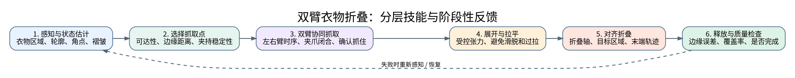

### 16.4 抓取点选择

抓取点不是简单选择图像最左边或最右边。应综合考虑：

- 是否位于衣物真实区域；
- 离边缘距离是否适合夹持；
- 是否容易被手臂遮挡；
- 机械臂是否可达；
- 左右抓取点能否形成合理张力；
- 抓取后是否便于下一步折叠。

可以定义一个候选抓取点评分函数：

$$
S(p)=w_1S_{edge}(p)+w_2S_{reach}(p)+w_3S_{visibility}(p)+w_4S_{stability}(p)
$$

其中各项分别衡量边缘位置、可达性、可见性和抓取稳定性。权重和评分方式需要通过数据或实验确定，不能把这个示意函数当成已经验证的最优抓取算法。

### 16.5 双臂拉展与张力

对毛巾这类柔性物体，左右夹爪的运动会改变衣物形态。如果拉力太小，衣物不能展开；拉力太大，可能导致滑脱、材料变形过度或夹持失败。

若能够获得力/力矩传感信息，可研究基于力反馈的张力调节。若没有外部力传感器，至少应该通过视觉和机器人状态间接检查：

- 两抓取点之间距离；
- 衣物边缘变化；
- 是否出现夹爪滑动；
- 衣物是否突然下垂或被拉偏。

### 16.6 折叠目标与几何评价

对近似矩形毛巾，可以先估计目标折叠轴。若折叠轴为直线 $l$，点 $p$ 关于该直线的镜像点可以用于构造对称目标。实际操作时要将图像几何转换到机器人世界坐标系。

设目标边缘关键点集合为 $P^*$，实际折叠后的对应关键点为 $P$，可用平均对齐误差：

$$
E_{align}=\frac{1}{N}\sum_{i=1}^{N}\|p_i-p_i^*\|_2
$$

如果只关心折叠区域覆盖程度，可以计算预测区域和目标区域的IoU：

$$
IoU=\frac{|M\cap M^*|}{|M\cup M^*|}
$$

关键点、区域和折叠轴的定义必须在实验前固定，避免不同实验采用不同的成功标准。

---

# 第七部分：视觉定位、控制与真实机器人部署

## 17. RGB-D 与坐标变换：从像素到机器人动作

### 17.1 相机坐标系与机器人坐标系

常用坐标系：

- 世界坐标系 $W$；
- 机器人基坐标系 $B$；
- 相机坐标系 $C$；
- 末端执行器坐标系 $E$。

相机检测出的三维点通常先处于相机坐标系，需要通过外参变换到机器人基坐标系。

### 17.2 深度反投影

针孔相机模型：

$$
\begin{bmatrix}u\\v\\1\end{bmatrix}\sim
K\begin{bmatrix}X/Z\\Y/Z\\1\end{bmatrix}
$$

内参矩阵：

$$
K=\begin{bmatrix}f_x&0&c_x\\0&f_y&c_y\\0&0&1\end{bmatrix}
$$

给定像素坐标和深度值 $Z$，可恢复相机坐标：

$$
X=\frac{(u-c_x)Z}{f_x}
$$

$$
Y=\frac{(v-c_y)Z}{f_y}
$$

### 17.3 齐次坐标变换

若相机坐标系到机器人基坐标系的变换为 $^BT_C$，则：

$$
{}^Bp={}^BT_C\,{}^Cp
$$

齐次变换矩阵：

$$
{}^BT_C=\begin{bmatrix}{}^BR_C&{}^Bp_C\\0&1\end{bmatrix}
$$

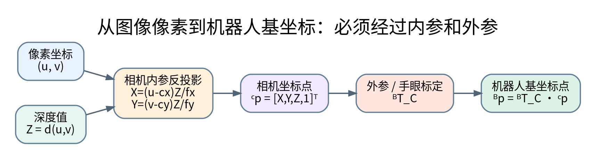

### 17.4 手眼标定

如果相机固定在工作台上，可进行相机与机器人基坐标系之间的外参标定。若相机安装在机械臂末端，则涉及手眼标定问题，常见形式为：

$$
AX=XB
$$

其中 $A,B$ 是机器人运动和相机观察之间的相对变换，$X$ 是需要估计的手眼变换矩阵。

你的课题必须先明确相机安装方式，再决定标定方案。

### 17.5 标定误差会怎样影响VLA执行

即使VLA在图像上预测的抓取点非常准确，如果外参存在偏差，映射到机械臂坐标系后仍可能抓偏。因此要区分：

- 视觉检测误差；
- 深度测量误差；
- 内参误差；
- 外参标定误差；
- 机器人末端定位误差；
- 夹爪实际接触误差。

部署前应使用已知位置的标定点测试端到端定位误差。

---

## 18. 分层控制：VLA 不等于底层控制器

### 18.1 为什么要分层

VLA模型的主要任务是理解视觉、语言和任务状态并生成动作策略。它通常不应直接承担所有毫秒级安全控制工作。

推荐分层：

1. 高层：语言理解、任务分解；
2. 中层：VLA或模仿学习策略；
3. 协同层：左右臂关系、同步和任务状态机；
4. 规划层：逆运动学、路径规划、碰撞检查；
5. 底层：机器人实时控制、速度/加速度限制、安全停止。

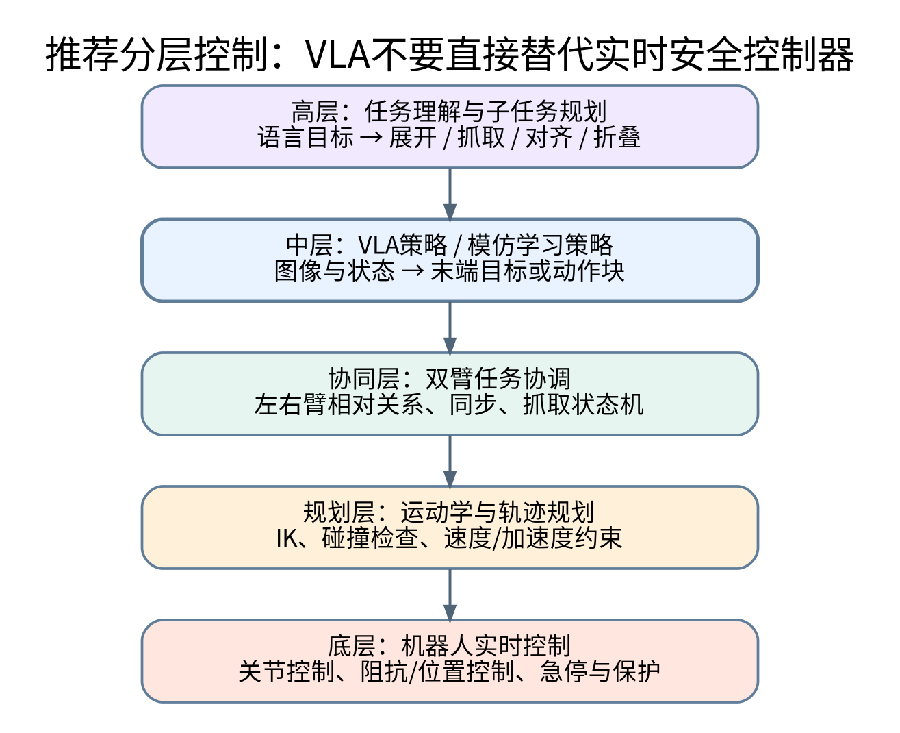

### 18.2 VLA输出怎样进入机器人控制

典型执行链：

$$
\text{VLA动作预测}\rightarrow\text{动作反归一化}\rightarrow\text{坐标变换}\rightarrow\text{目标合法性检查}\rightarrow\text{轨迹规划}\rightarrow\text{控制器执行}
$$

每一步都需要明确数据格式、单位、坐标系和时间戳。

### 18.3 逆运动学

机械臂正运动学：

$$
x=f(q)
$$

逆运动学希望根据目标末端位姿求解关节角：

$$
q^*=f^{-1}(x^*)
$$

实际逆运动学可能存在多个解，也可能没有可行解。数值方法可基于雅可比矩阵迭代：

$$
\Delta q=J^+\Delta x
$$

其中 $J^+$ 是伪逆。为改善奇异点附近的数值稳定性，可使用阻尼最小二乘形式：

$$
\Delta q=J^T(JJ^T+\lambda^2I)^{-1}\Delta x
$$

### 18.4 轨迹与控制周期

模型可能以较低频率生成动作块，而底层控制器以较高频率跟踪轨迹。二者不能简单等同。

例如：

- VLA：每隔一段时间更新动作目标；
- 任务规划：负责阶段切换和动作合法性；
- MoveIt或其他规划器：生成可行轨迹；
- Franka控制接口：按照实时控制要求执行。

具体频率由硬件和软件接口决定，必须遵循实验室平台规范，不要随意把低频模型输出直接当作实时力矩命令。

### 18.5 阻抗控制基本概念

阻抗控制希望在机器人末端表现出设定的等效质量、阻尼和刚度关系。简化形式：

$$
M_d\ddot x+D_d\dot x+K_d(x-x_d)=F_{ext}
$$

其中：

- $M_d$：期望惯性；
- $D_d$：期望阻尼；
- $K_d$：期望刚度；
- $x_d$：目标位置；
- $F_{ext}$：外部作用力。

柔性物体操作涉及接触和拉伸，因此阻抗控制有参考价值。但本科毕设不一定需要自己开发完整阻抗控制器，优先使用平台经过验证的控制接口。

### 18.6 部署架构

建议把GPU推理和机器人实时控制分层部署：GPU侧负责模型推理，机器人侧负责ROS 2通信、运动规划和底层控制。

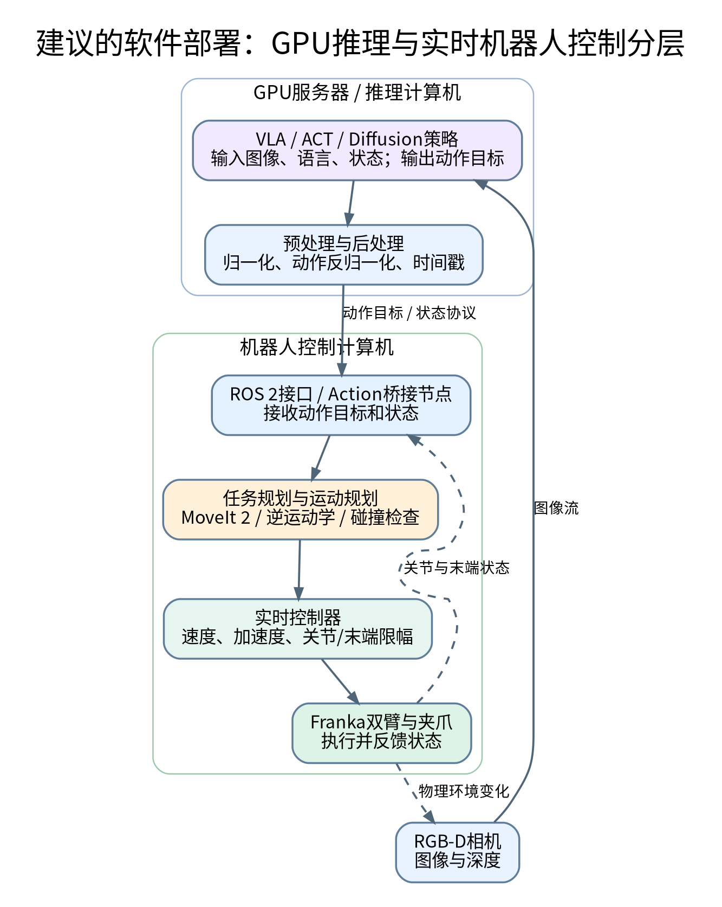

---

# 第八部分：系统集成与安全

## 19. 从离线推理到真实机器人

### 19.1 离线推理

先准备一批测试图像和语言指令，不连接机器人。验证：

- 模型能否正常加载；
- 图像预处理是否一致；
- 语言Tokenizer是否正确；
- 模型输出维度是否符合预期；
- 动作反归一化是否正确；
- 是否存在NaN、Inf或超范围数值。

### 19.2 仿真或数字环境测试

如果实验室有对应仿真环境，可以先检查：

- 目标是否可达；
- 左右臂是否碰撞；
- 动作是否过大；
- 夹爪指令是否正确；
- 时间戳和动作序列是否一致。

仿真与真实机器人仍存在差异，不能把仿真成功直接当作真实成功。

### 19.3 真实机器人分级测试

建议逐级增加风险：

1. 只读取相机和机器人状态；
2. 不使能机器人，只计算目标动作；
3. 在仿真中执行；
4. 真实机器人低速、无物体执行空路径；
5. 单臂低速执行短距离动作；
6. 双臂分别测试；
7. 双臂同步但不抓取衣物；
8. 抓取固定位置的毛巾；
9. 完成展开和对折；
10. 最后增加位置、角度和材质变化。

### 19.4 安全检查

任何模型输出都必须视为未经验证的候选动作，而不是安全指令。安全层至少检查：

- 目标位置是否在工作空间范围内；
- 关节位置、速度、加速度是否超过限制；
- 末端姿态是否合理；
- 左右臂是否可能碰撞；
- 机器人与桌面、相机、夹具是否可能碰撞；
- 夹爪动作是否符合硬件接口；
- 通信中断时是否进入安全状态；
- 是否能够急停和恢复。

安全约束可以抽象为：

$$
a_t\in\mathcal{A}_{safe}(s_t)
$$

即模型产生的动作必须经过安全集合过滤。实际安全实现要依靠机器人控制器、碰撞场景和硬件安全机制，不能只依靠一个数学过滤函数。

---

# 第九部分：实验设计与论文分析

## 20. 如何评价 VLA 衣物折叠系统

### 20.1 成功率

$$
SuccessRate=\frac{N_{success}}{N_{total}}\times100\%
$$

必须事先定义成功判据，例如：衣物完成指定折叠、关键边缘误差不超过设定阈值、没有掉落或明显多层误抓。

### 20.2 平均执行时间

$$
T_{avg}=\frac{1}{N}\sum_{i=1}^{N}T_i
$$

### 20.3 关键点误差

$$
E_{kp}=\frac{1}{N}\sum_{i=1}^{N}\|p_i-p_i^*\|_2
$$

### 20.4 归一化折叠对齐误差

若衣物尺度在不同实验间有变化，可以用特征长度归一化：

$$
E_{norm}=\frac{E_{align}}{L_{cloth}+\epsilon}
$$

### 20.5 鲁棒性

鲁棒性不能只用一个数表示。可以通过改变以下条件做分组实验：

- 初始位置；
- 初始旋转；
- 褶皱程度；
- 衣物厚度；
- 光照；
- 遮挡；
- 相机视角。

### 20.6 泛化能力

训练集和测试集应在Episode级别划分。测试条件尽量包含训练中没有出现过的组合，例如不同初始旋转、不同颜色或一定程度褶皱。

### 20.7 消融实验

建议在时间允许时做如下消融：

- 有无机器人状态输入；
- 单视角与多视角；
- 单步动作与动作块；
- 预训练模型与微调模型；
- 规则策略与学习策略；
- 无恢复机制与有恢复机制。

### 20.8 结果表格模板

| 方法 | 测试条件 | 成功次数/总次数 | 成功率 | 平均时间 | 平均对齐误差 | 主要失败原因 |
|---|---|---:|---:|---:|---:|---|
| 规则基线 | 固定初始位置 | 待测 | 待测 | 待测 | 待测 | 待记录 |
| ACT/BC | 固定初始位置 | 待测 | 待测 | 待测 | 待测 | 待记录 |
| 预训练VLA | 固定初始位置 | 待测 | 待测 | 待测 | 待测 | 待记录 |
| 微调VLA | 固定初始位置 | 待测 | 待测 | 待测 | 待测 | 待记录 |
| 微调VLA | 初始状态变化 | 待测 | 待测 | 待测 | 待测 | 待记录 |

实验数据必须真实记录，不能为了论文效果修改成功次数或删除失败样本。

---

# 第十部分：代码实践与学习任务

## 21. 建议完成的代码练习

### 练习 1：用 PyTorch 写一个简单动作回归模型

目标：理解观测向量如何映射到动作向量。

```python
import torch
from torch import nn

class SimplePolicy(nn.Module):
    def __init__(self, obs_dim: int, action_dim: int):
        super().__init__()
        self.net = nn.Sequential(
            nn.Linear(obs_dim, 256),
            nn.ReLU(),
            nn.Linear(256, 256),
            nn.ReLU(),
            nn.Linear(256, action_dim),
        )

    def forward(self, obs: torch.Tensor) -> torch.Tensor:
        return self.net(obs)

# 示例：输入一个低维观测向量，输出一个动作向量
obs_dim = 32
action_dim = 14
model = SimplePolicy(obs_dim, action_dim)
obs = torch.randn(8, obs_dim)
action = model(obs)
print(action.shape)  # torch.Size([8, 14])
```

这只是用来理解策略结构的玩具示例，并不是可直接控制Franka的VLA程序。

### 练习 2：实现动作归一化和反归一化

```python
import numpy as np

class ActionNormalizer:
    def __init__(self, mean: np.ndarray, std: np.ndarray, eps: float = 1e-6):
        self.mean = np.asarray(mean, dtype=np.float32)
        self.std = np.maximum(np.asarray(std, dtype=np.float32), eps)
        self.eps = eps

    def normalize(self, action: np.ndarray) -> np.ndarray:
        action = np.asarray(action, dtype=np.float32)
        return (action - self.mean) / self.std

    def denormalize(self, normalized_action: np.ndarray) -> np.ndarray:
        normalized_action = np.asarray(normalized_action, dtype=np.float32)
        return normalized_action * self.std + self.mean

# 应使用训练集统计量，并在部署时加载同一份统计量
```

### 练习 3：检查动作边界

```python
import numpy as np

def validate_action(action: np.ndarray,
                    lower: np.ndarray,
                    upper: np.ndarray) -> tuple[bool, str]:
    action = np.asarray(action, dtype=np.float64)
    lower = np.asarray(lower, dtype=np.float64)
    upper = np.asarray(upper, dtype=np.float64)

    if action.shape != lower.shape or action.shape != upper.shape:
        return False, "动作维度与边界维度不一致"
    if not np.all(np.isfinite(action)):
        return False, "动作包含 NaN 或 Inf"
    if np.any(action < lower) or np.any(action > upper):
        return False, "动作超出配置范围"
    return True, "通过数值边界检查"
```

注意：数值边界检查不是完整的碰撞检测或机器人安全认证。

### 练习 4：读取一个Episode并检查时间戳

```python
from dataclasses import dataclass
from typing import Sequence

@dataclass
class FrameRecord:
    timestamp: float
    image_path: str
    robot_state: list[float]
    action: list[float]


def check_episode(records: Sequence[FrameRecord], max_dt: float = 0.05) -> list[str]:
    problems = []
    if not records:
        return ["Episode 为空"]

    times = [r.timestamp for r in records]
    for i in range(1, len(times)):
        if times[i] <= times[i - 1]:
            problems.append(f"第 {i} 帧时间戳不递增")
        if times[i] - times[i - 1] > max_dt:
            problems.append(f"第 {i} 帧与前一帧间隔过大")

    dims = {len(r.action) for r in records}
    if len(dims) != 1:
        problems.append("同一Episode内动作维度不一致")
    return problems
```

### 练习 5：建立VLA输出适配器

在真实工程中，不应该让模型代码直接操作机器人。建议定义统一适配器：

```python
from dataclasses import dataclass
from typing import Sequence

@dataclass
class DualArmTarget:
    left_pose: Sequence[float]
    right_pose: Sequence[float]
    left_gripper: float
    right_gripper: float
    frame_id: str
    timestamp: float

class ActionAdapter:
    def __init__(self, normalizer, workspace_checker):
        self.normalizer = normalizer
        self.workspace_checker = workspace_checker

    def decode(self, model_output) -> DualArmTarget:
        # 1. 将模型输出转换为数组
        # 2. 反归一化
        # 3. 拆分左右臂动作
        # 4. 转换到约定坐标系
        # 5. 检查维度、单位和工作空间
        # 6. 构造目标消息
        # 这里保留接口示意，不绑定任何具体Franka驱动
        raise NotImplementedError
```

### 练习 6：写一个离线策略评估脚本

统计成功率、平均时间和对齐误差，并把每次实验的失败原因保存在CSV或JSON中。不要只保存最终平均值，要保留每次原始实验记录。

---

## 22. 本课题推荐的学习和开发顺序

### 阶段 A：先理解模型

完成：

- 能解释VLM、VLA和机器人策略的区别；
- 能画出VLA输入、融合、动作输出结构；
- 能解释Transformer Attention；
- 能解释离散动作Token与连续动作回归的区别；
- 能讲清楚OpenVLA、OFT、RDT、π0的主要差异。

### 阶段 B：先把数据弄明白

完成：

- 确定RGB、深度、左右臂状态和动作字段；
- 统一时间戳；
- 明确动作坐标系和单位；
- 能读取一个Episode；
- 能画出一次折叠的图像序列和动作序列。

### 阶段 C：先做传统闭环

完成：

- 相机识别毛巾；
- 获取抓取点三维位置；
- 转换到机器人坐标系；
- 双臂可分别到达目标；
- 完成低速抓取和对折基线；
- 失败后能停止并重新观察。

### 阶段 D：部署和微调VLA

完成：

- 模型可以离线推理；
- 预处理与训练一致；
- 能够使用示范数据微调；
- 输出动作经过适配和安全检查；
- 可以在受控条件下执行；
- 真实实验效果有记录。

### 阶段 E：形成论文对比

完成：

- 传统基线与学习方法对比；
- 预训练模型与微调模型对比；
- 固定条件与变化条件测试；
- 失败案例分类；
- 关键模块消融；
- 根据数据写出结论和局限。

---

# 第十一部分：常见误区、答辩问题与术语

## 23. 最容易犯的十个错误

1. **把VLM当成VLA。** 能看懂图片和回答问题，不等于能输出机器人可执行动作。
2. **认为VLA输出就是电机控制命令。** 通常还要经过动作适配、运动规划和控制器。
3. **把单臂7维动作直接拼成双臂14维就认为适配完成。** 还要验证坐标系、时间同步、归一化和控制接口。
4. **只记录图像，不记录机器人状态。** 许多策略需要 proprioception（本体状态）才能判断当前机器人的姿态和动作条件。
5. **图像、动作不同步。** 会导致模型学到错误的观测—动作对应关系。
6. **只训练成功轨迹。** 会让模型缺少对边界状态和恢复过程的理解。
7. **只看Loss，不做真实评估。** 训练损失下降不等于机器人成功率提高。
8. **忽略推理延迟。** 一段动作预测得再准，如果延迟太大，也可能无法及时反馈环境变化。
9. **让模型直接绕过控制安全层。** 模型输出必须经过机器人系统的约束和安全检查。
10. **一开始做过大的任务。** 应先用简单毛巾、固定桌面和受控初始状态验证，再增加T恤、褶皱和泛化条件。

## 24. 答辩时应该能够回答的问题

### 概念类

1. 具身智能和传统人工智能有什么区别？
2. VLM、VLA和机器人策略之间是什么关系？
3. 为什么VLA需要视觉、语言和机器人状态？
4. Transformer的Self-Attention和Cross-Attention有什么区别？
5. 什么是动作Token？什么是连续动作回归？

### 算法类

6. 行为克隆的损失函数是什么？
7. 为什么模仿学习会出现分布偏移？
8. ACT中的Action Chunking解决什么问题？
9. Diffusion Policy怎样生成动作序列？
10. Flow Matching和Diffusion的核心区别是什么？
11. LoRA为什么可以减少可训练参数？

### 机器人类

12. 为什么VLA输出不能直接绕过机器人控制器？
13. 如何把相机坐标系中的抓取点转换成Franka基坐标系中的点？
14. 双臂动作空间怎么定义？
15. 如何解决双臂同步和碰撞问题？
16. 为什么衣物操作比刚性物体抓取困难？
17. 如何判断衣物折叠成功？

### 实验类

18. 训练数据如何采集和同步？
19. 训练集与测试集怎样划分？
20. 如何证明微调VLA优于预训练模型？
21. 如何解释抓取失败、衣物滑脱和多层误抓？
22. 模型推理延迟对闭环控制有什么影响？

## 25. 术语表

| 术语 | 英文 | 含义 |
|---|---|---|
| 具身智能 | Embodied Intelligence | 通过物理身体与环境交互形成智能行为 |
| 视觉语言动作模型 | Vision-Language-Action Model | 结合视觉、语言和机器人动作的策略模型 |
| 视觉语言模型 | Vision-Language Model | 理解图像与语言关系的模型 |
| 策略 | Policy | 从观测或状态映射到动作的规则或模型 |
| 观测 | Observation | 相机、深度、机器人状态等输入 |
| 本体状态 | Proprioception | 机器人自身关节、末端等状态 |
| 行为克隆 | Behavior Cloning | 从专家示范监督学习动作 |
| 模仿学习 | Imitation Learning | 通过示范学习行为策略 |
| 强化学习 | Reinforcement Learning | 通过奖励和交互优化策略 |
| 动作分块 | Action Chunking | 一次预测多个未来动作 |
| 扩散策略 | Diffusion Policy | 通过去噪生成机器人动作序列 |
| 流匹配 | Flow Matching | 学习连续向量场以生成动作分布 |
| 参数高效微调 | PEFT | 只更新少量参数进行适配 |
| 低秩适配 | LoRA | 使用低秩矩阵近似参数增量 |
| 多模态融合 | Multimodal Fusion | 将图像、语言、状态等信息结合 |
| 坐标变换 | Coordinate Transform | 不同参考坐标系之间的几何映射 |
| 手眼标定 | Hand-Eye Calibration | 估计相机与机器人之间的空间变换 |
| 动作空间 | Action Space | 机器人可采取动作的集合或参数化形式 |
| 状态空间 | State Space | 描述环境和机器人状态的变量集合 |
| 双臂协同 | Bimanual Coordination | 两条机械臂配合完成同一任务 |
| 柔性物体操作 | Deformable Object Manipulation | 对衣物、布料等可变形物体进行操作 |
| 闭环控制 | Closed-loop Control | 根据执行反馈持续修正控制行为 |
| 滚动时域控制 | Receding Horizon Control | 预测一段未来动作，执行部分后重新规划 |

---

# 第十二部分：推荐阅读资料与官方链接

以下按“理解基础—核心模型—双臂与模仿学习—数据和工程工具”组织。论文和代码可能持续更新，下载前应核对官方仓库当前的安装说明、权重许可、硬件要求和依赖版本。本文整理日期：**2026年11月11日**。

## A. 具身智能与VLA基础

1. **RT-2: New Model Translates Vision and Language into Action**  
   Google DeepMind介绍：<https://deepmind.google/blog/rt-2-new-model-translates-vision-and-language-into-action/>  
   重点：VLM如何通过机器人数据训练成为能够输出动作的VLA。

2. **Open X-Embodiment: Robotic Learning Datasets and RT-X Models**  
   论文：<https://arxiv.org/abs/2310.08864>  
   项目：<https://robotics-transformer-x.github.io/>  
   重点：多机器人示范数据、跨机器人迁移和统一数据问题。

3. **OpenVLA: An Open-Source Vision-Language-Action Model**  
   论文：<https://arxiv.org/abs/2406.09246>  
   代码：<https://github.com/openvla/openvla>  
   重点：开源VLA结构、动作Token、微调和部署。

## B. VLA 微调与动作生成

4. **Fine-Tuning Vision-Language-Action Models: Optimizing Speed and Success（OpenVLA-OFT）**  
   论文：<https://arxiv.org/abs/2502.19645>  
   项目：<https://openvla-oft.github.io/>  
   重点：并行解码、动作分块、连续动作表示、L1目标和双臂ALOHA实验。

5. **RDT-1B: A Diffusion Foundation Model for Bimanual Manipulation**  
   论文：<https://arxiv.org/abs/2410.07864>  
   项目：<https://rdt-robotics.github.io/rdt-robotics/>  
   重点：双臂动作、统一动作空间、扩散Transformer和多机器人数据。

6. **π0: A Vision-Language-Action Flow Model for General Robot Control**  
   论文：<https://arxiv.org/abs/2410.24164>  
   重点：Flow Matching、通用机器人策略和衣物折叠任务。

7. **π0.5: A Vision-Language-Action Model with Open-World Generalization**  
   论文：<https://arxiv.org/abs/2504.16054>  
   重点：多机器人协同训练、语义子任务与开放环境泛化。

## C. 双臂与模仿学习

8. **Learning Fine-Grained Bimanual Manipulation with Low-Cost Hardware（ALOHA / ACT）**  
   论文：<https://arxiv.org/abs/2304.13705>  
   项目：<https://tonyzhaozh.github.io/aloha/>  
   重点：双臂遥操作、动作块、示范学习。

9. **Diffusion Policy: Visuomotor Policy Learning via Action Diffusion**  
   论文：<https://arxiv.org/abs/2303.04137>  
   项目：<https://diffusion-policy.cs.columbia.edu/>  
   重点：动作去噪、条件策略、多模态动作分布和滚动时域执行。

10. **ALOHA Unleashed: A Simple Recipe for Robot Dexterity**  
    论文：<https://proceedings.mlr.press/v270/zhao25b.html>  
    重点：双臂操作、柔性物体和模仿学习系统。

11. **Unfolding the Literature: A Review of Robotic Cloth Manipulation**（2025）  
    论文：<https://arxiv.org/abs/2407.01361>  
    重点：衣物建模、感知、材质变化、操作与泛化难点。

12. **Deep Learning-based Robotic Cloth Manipulation Applications: Systematic Review, Challenges and Opportunities for Physical AI**（2026）  
    论文：<https://doi.org/10.3389/frobt.2026.1752914>  
    重点：衣物展开/折叠、数据集、实验平台、动作原语、评价指标和常见失败模式。

13. **A Survey on Robotic Manipulation of Deformable Objects: Recent Advances, Open Challenges and New Frontiers**（2026）  
    论文：<https://doi.org/10.1016/j.neucom.2026.134058>  
    重点：更广义的可变形物体操作，可用于论文拓展阅读。

## D. 工程开发与数据

14. **Hugging Face LeRobot 文档**  
    <https://huggingface.co/docs/lerobot/index>  
    重点：示范数据录制、LeRobotDataset、ACT、π0等策略、微调与部署。

15. **PyTorch Tutorials**  
    <https://pytorch.org/tutorials/>  
    重点：Tensor、Dataset、DataLoader、训练循环和模型保存。

16. **Hugging Face PEFT / LoRA**  
    <https://huggingface.co/docs/peft/index>  
    重点：参数高效微调。

17. **ROS 2 Documentation**  
    <https://docs.ros.org/>  
    重点：节点、Topic、Service、Action、TF2、Launch和Rosbag。

18. **MoveIt 2 Documentation**  
    <https://moveit.picknik.ai/main/index.html>  
    重点：运动规划、机器人状态、碰撞场景。

19. **Franka Robotics Documentation**  
    <https://frankarobotics.github.io/docs/>  
    重点：机器人接口、控制和硬件规范。

20. **franka_ros2**  
    <https://github.com/frankarobotics/franka_ros2>  
    重点：Franka与ROS 2集成，实际使用时核对版本支持。

21. **OpenCV Documentation**  
    <https://docs.opencv.org/>  
    重点：图像处理、相机标定和视觉基础。

---

# 附录 A：本课题的建议技术路线图


建议的最小闭环：

$$
\text{RGB-D与机器人状态}\rightarrow\text{感知/编码}\rightarrow\text{VLA策略}\rightarrow\text{动作适配}\rightarrow\text{双臂规划控制}\rightarrow\text{新观测}
$$

推荐先完成一个固定毛巾折叠任务，再扩展到不同起始位置和不同衣物类型。

## 附录 A.1 可作为项目验收的模块表

| 模块 | 最小验收条件 | 进阶验收条件 |
|---|---|---|
| 相机 | 稳定读取RGB和Depth | 多视角、时间同步 |
| 视觉感知 | 分割毛巾区域 | 稳定关键点和状态估计 |
| 坐标标定 | 已知点转换误差可测 | 多点验证和误差分析 |
| ROS2 | 节点通信正常 | 全系统Launch和Rosbag |
| Franka | 单臂可控 | 双臂同步和避障 |
| 规则基线 | 固定初始状态折叠 | 多初始状态折叠 |
| 数据 | 完成Episode记录 | 多条件、带失败标签的数据集 |
| VLA | 离线推理 | 微调后真实平台闭环执行 |
| 评价 | 成功率和时间 | 泛化、消融和失败分析 |

# 附录 B：你应该达到的理解程度

下面不是要求你记住全部公式，而是衡量是否真正理解。

| 知识点 | 入门合格 | 毕设需要达到 |
|---|---|---|
| 具身智能 | 能解释感知、决策、行动 | 能解释真实交互为何需要闭环 |
| MDP/POMDP | 能说出状态、动作、观测 | 能理解衣物状态部分可观测 |
| Transformer | 知道Attention是什么 | 能推导Q/K/V和缩放点积注意力 |
| 多模态融合 | 知道图像和语言要融合 | 能解释视觉、语言、机器人状态怎样进入策略 |
| VLA | 知道输入图像和语言、输出动作 | 能解释一款模型的架构、数据和输出定义 |
| BC | 能写出监督损失 | 能训练并分析动作预测误差 |
| ACT | 知道动作分块 | 能解释动作块长度和闭环更新关系 |
| Diffusion/Flow | 知道生成式策略 | 能解释训练目标和推理过程 |
| LoRA | 知道低秩适配 | 能实际运行微调并比较结果 |
| 双臂动作 | 知道左右臂都要控制 | 能定义联合状态、联合动作和同步约束 |
| 柔性物体 | 知道衣物会变形 | 能定义抓取点、折叠阶段和评价指标 |
| 系统部署 | 知道模型要连接机器人 | 能实现动作适配、安全检查和实验记录 |

# 附录 C：阅读论文时使用的分析模板

每读一篇VLA或机器人学习论文，建议填写下表：

| 问题 | 记录内容 |
|---|---|
| 论文想解决什么问题？ |  |
| 使用什么机器人？ |  |
| 输入有哪些模态？ |  |
| 是否输入机器人状态？ |  |
| 动作空间如何定义？ |  |
| 策略输出单步动作还是动作块？ |  |
| 使用什么模型主干？ |  |
| 损失函数是什么？ |  |
| 训练数据来自哪里？ |  |
| 如何做微调？ |  |
| 推理延迟是多少？ |  |
| 如何进行安全控制？ |  |
| 测试任务有哪些？ |  |
| 成功率和评价指标是什么？ |  |
| 哪些设计可以迁移到Franka双臂？ |  |
| 哪些部分不能直接迁移？ |  |
| 我可以复现的最小实验是什么？ |  |

---

## 最后的学习建议

对你的毕业设计而言，最重要的不是把所有VLA论文都读完，而是掌握下面这条主线：

$$
\boxed{\text{理解VLA}\rightarrow\text{理解动作表示}\rightarrow\text{采集双臂示范}\rightarrow\text{微调策略}\rightarrow\text{安全执行}\rightarrow\text{实验验证}}
$$

当你可以清楚解释“模型看到什么、模型预测什么、预测动作怎样变成Franka可以执行的目标、机器人执行后怎样判断成败”时，你才真正掌握了这项毕业设计的核心。

**建议的第一个实践目标：** 不训练大型模型，先用固定相机拍摄一块矩形毛巾，完成图像分割、角点定位、深度反投影和相机到机器人坐标系转换。这个小实验会把计算机视觉、数学、机器人坐标和真实操作第一次连接起来。
