# 双臂协同控制与柔性物体操作学习笔记

> **适用课题：** 基于 VLA 模型的双臂机器人衣物折叠系统设计与实现  
> **专业背景：** 自动化、机器人与智能控制方向  
> **核心平台：** Franka 双机械臂、RGB-D 相机、夹爪、ROS/ROS2、MoveIt2、PyTorch/VLA  
> **学习目标：** 理解双臂如何协调运动、如何处理柔性衣物、如何将感知结果转化为安全可执行的协同动作，并能够独立设计实验、分析失败原因。

---

## 如何使用这份笔记

这份笔记不是单纯的概念汇总，而是按照你的毕业设计实际开发链路组织的：

1. 先理解双臂系统的任务、坐标系和运动学关系。
2. 再理解双臂协调、同步、碰撞规避和柔顺控制。
3. 接着理解衣物的柔性、状态表示、抓取和折叠操作。
4. 最后把视觉、VLA、ROS2、双臂控制器和实验评价连接起来。

**学习建议：** 每读完一个小节，都尝试回答三个问题：它解决什么工程问题？数学式中的每个量代表什么？在 Franka 双臂折衣系统中它会出现在什么位置？不要只背公式。

**公式约定：** 全文独立公式统一使用 `$$ ... $$` 块级 LaTeX。建议使用支持 MathJax/KaTeX 的 Markdown 阅读器，例如 Obsidian、Typora 或 VS Code + Markdown 数学公式插件。请不要把公式中的反斜杠删除，也不要把块公式改成普通文本。

**图片说明：** `assets/` 文件夹中包含本笔记配套的 14 张原理图。请保持 Markdown 文件与 `assets` 文件夹处于同一目录；也可以直接解压本笔记配套 ZIP 包后阅读。

## 目录

- [第 1 章 双臂协同与柔性物体操作概述](#第-1-章-双臂协同与柔性物体操作概述)
- [第 2 章 双臂机器人运动学基础](#第-2-章-双臂机器人运动学基础)
- [第 3 章 双臂协同控制理论](#第-3-章-双臂协同控制理论)
- [第 4 章 双臂轨迹同步与运动规划](#第-4-章-双臂轨迹同步与运动规划)
- [第 5 章 碰撞规避与安全约束](#第-5-章-碰撞规避与安全约束)
- [第 6 章 柔顺控制与力交互](#第-6-章-柔顺控制与力交互)
- [第 7 章 柔性物体与衣物建模](#第-7-章-柔性物体与衣物建模)
- [第 8 章 衣物感知与状态表示](#第-8-章-衣物感知与状态表示)
- [第 9 章 衣物抓取与双臂操作策略](#第-9-章-衣物抓取与双臂操作策略)
- [第 10 章 衣物折叠任务规划](#第-10-章-衣物折叠任务规划)
- [第 11 章 视觉反馈与闭环控制](#第-11-章-视觉反馈与闭环控制)
- [第 12 章 VLA 与双臂控制系统的接口设计](#第-12-章-vla-与双臂控制系统的接口设计)
- [第 13 章 ROS2 工程实现建议](#第-13-章-ros2-工程实现建议)
- [第 14 章 实验设计、评价指标与数据记录](#第-14-章-实验设计评价指标与数据记录)
- [第 15 章 面向毕业设计的实施路线](#第-15-章-面向毕业设计的实施路线)
- [第 16 章 常见故障与调试方法](#第-16-章-常见故障与调试方法)
- [第 17 章 必须掌握的知识清单与自测题](#第-17-章-必须掌握的知识清单与自测题)
- [第 18 章 推荐教材、论文与工程资料](#第-18-章-推荐教材论文与工程资料)
- [附录 A 常用符号表](#附录-a-常用符号表)
- [附录 B 公式速查表](#附录-b-公式速查表)

---

# 第 1 章 双臂协同与柔性物体操作概述

## 1.1 什么是双臂协同操作

双臂协同操作（Bimanual Manipulation）是指两个机械臂在同一任务目标下，通过任务分配、运动协调、时间同步和交互力协调，共同完成单个机械臂难以完成或效率较低的操作。

常见任务包括：搬运长物体、双手装配、布料展开、衣物折叠、线缆整理和容器操作。对于刚性物体，两个末端通常需要保持相对几何关系；对于衣物等柔性物体，两个末端既要协调，又不能把衣物当成刚性连杆来约束。

你的毕业设计中，左臂和右臂不是两套彼此无关的控制程序。它们通过同一件衣物发生物理耦合：左臂拉动衣物时，右臂会感受到衣物形状、张力和位置变化；右臂移动也会反过来改变左臂附近的衣物状态。

## 1.2 双臂折衣系统整体结构

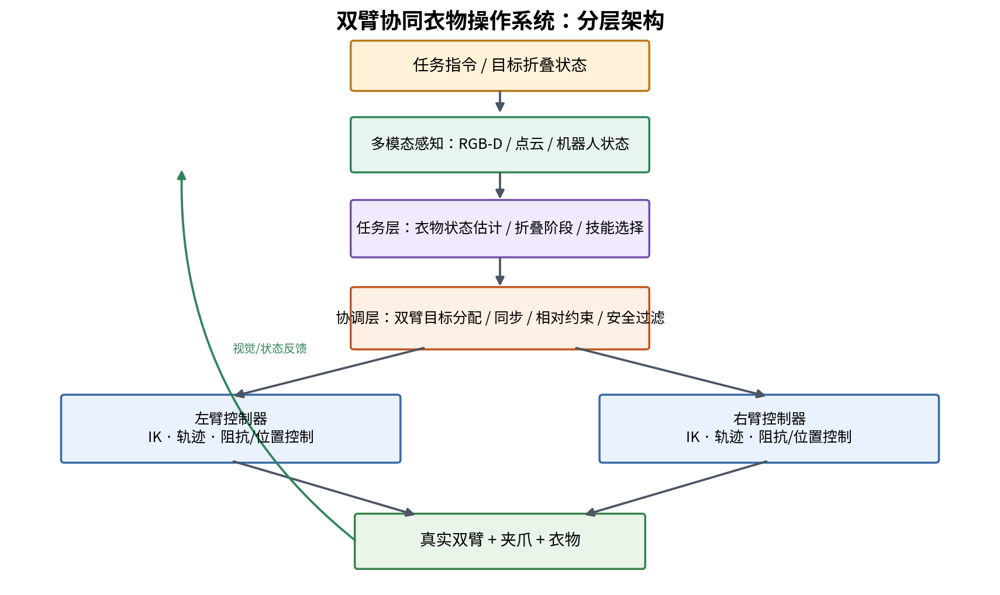

可将系统划分为五层：

| 层级 | 主要输入 | 主要输出 | 负责的问题 |
|---|---|---|---|
| 感知层 | RGB、深度、点云、机器人状态 | 衣物区域、关键点、状态估计 | 衣物在哪里、当前是什么形态 |
| 任务层 | 语言指令、当前状态、目标折叠状态 | 子任务和动作原语 | 下一步应该做什么 |
| 协调层 | 子任务、两臂状态、约束 | 两臂目标、同步参数、安全约束 | 两臂如何配合 |
| 运动控制层 | 末端目标、关节状态、力反馈 | 关节轨迹或控制指令 | 如何稳定地运动 |
| 执行与反馈层 | 控制指令、相机数据 | 新状态、成功/失败判断 | 动作是否真正达到目标 |

这里需要区分三个概念：

- **任务协调：** 左臂负责哪一侧，右臂负责哪一侧，何时抓取、何时拉平、何时翻折。
- **运动协调：** 两臂在空间中如何移动，是否同步，是否会碰撞。
- **力协调：** 两臂对衣物施加多大的拉力，是否产生过度拉伸、打滑或松弛。

只解决运动同步，不代表完成了双臂协同。两台机械臂即使同时到达各自的目标点，也可能因为抓取点不合理而把衣物扭转或拉皱。

## 1.3 为什么柔性衣物比刚性物体难

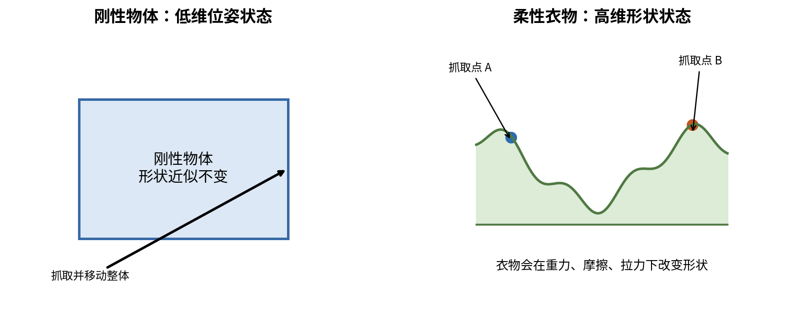

刚性物体通常可以用一个位姿描述，即位置和姿态；物体整体移动时，形状基本不变。衣物的形状则会随重力、摩擦、抓取位置、拉伸方向和接触状态不断改变。

例如，把一个刚性盒子的两个边缘夹住并向外移动，盒子本身不会被明显拉长；把一件 T 恤左右两侧夹住并向外移动，衣物可能被展开，也可能因抓取点不对而扭转、滑动或产生褶皱。

衣物操作的难点主要包括：

1. **高维状态：** 衣物表面有大量自由度，不能只用一个三维位姿描述。
2. **部分可观测：** 一层布料可能遮挡另一层，折叠区域可能藏在下面。
3. **非刚性形变：** 同一个末端位移，在不同衣物、不同初始形态下可能产生不同结果。
4. **接触复杂：** 衣物与桌面、夹爪、另一部分衣物之间都有摩擦和接触。
5. **材料差异：** 棉、涤纶、针织和厚毛巾的质量、摩擦、弯曲刚度和拉伸性能不同。
6. **动作后状态改变：** 抓取、抬升或拉动一次后，下一步的衣物状态必须重新估计。

因此，衣物折叠系统应采用“感知—规划—执行—再感知”的闭环方式，而不是一次规划一条长动作轨迹后完全不再观察。

## 1.4 双臂共享工作空间

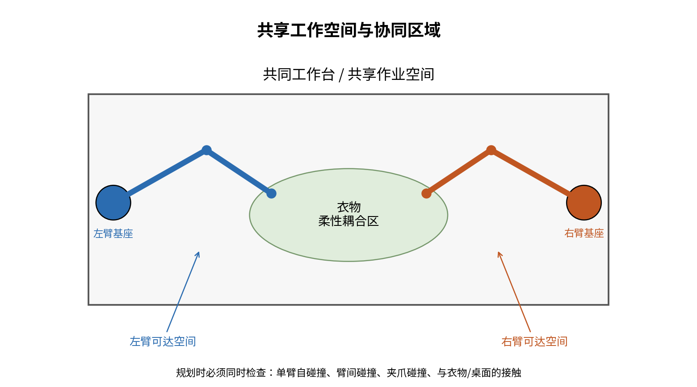

双臂通常分别安装在工作台两侧，中间区域是共享工作空间。两条机械臂可能同时进入该区域，因此需要检查：

- 左臂自身连杆碰撞；
- 右臂自身连杆碰撞；
- 左臂与右臂之间的碰撞；
- 夹爪之间的碰撞；
- 机械臂与相机、桌面、支架等环境碰撞；
- 机械臂与衣物接触时是否会拉扯到不合理的位置。

**重要区别：** 机械臂与衣物接触并不一定是碰撞错误。衣物操作本来就需要接触；但机器人手臂、夹爪与桌面、另一条机械臂之间的接触通常应被严格限制。规划场景要区分“允许接触的操作对象”和“必须避开的障碍物”。

## 1.5 你应该如何理解整个课题

建议把课题看成三个相互依赖的子问题：

- **机器人问题：** 两台机械臂能否准确、安全、同步地到达目标位置？
- **衣物问题：** 当前衣物是什么形状，抓哪里、怎么拉、怎么折，动作后会变成什么样？
- **智能决策问题：** 怎样从视觉和语言输入中选择下一步动作，并判断动作是否成功？

VLA 模型主要帮助解决第三类问题，并为前两类问题提供动作建议；机器人运动学、规划和底层控制仍然需要明确的工程模块来保证安全和可执行性。

---

# 第 2 章 双臂机器人运动学基础

## 2.1 关节空间、任务空间和末端执行器

机械臂由若干关节和连杆组成。关节变量通常用向量 q 表示：

$$
\mathbf q = [q_1,q_2,\ldots,q_n]^T
$$

其中，转动关节的 q 表示角度，移动关节的 q 表示位移。所有关节变量构成的空间称为关节空间（Joint Space）。

末端执行器（End Effector）通常是机械臂最末端的工具，例如夹爪。末端在三维空间中的位置和姿态组成任务空间（Task Space）中的状态。

末端位姿可用齐次变换矩阵表示：

$$
{}^{B}\mathbf T_{E}=\begin{bmatrix}
{}^{B}\mathbf R_{E} & {}^{B}\mathbf p_{E}\\
\mathbf 0^T & 1
\end{bmatrix}
$$

其中，B 表示机器人基座坐标系，E 表示末端坐标系；R 是旋转矩阵，p 是平移向量。

机器人学中常见的两个问题：

- 正运动学（FK）：已知关节角，求末端位姿。
- 逆运动学（IK）：已知末端目标位姿，求关节角。

对于你的课题，视觉模块通常给出衣物抓取点的三维位置，规划模块需要将其转化成机械臂末端目标位姿，最后通过逆运动学得到关节目标。

## 2.2 坐标系与齐次变换

双臂系统至少涉及以下坐标系：

- W：世界或工作台坐标系；
- B_L：左臂基座坐标系；
- B_R：右臂基座坐标系；
- C：相机坐标系；
- E_L、E_R：左、右末端坐标系；
- G_L、G_R：左、右夹爪工具坐标系。

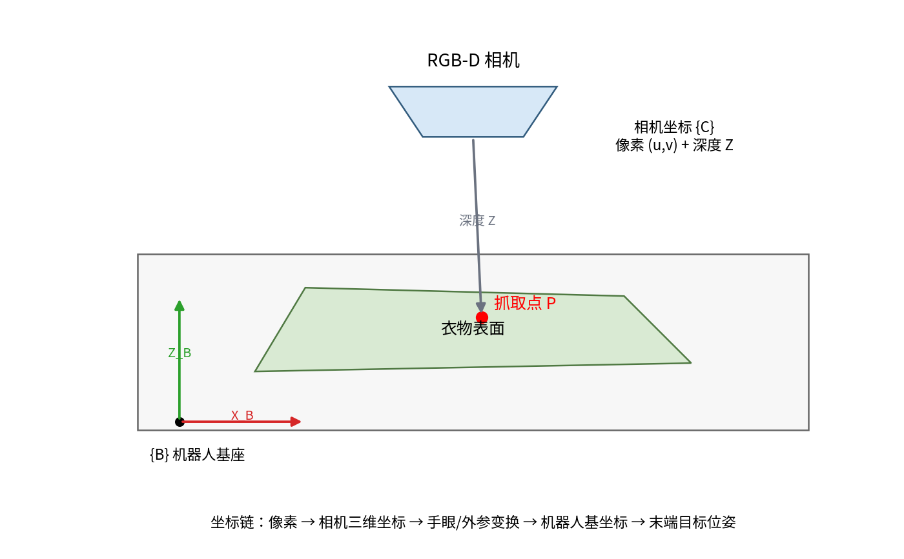

齐次变换矩阵写作：

$$
{}^{A}\mathbf T_{B}=\begin{bmatrix}
{}^{A}\mathbf R_{B} & {}^{A}\mathbf t_{B}\\
\mathbf 0^T & 1
\end{bmatrix}
$$

它表示坐标系 B 相对于坐标系 A 的位姿，也可以用来把一个在 B 坐标系下表示的点转换到 A 坐标系。

若相机检测到衣物上的三维点：

$$
{}^{C}\mathbf p=\begin{bmatrix}X_C&Y_C&Z_C&1\end{bmatrix}^{T}
$$

则其在机器人基坐标系下的坐标为：

$$
{}^{B}\mathbf p={}^{B}\mathbf T_C\,{}^{C}\mathbf p
$$

若相机先输出像素坐标 u、v 和深度 Z，则在针孔相机模型下：

$$
X_C=\frac{(u-c_x)Z}{f_x},\qquad
Y_C=\frac{(v-c_y)Z}{f_y},\qquad
Z_C=Z
$$

这里的 f_x、f_y、c_x、c_y 来自相机内参。实际使用时还要处理深度单位、深度无效值、畸变和相机坐标轴方向。

**易错点：** 不要直接把相机坐标系中的 X、Y、Z 当作机器人基坐标系中的 X、Y、Z。相机可能倒置安装，光学坐标轴定义也与机器人基坐标轴不同。必须使用经过标定的变换矩阵。

## 2.3 左右臂的关节状态组合

假设左臂有 n_L 个关节，右臂有 n_R 个关节，定义整个双臂系统的联合关节向量：

$$
\mathbf q=\begin{bmatrix}\mathbf q_L\\\mathbf q_R\end{bmatrix}
\in\mathbb R^{n_L+n_R}
$$

其中：

$$
\mathbf q_L\in\mathbb R^{n_L},\qquad
\mathbf q_R\in\mathbb R^{n_R}
$$

如果实验室使用的是常见 7 自由度 Franka Panda 双臂，那么联合关节维度通常为 14；但必须以实验室具体机械臂型号、关节配置和工具配置为准，不能仅凭“Franka”名称假定自由度。

两臂末端的速度关系可分别写成：

$$
\dot{\mathbf x}_L=\mathbf J_L(\mathbf q_L)\dot{\mathbf q}_L
$$

$$
\dot{\mathbf x}_R=\mathbf J_R(\mathbf q_R)\dot{\mathbf q}_R
$$

把两臂组合起来：

$$
\begin{bmatrix}\dot{\mathbf x}_L\\\dot{\mathbf x}_R\end{bmatrix}
=
\begin{bmatrix}\mathbf J_L&\mathbf 0\\\mathbf 0&\mathbf J_R\end{bmatrix}
\begin{bmatrix}\dot{\mathbf q}_L\\\dot{\mathbf q}_R\end{bmatrix}
$$

因此双臂系统的块对角雅可比矩阵为：

$$
\mathbf J_{dual}=\begin{bmatrix}\mathbf J_L&\mathbf 0\\\mathbf 0&\mathbf J_R\end{bmatrix}
$$

这个矩阵表示：在还没有考虑衣物耦合时，左臂关节直接决定左臂末端速度，右臂关节直接决定右臂末端速度。真正的耦合来自共同操作的衣物、共享空间约束和协调控制任务。

## 2.4 正运动学与逆运动学

### 2.4.1 正运动学

每个关节和连杆之间都存在一个相对变换。沿着机械臂从基座到末端依次相乘，就可以得到末端位姿：

$$
{}^{0}\mathbf T_n={}^{0}\mathbf T_1\,{}^{1}\mathbf T_2\cdots{}^{n-1}\mathbf T_n
$$

如果使用 DH 参数（Denavit-Hartenberg），需要定义连杆长度、连杆扭角、连杆偏距和关节角。对于已经存在的 Franka 机器人模型，通常不必手动从零建立所有参数，但应该能读懂 URDF 中的关节和连杆关系，并理解正运动学计算结果。

### 2.4.2 逆运动学

逆运动学目标是：给定末端目标位姿，求关节变量。通常写成：

$$
\mathbf q^*=IK(\mathbf T^*)
$$

逆运动学可能存在：

- 多组解：不同关节姿态到达同一个末端目标；
- 无解：目标位姿超出工作空间；
- 奇异位形：某些方向上的末端运动能力下降；
- 关节限制：数学解存在，但关节角超出允许范围。

7 自由度机械臂通常具有冗余自由度。冗余意味着在满足末端任务的同时，还可以调整肘部姿态、避障或远离关节限位。

### 2.4.3 雅可比矩阵的物理含义

雅可比矩阵描述关节速度与末端速度之间的局部线性关系：

$$
\dot{\mathbf x}=\mathbf J(\mathbf q)\dot{\mathbf q}
$$

如果末端任务包含三维位置和三维角速度，可将末端速度写成六维 Twist：

$$
\mathbf V=\begin{bmatrix}\mathbf v\\\boldsymbol\omega\end{bmatrix}
$$

相应地：

$$
\mathbf V=\mathbf J(\mathbf q)\dot{\mathbf q}
$$

要点是：雅可比矩阵不是固定常数，它随关节姿态变化。机械臂伸直、肘部接近某些特殊姿态时，雅可比矩阵可能接近降秩，导致某些方向的运动需要很大的关节速度。

## 2.5 双臂整体运动与相对运动

双臂协同中一个非常有用的思想，是把两个末端的运动拆成：

1. 整体运动：两只夹爪共同向某个方向移动；
2. 相对运动：两只夹爪之间的距离和相对位置发生变化。

对于简化的三维位置描述，定义：

$$
\mathbf c=\frac{\mathbf p_L+\mathbf p_R}{2}
$$

$$
\mathbf r=\mathbf p_R-\mathbf p_L
$$

其中 c 是两末端位置的中点，r 是右末端相对左末端的位置向量。

对时间求导：

$$
\dot{\mathbf c}=\frac{1}{2}(\dot{\mathbf p}_L+\dot{\mathbf p}_R)
$$

$$
\dot{\mathbf r}=\dot{\mathbf p}_R-\dot{\mathbf p}_L
$$

把左、右末端雅可比代入：

$$
\dot{\mathbf c}=\frac{1}{2}(\mathbf J_L\dot{\mathbf q}_L+\mathbf J_R\dot{\mathbf q}_R)
$$

$$
\dot{\mathbf r}= -\mathbf J_L\dot{\mathbf q}_L+\mathbf J_R\dot{\mathbf q}_R
$$

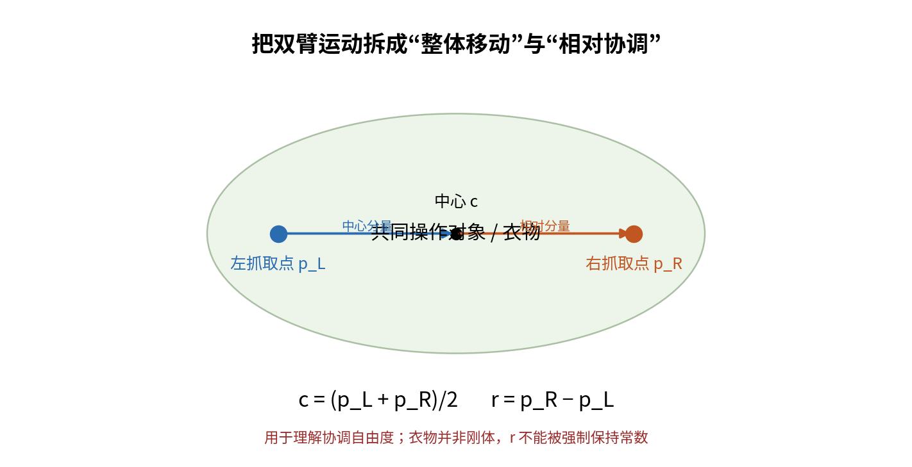

这组式子非常适合帮助理解双臂动作：

- 当两臂速度相同，整体中心移动，而相对距离近似不变；
- 当两臂速度方向相反，整体中心可能不动，但两末端间距改变；
- 当两臂速度不同且不对称时，整体运动和相对运动同时发生。

**但注意：** 这只是位置层面的简化分解。真实完整位姿还包含旋转，需要在 SE(3) 上处理；更重要的是，衣物不是刚性物体，不能简单要求两夹爪的相对距离恒定。衣物操作时，r 应根据需要的拉伸、松弛和折叠状态调整。

## 2.6 速度级逆运动学与伪逆

如果希望末端实现指定速度，可以使用雅可比伪逆求关节速度：

$$
\dot{\mathbf q}=\mathbf J^{\dagger}\mathbf V_d
$$

当 J 满列秩且适用条件满足时，伪逆可获得满足任务的最小范数解。对冗余机械臂，还可以利用零空间完成次级任务：

$$
\dot{\mathbf q}=\mathbf J^{\dagger}\mathbf V_d+
(\mathbf I-\mathbf J^{\dagger}\mathbf J)\mathbf z
$$

其中：

- 第一项负责完成主要末端任务；
- 第二项位于雅可比矩阵的零空间，不改变一阶近似下的主要末端任务；
- z 是次级目标的关节速度，例如避开关节限位、改善肘部姿态、远离障碍物。

一个常见的次级目标是最小化代价函数 H(q)，可令：

$$
\mathbf z=-k\nabla_{\mathbf q}H(\mathbf q)
$$

例如关节限位代价可以在接近上下限时迅速增大，让零空间项把关节姿态推离极限。

### 阻尼最小二乘（Damped Least Squares）

接近奇异点时，直接使用伪逆可能使关节速度异常大。常用阻尼形式：

$$
\mathbf J^{\#}=\mathbf J^T(\mathbf J\mathbf J^T+\lambda^2\mathbf I)^{-1}
$$

$$
\dot{\mathbf q}=\mathbf J^{\#}\mathbf V_d
$$

lambda 是阻尼系数。离奇异点较远时可以较小，接近奇异点时可以增大。阻尼会牺牲一部分末端跟踪精度，以换取更稳定的关节速度。

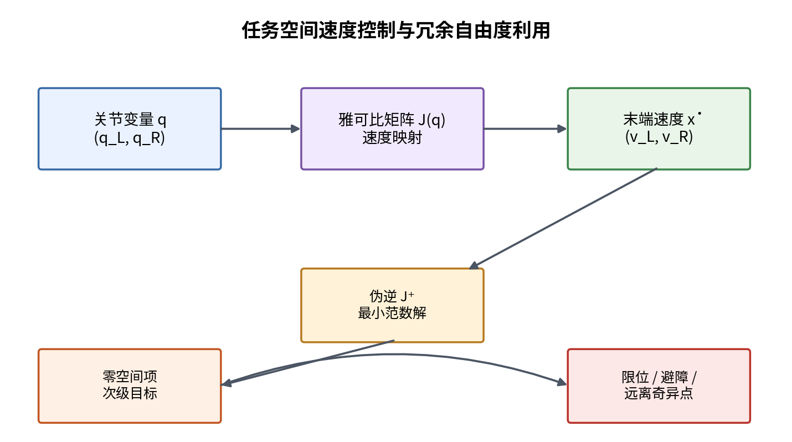

## 2.7 本章需要达到的程度

你不必从头开发 Franka 的运动学求解器，但必须达到：

- 能解释关节空间与任务空间的区别；
- 能看懂坐标变换矩阵，知道变换方向；
- 能解释正运动学、逆运动学和雅可比矩阵；
- 能理解为什么双臂联合状态可以写成两个关节向量的拼接；
- 能解释整体运动和相对运动的区别；
- 能理解冗余自由度和零空间的作用；
- 能够检查相机抓取点、机械臂末端目标、关节解是否在同一个正确的坐标体系中。

---

# 第 3 章 双臂协同控制理论

## 3.1 为什么两个独立控制器不等于双臂协同

假设左臂和右臂分别有一个控制器。两个控制器都能准确跟踪各自的轨迹，但如果轨迹是独立生成的，可能出现：

- 左臂已经抓住衣物，右臂还没有到位；
- 左臂开始拉，右臂夹爪仍未闭合；
- 两臂移动时间不同，衣物受到突然的拉扯；
- 一侧先松开，另一侧仍在用力，导致衣物滑落；
- 两臂分别规划的轨迹在共享空间中相交。

因此，双臂协同控制必须在两臂之上增加任务协调和约束管理。

## 3.2 双臂控制的常见组织方式

### 3.2.1 主从控制（Master-Slave）

一条机械臂作为主臂，负责生成主要运动；另一条机械臂作为从臂，根据主臂状态或共同任务约束进行跟随。

优点：结构直观，适合搬运、双臂示教和某些受约束任务。缺点：主臂的误差会传递给从臂；从臂的反馈如果没有参与主臂决策，整体协调可能不够灵活。

### 3.2.2 对称协调控制

两臂没有固定主从关系，由共同的任务规划器同时给出两臂目标。对于衣物折叠，通常更自然：左右臂分别操作衣物左右区域，同时满足拉平、对齐或折叠要求。

优点是两臂角色可以随任务阶段切换；缺点是协调层需要处理更多约束。

### 3.2.3 集中式控制

中央控制器同时接收两臂关节状态、末端状态、衣物状态和环境状态，计算联合控制量。

可将控制问题写成：

$$
\mathbf u^*=\arg\min_{\mathbf u}
J(\mathbf u;\mathbf q_L,\mathbf q_R,\hat{\mathbf s}_{cloth})
$$

并满足运动学、速度、关节限位和碰撞约束。

集中式控制更容易表达整体目标，但计算负担和软件复杂度较高。

### 3.2.4 分布式控制

左右臂各自有局部控制器，通过共享状态、目标和协调信号进行配合。分布式方式有利于模块独立，但必须设计可靠的同步机制和状态一致性机制。

**工程建议：** 对你的毕业设计，推荐采用“中央任务协调器 + 左右臂独立底层控制器”的分层结构。中央层负责折叠阶段、动作目标和安全约束；底层控制器各自负责关节轨迹跟踪或厂商提供的安全控制接口。

## 3.3 刚性双臂协作与柔性双臂协作的区别

对于两个机械臂共同搬运一根刚性杆或刚性箱体，如果两臂都牢固抓住物体，那么末端之间存在近似固定的几何关系。物体的位姿决定两末端应该处于什么位置。

对于衣物，情况不同：

- 衣物可以被拉伸、弯曲、折叠；
- 两抓取点之间的空间距离不等于衣物材料点之间的固定距离；
- 衣物会在夹爪之间滑动或发生局部形变；
- 需要允许相对运动改变，而不是始终保持刚性闭链约束。

所以，**刚性物体协作中的固定相对位姿约束不能直接照搬到衣物操作**。对于衣物，更合理的是定义任务相关的“软约束”：例如保持适度张力、使衣物边缘接近目标线、避免关键点间距离过度偏离期望范围。

## 3.4 双臂的任务空间约束

一种通用做法是定义两末端的任务变量，再定义期望关系。

对于简化的相对位置误差：

$$
\mathbf e_r=\mathbf r_d-\left(\mathbf p_R-\mathbf p_L\right)
$$

其中 r_d 是期望相对位置，e_r 是当前相对位置误差。

可以设计一个相对速度控制律：

$$
\dot{\mathbf r}_{cmd}=\dot{\mathbf r}_d+\mathbf K_r\mathbf e_r
$$

同样可以对整体中心设计控制律：

$$
\dot{\mathbf c}_{cmd}=\dot{\mathbf c}_d+\mathbf K_c\mathbf e_c
$$

再将中心速度和相对速度组合成左右末端速度。由定义可得：

$$
\dot{\mathbf p}_{L,cmd}=\dot{\mathbf c}_{cmd}-\frac{1}{2}\dot{\mathbf r}_{cmd}
$$

$$
\dot{\mathbf p}_{R,cmd}=\dot{\mathbf c}_{cmd}+\frac{1}{2}\dot{\mathbf r}_{cmd}
$$

这给出一个直观的双臂协调方法：中心运动控制整体位置，相对运动控制两夹爪间的几何关系。

**对衣物的使用方式：** 在拉平阶段，r_d 可以缓慢增加，避免突然拉扯；在保持阶段，r_d 保持在一个合理范围；在折叠阶段，r_d 和两端姿态都需要根据折线和衣物关键点重新设定。r_d 不应被当成固定常数。

## 3.5 协同任务的优化表达

双臂协调常可以表述为一个优化问题。以末端任务误差、关节运动量和碰撞风险为例：

$$
J= w_p\|\mathbf e_p\|^2+w_r\|\mathbf e_r\|^2
+w_q\|\Delta\mathbf q\|^2+w_cJ_{collision}
$$

其中：

- e_p：两臂整体任务的位置或姿态误差；
- e_r：相对位置或相对姿态误差；
- Delta q：关节运动量；
- J_collision：碰撞风险代价；
- w_p、w_r、w_q、w_c：权重。

对柔性衣物还可以添加张力或形变代价：

$$
J_{cloth}=w_t\,\phi(\hat T)+w_d\,\|\hat{\mathbf s}_{cloth}-\mathbf s_{target}\|^2
$$

其中 T 是估计的衣物张力，phi 可以在张力过大或过小时增大；s_cloth 是当前衣物状态的特征向量。

综合起来：

$$
J_{total}=J+J_{cloth}
$$

这说明协同控制不只是让末端到点，而是要在任务完成、运动平滑、避障和衣物形态之间取得平衡。

## 3.6 双臂协同控制中的内力概念

在双臂共同抓持刚性物体时，即使物体整体没有移动，两臂仍可能互相施加相反的力。这部分不引起物体整体运动的力称为内力（Internal Force）。

对于柔性衣物，也存在类似的相互拉扯作用：两夹爪同时向外拉会使衣物张紧；拉得太大可能拉伸、损伤或使夹爪滑脱；拉得太小则衣物可能松垂，难以形成清晰折线。

因此衣物任务关注的不只是外部运动，还包括夹爪对衣物施加的张力和接触力。若没有腕部力传感器，可以先通过视觉估计形变、绳索/衣物几何变化和夹爪状态间接判断，但这类估计不能等同于直接力测量。

## 3.7 本章小结

你需要记住：

- 双臂协调包括任务分配、运动同步和力协调；
- 主从、对称、集中式和分布式是不同的软件组织方式；
- 刚性物体可以使用相对位姿固定约束，衣物更适合使用可变的软约束；
- 将双臂运动拆成整体运动与相对运动，有助于设计折叠动作；
- 真实系统应同时考虑任务误差、碰撞、关节限制、衣物张力和动作平滑性。

---

# 第 4 章 双臂轨迹同步与运动规划

## 4.1 为什么同步很重要

双臂抓住同一件衣物后，如果一只手快速移动、另一只手停顿，衣物会受到非预期拉扯。即使两臂最终都到达正确位置，中途的相位差也可能导致褶皱、打滑或局部过载。

同步至少包括：

1. **起始同步：** 两臂在同一任务阶段开始动作；
2. **时间同步：** 两条轨迹使用共同的时间基准；
3. **相位同步：** 两臂动作的进度保持在合理关系；
4. **事件同步：** 抓取完成、夹爪闭合、释放等关键事件得到确认后才进入下一阶段。

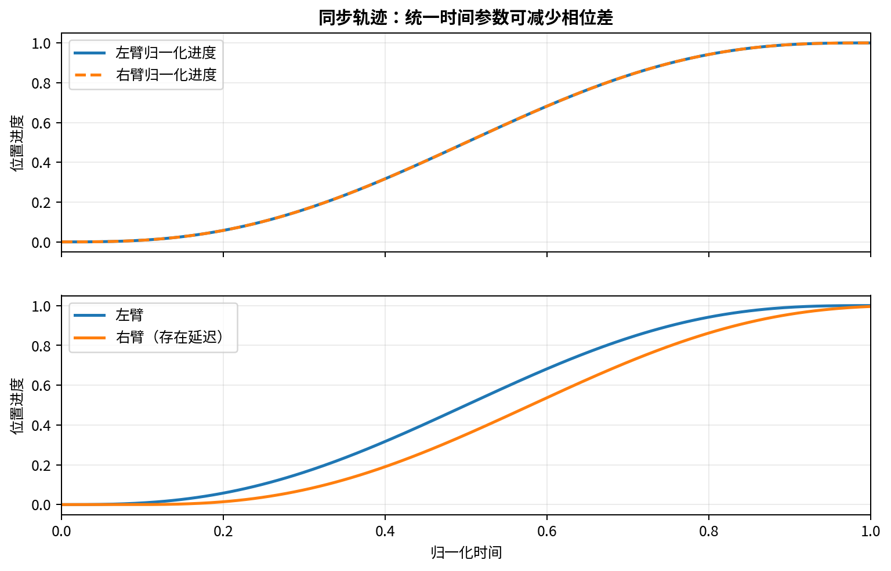

## 4.2 关节空间规划与笛卡尔空间规划

### 关节空间规划

直接规划关节变量 q(t)。优势是容易处理关节限位，也适合使用关节轨迹控制器执行；不足是末端路径不一定是直线，可能绕出不直观的轨迹。

### 笛卡尔空间规划

直接规划末端的位置和姿态，再通过逆运动学转化成关节轨迹。优势是容易指定抓取点、抬升高度、水平拉平路径和折叠轨迹；不足是逆运动学可能无解或解不连续。

衣物折叠通常需要两种空间混合使用：抓取点定位和拉平过程更接近笛卡尔任务；关节限制和避障检查则需要在关节空间完成。

## 4.3 时间参数化与五次多项式轨迹

即使路径几何形状正确，也需要为其分配合理的时间。直接给机械臂一个位置跳变，可能产生很大的速度和加速度需求。

常用五次多项式对单个标量轨迹进行平滑规划：

$$
s(t)=a_0+a_1t+a_2t^2+a_3t^3+a_4t^4+a_5t^5
$$

假设运动从 0 时刻开始，到 T 时刻结束，希望满足：

$$
s(0)=0,\quad \dot s(0)=0,\quad \ddot s(0)=0
$$

$$
s(T)=1,\quad \dot s(T)=0,\quad \ddot s(T)=0
$$

将边界条件代入多项式，可得：

$$
a_0=a_1=a_2=0
$$

剩下三个方程：

$$
a_3T^3+a_4T^4+a_5T^5=1
$$

$$
3a_3T^2+4a_4T^3+5a_5T^4=0
$$

$$
6a_3T+12a_4T^2+20a_5T^3=0
$$

解得：

$$
a_3=\frac{10}{T^3},\qquad a_4=-\frac{15}{T^4},\qquad a_5=\frac{6}{T^5}
$$

因此归一化进度函数为：

$$
s(t)=10\left(\frac{t}{T}\right)^3-15\left(\frac{t}{T}\right)^4+6\left(\frac{t}{T}\right)^5
$$

若起点为 x_0，终点为 x_1，则：

$$
x(t)=x_0+(x_1-x_0)s(t)
$$

该方法使起点和终点的速度、加速度均为零，适合需要平稳启动和停止的运动段。

## 4.4 双臂轨迹同步的两种常见方法

### 方法一：统一进度变量

为左右臂定义同一个进度参数 s(t)，两臂各自沿自己的路径执行：

$$
\mathbf p_L(t)=\mathbf p_{L,0}+s(t)(\mathbf p_{L,1}-\mathbf p_{L,0})
$$

$$
\mathbf p_R(t)=\mathbf p_{R,0}+s(t)(\mathbf p_{R,1}-\mathbf p_{R,0})
$$

两臂拥有相同的运动进度，因此可以较好地保持同步。

### 方法二：先分别规划，再做时间对齐

如果两臂路径长度、速度约束或逆运动学结果不同，可以先分别得到轨迹，再进行时间参数化，使两条轨迹在共同时间点上具有一致的开始、结束和关键事件。

ROS2 的 Joint Trajectory Controller 接收带时间戳的关节轨迹点，并按控制器能力在点之间插值；位置、速度和加速度是否同时提供，会影响插值方式和连续性。具体可参考 ros2_control 官方文档，实际控制器能力以实验室配置为准。[6]

## 4.5 动作同步与事件屏障

对于衣物抓取，不能只根据预设时间判断夹爪是否已抓住。更稳妥的流程是：

1. 左右臂分别移动到抓取预备位；
2. 两臂都报告“到位”；
3. 两夹爪分别闭合；
4. 通过夹爪状态、图像变化或力/电流反馈确认抓取；
5. 两臂同时进入抬升阶段；
6. 再次观察衣物是否被两侧稳定提起。

这类“所有条件满足后才继续”的机制可以称为事件屏障（Barrier / Synchronization Barrier）。它比固定等待一段时间更加可靠。

## 4.6 双臂轨迹设计原则

- 两臂起点应处于经过验证的安全姿态；
- 先规划再执行，不要在真机上边猜边移动；
- 两臂尽量采用共同的动作时基；
- 避免一侧高速、另一侧低速的明显相位差；
- 运动速度、加速度和加加速度（Jerk）应符合机器人及衣物任务约束；
- 对抓取、拉伸、翻折和释放分别设置阶段性目标；
- 任何一臂失败时，另一臂不能无条件继续执行。

---

# 第 5 章 碰撞规避与安全约束

## 5.1 为什么双臂比单臂更容易发生碰撞

双臂拥有两个运动链，且可能同时进入工作台中心区域。碰撞不仅来自末端，还可能发生在上臂、前臂、肘部、手腕和夹爪之间。

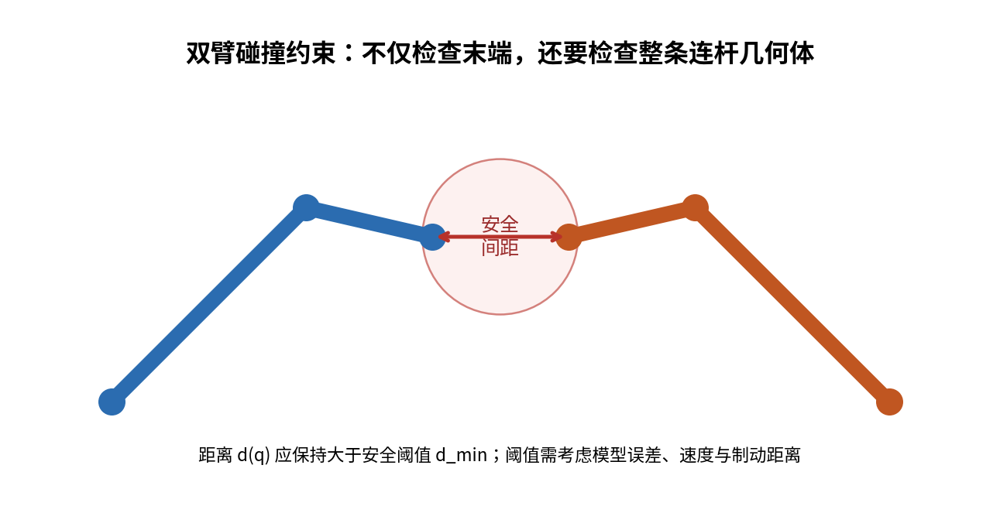

仅检查两个末端点之间的距离是不够的。应尽量使用机器人完整碰撞几何体进行自碰撞和臂间碰撞检测。

## 5.2 最小距离约束

设左臂某个碰撞几何体与右臂某个碰撞几何体之间的最小距离为 d(q)，安全距离为 d_min，则：

$$
d(\mathbf q)\ge d_{min}
$$

对所有需要检查的碰撞体对，都需要满足相应距离约束。

安全距离不能随意设置。它要考虑：

- 机器人模型和标定误差；
- 控制跟踪误差；
- 当前运动速度；
- 制动距离；
- 夹爪尺寸和工具偏置；
- 物体及线缆等环境的不确定性。

## 5.3 基于距离函数的速度约束

假设 d(q) 是两个碰撞体的距离函数。希望距离不下降到安全阈值以下，可以约束距离的变化率：

$$
\dot d(\mathbf q)=\nabla_{\mathbf q}d(\mathbf q)^T\dot{\mathbf q}
$$

一种简单的安全约束形式是：

$$
\dot d(\mathbf q)\ge -\alpha(d-d_{min})
$$

其中 alpha 为正数。直观含义是：当距离已经接近安全下限时，不允许距离继续快速减小；距离较大时可以保留一定接近自由度。

在速度级 QP（Quadratic Programming）控制器中，可以把上述不等式与任务跟踪目标一起求解。

## 5.4 二次规划（QP）形式

一个示意性的速度级优化问题为：

$$
\min_{\dot{\mathbf q}}\quad
\|\mathbf J\dot{\mathbf q}-\mathbf V_d\|_W^2+
\lambda\|\dot{\mathbf q}\|^2
$$

满足：

$$
\dot d_i(\mathbf q)\ge -\alpha_i(d_i-d_{min,i})
$$

$$
\dot{\mathbf q}_{min}\le\dot{\mathbf q}\le\dot{\mathbf q}_{max}
$$

$$
\mathbf q_{min}\le\mathbf q\le\mathbf q_{max}
$$

其中 W 是任务误差权重矩阵，lambda 用于抑制过大的关节速度。

注意：这是用于理解的简化形式。真实机器人还要考虑动力学、控制周期、加速度限制、碰撞几何精度和底层控制器接口。若没有经过验证的安全控制链，不要自行将 QP 输出直接接入真实机械臂。

## 5.5 规划场景中的衣物与桌面

衣物操作需要特别处理碰撞对象：

- 桌面：通常是障碍物，但允许夹爪在预定区域附近接近；
- 衣物：是操作对象，夹爪需要与衣物接触；
- 另一臂：通常作为需要避让的碰撞对象；
- 相机支架：必须避开；
- 夹爪：需建立真实的工具几何模型，不能只把末端法兰当成末端。

MoveIt2 的 Planning Scene 负责组织机器人状态、世界几何体、附着物体和碰撞检测。运动规划时可以通过规划组、碰撞对象和约束表达任务。官方文档介绍了规划请求、规划场景和碰撞检查的基本机制。[5]

## 5.6 安全控制的工程底线

1. 真机测试前必须确认急停和安全停止功能有效。
2. 首次执行新轨迹时使用低速、短距离和保守工作空间。
3. 双臂协作时建立明确的臂间碰撞检查。
4. VLA 输出只能作为候选动作，不应绕过安全约束直接下发。
5. 对动作长度、末端速度、关节速度和夹爪开合设置边界。
6. 相机或状态数据异常时，应停止动作或进入预定义安全状态。
7. 控制器报错、通信中断、夹爪状态不确定时，不允许盲目继续。
8. 所有真机试验遵守实验室设备管理和导师要求。

---

# 第 6 章 柔顺控制与力交互

## 6.1 为什么衣物操作需要柔顺性

如果机器人把末端位置当成绝对刚性的目标，遇到桌面高度误差、衣物堆叠、夹爪接触偏差或相机标定误差时，可能产生过大的接触力。

柔顺控制（Compliance Control）希望机器人在遇到外部接触和不确定性时，表现出适度的让步能力，而不是强行把末端压到设定位置。

对于衣物任务，柔顺性有助于：

- 轻柔接触桌面；
- 避免抓取时压皱或推走衣物；
- 拉平时逐步建立张力；
- 处理双臂之间的微小不同步；
- 降低夹爪和衣物之间的冲击。

## 6.2 位置控制、力控制和阻抗控制

### 位置控制

控制目标是让末端达到指定位置或姿态。优点是直观、易规划；缺点是在接触环境中若目标不准确，可能产生较大接触力。

### 力控制

控制目标是让末端施加指定力。需要可靠的力/力矩传感器或经过验证的力估计方法，并考虑机器人动力学和接触环境。

### 阻抗控制

阻抗控制不是简单地控制位置或力，而是规定机器人在位移、速度与外力之间呈现怎样的动态关系。

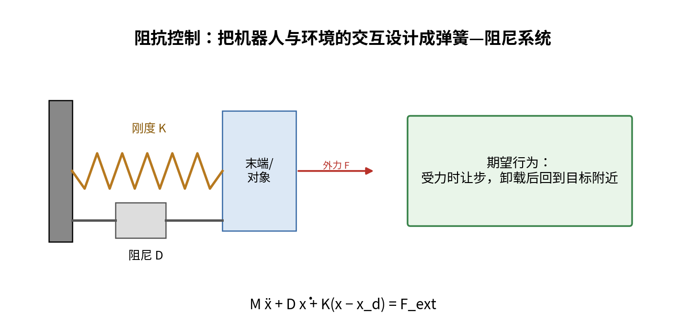

## 6.3 从弹簧—阻尼系统推导阻抗模型

考虑一个质量块连接弹簧和阻尼器，外力作用在质量块上。根据牛顿第二定律：

$$
M\ddot x=F_{ext}-D\dot x-K(x-x_d)
$$

移项得到：

$$
M\ddot x+D\dot x+K(x-x_d)=F_{ext}
$$

推广到机器人末端的多自由度形式：

$$
\mathbf M_d\ddot{\mathbf e}+
\mathbf D_d\dot{\mathbf e}+\mathbf K_d\mathbf e=
\mathbf F_{ext}
$$

其中：

- e 是末端相对于期望轨迹的误差；
- M_d 是期望惯量矩阵；
- D_d 是期望阻尼矩阵；
- K_d 是期望刚度矩阵；
- F_ext 是外部接触力。

直观理解：

- K 越大，机器人越不愿意偏离目标位置；
- D 越大，运动越不容易产生振荡；
- M 越大，运动响应越迟缓；
- 当外力作用时，误差会按设定的动态规律变化。

对于衣物抓取和轻触桌面，通常不希望刚度设置得过高。具体参数必须通过机器人平台、末端工具、控制接口和实验室安全规范确定，不能直接照搬论文中的数值。

## 6.4 导纳控制

导纳控制（Admittance Control）通常根据测得的外力，计算一个位置或速度修正量，再交给位置控制器执行。其概念模型同样可以写作：

$$
\mathbf M_d\ddot{\mathbf x}_{a}+
\mathbf D_d\dot{\mathbf x}_{a}+
\mathbf K_d\mathbf x_{a}=\mathbf F_{ext}
$$

其中 x_a 表示由外力产生的调整量。

与阻抗控制的区别要结合具体机器人接口理解：阻抗控制通常规定运动偏差与力之间的动态关系；导纳控制通常把力输入转化成运动指令。实际机器人控制器可能提供厂商封装的阻抗接口或导纳接口，必须按对应接口文档使用。

## 6.5 双臂协同中的柔顺策略

可以考虑分层设置：

- **整体任务层：** 两臂共同保持衣物的大体位置和运动方向；
- **局部柔顺层：** 每个夹爪根据接触、张力或视觉反馈做小范围调整；
- **安全层：** 限制末端速度、力、关节范围和臂间距离。

对于刚性物体，常常希望两臂刚性地保持物体相对位姿；对于衣物，则应允许一定相对位移，并控制张力不要过大或过小。

## 6.6 抓持摩擦与防滑的基本关系

夹爪依靠摩擦力保持衣物。简单库仑摩擦模型中，接触面的最大静摩擦力近似为：

$$
F_{friction,max}=\mu N
$$

其中 mu 为摩擦系数，N 为法向夹持力。

如果衣物沿夹爪方向承受的切向载荷超过可提供的摩擦力，可能发生滑动。因此需要考虑：夹持力、衣物表面摩擦、夹爪材料、衣物厚度和拉动加速度。

真实织物具有压缩、弯曲、局部变形和多层接触等特性，库仑模型只是粗略近似。不要用一个固定摩擦系数解释所有衣物的抓取结果。

## 6.7 什么时候考虑力反馈

建议先从视觉闭环和安全位置控制做起，再视硬件情况逐步增加力反馈。

- 如果只有 RGB-D 相机和夹爪状态：可以通过衣物关键点位移、布料形变、夹爪状态变化估计是否拉紧或滑落；
- 如果有腕部六维力/力矩传感器：可以研究接触力、拉力和双臂受力差；
- 如果机械臂支持可靠的关节力矩估计：可以在导师指导下探索基于模型的外力估计，但要注意估计误差。

**不能把视觉估计的张力与真实力传感器测量的力混为一谈。** 在论文中必须清楚说明传感量来源。

---

# 第 7 章 柔性物体与衣物建模

## 7.1 柔性物体是什么

柔性物体（Deformable Object）是指在外力作用下会产生显著形状变化的物体。衣物、绳索、软袋、海绵和食品都属于广义柔性物体。

衣物通常具有薄片结构：厚度远小于长度和宽度，主要形变包括拉伸、弯曲、剪切、折叠和褶皱。衣物还具有各向异性，即沿经纬方向的拉伸和弯曲特性可能不同。

## 7.2 衣物状态不能只用一个位姿描述

刚体状态可以用位置和姿态表示：

$$
\mathbf x_{rigid}=[x,y,z,\phi,\theta,\psi]^T
$$

但衣物需要描述表面形状或其低维近似表示。常见表示方式包括：

1. 轮廓或分割掩膜（Mask）；
2. 稠密网格或点云；
3. 粒子/节点集合；
4. 语义关键点；
5. 图结构；
6. 学习得到的低维潜在状态。

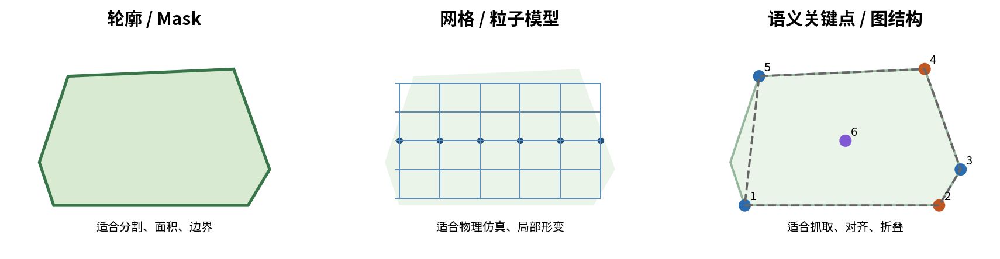

不同表示的适用场景不同：

| 表示 | 优点 | 缺点 | 在本课题中的用途 |
|---|---|---|---|
| Mask/轮廓 | 易于分割、面积和边界计算 | 无法直接描述全部三维褶皱 | 衣物区域、轮廓变化 |
| 点云 | 含有三维几何信息 | 噪声、遮挡、点数大 | 表面形态、深度、桌面高度 |
| 网格/粒子 | 可描述局部形变 | 建模和参数估计较复杂 | 仿真、物理近似 |
| 关键点 | 状态紧凑，便于规划 | 关键点遮挡或识别错误会影响任务 | 衣角、肩点、袖口、折叠对齐 |
| 图结构 | 能表达点之间的关系 | 需要设计节点和边 | 衣物拓扑、关键点关系 |
| 潜在向量 | 维度低，适合学习 | 物理意义不够直观 | 学习策略的状态输入 |

**针对你的毕业设计：** 建议先使用“衣物分割区域 + 少量语义关键点 + RGB-D 三维坐标”的低维状态表示；等流程跑通后，再考虑稠密点云、图神经网络或学习型形变模型。

## 7.3 粒子模型

粒子模型用一组离散点表示物体。第 i 个粒子的位置、速度和质量分别为：

$$
\mathbf p_i\in\mathbb R^3,\qquad
\mathbf v_i\in\mathbb R^3,\qquad
m_i>0
$$

整个物体可以表示为所有粒子的集合。粒子之间的连接关系用于表达结构约束。它的优点是直观，便于实时计算；缺点是如果粒子和连接关系选择不合理，模拟出来的形变可能与真实衣物差异较大。

## 7.4 质点—弹簧模型

质量—弹簧模型（Mass-Spring Model）把柔性物体离散为质点，并通过弹簧连接相邻质点。

一条连接粒子 i 和 j 的弹簧，其当前长度为：

$$
l_{ij}=\|\mathbf p_j-\mathbf p_i\|
$$

弹簧静止长度为 l_0，刚度为 k。弹簧势能可写为：

$$
U_{ij}=\frac{1}{2}k(l_{ij}-l_0)^2
$$

根据势能对位置求负梯度，可得到作用在粒子上的弹簧力。作用在粒子 i 上的力为：

$$
\mathbf f_{ij}^{spring}=
 k(l_{ij}-l_0)\frac{\mathbf p_j-\mathbf p_i}{l_{ij}}
$$

符号方向表示：当弹簧长度大于静止长度时，力会把两个粒子拉近；当长度小于静止长度时，力会产生相反方向的作用。

可以进一步添加阻尼力：

$$
\mathbf f_{ij}^{damp}=c\left((\mathbf v_j-\mathbf v_i)\cdot\hat{\mathbf d}_{ij}\right)\hat{\mathbf d}_{ij}
$$

其中：

$$
\hat{\mathbf d}_{ij}=\frac{\mathbf p_j-\mathbf p_i}{\|\mathbf p_j-\mathbf p_i\|}
$$

对第 i 个粒子应用牛顿第二定律：

$$
m_i\ddot{\mathbf p}_i=
\mathbf f_i^{ext}+\sum_{j\in\mathcal N(i)}
(\mathbf f_{ij}^{spring}+\mathbf f_{ij}^{damp})
$$

这里 N(i) 是与粒子 i 相连的邻居集合，f_ext 包含重力、接触力和机器人施加的力。

把所有粒子组合成矩阵形式，可以得到简化的二阶系统：

$$
\mathbf M\ddot{\mathbf x}+\mathbf D\dot{\mathbf x}+\nabla U(\mathbf x)=\mathbf f_{ext}
$$

其中 x 是所有粒子位置拼接后的向量，M 是质量矩阵，D 是阻尼项，U 是弹性势能。

### 对衣物模型要额外注意什么

普通弹簧模型容易模拟边长拉伸，但衣物还有弯曲和剪切。一个简化的薄片网格可以同时设置：

- 结构弹簧：连接网格横向、纵向相邻节点；
- 剪切弹簧：连接网格对角节点，限制面内剪切；
- 弯曲弹簧：约束相邻网格面之间的弯曲角度。

单纯用结构弹簧，布料可能过于像网格橡皮筋；单纯用弯曲弹簧，又无法正确描述拉伸。真实衣物通常需要结合不同类型的结构约束。

## 7.5 有限元模型（FEM）

有限元方法（Finite Element Method）将连续材料划分成多个有限单元，通过节点位移近似材料变形。它可以更系统地描述材料弹性、应变和应力。

对于小变形线弹性材料，常见的线性动力学形式为：

$$
\mathbf M\ddot{\mathbf u}+\mathbf C\dot{\mathbf u}+\mathbf K\mathbf u=\mathbf f
$$

其中 u 是节点位移向量，M 是质量矩阵，C 是阻尼矩阵，K 是刚度矩阵，f 是外力。

FEM 的优点是可以把材料参数和力学性质联系起来；缺点是建模、网格生成、参数识别和计算开销较大。衣物涉及大变形、褶皱、接触和自碰撞，简单线弹性 FEM 并不能完整描述真实服装行为。

对于本科毕业设计，通常不必先实现高精度布料有限元求解器。可以把它作为理解布料物理特性的工具，系统实现优先采用可观测的关键点和数据驱动状态表示。

## 7.6 形状动力学的通用表达

柔性物体的状态可以抽象为：

$$
\mathbf s_t=\{\mathbf p_1,\ldots,\mathbf p_N,
\mathbf v_1,\ldots,\mathbf v_N,\mathcal G\}
$$

其中 G 表示节点连接或拓扑结构。操作动作 a_t 作用后，状态发生变化：

$$
\mathbf s_{t+1}=f(\mathbf s_t,\mathbf a_t,\boldsymbol\theta,\mathbf w_t)
$$

其中 theta 表示材料参数，w_t 表示未建模扰动，例如摩擦变化、衣物滑动和感知误差。

这说明衣物变形不是简单的几何映射，而是与动作、材料、接触和环境共同相关的动态过程。

## 7.7 为什么需要低维状态表示

如果直接用成千上万个点来描述衣物，控制器很难实时规划。实际机器人系统通常选择与任务相关的低维表示，例如：

$$
\mathbf s_t^{cloth}=
[x_{corner1},y_{corner1},z_{corner1},\ldots,
 x_{cornerK},y_{cornerK},z_{cornerK},A,\theta_f,\ldots]^T
$$

可能包括：

- 衣物四角位置；
- 肩部、袖口和下摆关键点；
- 衣物投影面积；
- 主轴方向；
- 轮廓与目标轮廓之间的误差；
- 当前折叠阶段；
- 关键点置信度。

低维表示的原则是：只保留完成当前任务所需的信息。抓取衣物角点时，角点位置比全局纹理更直接；评估折叠对齐时，折叠边和目标边的位置更加重要。

## 7.8 衣物材料与不确定性

真实衣物并不是参数固定的理想弹性薄片。材料可能有：

- 各向异性：经向和纬向的性质不同；
- 非线性：拉力和伸长量不一定成正比；
- 黏弹性：受力时间会影响变形；
- 滑移：衣物可能在夹爪中移动；
- 摩擦：与桌面和自身接触时会发生粘滑变化；
- 褶皱：局部形变具有多稳定状态。

因此，模型要服务于任务，不必追求完全还原所有物理细节。你的系统可以先做到：衣物分割准确、抓取点可用、动作后重新估计形状、折叠状态可判定。

---

# 第 8 章 衣物感知与状态表示

## 8.1 感知系统需要输出什么

视觉系统不应该只输出“这里有一件衣服”。对双臂操作有用的输出至少包括：

1. 衣物分割区域；
2. 衣物轮廓；
3. 重要关键点；
4. 关键点置信度；
5. 关键点三维坐标；
6. 衣物相对桌面的高度；
7. 当前是否被遮挡、重叠或大面积折叠；
8. 当前折叠阶段和任务完成程度。

## 8.2 RGB 与深度的互补作用

RGB 图像适合识别颜色、纹理、衣物类别和语义特征；深度图适合估计三维位置、表面高度和叠层关系。二者互补：RGB 对纹理敏感，但无法单独确定距离；深度能提供几何信息，但可能在黑色、反光、薄布或边缘处出现噪声。

系统可采用以下处理流程：

1. 同步获取 RGB 与 Depth；
2. 根据标定参数对齐彩色图和深度图；
3. 分割衣物区域；
4. 提取轮廓和候选关键点；
5. 从深度图读取关键点深度；
6. 转换为相机坐标；
7. 通过手眼标定转换到机器人坐标；
8. 根据当前机器人姿态和工作空间判断可达性。

## 8.3 多视角感知

任务书明确提到多视角 RGB-D 相机。多视角的价值在于降低遮挡：俯视相机容易看到衣物整体轮廓，但衣物叠层或竖起的边缘可能缺少侧面深度；侧视或斜视相机能补充高度和褶皱信息。

多视角融合要解决：

- 多相机时间同步；
- 每台相机的内参标定；
- 相机之间的外参标定；
- 不同视角点云配准；
- 遮挡和重复点处理；
- 不同相机观测置信度融合。

若多个相机都转换到同一个世界/工作台坐标系，就可以在统一坐标下融合数据。

## 8.4 关键点与图结构

对于 T 恤，可以定义语义关键点，例如左肩、右肩、左袖口、右袖口、左下摆、右下摆和衣领中心。关键点集合为：

$$
\mathcal P=\{\mathbf p_1,\mathbf p_2,\ldots,\mathbf p_K\}
$$

用边集合 E 描述关键点之间的关系，就得到图结构：

$$
\mathcal G=(\mathcal P,\mathcal E)
$$

例如，左肩和左袖口之间的边可以表达左袖长度方向；左下摆和右下摆之间的边可以表达衣物下边缘方向。

关键点不仅是位置，还应该有置信度：

$$
c_i\in[0,1]
$$

当置信度低时，不应直接把该点作为高风险抓取目标。可以重新观察、切换视角、使用轮廓几何推断，或执行低风险的探索动作。

## 8.5 关键点三维定位与不确定度

像素坐标和深度都有误差。对像素点与深度进行三维反投影后，误差会受到焦距、深度和像素位置影响。距离相机越远，固定像素误差通常对应更大的横向位置误差。

可以为每个关键点维护一个协方差矩阵：

$$
\boldsymbol\Sigma_i=\operatorname{Cov}(\mathbf p_i)
$$

当位置不确定度较大时，规划器可以：

- 降低动作速度；
- 增加安全距离；
- 优先使用更宽容的抓取区域；
- 重新拍摄或融合另一视角；
- 避免在低置信度点上执行精细折叠。

## 8.6 衣物状态估计与时间连续性

单帧图像只描述当前时刻；操作过程需要跟踪关键点和衣物整体状态。可以维护上一时刻的关键点，利用光流、特征跟踪、检测器或时序模型估计当前状态。

状态更新的抽象表达：

$$
\hat{\mathbf s}_{t}=\operatorname{Update}(\hat{\mathbf s}_{t-1},\mathbf o_t)
$$

其中 o_t 是当前视觉观测。若当前观测与运动预测差异过大，应判断是否发生了滑移、遮挡、抓取失败或折叠阶段变化。

## 8.7 抓取点选择的视觉线索

衣物抓取点可以考虑：

- 角点：便于展开和对齐；
- 边缘附近：便于夹持，但不能太靠边以免滑脱；
- 远离严重褶皱或遮挡的区域；
- 位于机械臂可达范围内；
- 夹爪能够以合理姿态接近；
- 两臂抓取点之间有足够距离，避免局部堆叠或夹爪相撞。

不要把“视觉上最明显的点”自动等同于“最好的抓取点”。好的抓取点还必须考虑可达性、夹爪接近方向、可夹持区域、布料受力路径和下一步动作。

---

# 第 9 章 衣物抓取与双臂操作策略

## 9.1 衣物抓取与刚性物体抓取的区别

刚性物体抓取通常关注物体重心、接触面和稳定抓取位姿。衣物抓取还必须考虑：

- 抓取点是否位于单层布料；
- 是否抓到多层衣物；
- 是否抓住衣角或袖口；
- 夹爪闭合时布料是否被推走；
- 抬起后是否发生滑移；
- 抓取点是否有利于下一步展开或折叠。

## 9.2 抓取点的代价函数

对每个候选抓取点 g，可定义一个综合评分：

$$
S(g)=w_1C_{keypoint}+w_2C_{edge}+w_3C_{reachable}
-w_4C_{occlusion}-w_5C_{collision}-w_6C_{slip}
$$

其中：

- C_keypoint：是否接近目标语义关键点；
- C_edge：是否具有适合夹持的边缘结构；
- C_reachable：机械臂可达程度；
- C_occlusion：遮挡风险；
- C_collision：接近过程碰撞风险；
- C_slip：滑移风险。

这些评分可以来自规则、几何模型或学习模型。最初的毕业设计不需要把所有项都训练成神经网络，可以先使用规则和实验标定。

## 9.3 双臂抓取的几何关系

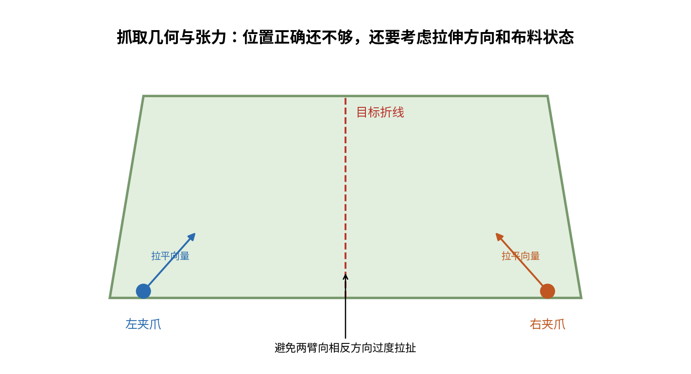

对衣物左右两侧分别选择抓取点。抓取点距离太近，可能只拉动衣物局部；距离太远，则可能难以同时到达或造成布料过度张紧。要根据衣物尺寸、夹爪工作空间和目标折叠方式选择。

抓取完成后，可以执行小幅度测试动作：

1. 两臂向上抬起少量距离；
2. 观察衣物是否整体随夹爪移动；
3. 检查是否有一侧滑落；
4. 检查两侧关键点是否产生符合预期的变化；
5. 再决定是否继续拉平。

这相当于通过一个低风险动作，确认抓取是否有效。

## 9.4 双臂常用动作原语

动作原语（Motion Primitive）是可重复调用的基础动作单元。建议将衣物操作拆成：

| 动作原语 | 主要作用 | 关键约束 | 结束条件 |
|---|---|---|---|
| Approach | 接近目标点 | 可达、避障、姿态合理 | 两臂到达预抓取位 |
| Grasp | 夹持衣物 | 夹爪行程、接触状态 | 夹爪闭合且抓取可信 |
| Lift | 抬起衣物 | 低速、避免拉扯 | 衣物离开桌面或达到目标高度 |
| Stretch | 双侧拉平 | 控制相对距离与张力 | 轮廓更展开、关键点关系合理 |
| Reposition | 重新定位 | 两臂同步、避免扭转 | 衣物到达目标区域 |
| Fold | 翻折/对折 | 折线、目标边缘对齐 | 折叠边达到允许误差 |
| Press/Settle | 轻压或整理 | 低力/低速、避免夹入多层 | 褶皱和边缘误差满足条件 |
| Release | 释放衣物 | 支撑稳定、两臂协调 | 夹爪打开且衣物不滑落 |

动作原语应当有明确的输入、输出和失败状态。例如 Grasp 的输入不是只有一个抓取点，还应包含抓取姿态、接近方向、夹爪闭合策略和成功判定条件。

## 9.5 展开与拉平

衣物平铺通常需要先把局部褶皱展开。一个简单的过程是：

1. 视觉系统估计衣物主体轮廓和两个抓取点；
2. 双臂分别接近并夹持；
3. 低速抬升，检查抓取可靠性；
4. 两臂按规划方向缓慢分开；
5. 观察衣物轮廓是否扩大、关键点是否更接近预期；
6. 必要时改变拉动方向或重新抓取；
7. 逐渐降低衣物，使其平放到工作台上。

**不要用单一“把两臂拉到最大距离”的策略。** 过度拉伸可能导致衣物变形或从夹爪中滑脱；合理的拉平目标应由衣物关键点、轮廓和接触状态共同决定。

## 9.6 视觉引导的拉平方向

假设两个关键点的位置分别为 p_L 和 p_R，可以定义当前主方向：

$$
\mathbf d=\frac{\mathbf p_R-\mathbf p_L}
{\|\mathbf p_R-\mathbf p_L\|}
$$

如果期望沿该方向拉平，可以让两个末端产生方向相反的相对运动，同时控制整体中心位置不发生过大偏移。

但当衣物轮廓方向与两个抓取点连线不一致时，不能简单沿 d 拉动；应根据目标衣物形状、轮廓主轴和褶皱方向选择动作。

## 9.7 折叠操作

折叠不是简单把一侧机械臂移动到另一侧。它要求衣物上的一组点映射到目标位置，并尽量保持折叠边平直、衣物层次合理。

一种常见的几何目标是沿一条折线进行镜像映射。设折线经过点 p_0，单位法向量为 n，原始点为 p，则其关于折线的镜像位置可写为：

$$
\mathbf p'=\mathbf p-2\mathbf n\mathbf n^T(\mathbf p-\mathbf p_0)
$$

这是二维或三维空间中关于直线/平面的反射表达，具体使用时要根据工作台平面和折线方向选取合适的坐标表示。

这个公式的意义是：折叠前某个衣物点 p，理想情况下应该移动到折线另一侧的对称位置 p'。实际衣物并不会像刚性几何图形一样完美翻转，因此这个公式更适合作为目标几何关系，而不是完整的布料动力学模型。

## 9.8 抓取后是否滑移的判断

设抓取后关键点的预测位置为 p_hat，视觉重新检测到的位置为 p_obs，则：

$$
\mathbf e_{track}=\|\hat{\mathbf p}-\mathbf p_{obs}\|
$$

如果末端移动了较大距离，但衣物关键点没有产生预期位移，可能说明抓取滑移、衣物被桌面摩擦阻碍，或视觉跟踪错误。此时不应继续沿原轨迹执行，而应暂停、重新观察和重新规划。

---

# 第 10 章 衣物折叠任务规划

## 10.1 从连续动作到任务状态机

完整衣物折叠可以分解成离散阶段：

1. Observe：观察初始衣物状态；
2. Locate：确定抓取点和折叠目标；
3. Pre-grasp：双臂到达抓取预备位；
4. Grasp：同时抓取；
5. Lift：抬升验证抓取；
6. Spread：展开、拉平；
7. Place：放置到平整区域；
8. Align：对齐衣物边缘和关键点；
9. Fold-1：执行第一次折叠；
10. Reobserve：重新感知折叠结果；
11. Fold-2：执行下一次折叠或整理；
12. Evaluate：判断最终结果；
13. Recover：若失败，则恢复或重新规划。

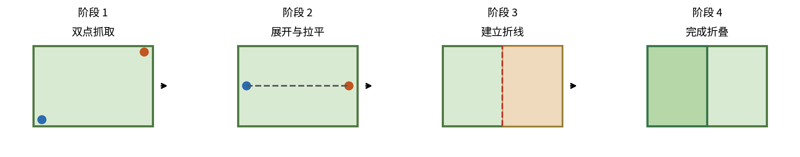

状态机的好处是每个阶段都有明确的进入条件、执行动作和退出条件。这样出现问题时，能够知道失败发生在哪一步，而不是只知道“整个折叠失败了”。

## 10.2 状态机示例

```text
IDLE
  └──> PERCEIVE
         └──> PLAN_GRASP
                └──> APPROACH
                       └──> GRASP
                              └──> VERIFY_GRASP
                                     ├── success -> LIFT
                                     └── failure -> RECOVER_GRASP
  LIFT
   └──> SPREAD
          └──> PLACE
                 └──> ALIGN
                        └──> FOLD
                               └──> VERIFY_FOLD
                                      ├── success -> NEXT_FOLD / DONE
                                      └── failure -> REPLAN
```

在实现中，每个状态应该有超时和异常分支。例如，两臂等待同步到位超过规定时间，不能无限等待；相机数据超时，不能继续使用过期坐标。

## 10.3 层次化任务规划

可以将规划分为三层：

### 高层：语义任务

理解用户指令，例如“把 T 恤对折”。决定目标衣物类别、折叠类型和期望结果。

### 中层：动作原语序列

把语义任务变成抓取、展开、对齐、翻折、释放等技能序列。

### 低层：运动与控制

生成左右末端目标、关节轨迹、夹爪指令和安全约束。

高层不需要知道每个关节的毫弧度变化；底层也不应该直接猜测“用户说对折”意味着哪个衣角要抓。分层设计使系统更容易调试。

## 10.4 折叠目标的表示

对于规则衣物，可以定义目标关键点位置、轮廓、折线和叠放关系。假设当前关键点集合为 P，目标关键点为 P*，可以定义：

$$
E_{keypoint}=\frac{1}{K}\sum_{i=1}^{K}
\|\mathbf p_i-\mathbf p_i^*\|_2^2
$$

同时考虑衣物轮廓差异：

$$
E_{mask}=1-\operatorname{IoU}(M,M^*)
$$

其中 M 是当前衣物区域，M* 是目标区域，IoU 是交并比。

再考虑折叠边的对齐误差：

$$
E_{edge}=\frac{1}{N}\sum_{i=1}^{N}
\operatorname{dist}(\mathbf v_i,\mathcal L^*)
$$

其中 v_i 是当前折叠边上的采样点，L* 是目标折叠边。

综合目标误差：

$$
E_{total}=w_kE_{keypoint}+w_mE_{mask}+w_eE_{edge}
$$

权重需要通过实际任务调节。不同衣物形状和折叠方式下，重点指标可能不同。

## 10.5 动作执行时机与重规划

不要在执行一整段长动作之前假定衣物状态永远符合预测。更合理的策略是短时动作规划：

1. 根据当前状态预测下一小段动作；
2. 执行短时动作；
3. 重新拍摄并估计衣物状态；
4. 计算误差和不确定度；
5. 继续、修正、重新抓取或停止。

这就是滚动时域或模型预测思想的一种简单工程化应用。它可以不依赖完整准确的布料物理模型，而是通过反复观察来修正动作。

---

# 第 11 章 视觉反馈与闭环控制

## 11.1 开环与闭环

开环控制根据预先计算好的动作直接执行，不使用执行结果修正后续动作。闭环控制会持续比较当前状态和目标状态，根据误差调整动作。

对于衣物折叠，开环方法的问题是：第一次抓取后，衣物可能已经滑动、拉伸或折叠；如果仍按初始规划继续动作，误差可能不断累积。

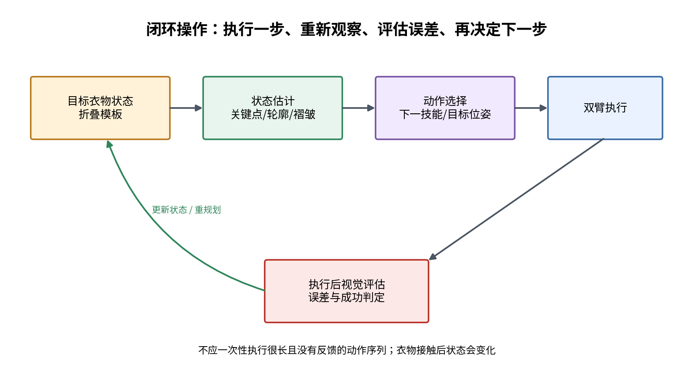

## 11.2 基于状态误差的反馈

假设当前衣物状态为 s，目标状态为 s*，定义误差：

$$
\mathbf e=\mathbf s^*-\hat{\mathbf s}
$$

一个简单的比例控制思想为：

$$
\mathbf u=\mathbf K\mathbf e
$$

其中 u 是下一步动作修正量。对于视觉关键点任务，可以把 u 理解为抓取点或末端目标的调整方向，而不是直接把它当成关节力矩。

在多变量衣物任务中，K 可以是对角权重，也可以是由数据学习得到的局部映射。实际使用时还需要限幅和碰撞约束。

## 11.3 视觉伺服的两种方式

### Image-Based Visual Servoing（IBVS）

直接在图像平面中定义特征误差，例如关键点像素位置和目标像素位置之间的偏差。优点是不一定需要完整恢复三维模型；缺点是图像运动与机器人三维运动之间的关系受相机内参和深度影响。

### Position-Based Visual Servoing（PBVS）

先根据图像和深度估计三维位姿，再在三维空间中定义误差。优点是动作更容易与机器人坐标系结合；缺点是依赖标定和深度精度。

对于你的 RGB-D 双臂折衣系统，可以先采用 PBVS 或关键点三维坐标反馈，逐步加入图像平面误差作为辅助。

## 11.4 闭环执行的基本算法

```python
while not task_finished:
    rgb, depth = camera.get_synchronized_frames()
    cloth_state = perception.estimate(rgb, depth)

    if cloth_state.confidence < confidence_threshold:
        robot.stop_or_hold()
        camera.request_new_observation()
        continue

    action = planner.choose_next_action(cloth_state)
    action = safety_filter.check_and_limit(action)

    dual_arm.execute_short_horizon(action)
    result = dual_arm.wait_for_result(timeout=...)

    if not result.success:
        recovery.handle(result.error_code)
        continue

    new_state = perception.estimate(*camera.get_synchronized_frames())
    if task_evaluator.is_success(new_state):
        task_finished = True
```

这是流程示意，不是可以直接复制运行的真实机器人代码。真实接口应替换为实验室相机驱动、ROS2 Action、MoveIt2 和 Franka 控制接口，并加入异常处理、急停和动作超时。

## 11.5 何时重新观察

建议在以下事件后触发新一轮感知：

- 两夹爪完成闭合；
- 衣物离开桌面；
- 双臂拉平完成；
- 衣物重新放置到桌面；
- 一次折叠动作完成；
- 夹爪打开；
- 机器人检测到滑移、接触异常或跟踪误差异常。

并非必须每个控制周期都运行完整 VLA。可以将高频底层控制和低频视觉/高层决策分开：底层轨迹控制在机器人允许的控制频率运行；视觉和 VLA 根据任务阶段按需更新。具体频率应根据硬件和模型推理能力实测确定。

---

# 第 12 章 VLA 与双臂控制系统的接口设计

## 12.1 VLA 在整个系统中的角色

VLA 是高层的视觉—语言—动作策略模型。它可以根据图像和指令提出动作，但模型的动作表示并不一定与 Franka 的控制接口一致。

例如模型输出可能是：

- 末端增量位姿；
- 夹爪开合量；
- 关节动作；
- 离散动作 token；
- 一段动作序列（Action Chunk）。

在系统集成时，必须先查看模型的数据定义、坐标系、单位、归一化范围、动作维度和控制频率。

## 12.2 推荐的动作转换链路

```text
VLA 输入：图像 + 语言 + 可选机器人状态
                  ↓
             模型推理
                  ↓
             原始动作向量
                  ↓
       反归一化 / 单位还原 / 解码
                  ↓
       统一坐标系转换 / 目标位姿构造
                  ↓
       任务约束与动作原语映射
                  ↓
        IK / MoveIt2 / 轨迹规划
                  ↓
          安全检查与限幅
                  ↓
         ROS2 控制接口执行
                  ↓
         视觉重新观察与反馈
```

## 12.3 为什么需要动作适配层

模型输出动作可能是归一化的，而机器人需要米、弧度、秒和具体控制接口。必须经过动作适配层完成：

1. 维度检查：动作向量长度是否正确；
2. 数值检查：是否包含 NaN、Inf 或异常极值；
3. 反归一化：恢复训练数据中的真实量纲；
4. 坐标系处理：模型动作定义在哪个坐标系；
5. 参考系处理：动作是绝对位姿还是相对增量；
6. 姿态转换：欧拉角、四元数或旋转矩阵；
7. 夹爪映射：模型中的开合参数如何对应真实夹爪；
8. 安全过滤：动作是否超出工作空间、速度和关节限制；
9. 规划执行：将动作转为机器人控制器能够接受的命令。

**特别注意：** 不能默认模型输出的 Delta X、Delta Y、Delta Z 就是机器人基坐标系下的米制位移。必须检查训练数据和模型实现。

## 12.4 高层技能与底层控制解耦

建议 VLA 不要直接输出每个关节的高速控制量，而是优先输出高层动作意图或有限时域动作，再由底层确定安全轨迹。例如：

- 左臂抓取衣物左下角；
- 右臂抓取衣物右下角；
- 两臂向外拉平；
- 右侧衣片向中线翻折。

任务规划器把意图转换成精确的目标点、目标姿态和动作原语，机器人控制系统负责执行。

这有利于：

- 限制模型错误带来的风险；
- 使用成熟的运动规划；
- 方便单独调试模型和机器人；
- 将机器人安全规则与模型参数隔离；
- 在模型失效时启用传统规则策略。

## 12.5 VLA 输出与双臂数据集

如果后续需要微调 VLA 或模仿学习策略，采集数据时至少应考虑同步记录：

- RGB 图像和时间戳；
- 深度图像和时间戳；
- 左右机械臂关节状态；
- 左右末端位姿；
- 夹爪状态；
- 任务指令；
- 动作命令；
- 任务阶段标签；
- 成功/失败标签；
- 衣物类别和材料信息（可选）；
- 标定参数和硬件软件版本。

双臂数据的时间同步尤其重要。若左右臂动作和图像时间戳错位，模型可能学到错误的因果关系。

---

# 第 13 章 ROS2 工程实现建议

## 13.1 ROS2 节点划分建议

结合你的课题，可以设计如下节点：

| 节点 | 主要功能 | 输入 | 输出 |
|---|---|---|---|
| camera_manager | 相机驱动和同步 | 相机硬件数据 | RGB、Depth、CameraInfo |
| cloth_perception | 衣物分割、关键点和状态估计 | RGB、Depth | ClothState |
| vla_inference | VLA 推理 | 图像、指令、可选状态 | 原始模型动作/技能建议 |
| task_manager | 管理折叠状态机 | 感知状态、模型结果 | 子任务和阶段状态 |
| bimanual_coordinator | 双臂目标协调与同步 | 子任务、左右臂状态 | 左右臂目标和同步信息 |
| motion_planner | 运动规划、IK、碰撞检查 | 目标位姿、规划场景 | 关节轨迹 |
| left_arm_controller | 左臂执行 | 左臂轨迹/控制目标 | 关节状态、执行结果 |
| right_arm_controller | 右臂执行 | 右臂轨迹/控制目标 | 关节状态、执行结果 |
| gripper_controller | 夹爪操作 | 开合/夹持目标 | 夹爪状态 |
| task_evaluator | 结果评估 | 最新衣物状态 | 成功率、误差、任务状态 |
| safety_monitor | 安全监测 | 关节、碰撞、通信、速度 | 允许/停止/故障状态 |

## 13.2 Topic、Service 和 Action 怎么选

- Topic：持续发布的传感器状态，例如图像、关节状态、点云。
- Service：快速请求—响应，例如查询某个配置或切换一个简单模式。
- Action：持续时间较长、需要反馈和取消的任务，例如机械臂运动、抓取、折叠动作。

建议将“执行一次抓取”或“执行一次折叠技能”设计为 Action，而不是只发布一个没有执行反馈的 Topic。

## 13.3 规划组和控制器的组织

在 MoveIt2 中，可以根据机器人模型建立：

- left_arm：左臂规划组；
- right_arm：右臂规划组；
- dual_arms：联合规划组（如配置和规划器支持）；
- left_hand / right_hand：左右夹爪相关组。

联合规划组是否能稳定进行双臂规划，取决于机器人模型、规划器配置、碰撞场景和运动约束。不要以为只要 SRDF 中建立了 dual_arms 组，就自动拥有完整的双臂协同策略。

ros2_control 负责将控制器与硬件接口组织起来；Joint Trajectory Controller 可以接收按时间排列的关节轨迹点。左右臂如果分别使用轨迹控制器，任务协调器需要处理启动时刻、时间戳、执行反馈和异常中止。有关 Joint Trajectory Controller 的接口和插值细节，查阅当前发行版的官方文档。[6]

## 13.4 统一状态消息的设计

建议定义一个统一的衣物状态消息，至少包括：

```text
Header header
string garment_type
bool is_visible
float32 confidence
geometry_msgs/Point[] keypoints_camera
geometry_msgs/Point[] keypoints_base
float32[] keypoint_confidence
sensor_msgs/Image segmentation_mask
float32 projected_area
string folding_stage
```

这只是接口设计示意。真实 ROS2 自定义消息需要定义固定字段类型、数组长度策略、时间戳和坐标系，并在包中生成消息代码。

对于双臂协调目标，可以定义：

```text
Header header
Pose left_target
Pose right_target
float32 duration
bool left_gripper_open
bool right_gripper_open
string primitive_name
string reference_frame
```

生产级系统还应明确：目标是绝对位姿还是增量、姿态采用四元数还是其他表达、夹爪开合单位、允许误差、超时、是否允许取消以及失败码。

## 13.5 TF2 与坐标树

建议使用清晰的 TF 树：

```text
world / table_frame
 ├── left_base
 │    └── left_link_1 ... left_tool
 ├── right_base
 │    └── right_link_1 ... right_tool
 ├── camera_1_link
 └── camera_2_link
```

坐标树中的每条变换必须有明确来源：固定安装外参、机器人关节状态或标定结果。避免在多个节点中分别维护相互矛盾的手写变换矩阵。

## 13.6 数据记录与复现

使用 rosbag2 记录关键 Topic；每次实验保留：

- 代码 Git commit；
- ROS2 发行版和依赖版本；
- 相机标定参数；
- 机器人型号和工具配置；
- VLA 模型权重和配置；
- 任务指令与初始衣物状态；
- 相机、关节、末端和夹爪数据；
- 执行结果及异常日志。

如果无法复现某次“成功折叠”，论文实验结果就很难形成可信证据。

---

# 第 14 章 实验设计、评价指标与数据记录

## 14.1 为什么需要量化评价

“机器人看起来折得还可以”不能作为充分的实验结论。你需要说明：折叠成功率是多少、平均用时是多少、边缘对齐误差是多少、不同衣物和初始状态下是否稳定。

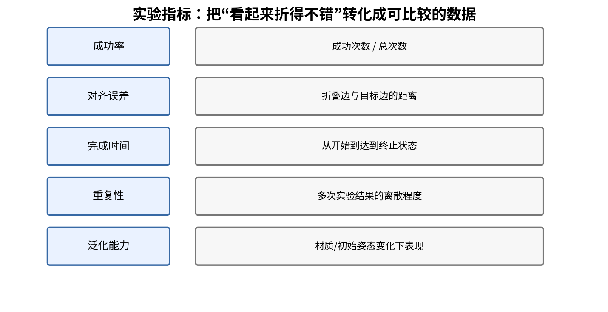

## 14.2 折叠成功率

若进行 N 次实验，其中成功完成任务的次数为 N_s，则成功率为：

$$
SR=\frac{N_s}{N}\times100\%
$$

必须提前定义“成功”的判据。例如：完成预定折叠步骤、衣物没有脱落、主要折叠边误差小于指定阈值、最终形状符合目标状态。判据不能在看到实验结果后随意修改。

## 14.3 平均操作时间

第 i 次任务从开始到达到终止条件的时间为 T_i，则：

$$
\bar T=\frac{1}{N}\sum_{i=1}^{N}T_i
$$

还应记录标准差，反映不同实验之间的时间波动：

$$
\sigma_T=\sqrt{\frac{1}{N-1}\sum_{i=1}^{N}(T_i-\bar T)^2}
$$

## 14.4 关键点对齐误差

若有 K 个关键点，当前点为 p_i，目标点为 p_i*：

$$
E_{kp}=\frac{1}{K}\sum_{i=1}^{K}
\|\mathbf p_i-\mathbf p_i^*\|_2
$$

注意：关键点对齐误差依赖坐标系和标定精度。建议使用工作台坐标系下的三维距离，或在同一张经过对齐的图像平面上比较像素距离，不能把不同坐标系的数值直接相减。

## 14.5 轮廓 IoU

当前衣物区域为 M，目标衣物区域为 M*：

$$
IoU=\frac{|M\cap M^*|}{|M\cup M^*|}
$$

IoU 越大，说明当前和目标轮廓重叠越多。对于衣物层叠和遮挡，轮廓相似不一定意味着折叠层次正确，因此需要结合关键点、边缘和人工检查。

## 14.6 折叠边误差

对当前折叠边采样 N 个点 v_i，目标折叠线为 L*：

$$
E_{edge}=\frac{1}{N}\sum_{i=1}^{N}
\operatorname{dist}(\mathbf v_i,\mathcal L^*)
$$

如果目标折叠边本身是有限线段，而不是无限直线，则距离应计算到线段，而不是无限延长的直线。

## 14.7 抓取与执行指标

还可以记录：

- 抓取成功率；
- 夹爪滑移次数；
- 双臂同步误差；
- 轨迹规划成功率；
- 碰撞/安全停止次数；
- 重新规划次数；
- 需要人工干预的次数。

双臂末端同步误差可以定义为：

$$
E_{sync}(t)=\|\mathbf r(t)-\mathbf r_d(t)\|_2
$$

这里 r 是实际相对位置，r_d 是期望相对位置。对衣物任务，该误差需要按动作阶段解释，不能把它变成始终固定的“夹爪间距误差”。

## 14.8 泛化实验

至少考虑三个维度：

1. 衣物类别：T 恤、毛巾、长袖上衣等；
2. 初始状态：平铺、轻微褶皱、明显皱团、局部遮挡；
3. 环境条件：不同位置、不同朝向、不同材料或光照。

本科毕业设计可以先固定衣物类别和实验环境，建立可靠基线，再逐步扩展。不要一开始就承诺对所有材质、所有衣物、所有初始状态都能稳定折叠。

## 14.9 实验对照设计

可以设置：

- Baseline A：固定规则抓取与预设动作；
- Baseline B：视觉关键点引导的动作；
- Proposed：加入 VLA 决策或模型适配后的系统。

比较成功率、时间、关键点误差和干预次数。对比时要尽量保持硬件、衣物、初始状态和实验次数一致。

---

# 第 15 章 面向毕业设计的实施路线

## 15.1 先搭建最小可行系统

不要从“一次性完成 VLA 双臂自主折衣”开始。建议逐级增加复杂度：

### 阶段 A：单臂基础控制

目标：单臂能安全地到达指定位置、读取关节状态、控制夹爪开合、执行简单抓取。验收材料：代码、轨迹图、关节状态日志、抓取视频。

### 阶段 B：双臂独立运行

目标：左右臂能分别控制，双方的关节状态和末端位姿都能正确读取。验收材料：两臂独立运动视频、左右臂 TF、双臂碰撞模型。

### 阶段 C：双臂同步运动

目标：两臂能同时执行时间对齐的预设轨迹，在无衣物条件下完成同步移动。验收材料：两臂末端位置曲线、同步误差曲线、碰撞检查结果。

### 阶段 D：双臂抓取固定/简单物体

目标：验证同步夹持和共同移动流程。建议先使用低风险、形状简单的物体，不要立即上真实衣物。

### 阶段 E：单件衣物双臂拉平

目标：完成衣物关键点识别、抓取点选择、低速双臂拉平和视觉反馈。验收材料：关键点图、抓取点图、拉平前后轮廓对比。

### 阶段 F：固定动作序列的衣物折叠

先不依赖 VLA 自主生成全部动作，使用人工设计的动作原语完成基础折叠。这样可以把“机器人控制是否可靠”与“模型决策是否准确”分开验证。

### 阶段 G：接入 VLA

当底层系统稳定后，再让 VLA 提供技能选择、抓取建议或动作候选。增加动作适配、安全检查和闭环评估。

### 阶段 H：实验评价与论文

记录多次实验、做对照、分析失败原因，并整理可复现代码和图表。

## 15.2 双臂协同与柔性操作模块的八周安排

| 周次 | 理论学习 | 工程实践 | 阶段验收 |
|---|---|---|---|
| 第 1 周 | FK/IK、坐标系、雅可比 | 读取两臂状态，检查 TF | 正确说明左右臂坐标关系 |
| 第 2 周 | 双臂任务协调、主从/对称控制 | 左右臂独立控制 | 两臂分别到达安全目标位 |
| 第 3 周 | 整体/相对运动、轨迹同步 | 两臂同步执行简单轨迹 | 记录同步误差曲线 |
| 第 4 周 | 碰撞检测、零空间、运动规划 | 配置双臂规划场景 | 能检测典型臂间碰撞 |
| 第 5 周 | 阻抗/导纳、抓取摩擦 | 夹爪抓取与低速抬升实验 | 抓取成功率可统计 |
| 第 6 周 | 柔性物体状态表示、弹簧模型 | 衣物分割与关键点定位 | 可输出关键点三维坐标 |
| 第 7 周 | 衣物动作原语、折叠几何 | 双臂拉平、对齐、简单折叠 | 完成固定动作基线 |
| 第 8 周 | 闭环反馈、实验指标 | 失败恢复、对照实验 | 形成实验表格和视频 |

这八周是一个聚焦模块的建议安排，不替代整个毕业设计的总进度。若实验室已有现成的双臂控制和相机标定，可将时间更多分配给衣物状态估计与闭环策略。

## 15.3 每周必须留下的成果

- 一份理论笔记：解释原理和公式，而不是只复制定义；
- 一份可运行代码：能单独复现本周功能；
- 一份实验记录：设备、参数、成功/失败和截图；
- 一份问题清单：下一周优先解决的 3～5 个问题。

## 15.4 毕业论文中如何体现这一模块的工作

可以在论文中呈现：

- 双臂系统坐标系与结构图；
- 双臂联合运动学模型；
- 双臂同步轨迹规划方法；
- 臂间碰撞检测和安全约束；
- 衣物状态表示和关键点检测；
- 双臂动作原语和任务状态机；
- 视觉反馈闭环；
- 不同条件下的实验结果和失败分析。

理论章节不能只写“使用 MoveIt2 规划”，而应说明规划输入是什么、约束是什么、输出是什么、如何验证轨迹有效。

---

# 第 16 章 常见故障与调试方法

## 16.1 两臂都能动，但同时执行就出错

可能原因：

- 两个控制器抢占同一硬件资源；
- 控制器接口或关节列表配置错误；
- 起始时间戳不一致；
- 两臂轨迹单独可行，但联合轨迹存在碰撞；
- 同步逻辑只等待固定时间，没有检查执行结果。

排查顺序：先单臂验证，再双臂空载低速验证；检查控制器状态、关节列表、TF 和轨迹时间戳；最后打开双臂联合碰撞检查。

## 16.2 末端到达目标点，但夹爪抓不到衣物

可能原因：

- RGB 与 Depth 没有对齐；
- 相机外参错误；
- 深度单位错误；
- 抓取点在图像上正确，但实际属于另一层布料；
- 夹爪工具坐标系偏移没有标定；
- 抓取姿态方向不合理；
- 目标点不可达或靠近桌面碰撞区域。

排查顺序：在 RViz2 或可视化工具中显示相机点云、抓取点和末端坐标轴；用已知位置的标定物检查坐标误差；确认工具中心点（TCP）设置。

## 16.3 两臂同时抓住衣物，但拉平时衣物扭转

可能原因：

- 抓取点不是对应的左右位置；
- 衣物初始状态估计错误；
- 两夹爪抓取了不同层；
- 拉动方向与衣物主方向不一致；
- 两臂不同步；
- 拉伸幅度过大或过小。

改进方法：先用关键点关系确定左右对应关系；增加小幅抬升验证；对每个短动作重新观察；把相对距离作为可调变量，而不是固定值。

## 16.4 衣物从夹爪中滑落

可能原因：

- 夹持位置过于靠近布边；
- 夹爪接触面摩擦不足；
- 夹持力不合适；
- 运动加速度过大；
- 衣物重量或多层厚度超出夹爪适用范围；
- 夹爪闭合状态没有确认。

改进方法：改变抓取区域；采用低速抬升验证；根据夹爪和材料特性调整夹持策略；通过视觉跟踪或夹爪状态监测滑移。

## 16.5 折叠看似完成，但边缘不齐

可能原因：

- 折叠线估计不准；
- 目标边缘被遮挡；
- 衣物放置后发生滑动；
- 两臂翻折时运动关系不正确；
- 没有进行折叠后的状态评估。

改进方法：将折叠过程分成定位、抬起、翻转、放置和对齐；对齐时重新检测关键点；只对需要修正的局部区域做小动作。

## 16.6 ROS2 话题有数据，但机器人不执行

逐项检查：

1. 消息类型和字段是否匹配；
2. 话题名称和命名空间是否正确；
3. 控制器是否处于 active 状态；
4. Action Server 是否可用；
5. 轨迹中的关节名是否与控制器配置完全一致；
6. 时间戳和时间单位是否正确；
7. 目标关节位置、速度是否越界；
8. 是否有硬件安全状态或错误代码阻止执行。

## 16.7 调试原则

按层定位问题，不要同时修改多个模块：

- 感知层：图像、深度、关键点；
- 坐标层：相机—机器人—末端坐标变换；
- 规划层：IK、轨迹、碰撞；
- 控制层：控制器状态、跟踪误差；
- 交互层：夹爪、衣物形变、滑移；
- 任务层：状态机、成功判据和恢复策略。

每次只改一个主要变量，并保留修改前后的日志和结果。

---

# 第 17 章 必须掌握的知识清单与自测题

## 17.1 理论知识清单

### 双臂运动学

- [ ] 能够解释两臂关节变量和联合关节向量；
- [ ] 能够解释 FK、IK 和雅可比矩阵；
- [ ] 能够解释整体运动和相对运动；
- [ ] 能够说明冗余自由度、零空间和奇异点；
- [ ] 能够根据坐标变换把相机抓取点变成机器人目标点。

### 双臂协同控制

- [ ] 能够区分主从、对称、集中式和分布式控制；
- [ ] 能够解释两臂任务同步和时间同步；
- [ ] 能够解释刚性双臂闭链约束和柔性物体软约束的区别；
- [ ] 能够解释内力、张力和相对位姿约束；
- [ ] 能够设计两臂同步运动流程。

### 运动规划与安全

- [ ] 能够区分关节空间规划与笛卡尔空间规划；
- [ ] 能够解释五次多项式轨迹；
- [ ] 能够解释臂间碰撞检测；
- [ ] 能够说明关节速度、位置和安全距离约束；
- [ ] 能够解释为什么 VLA 输出必须经过安全过滤。

### 柔性物体操作

- [ ] 能够解释衣物高维状态和部分可观测性；
- [ ] 能够比较 Mask、点云、网格、关键点和图表示；
- [ ] 能够推导质量—弹簧模型的基本动力学；
- [ ] 能够解释织物拉伸、弯曲、剪切、摩擦和滑移；
- [ ] 能够设计衣物抓取、拉平、对齐和折叠动作原语。

### 系统工程

- [ ] 能够划分 ROS2 节点和通信接口；
- [ ] 能够设计任务状态机；
- [ ] 能够记录同步图像和双臂状态；
- [ ] 能够计算成功率、时间和折叠误差；
- [ ] 能够解释实验失败原因并提出改进方案。

## 17.2 概念自测题

1. 为什么双臂同时到达各自的目标点，不代表已经实现协同？
2. 当左右末端速度相同时，整体运动和相对运动分别如何变化？
3. 为什么衣物不能简单采用“两个夹爪相对位姿固定”的刚性闭链约束？
4. 雅可比矩阵的物理意义是什么？
5. 逆运动学为什么可能有多解或无解？
6. 零空间项为什么可以用于避开关节限位？
7. 为什么双臂同步应使用共同时间基准或事件屏障？
8. 五次多项式中的 10、-15、6 是如何由边界条件得到的？
9. 为什么只检查两末端距离不足以避免双臂碰撞？
10. 阻抗控制中的 M、D、K 分别代表什么？
11. 质量—弹簧模型中弹簧力如何从势能求导得到？
12. 为什么衣物关键点状态比单纯的整件衣物中心点更有利于折叠？
13. 抓取点选择为什么需要同时考虑可达性和后续任务？
14. 为什么折叠动作执行后必须重新观察？
15. VLA 动作输出到 Franka 控制指令之间为什么需要动作适配层？

## 17.3 实践自测题

### 实践 1：双臂同步移动

让两臂从安全初始位移动到两个目标位。记录两臂末端位置随时间变化，计算相对位置误差。要求轨迹平滑、两臂没有碰撞、执行结果可复现。

### 实践 2：衣物关键点定位

使用 RGB-D 相机拍摄一件平铺 T 恤，检测至少四个关键点，输出像素坐标、深度和机器人基坐标。用可视化把三维关键点画在点云或工作台场景中。

### 实践 3：双臂抓取验证

设计一对抓取点，两臂低速接近并夹持。先小幅抬升，判断是否抓稳，再执行小幅拉平动作。记录成功、滑移和重新抓取次数。

### 实践 4：衣物折叠闭环

执行一次短折叠动作后重新获取图像，计算折叠边误差。若误差超过阈值，执行小幅纠正动作，再次测量。

---

# 第 18 章 推荐教材、论文与工程资料

> 建议按“基础教材 → 经典综述 → 真实衣物操作研究 → 工程文档”的顺序阅读。论文阅读不要只看摘要，至少阅读问题定义、系统架构、状态表示、动作空间、实验设置和失败案例。

## 18.1 柔性物体建模与操作综述

1. **Arriola-Rios et al., Modeling of Deformable Objects for Robotic Manipulation: A Tutorial and Review.** 适合系统学习柔性物体形状表示、动力学模型、质量—弹簧模型、有限元和操控方法。  
   https://pmc.ncbi.nlm.nih.gov/articles/PMC7805872/  
   DOI: https://doi.org/10.3389/frobt.2020.00082

2. **Data-Driven Robotic Manipulation of Cloth-like Deformable Objects: The Present, Challenges and Future Prospects (2023).** 重点关注数据驱动衣物操作、状态—动作关系和模仿学习/强化学习方法。  
   https://pmc.ncbi.nlm.nih.gov/articles/PMC10007406/

3. **Longhini et al., Unfolding the Literature: A Review of Robotic Cloth Manipulation (Annual Review of Control, Robotics, and Autonomous Systems, 2025).** 关注衣物感知、建模、操作、泛化和评测问题，适合写研究现状。  
   https://doi.org/10.1146/annurev-control-022723-033252

4. **Robotic manipulation of deformable objects: a comprehensive review (2026).** 可用于了解近年柔性物体感知、模型和控制的发展方向。  
   https://doi.org/10.1108/RIA-06-2025-0168

## 18.2 衣物折叠与双臂操作论文

5. **Folding Clothes Autonomously: A Complete Pipeline (IEEE Transactions on Robotics, 2016).** 研究双臂衣物分拣、展开、铺平和折叠的完整流水线。非常贴近你的毕业设计任务。  
   https://doi.org/10.1109/TRO.2016.2602376

6. **Learning Fine-Grained Bimanual Manipulation with Low-Cost Hardware (ALOHA, RSS 2023).** 适合理解双臂遥操作、示教数据采集和精细双手操作策略。它不是衣物专用系统，但对双臂数据和动作同步非常有参考价值。  
   https://robots-that-learn.github.io/resources/Aloha23.pdf  
   项目网站：https://tonyzhaozh.github.io/aloha/

7. **Dual-Arm Robotic Textile Unfolding with Depth-Corrected Perception and Fold Resolution (2026).** 讨论深度校正感知、双臂抓取、展开和褶皱处理，与衣物操作工程流程较为接近。  
   https://doi.org/10.3390/robotics15040078

8. **Six-DOF Impedance Control of Dual-Arm Cooperative Manipulators.** 适合理解双臂协作中的对象级阻抗和末端级柔顺控制。  
   https://doi.org/10.1109/TMECH.2008.2002816

## 18.3 机器人学教材

9. **Modern Robotics: Mechanics, Planning, and Control — Kevin M. Lynch and Frank C. Park.** 重点学习刚体运动、旋量、正逆运动学、雅可比、动力学和规划。  
   在线课程与教材：https://modernrobotics.northwestern.edu/

10. **Introduction to Robotics: Mechanics and Control — John J. Craig.** 重点学习坐标变换、DH 参数、正逆运动学、雅可比和轨迹规划。

## 18.4 工程文档

11. **MoveIt 2 官方教程：** 重点阅读 Planning Scene、Planning Groups、运动规划、碰撞检测、运动学插件和轨迹执行。  
    https://moveit.picknik.ai/main/index.html

12. **ROS 2 Documentation：** 重点阅读节点、Topic、Service、Action、TF2、Launch、rosbag2。  
    https://docs.ros.org/

13. **ros2_control：** 重点阅读 Controller Manager、硬件接口、Joint Trajectory Controller。  
    https://control.ros.org/

14. **Franka Robotics 官方文档：** 具体型号、控制接口、系统版本、工具和安全配置以实验室平台对应文档为准。  
    https://frankarobotics.github.io/docs/

---

# 附录 A 常用符号表

| 符号 | 含义 | 典型单位 |
|---|---|---|
| q | 机械臂关节变量 | rad 或 m |
| q_L、q_R | 左、右臂关节变量 | rad 或 m |
| p_L、p_R | 左、右末端位置 | m |
| c | 双臂末端中点 | m |
| r | 右末端相对左末端的位置 | m |
| T | 齐次变换矩阵 | 无量纲/含 m 平移 |
| R | 旋转矩阵 | 无量纲 |
| J | 雅可比矩阵 | 依定义 |
| V | 末端 Twist | m/s、rad/s |
| M | 质量/惯量矩阵 | kg 或等效单位 |
| D | 阻尼矩阵 | 依定义 |
| K | 刚度矩阵 | N/m 或 N·m/rad |
| p_i | 衣物节点位置 | m |
| v_i | 衣物节点速度 | m/s |
| k | 弹簧刚度 | N/m |
| c | 阻尼系数（上下文相关） | N·s/m |
| mu | 摩擦系数 | 无量纲 |
| N | 法向力 | N |
| d_min | 安全距离阈值 | m |
| IoU | 轮廓交并比 | 无量纲 |
| SR | 任务成功率 | % |

---

# 附录 B 公式速查表

## B.1 坐标变换

$$
{}^{A}\mathbf p={}^{A}\mathbf T_B\,{}^{B}\mathbf p
$$

## B.2 相机反投影

$$
X=\frac{(u-c_x)Z}{f_x},\qquad
Y=\frac{(v-c_y)Z}{f_y},\qquad Z=Z
$$

## B.3 机器人微分运动学

$$
\dot{\mathbf x}=\mathbf J(\mathbf q)\dot{\mathbf q}
$$

## B.4 伪逆与零空间

$$
\dot{\mathbf q}=\mathbf J^{\dagger}\mathbf V_d+
(\mathbf I-\mathbf J^{\dagger}\mathbf J)\mathbf z
$$

## B.5 双臂中心位置与相对位置

$$
\mathbf c=\frac{\mathbf p_L+\mathbf p_R}{2},\qquad
\mathbf r=\mathbf p_R-\mathbf p_L
$$

## B.6 五次多项式时间标定

$$
s(t)=10\left(\frac{t}{T}\right)^3-
15\left(\frac{t}{T}\right)^4+
6\left(\frac{t}{T}\right)^5
$$

## B.7 碰撞距离约束

$$
d(\mathbf q)\ge d_{min}
$$

## B.8 阻抗模型

$$
\mathbf M_d\ddot{\mathbf e}+\mathbf D_d\dot{\mathbf e}+
\mathbf K_d\mathbf e=\mathbf F_{ext}
$$

## B.9 弹簧势能

$$
U_{ij}=\frac{1}{2}k(l_{ij}-l_0)^2
$$

## B.10 柔性物体动力学

$$
\mathbf M\ddot{\mathbf x}+\mathbf D\dot{\mathbf x}+\nabla U(\mathbf x)=\mathbf f_{ext}
$$

## B.11 摩擦力上限近似

$$
F_{friction,max}=\mu N
$$

## B.12 关键点误差

$$
E_{kp}=\frac{1}{K}\sum_{i=1}^{K}
\|\mathbf p_i-\mathbf p_i^*\|_2
$$

## B.13 轮廓交并比

$$
IoU=\frac{|M\cap M^*|}{|M\cup M^*|}
$$

## B.14 实验成功率

$$
SR=\frac{N_s}{N}\times100\%
$$

---

# 学完本笔记后，你应当能够做什么？

完成本笔记学习后，你应该能够独立解释双臂协同衣物折叠系统的基本工作原理，理解双臂运动学、整体与相对运动、同步规划、碰撞约束、柔顺控制、衣物状态表示、抓取策略和闭环反馈。工程上，应至少能够参与完成双臂状态读取、同步轨迹执行、RGB-D 衣物关键点定位、抓取与拉平实验，并能把 VLA 输出经过安全适配后交给机器人运动规划系统。

最重要的学习顺序是：**先让双臂安全、同步地运动；再让双臂稳定抓住和拉平衣物；接着完成固定策略折叠；最后再让 VLA 参与决策和动作生成。** 这条路线能够把问题拆开验证，避免模型、感知、控制和衣物物理同时出错而无法定位原因。

---

*笔记版本：2026-11-11*  
*说明：本文是面向毕业设计学习和工程实施的教学性整理。涉及的动力学、阻抗、距离约束和状态表示均为用于理解与原型设计的模型；真实 Franka 型号、夹爪、相机、控制模式、软件版本和安全参数必须以实验室设备及导师要求为准。*
