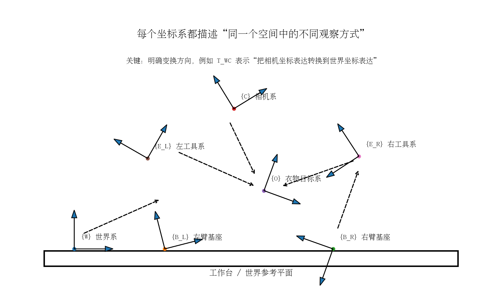
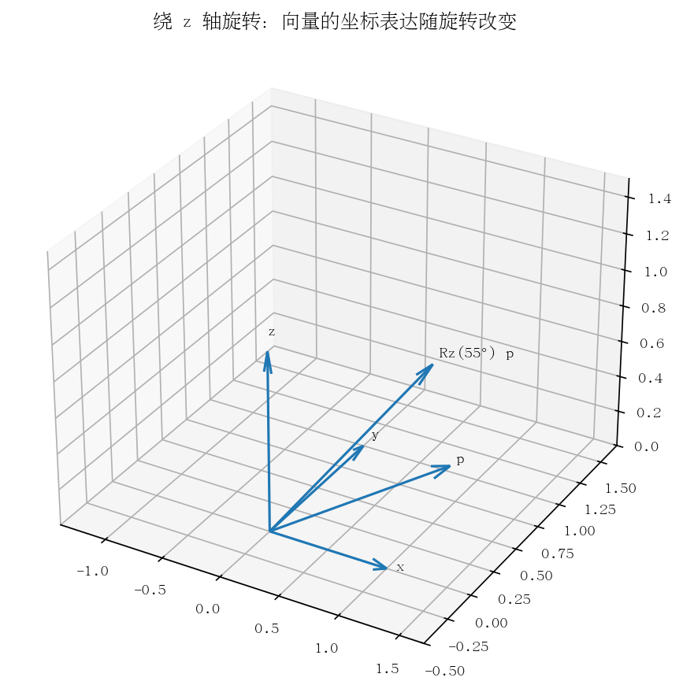
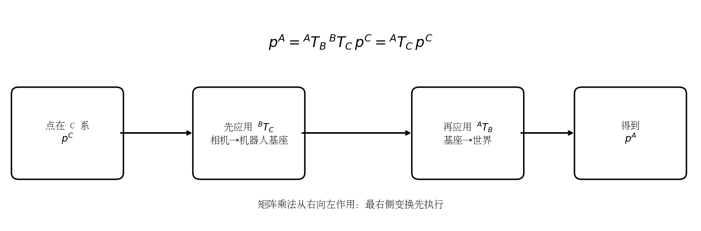
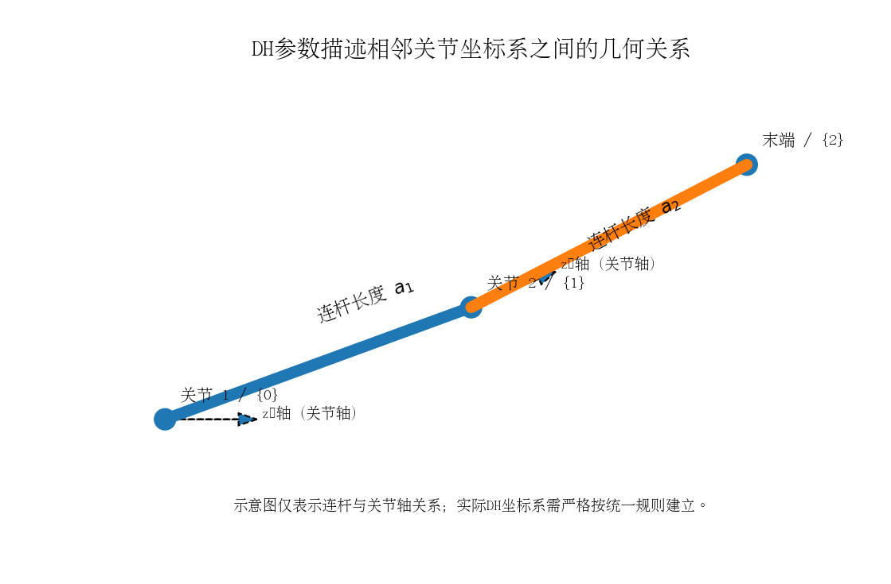
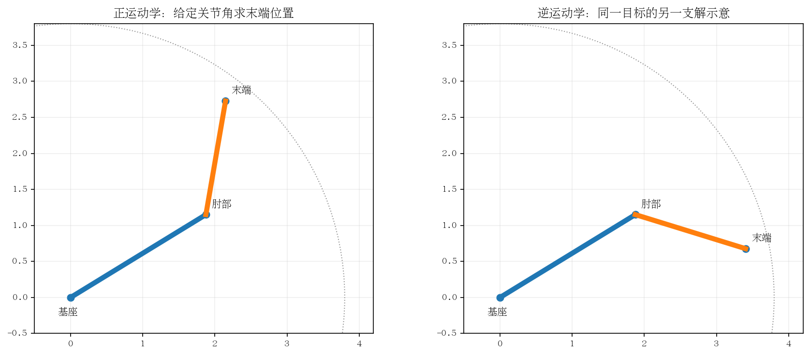
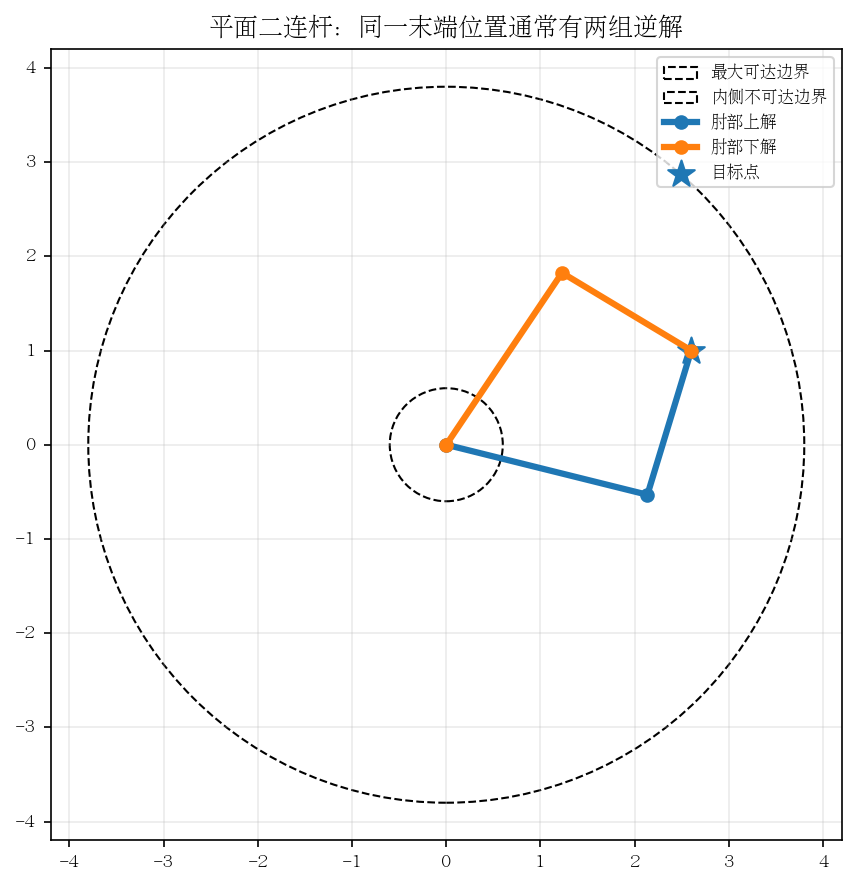
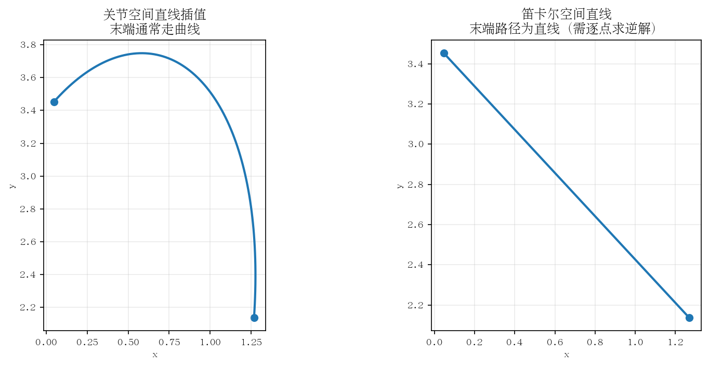
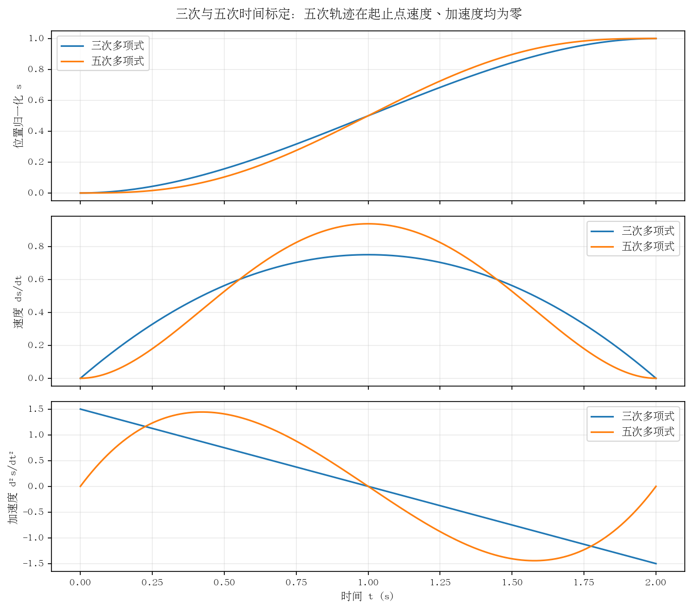
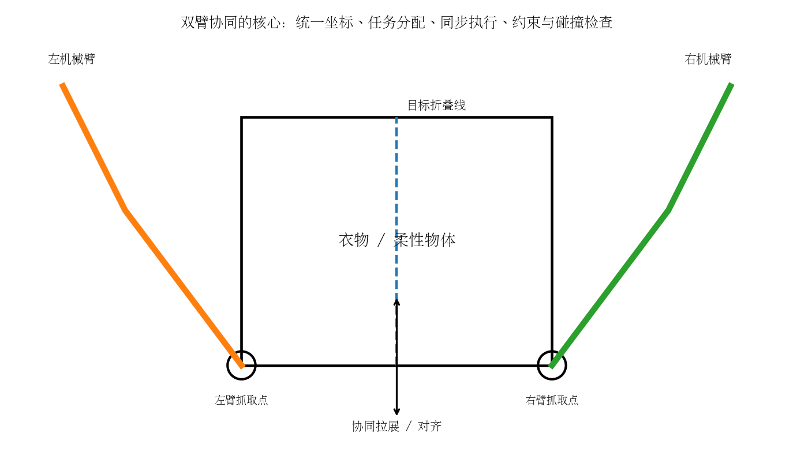
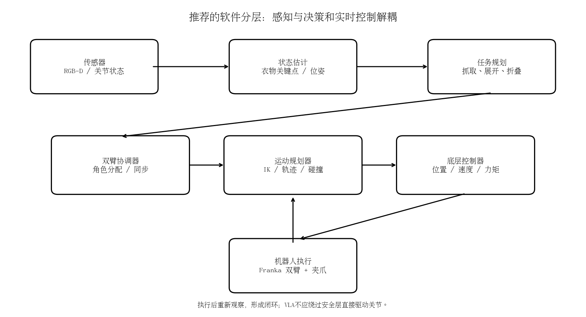

# 任务A. 坐标系与坐标变换

- 世界坐标系
- 机器人基坐标系
- 机械臂末端坐标系
- 相机坐标系
- 工具坐标系
- 衣物目标坐标系
掌握的数学知识：
- 三维向量
- 矩阵乘法
- 欧拉角
- 旋转矩阵
- 四元数
- 齐次变换矩阵
- 齐次坐标变换链
# 任务B.正运动学（Forward Kinematics）
解决问题：已知机械臂每个关节的角度，求出机械臂末端的位置和姿态。  
- D-H 参数法  
- 关节坐标系  
- 连杆变换矩阵  
- 正运动学求解  
对于一台具有 \(n\) 个关节的机械臂：
$$T_0^n = T_0^1 T_1^2 \cdots T_{n-1}^n$$
  
# 任务C.逆运动学（Inverse Kinematics）  
解决问题：已知机械臂末端需要到达的位置和姿态，反过来求解每个关节应该转动多少。  
- 解析法  
- 数值迭代法  
- 雅可比伪逆法   
- 雅可比伪逆法  
# 任务D.轨迹规划
解决问题：机器人不能简单地从 A 点瞬间跳到 B 点。需要生成连续、平滑、安全的轨迹。  
- 关节空间规划  
- 笛卡尔空间规划  
- 直线轨迹  
- 三次多项式轨迹  
- 五次多项式轨迹  
- 速度、加速度约束  
- 碰撞检测 
# 任务E.双臂协调控制
解决问题：通过控制相对位姿，保持双臂之间的协作关系。  
- 两台机械臂的独立控制  
- 两臂的坐标系统一
- 双臂任务分配
- 双臂同步执行
- 双臂碰撞检测
- 双臂协同抓取
- 物体约束与相对运动
## 验收标准：能够理解并解释机械臂正逆运动学，能够在 Python 中实现简单的坐标变换，能够在仿真环境中控制机械臂到达指定位置。

# 双臂机器人运动学与协同控制：从坐标变换到衣物折叠

> **课程定位：** 面向自动化专业本科毕业设计，服务于“基于VLA模型的双臂机器人衣物折叠系统设计与实现”。
>
> **覆盖目录：** A. 坐标系与坐标变换；B. 正运动学；C. 逆运动学；D. 轨迹规划；E. 双臂协调控制。
>
> **学习目标：** 不仅记住公式，还要能解释公式代表什么、知道什么时候使用、能用 Python 完成基本计算，并理解这些内容如何连接到 RGB-D 相机、Franka 双臂和衣物操作任务。

---

## 如何使用这份笔记

建议按 A → B → C → D → E 的顺序学习。每一节采用“问题—直觉—数学—代码—检查”的结构。

- 第一遍：重点理解坐标系、矩阵方向和物理含义，不急于背公式。
- 第二遍：手算二维例题，使用 Python 验证矩阵结果。
- 第三遍：把相机、机器人基座、工具和衣物目标坐标系联系起来。
- 最后：将单臂算法推广到左右两臂，完成双臂同步和安全约束。

**统一约定：** 本笔记采用右手坐标系、列向量、主动旋转矩阵左乘向量；角度计算内部统一用弧度（rad），长度统一用米（m）。变换记号 `^A T_B` 表示“把在 B 坐标系中表达的量转换为 A 坐标系中的表达”。不同软件或论文若采用行向量、左/右乘或不同欧拉角顺序，必须先核对约定，不能混用。

## 目录

- [A. 坐标系与坐标变换](#a-坐标系与坐标变换)
  - [A1. 为什么需要多个坐标系](#a1-为什么需要多个坐标系)
  - [A2. 三维向量与矩阵](#a2-三维向量与矩阵)
  - [A3. 旋转矩阵](#a3-旋转矩阵)
  - [A4. 欧拉角与四元数](#a4-欧拉角与四元数)
  - [A5. 齐次变换矩阵](#a5-齐次变换矩阵)
  - [A6. 变换复合、逆变换与坐标链](#a6-变换复合逆变换与坐标链)
  - [A7. 相机—机器人—衣物坐标关系](#a7-相机机器人衣物坐标关系)
  - [A8. Python 实现](#a8-python-实现)
- [B. 正运动学](#b-正运动学-forward-kinematics)
  - [B1. 正运动学要解决什么问题](#b1-正运动学要解决什么问题)
  - [B2. 关节坐标系与 DH 参数](#b2-关节坐标系与-dh-参数)
  - [B3. DH 连杆变换矩阵推导](#b3-dh-连杆变换矩阵推导)
  - [B4. 多关节连乘与二维二连杆示例](#b4-多关节连乘与二维二连杆示例)
  - [B5. 雅可比矩阵入门](#b5-雅可比矩阵入门)
- [C. 逆运动学](#c-逆运动学-inverse-kinematics)
  - [C1. 逆运动学的本质与难点](#c1-逆运动学的本质与难点)
  - [C2. 解析法：平面二连杆](#c2-解析法平面二连杆)
  - [C3. 数值迭代法](#c3-数值迭代法)
  - [C4. 雅可比伪逆与阻尼最小二乘](#c4-雅可比伪逆与阻尼最小二乘)
  - [C5. 可达性、多解与奇异位形](#c5-可达性多解与奇异位形)
- [D. 轨迹规划](#d-轨迹规划)
  - [D1. 路径与轨迹的区别](#d1-路径与轨迹的区别)
  - [D2. 关节空间与笛卡尔空间规划](#d2-关节空间与笛卡尔空间规划)
  - [D3. 直线轨迹与时间参数化](#d3-直线轨迹与时间参数化)
  - [D4. 三次多项式轨迹推导](#d4-三次多项式轨迹推导)
  - [D5. 五次多项式轨迹推导](#d5-五次多项式轨迹推导)
  - [D6. 速度、加速度与碰撞约束](#d6-速度加速度与碰撞约束)
  - [D7. 常见规划算法](#d7-常见规划算法)
- [E. 双臂协调控制](#e-双臂协调控制)
  - [E1. 双臂问题与单臂的区别](#e1-双臂问题与单臂的区别)
  - [E2. 两个机械臂的坐标系统一](#e2-两个机械臂的坐标系统一)
  - [E3. 任务分配与协同抓取](#e3-任务分配与协同抓取)
  - [E4. 双臂同步轨迹](#e4-双臂同步轨迹)
  - [E5. 双臂碰撞检测](#e5-双臂碰撞检测)
  - [E6. 衣物的柔性约束](#e6-衣物的柔性约束)
  - [E7. 双臂折叠任务分解](#e7-双臂折叠任务分解)
- [F. Python 综合练习](#f-python-综合练习)
- [G. 易错点与排错清单](#g-易错点与排错清单)
- [H. 学习验收标准](#h-学习验收标准)
- [I. 推荐资料](#i-推荐资料)

---

# A. 坐标系与坐标变换

## A1. 为什么需要多个坐标系

机器人不是只在一个坐标系里工作。相机“看到”的点通常先表示在相机坐标系中；机器人关节和末端位姿通常相对于机器人基座表示；桌面、衣物折叠目标则更适合相对于世界或工作台表示。

典型坐标系包括：

| 符号 | 名称 | 用途 |
|---|---|---|
| `{W}` | 世界/工作台坐标系 | 给整个工作空间提供统一参考 |
| `{B_L}` | 左臂基座坐标系 | 描述左臂关节和末端 |
| `{B_R}` | 右臂基座坐标系 | 描述右臂关节和末端 |
| `{C}` | 相机坐标系 | 表示 RGB-D 相机测得的三维点 |
| `{E_L}`、`{E_R}` | 左右末端/工具坐标系 | 表示夹爪的位置与姿态 |
| `{O}` | 衣物目标坐标系 | 描述衣物中心、边缘、角点和目标折叠线 |

### 衣物目标坐标系怎么定义？

对于桌面上的近似平铺衣物，可以先把目标坐标系 `{O}` 原点定义在衣物轮廓中心或一个稳定参考角点；`x_O` 轴沿衣物宽度方向，`y_O` 轴沿衣物长度方向，`z_O` 轴垂直桌面向上。这样折叠线、左右边缘、角点就可以用衣物局部坐标表示。若衣物发生旋转或被拉展，`^W T_O` 会变化，应通过视觉重新估计，而不能一直使用最初的固定姿态。



**核心问题：** 相机检测到衣物角点 `p^C`，机器人不能直接把这三个数字当成自己的目标坐标。必须先知道相机与机器人之间的外参，再把点转换到机器人使用的坐标系。

## A2. 三维向量与矩阵

### 1. 三维位置向量

一个三维点在坐标系 A 中可写为列向量：

$$
{}^A\mathbf p=\begin{bmatrix}x_A\\y_A\\z_A\end{bmatrix}
$$

注意：同一个空间点在不同坐标系中的坐标数字通常不同，但它代表的物理点相同。

### 2. 向量与点的区别

- **点/位置：** 有绝对位置，平移坐标系会改变它的坐标。
- **方向向量：** 只表示方向，不受坐标系原点平移影响。

例如相机到衣物抓取点的“位置”会受到原点选择影响；夹爪的“朝下方向”是方向，不应因为坐标原点平移而改变。

### 3. 矩阵乘法

若 `A` 为 `m×n`，`B` 为 `n×k`，则 `AB` 为 `m×k`。矩阵乘法一般不满足交换律：

$$
AB\neq BA
$$

这意味着坐标变换的顺序非常重要。先旋转再平移，与先平移再旋转，结果通常不同。

### 4. 点积与叉积

点积：

$$
\mathbf a\cdot\mathbf b=\|\mathbf a\|\|\mathbf b\|\cos\theta
$$

可用于计算夹角、投影和判断两个方向是否接近正交。

叉积：

$$
\mathbf a\times\mathbf b=
\begin{bmatrix}
a_yb_z-a_zb_y\\
a_zb_x-a_xb_z\\
a_xb_y-a_yb_x
\end{bmatrix}
$$

结果垂直于 `a` 和 `b` 所在平面，右手定则决定方向。机器人雅可比矩阵、旋转轴和力矩计算常用叉积。

## A3. 旋转矩阵

旋转矩阵 `R` 描述一个坐标系相对于另一个坐标系的朝向，满足：

$$
R^TR=I,\qquad \det(R)=1
$$

因此 `R^{-1}=R^T`。旋转矩阵的列向量可理解为新坐标系的三个轴在旧坐标系中的表达（具体方向仍需遵守上面的变换记号）。

### 1. 绕 x 轴旋转

$$
R_x(\alpha)=\begin{bmatrix}
1&0&0\\
0&\cos\alpha&-\sin\alpha\\
0&\sin\alpha&\cos\alpha
\end{bmatrix}
$$

### 2. 绕 y 轴旋转

$$
R_y(\beta)=\begin{bmatrix}
\cos\beta&0&\sin\beta\\
0&1&0\\
-\sin\beta&0&\cos\beta
\end{bmatrix}
$$

### 3. 绕 z 轴旋转

$$
R_z(\gamma)=\begin{bmatrix}
\cos\gamma&-\sin\gamma&0\\
\sin\gamma&\cos\gamma&0\\
0&0&1
\end{bmatrix}
$$



例如，向量 `p=[1,0,0]^T` 绕 z 轴旋转 90°：

$$
R_z(90^\circ)\mathbf p=\begin{bmatrix}0\\1\\0\end{bmatrix}
$$

也就是从 x 轴正方向转到 y 轴正方向。

### 4. 旋转顺序不能随意交换

常见的滚转—俯仰—偏航（roll-pitch-yaw, RPY）表达，在一种常用约定下写成：

$$
R=R_z(\text{yaw})R_y(\text{pitch})R_x(\text{roll})
$$

由于矩阵乘法不满足交换律，通常有 `Rz Ry Rx ≠ Rx Ry Rz`。调用机器人或视觉库时，必须确认它使用的欧拉角顺序、内禀/外禀旋转定义和角度单位。

## A4. 欧拉角与四元数

### 1. 欧拉角

用三个角描述姿态，例如 roll、pitch、yaw。优点是直观，容易理解；缺点是存在表示奇异（万向节锁），且旋转顺序依赖约定。

### 2. 四元数

单位四元数可写成：

$$
q=(w,x,y,z),\qquad w^2+x^2+y^2+z^2=1
$$

若旋转轴单位向量为 `u=[u_x,u_y,u_z]`，旋转角为 $\theta$，则：

$$
q=\left(\cos\frac\theta2,\ u_x\sin\frac\theta2,\ u_y\sin\frac\theta2,\ u_z\sin\frac\theta2\right)
$$

四元数适合姿态插值和连续姿态表示。注意有些库采用 `(x,y,z,w)` 顺序，而本笔记数学表达采用 `(w,x,y,z)`；代码接口必须确认顺序。

### 3. 什么时候选哪一种？

| 表示 | 优点 | 局限 | 使用场景 |
|---|---|---|---|
| 旋转矩阵 | 变换计算直接、无奇异参数化问题 | 9个元素，有冗余约束 | 坐标变换、运动学 |
| 欧拉角 | 3个数字，直观 | 顺序依赖、存在奇异 | 人机显示、调试 |
| 四元数 | 紧凑、插值平滑 | 不直观、需归一化 | 姿态插值、控制接口 |

## A5. 齐次变换矩阵

旋转矩阵只能表达朝向，不能单独表示平移。为把旋转和平移放在一个矩阵中，引入齐次坐标。

位置向量扩展为：

$$
\tilde{\mathbf p}=\begin{bmatrix}x\\y\\z\\1\end{bmatrix}
$$

刚体变换写成 4×4 矩阵：

$$
T=\begin{bmatrix}R&\mathbf t\\0\ 0\ 0&1\end{bmatrix}
$$

其中 `R` 是 3×3 旋转矩阵，`t=[t_x,t_y,t_z]^T` 是平移向量。

变换关系：

$$
{}^A\tilde{\mathbf p}={}^AT_B\ {}^B\tilde{\mathbf p}
$$

展开为：

$$
{}^A\mathbf p={}^AR_B\ {}^B\mathbf p+{}^A\mathbf t_B
$$

这句话的物理意义是：先把点按 B 系的坐标表达出来，再通过 `^A T_B` 把它变成 A 系坐标表达。

## A6. 变换复合、逆变换与坐标链

### 1. 变换复合

如果已知 B 相对 C 的变换和 A 相对 B 的变换：

$$
{}^AT_C={}^AT_B{}^BT_C
$$

因此点坐标可以连续转换：

$$
{}^A\tilde p={}^AT_B{}^BT_C{}^C\tilde p
$$



**阅读矩阵时从右向左执行。** `^A T_B ^B T_C p^C` 中，最右边的 `^B T_C` 先把 C 系坐标变成 B 系坐标，然后再变成 A 系坐标。

### 2. 齐次变换求逆

若：

$$
T=\begin{bmatrix}R&t\\0&1\end{bmatrix}
$$

因为旋转矩阵的逆为转置，所以：

$$
T^{-1}=\begin{bmatrix}R^T&-R^Tt\\0&1\end{bmatrix}
$$

这不是简单地把平移取负；必须先乘 `-R^T`。

### 3. 常见坐标链

在眼在手外（固定相机）的配置中，一条可能的坐标链是：

$$
{}^WT_O={}^WT_C\ {}^CT_O
$$

在眼在手上（相机安装在末端）的配置中，可能是：

$$
{}^WT_O={}^WT_E\ {}^ET_C\ {}^CT_O
$$

每一项的上标、下标要能首尾衔接。若相机安装在末端，`^E T_C` 是手眼外参；`^W T_E` 随机械臂关节运动变化。

## A7. 相机—机器人—衣物坐标关系

RGB-D相机通常输出深度图。某个像素 `(u,v)` 对应深度 `Z` 时，在针孔模型下：

$$
X=\frac{(u-c_x)Z}{f_x},\qquad
Y=\frac{(v-c_y)Z}{f_y},\qquad Z=Z
$$

矩阵形式：

$$
\begin{bmatrix}X\\Y\\Z\end{bmatrix}
=ZK^{-1}\begin{bmatrix}u\\v\\1\end{bmatrix},\quad
K=\begin{bmatrix}f_x&0&c_x\\0&f_y&c_y\\0&0&1\end{bmatrix}
$$

然后使用相机外参转换到机器人基座或世界坐标系：

$$
{}^B\tilde p={}^BT_C{}^C\tilde p
$$

**易错点：** 深度 `Z` 的单位可能是米，也可能是毫米或经过比例因子换算；相机驱动的深度对齐、内参、畸变和坐标轴方向也必须核实。


### 手眼标定是什么？

手眼标定的目标是求相机与机器人之间固定的刚体变换。例如眼在手上，需要估计 `^E T_C`；眼在手外，则需要估计相机相对机器人工作空间的外参。标定不是“调一个偏移量”那么简单，而是利用多个已知机器人运动姿态和视觉观测，求解刚体变换参数。

### AX = XB 是什么意思？

以眼在手上为例，令 `X` 表示待求的末端到相机固定变换。机器人在不同姿态下观察同一个标定板，标定板相对于基座的位姿应保持不变。把两组姿态之间的相对运动消去标定板位姿后，可以得到经典形式：

$$
A_iX=XB_i
$$

其中 `A_i` 来自机器人末端在两次采样间的相对运动，`B_i` 来自相机观测到的标定板相对运动，`X` 是待求的手眼变换。需要采集多个方向和幅度不同的运动，单一方向或几乎相同的姿态通常不足以稳定确定全部参数。

**实践建议：** 标定时让机器人在安全范围内做多组不同旋转与平移，确保相机能稳定识别标定板；将标定结果保存为带方向说明的矩阵，例如 `T_E_C`，并使用已知点做回代验证。

## A8. Python 实现

下面代码只做数学计算，不连接真实机械臂。

```python
import numpy as np

def rot_z(theta: float) -> np.ndarray:
    """绕 z 轴旋转，theta 使用弧度。"""
    c, s = np.cos(theta), np.sin(theta)
    return np.array([[c, -s, 0.0],
                     [s,  c, 0.0],
                     [0.0, 0.0, 1.0]])

def make_T(R: np.ndarray, t: np.ndarray) -> np.ndarray:
    """由旋转矩阵 R 和平移向量 t 构造 4x4 齐次变换。"""
    R = np.asarray(R, dtype=float)
    t = np.asarray(t, dtype=float).reshape(3)
    if R.shape != (3, 3):
        raise ValueError("R 必须为 3x3")
    T = np.eye(4)
    T[:3, :3] = R
    T[:3, 3] = t
    return T

def inverse_T(T: np.ndarray) -> np.ndarray:
    """利用刚体变换结构求逆。"""
    R, t = T[:3, :3], T[:3, 3]
    Ti = np.eye(4)
    Ti[:3, :3] = R.T
    Ti[:3, 3] = -R.T @ t
    return Ti

# 假设相机相对机器人基座旋转 30°，平移 [0.4, 0.1, 0.6] m
T_B_C = make_T(rot_z(np.deg2rad(30)), np.array([0.4, 0.1, 0.6]))
p_C = np.array([0.2, -0.1, 0.8, 1.0])
p_B = T_B_C @ p_C
print("点在 B 系中的坐标：", p_B[:3])
print("变换再求逆：", inverse_T(T_B_C) @ p_B)  # 应接近 p_C
```

### A 模块自测

1. `^A T_B` 到底表示把 A 系坐标变成 B 系，还是把 B 系坐标变成 A 系？请用自己的话解释。
2. 为什么 `T^{-1}` 的平移部分是 `-R^T t`，而不是单纯 `-t`？
3. 相机测得衣物角点 `(X,Y,Z)` 后，为什么不能直接把它发送给机械臂？
4. 绕 z 轴旋转 90° 后，`[1,0,0]^T` 变成什么？
5. `^W T_C ^C T_B` 是否是一个合法的坐标链？结果把什么坐标变成什么坐标？

---

# B. 正运动学（Forward Kinematics）

## B1. 正运动学要解决什么问题

正运动学（FK）已知各关节变量，计算机器人末端执行器的位置和姿态。

输入：

$$
q=[q_1,q_2,\ldots,q_n]^T
$$

输出：末端相对基座的位姿：

$$
{}^BT_E=f(q)
$$

它回答的问题是：**如果每个关节转到这些角度，夹爪会出现在空间中的哪里、朝向哪里？**

在衣物折叠中，FK可用于：读取当前夹爪位姿、把关节状态变成末端状态、判断抓取点是否到达目标、计算机械臂连杆在空间中的位置以进行碰撞检测。

## B2. 关节坐标系与 DH 参数

### 1. 为什么要建立关节坐标系

多关节机械臂可以看成若干刚体连杆由旋转关节或移动关节串联而成。为统一描述相邻连杆之间的关系，需要给每个关节/连杆分配局部坐标系。

### 2. 标准 DH 四个参数

标准 Denavit–Hartenberg（DH）方法使用四个参数表示相邻坐标系关系：

| 参数 | 含义 | 直观解释 |
|---|---|---|
| `θ_i` | 关节角 | 绕前一坐标系 z 轴的旋转量 |
| `d_i` | 连杆偏距 | 沿前一 z 轴的平移量 |
| `a_i` | 连杆长度 | 沿当前 x 轴的距离 |
| `α_i` | 连杆扭角 | 绕当前 x 轴的旋转量 |

对于旋转关节，通常 `θ_i` 是变量，`d_i` 为常量；对于移动关节，通常 `d_i` 是变量，`θ_i` 为常量。注意不同教材存在标准 DH 与改进 DH 两种约定，参数表和变换矩阵不能交叉使用。



### 3. 建立 DH 坐标系的一般规则（标准 DH）

1. 令 `z_{i-1}` 轴与第 i 个关节运动轴重合。
2. 选择相邻 z 轴的公法线方向作为 x 轴方向（平行或相交时按规则处理）。
3. y 轴由右手定则确定。
4. 确定各轴原点和参数符号。
5. 对每一行参数检查所得变换是否能正确描述实际机构。

**提醒：** DH建模难点通常不是背矩阵，而是坐标系放置是否一致。推荐先在纸上画出各关节轴和连杆，再填参数表。

## B3. DH 连杆变换矩阵推导

标准 DH 从坐标系 `{i-1}` 到 `{i}` 的变换按下列四步组合：

1. 绕 `z_{i-1}` 轴旋转 `θ_i`；
2. 沿 `z_{i-1}` 轴平移 `d_i`；
3. 沿 `x_i` 轴平移 `a_i`；
4. 绕 `x_i` 轴旋转 `α_i`。

因此：

$$
{}^{i-1}T_i=R_z(\theta_i)T_z(d_i)T_x(a_i)R_x(\alpha_i)
$$

其中：

$$
R_z(\theta)=\begin{bmatrix}c_\theta&-s_\theta&0&0\\s_\theta&c_\theta&0&0\\0&0&1&0\\0&0&0&1\end{bmatrix}
$$

$$
T_z(d)=\begin{bmatrix}1&0&0&0\\0&1&0&0\\0&0&1&d\\0&0&0&1\end{bmatrix},\quad
T_x(a)=\begin{bmatrix}1&0&0&a\\0&1&0&0\\0&0&1&0\\0&0&0&1\end{bmatrix}
$$

$$
R_x(\alpha)=\begin{bmatrix}1&0&0&0\\0&c_\alpha&-s_\alpha&0\\0&s_\alpha&c_\alpha&0\\0&0&0&1\end{bmatrix}
$$

将四个矩阵相乘，得到标准 DH 变换矩阵：

$$
A_i=\begin{bmatrix}
 c_\theta&-s_\theta c_\alpha&s_\theta s_\alpha&a c_\theta\\
 s_\theta& c_\theta c_\alpha&-c_\theta s_\alpha&a s_\theta\\
 0&s_\alpha&c_\alpha&d\\
 0&0&0&1
\end{bmatrix}
$$

这里省略下标 i，`cθ=cosθ_i`，`sθ=sinθ_i`，其余类似。

**推导理解：** 这个矩阵并不是孤立记忆的公式。它是四个简单刚体变换按指定顺序连乘得到的。若换成改进 DH，乘法顺序和矩阵形式也会改变。

## B4. 多关节连乘与二维二连杆示例

### 1. n 关节机械臂

由基座到末端依次连乘：

$$
{}^0T_n={}^0T_1{}^1T_2\cdots{}^{n-1}T_n
$$

其中每个 `^i-1 T_i` 由对应的 DH 参数构造。最终结果的左上 3×3 是末端姿态，右上 3×1 是末端位置。

### 2. 平面二连杆机械臂

为了理解 FK，先看最简单的两转动关节机械臂。连杆长度为 `l1,l2`，关节角为 `θ1,θ2`。



第一段连杆末端：

$$
x_1=l_1\cos\theta_1,\qquad y_1=l_1\sin\theta_1
$$

第二段相对于第一段的绝对方向是 `θ1+θ2`，所以末端位置：

$$
\boxed{x=l_1\cos\theta_1+l_2\cos(\theta_1+\theta_2)}
$$

$$
\boxed{y=l_1\sin\theta_1+l_2\sin(\theta_1+\theta_2)}
$$

末端平面朝向：

$$
\phi=\theta_1+\theta_2
$$

这两个位置公式是理解复杂机械臂 FK 的入门例子：每一段连杆的向量都先变换到同一个基坐标系，再相加。

### 3. Python 计算二维二连杆 FK

```python
import numpy as np

def fk_2r(theta1, theta2, l1=0.30, l2=0.25):
    """返回二维末端位置 (x, y) 和末端平面角 phi。角度单位 rad。"""
    x = l1*np.cos(theta1) + l2*np.cos(theta1 + theta2)
    y = l1*np.sin(theta1) + l2*np.sin(theta1 + theta2)
    phi = theta1 + theta2
    return np.array([x, y]), phi

p, phi = fk_2r(np.deg2rad(30), np.deg2rad(60))
print("末端位置(m):", p)
print("末端角度(deg):", np.rad2deg(phi))
```

## B5. 雅可比矩阵入门

虽然你的目录将雅可比放在逆运动学部分之外，但它是理解数值 IK、速度控制和奇异性的核心工具，必须了解。

对二维二连杆：

$$
\begin{bmatrix}\dot x\\\dot y\end{bmatrix}
=J(q)\begin{bmatrix}\dot\theta_1\\\dot\theta_2\end{bmatrix}
$$

由 FK 对关节角求偏导：

$$
J(q)=\begin{bmatrix}
- l_1\sin\theta_1-l_2\sin(\theta_1+\theta_2)&-l_2\sin(\theta_1+\theta_2)\\
l_1\cos\theta_1+l_2\cos(\theta_1+\theta_2)&l_2\cos(\theta_1+\theta_2)
\end{bmatrix}
$$

直观理解：雅可比矩阵告诉我们，关节角发生一个很小的变化时，末端位置会朝哪个方向、变化多少。

$$
\Delta x\approx J(q)\Delta q
$$

它是局部线性近似，不是大范围运动的精确关系。

### B 模块自测

1. FK的输入和输出分别是什么？
2. 标准 DH 的四个参数分别表示什么？
3. 为什么多关节 FK 要按从基座到末端的顺序连乘？
4. 写出平面二连杆的 x、y 公式，并用计算器验证一个角度组合。
5. 雅可比矩阵的每一列代表什么？

---

# C. 逆运动学（Inverse Kinematics）

## C1. 逆运动学的本质与难点

逆运动学（IK）是已知末端期望位置和姿态，反求能实现该位姿的关节变量：

$$
{}^BT_E^{des}\longrightarrow q^{*}
$$

它回答：**我希望夹爪到达衣物角点并保持某个抓取姿态，那么每个关节应该转到哪里？**

与 FK 相比，IK 通常更难，原因包括：

- 可能没有解：目标点超出机械臂工作空间。
- 可能有多个解：例如肘上、肘下等构型。
- 可能有无穷多解：冗余机械臂的自由度大于任务所需维度。
- 可能接近奇异位形：小的末端运动可能要求很大的关节速度。
- 需要考虑关节角限制、碰撞、可操作性和当前构型连续性。

## C2. 解析法：平面二连杆

目标点为 `(x,y)`。由余弦定理：

$$
r^2=x^2+y^2=l_1^2+l_2^2+2l_1l_2\cos\theta_2
$$

所以：

$$
\boxed{\cos\theta_2=\frac{x^2+y^2-l_1^2-l_2^2}{2l_1l_2}}
$$

令：

$$
D=\frac{x^2+y^2-l_1^2-l_2^2}{2l_1l_2}
$$

若 `|D|≤1`，则：

$$
\theta_2=\pm\arccos(D)
$$

两种符号通常对应肘上和肘下两种构型。

再由三角关系求第一关节角：

$$
\boxed{\theta_1=\operatorname{atan2}(y,x)-\operatorname{atan2}(l_2\sin\theta_2,\ l_1+l_2\cos\theta_2)}
$$



### 可达性条件

二连杆末端到基座的距离 `r` 必须满足：

$$
|l_1-l_2|\le r\le l_1+l_2
$$

- `r > l1+l2`：伸得不够远，目标不可达。
- `r < |l1-l2|`：两连杆无法折叠到那么近（若长度不相等）。
- 边界位置：通常接近伸直或完全折叠的奇异构型。

### Python 解析 IK

```python
import numpy as np

def ik_2r(x, y, l1=0.30, l2=0.25):
    D = (x*x + y*y - l1*l1 - l2*l2) / (2*l1*l2)
    if D < -1.0 - 1e-9 or D > 1.0 + 1e-9:
        raise ValueError("目标点不可达")
    D = np.clip(D, -1.0, 1.0)
    solutions = []
    for sign in (+1.0, -1.0):
        theta2 = sign * np.arccos(D)
        theta1 = np.arctan2(y, x) - np.arctan2(
            l2*np.sin(theta2), l1 + l2*np.cos(theta2)
        )
        solutions.append(np.array([theta1, theta2]))
    return solutions

for q in ik_2r(0.35, 0.20):
    print("IK(deg):", np.rad2deg(q))
```

## C3. 数值迭代法

真实的 7 自由度机械臂通常具有复杂的几何结构，解析求解可能繁琐，因此常使用数值方法。

假设当前关节为 `q_k`，通过 FK 得到末端位置 `x(q_k)`。希望达到 `x_d`，误差为：

$$
e_k=x_d-x(q_k)
$$

在当前点附近用一阶近似：

$$
x(q_k+\Delta q)\approx x(q_k)+J(q_k)\Delta q
$$

令其接近期望位置：

$$
J(q_k)\Delta q\approx e_k
$$

求出 `Δq` 后更新：

$$
q_{k+1}=q_k+\Delta q
$$

不断迭代，直到误差小于阈值，或达到最大迭代次数。

基本迭代流程：

1. 选取初始关节角 `q0`。
2. 用 FK 计算当前末端位姿。
3. 计算位置/姿态误差。
4. 计算当前雅可比矩阵 `J(q)`。
5. 求一个关节增量 `Δq`。
6. 对增量限幅，并检查关节限制。
7. 更新关节角，重复以上过程。

## C4. 雅可比伪逆与阻尼最小二乘

### 1. 伪逆法

当 `J` 可逆时，理论上 `Δq=J^{-1}e`。但机器人雅可比不一定是方阵，也可能不可逆，因此使用 Moore–Penrose 伪逆：

$$
\Delta q=J^+e
$$

然后：

$$
q_{k+1}=q_k+\lambda J^+e
$$

其中 `λ` 是步长系数，常取较小正数，以免更新太激进。

### 2. 阻尼最小二乘（Damped Least Squares, DLS）

接近奇异位形时，伪逆可能产生过大的关节增量。DLS通过加入阻尼项改善数值稳定性：

$$
\boxed{\Delta q=J^T(JJ^T+\mu^2I)^{-1}e}
$$

其中 `μ>0` 是阻尼系数。阻尼越大，更新越保守，但可能降低精度和收敛速度。

**从优化角度理解：** DLS 可以看作求解下面的正则化最小二乘问题：

$$
\Delta q^*=\arg\min_{\Delta q}\left(\|J\Delta q-e\|^2+\mu^2\|\Delta q\|^2\right)
$$

对目标函数求导并令其为零：

$$
2J^T(J\Delta q-e)+2\mu^2\Delta q=0
$$

因此：

$$
(J^TJ+\mu^2I)\Delta q=J^Te
$$

在适当维度与数值条件下，可得到等价的常用形式：

$$
\Delta q=J^T(JJ^T+\mu^2I)^{-1}e
$$

正则化项 `μ²||Δq||²` 惩罚过大的关节更新，故能缓解奇异附近的数值放大。

### 3. 为什么数值 IK 会失败？

- 初始关节角离目标构型太远。
- 目标本身不可达。
- 目标位姿靠近奇异点。
- 雅可比计算或坐标系使用错误。
- 步长过大导致迭代振荡。
- 没有处理关节限制或碰撞。
- 姿态误差表示不连续或欧拉角顺序不一致。

### 4. 六维位姿误差

完整末端任务包含位置和姿态。可构造六维误差向量：

$$
e=\begin{bmatrix}e_p\\e_R\end{bmatrix}
$$

其中 `e_p` 是位置误差，`e_R` 可通过旋转矩阵误差的对数映射得到。实践中建议使用成熟运动学库或 MoveIt 的 IK 插件处理完整位姿，不建议在不了解旋转误差的情况下直接把三个欧拉角相减。

## C5. 可达性、多解与奇异位形

### 1. 多解

同一末端位姿可能对应多个关节配置。机械臂规划时不能只找“任意一个解”，还应考虑：

- 与当前关节角的距离是否小；
- 是否满足关节上下限；
- 是否会碰撞；
- 是否远离奇异点；
- 下一段轨迹是否连续。

### 2. 奇异位形

对平面二连杆，雅可比行列式为：

$$
\det(J)=l_1l_2\sin\theta_2
$$

当 `θ2=0` 或 `π` 时，行列式为零，雅可比降秩，机械臂处于奇异构型。此时某些末端方向的瞬时运动能力会丢失。

### 3. 冗余自由度

如果机械臂有 7 个关节，但末端位置和姿态任务只有 6 个自由度，则可能存在冗余自由度。可以利用冗余自由度优化次级目标，例如：

- 远离关节限位；
- 远离障碍物；
- 避免奇异位形；
- 保持肘部在更合适的位置。

### C 模块自测

1. 为什么 IK 可能有 0 个、1 个、多个解？
2. 写出平面二连杆 IK 的 `θ2`、`θ1` 公式。
3. 伪逆法在奇异附近为什么不稳定？
4. DLS 中的阻尼项发挥什么作用？
5. 对实际 Franka，为什么还必须考虑关节限位、碰撞和当前构型？

---

# D. 轨迹规划

## D1. 路径与轨迹的区别

- **路径（Path）：** 描述从 A 到 B 经过哪些空间位置，不一定包含时间。
- **轨迹（Trajectory）：** 不仅描述位置，还规定每个时刻的位置、速度和加速度。

例如一条直线是路径；要求机器人在 2 秒内沿这条直线运动、起点终点速度为零，则是带时间参数的轨迹。

你的目录说“机器人不能简单从 A 点瞬间跳到 B 点”，本质上就是规划一条满足运动学、动力学和安全限制的轨迹。

## D2. 关节空间与笛卡尔空间规划

### 1. 关节空间规划

直接对关节角 `q` 插值：

$$
q(t)=q_0+s(t)(q_f-q_0)
$$

优点：容易满足关节角约束，规划简单；缺点：末端在空间中的路径一般不是直线。

### 2. 笛卡尔空间规划

直接对末端位置和姿态规划。例如位置直线：

$$
p(s)=p_0+s(p_f-p_0),\quad s\in[0,1]
$$

然后对每个离散点求 IK 得到关节角。优点：末端路径容易符合抓取、插入、沿桌面移动等任务要求；缺点：每个采样点都要求 IK，还要保证解的连续性、可达性和无碰撞。



### 3. 衣物折叠中如何选择？

- 从安全等待位移动到预抓取位：关节空间规划通常足够。
- 夹爪沿直线接近衣物角点：通常采用笛卡尔直线段。
- 抓住衣物后平稳抬起或拉展：更关注末端路径、两臂协调和衣物张力。
- 释放后退回安全位：可以使用关节空间规划。

实际系统常把不同动作阶段串成多段轨迹，而不是一条简单的 A→B 直线。

## D3. 直线轨迹与时间参数化

先定义几何路径，再定义随时间变化的标量 `s(t)`：

$$
p(t)=p_0+s(t)(p_f-p_0)
$$

其中 `s(0)=0`，`s(T)=1`。`s(t)` 决定运动进度。

速度：

$$
\dot p(t)=\dot s(t)(p_f-p_0)
$$

加速度：

$$
\ddot p(t)=\ddot s(t)(p_f-p_0)
$$

这样可以在不改变几何路径的前提下控制快慢和平滑程度。

## D4. 三次多项式轨迹推导

设一维关节轨迹：

$$
q(t)=a_0+a_1t+a_2t^2+a_3t^3
$$

给定起点和终点位置、速度：

$$
q(0)=q_0,\quad q(T)=q_f
$$

$$
\dot q(0)=0,\quad\dot q(T)=0
$$

求系数：

- `q(0)=q0` 得 `a0=q0`；
- `qdot(0)=0` 得 `a1=0`；
- `q(T)=qf`；
- `qdot(T)=0`。

解得：

$$
\boxed{q(t)=q_0+(q_f-q_0)(3\tau^2-2\tau^3)},\quad \tau=t/T
$$

速度：

$$
\dot q(t)=\frac{q_f-q_0}{T}(6\tau-6\tau^2)
$$

加速度：

$$
\ddot q(t)=\frac{q_f-q_0}{T^2}(6-12\tau)
$$

三次多项式可让起止速度为零，但起止加速度通常不为零。如果轨迹与静止状态直接拼接，加速度可能发生跳变。

## D5. 五次多项式轨迹推导

如果希望起点、终点速度和加速度都为零，使用五次多项式：

$$
q(t)=a_0+a_1t+a_2t^2+a_3t^3+a_4t^4+a_5t^5
$$

六个边界条件：

$$
q(0)=q_0,\quad q(T)=q_f
$$

$$
\dot q(0)=\dot q(T)=0
$$

$$
\ddot q(0)=\ddot q(T)=0
$$

令 `τ=t/T`，解线性方程可得到归一化表达：

$$
\boxed{q(t)=q_0+(q_f-q_0)(10\tau^3-15\tau^4+6\tau^5)}
$$

对应进度函数：

$$
s(\tau)=10\tau^3-15\tau^4+6\tau^5
$$

一阶导数：

$$
\frac{ds}{d\tau}=30\tau^2-60\tau^3+30\tau^4
$$

二阶导数：

$$
\frac{d^2s}{d\tau^2}=60\tau-180\tau^2+120\tau^3
$$

注意从 `τ` 转换到真实时间 `t` 时，需要分别除以 `T` 和 `T²`。



### Python 生成五次轨迹

```python
import numpy as np

def quintic_trajectory(q0, qf, duration, dt=0.01):
    """起止速度、加速度均为零的五次轨迹。"""
    if duration <= 0 or dt <= 0:
        raise ValueError("duration 和 dt 必须为正")
    t = np.arange(0.0, duration + dt/2, dt)
    tau = np.clip(t / duration, 0.0, 1.0)
    s = 10*tau**3 - 15*tau**4 + 6*tau**5
    ds = (30*tau**2 - 60*tau**3 + 30*tau**4) / duration
    dds = (60*tau - 180*tau**2 + 120*tau**3) / duration**2
    delta = np.asarray(qf, dtype=float) - np.asarray(q0, dtype=float)
    q = np.asarray(q0) + s[:, None] * delta
    qd = ds[:, None] * delta
    qdd = dds[:, None] * delta
    return t, q, qd, qdd

q0 = np.array([0.0, 0.2])
qf = np.array([0.8, -0.4])
t, q, qd, qdd = quintic_trajectory(q0, qf, duration=2.0)
print(q.shape, qd.shape, qdd.shape)
```

## D6. 速度、加速度与碰撞约束

### 1. 速度约束

每个关节通常有最大速度：

$$
|\dot q_i(t)|\le\dot q_{i,max}
$$

### 2. 加速度约束

$$
|\ddot q_i(t)|\le\ddot q_{i,max}
$$

还可能有 jerk（加加速度）限制，以减少冲击和振动。

**关键：** 轨迹公式平滑，不代表一定满足机器人实际的速度、加速度、力矩和安全限制。规划后必须进行约束检查；时间 T 不够时应延长执行时间或采用时间参数化算法。

### 3. 碰撞检测

要检查的碰撞包括：

- 机械臂自身连杆之间的碰撞（自碰撞）；
- 左臂与右臂碰撞；
- 机械臂与桌面、相机架、周边设备碰撞；
- 夹爪和衣物/桌面的接触是否符合任务需要。

常见几何近似：球体、胶囊体、盒体、网格模型。两个简化球体中心距 `d` 若小于半径和，则发生几何相交：

$$
d<r_1+r_2
$$

真实机器人应使用机器人模型和规划场景进行碰撞检测，并设置安全距离。不要只依靠肉眼判断轨迹安全。

## D7. 常见规划算法

| 方法 | 基本思想 | 优点 | 局限/适用情况 |
|---|---|---|---|
| 关节空间多项式 | 对关节角插值 | 简单、易控制 | 末端路径不一定直观 |
| 笛卡尔直线 | 末端沿直线运动，每点求 IK | 适合直线接近/撤离 | IK连续性和碰撞要处理 |
| 梯形速度 | 加速—匀速—减速 | 工业应用常见、速度约束直观 | 加速度在切换处可能不连续 |
| S 曲线 | 对加速度变化也进行约束 | 更平滑、冲击小 | 参数设计更复杂 |
| PRM | 先采样构建路网，再搜索 | 多查询场景可复用 | 依赖采样质量 |
| RRT / RRT-Connect | 在配置空间随机扩展树 | 高维空间适用 | 路径可能较曲折，需平滑 |
| CHOMP / TrajOpt 等优化法 | 优化轨迹代价和约束 | 可考虑平滑和障碍 | 需要合理代价与初值 |

在 ROS2 项目中，可以优先使用 MoveIt 2 的规划接口，而不是为了毕业设计从零实现高维采样规划器。你应理解规划结果、碰撞场景、约束和执行接口。

### D 模块自测

1. 路径与轨迹有什么区别？
2. 关节空间直线插值时，末端为什么通常不是直线？
3. 三次多项式和五次多项式分别满足哪些端点条件？
4. 为什么轨迹平滑仍然需要检查速度和加速度限制？
5. 双臂同时执行时，碰撞检测要额外考虑什么？

---

# E. 双臂协调控制

## E1. 双臂问题与单臂的区别

单臂控制只需处理一个机械臂的关节状态、末端目标和自身碰撞；双臂系统还要处理两个机械臂之间的空间关系和任务关系。

双臂协同不是简单地“同时运行两个单臂程序”，至少包含：

1. 两个机械臂的独立建模与控制；
2. 坐标系统一；
3. 双臂任务分配；
4. 同步执行；
5. 双臂互相避碰；
6. 对共同操作对象施加合适的几何/接触约束。



## E2. 两个机械臂的坐标系统一

假设左右臂基座都固定在世界坐标系 `{W}` 中，分别有：

$$
{}^WT_{B_L},\qquad {}^WT_{B_R}
$$

左、右末端相对各自基座的 FK 为：

$$
{}^{B_L}T_{E_L}(q_L),\qquad {}^{B_R}T_{E_R}(q_R)
$$

那么左右末端在世界坐标系中的位姿为：

$$
{}^WT_{E_L}={}^WT_{B_L}{}^{B_L}T_{E_L}(q_L)
$$

$$
{}^WT_{E_R}={}^WT_{B_R}{}^{B_R}T_{E_R}(q_R)
$$

这一步很重要：**不能把左臂基座坐标下的点和右臂基座坐标下的点直接相减。** 必须先变换到共同参考坐标系，再计算两者距离和相对关系。

左右末端的相对变换可写成：

$$
{}^{E_L}T_{E_R}=({}^WT_{E_L})^{-1}{}^WT_{E_R}
$$

它描述右末端相对于左末端的位置和朝向。

## E3. 任务分配与协同抓取

### 1. 任务分配

衣物折叠可按任务阶段给左右臂分配角色：

- 左臂：抓取衣物左侧角点或固定一侧；
- 右臂：抓取另一角点并配合拉展；
- 两臂共同：保持衣物展开、对齐折叠线、完成翻折。

这不是固定唯一分工。也可以依据目标位置、左右臂可达性和碰撞风险动态选择抓取点。

### 2. 抓取点与几何关系

例如从俯视图估计衣物左、右抓取点 `p_L^W`、`p_R^W`，先检查：

- 两个抓取点是否可达；
- 两夹爪能否以合适姿态接近；
- 抓取后两臂是否会互相碰撞；
- 两点间距离是否适合衣物的当前展开状态；
- 抓取后运动方向是否会造成衣物过度拉扯。

### 3. 刚性物体与柔性衣物的区别

对于刚性物体，如果左右夹爪分别抓住同一刚体的固定位置，两夹爪之间的相对位姿可近似保持固定。

但衣物是柔性物体，两个抓取点之间的距离、局部朝向会随褶皱、拉伸和滑移变化。因此不能简单把整个衣物当作刚体，也不能盲目强制左右末端保持一个固定相对位姿。应结合视觉反馈、抓取点跟踪和张力/安全限制动态调整。

## E4. 双臂同步轨迹

假设左右臂分别有轨迹：

$$
q_L(t),\qquad q_R(t)
$$

同步执行意味着两条轨迹具有共同的时间基准，并在同一任务时刻输出对应的关节目标或末端目标。

如果左右臂都从静止状态开始并在时刻 `T` 到达目标，可以让两臂共享时间参数 `s(t)`：

$$
q_L(t)=q_{L0}+s(t)(q_{Lf}-q_{L0})
$$

$$
q_R(t)=q_{R0}+s(t)(q_{Rf}-q_{R0})
$$

使用同一个 `s(t)` 可保证两臂动作的进度同步，但**不自动保证无碰撞、无拉扯或任务正确**。还要检查每个时刻两臂的空间位置和衣物状态。

若两臂单独计算出的最短时间不同，可以选择统一总时长 `T=max(T_L,T_R)`，或对较快一侧进行时间缩放。真实控制中还要考虑控制周期、通信延迟、状态反馈和控制器接口。

## E5. 双臂碰撞检测

双臂系统需要检查：

1. 左臂自身碰撞；
2. 右臂自身碰撞；
3. 左臂与右臂交叉碰撞；
4. 夹爪与对方机械臂/夹爪碰撞；
5. 机械臂与桌面、相机支架和其他环境物体碰撞。

可以将两臂的关节状态组合成整体配置向量：

$$
q_{dual}=\begin{bmatrix}q_L\\q_R\end{bmatrix}
$$

若左右臂各 7 个关节，则双臂关节空间维数为 14。规划和碰撞检查需要在联合配置空间或统一规划场景中完成。

**工程建议：** 不要假设两个单臂规划器分别返回安全轨迹，就意味着两臂合起来安全。双臂轨迹必须放在统一场景中检查交叉碰撞。

## E6. 衣物的柔性约束

衣物操作既需要避免完全松弛，也要避免过度拉伸。可以先从几何层面建立简单指标，而不是一开始就建立复杂布料动力学模型。

### 1. 抓取点间距

令两个抓取点为 `g_L(t)` 和 `g_R(t)`：

$$
d_g(t)=\|g_L(t)-g_R(t)\|
$$

可设置一个任务相关的合理范围：

$$
d_{min}\le d_g(t)\le d_{max}
$$

注意这只是简单几何约束，不等同于真实布料张力。抓取点滑动、布料折叠和多层夹持都会让这个指标失去充分代表性。

### 2. 视觉反馈

可以通过分割或关键点跟踪估计：

- 衣物轮廓；
- 角点位置；
- 主方向或折叠轴；
- 左右抓取点是否滑移；
- 折叠前后边缘重合程度。

因此建议形成闭环：观察衣物 → 计算目标抓取/移动位置 → 规划双臂动作 → 执行 → 重新观察 → 修正。

### 3. 柔顺控制概念

在有力/力矩传感与合适控制接口的前提下，可了解阻抗控制的基本形式：

$$
M_d\ddot e+D_d\dot e+K_d e=F_{ext}
$$

其中 `e` 是位置偏差，`M_d,D_d,K_d` 分别表示期望惯性、阻尼和刚度参数，`F_ext` 是外力。直观上，阻抗控制通过设定“像弹簧—阻尼器一样”的动态响应，让机器人在接触时更柔顺。

它是进阶内容，不要在没有确认机器人控制接口、力矩限制和实验室安全流程时自行尝试低层力矩控制。

## E7. 双臂折叠任务分解

建议把衣物折叠拆成可独立验证的动作阶段：

| 阶段 | 感知与决策 | 左右臂动作 | 终止/检查条件 |
|---|---|---|---|
| 1. 初始识别 | 分割衣物、估计轮廓和方向 | 保持安全等待位 | 衣物区域与关键点可信 |
| 2. 预抓取 | 选择左右抓取点和夹爪姿态 | 分别运动到预抓取位 | 可达、无碰撞 |
| 3. 同步抓取 | 监测夹爪状态/视觉变化 | 两臂按协调时序闭合夹爪 | 抓取成功，无明显滑移 |
| 4. 展开拉平 | 根据衣物轮廓估计调整方向 | 两臂缓慢协同移动 | 衣物处于目标展开状态 |
| 5. 对齐折叠 | 估计折叠线和目标边缘 | 一臂固定，另一臂配合翻折，或两臂共同操作 | 边缘偏差在容差内 |
| 6. 释放 | 判断衣物是否稳定 | 逐步释放夹爪 | 衣物没有明显回弹/滑落 |
| 7. 结果评价 | 视觉测量边缘、面积和折叠状态 | 回到安全位 | 记录成功/失败及原因 |



### E 模块自测

1. 为什么左右臂基座坐标下的点不能直接相减？
2. 怎样计算左右末端之间的相对变换？
3. 同步轨迹是否意味着两臂一定不会碰撞？为什么？
4. 为什么衣物不能简单地当成刚性物体处理？
5. 请把“毛巾对折”拆成至少 5 个可验证的动作阶段。

---

# F. Python 综合练习

以下练习把 A—E 的基础知识串起来。代码仍然是数学仿真，不向真实 Franka 发送命令。

## F1. 用齐次变换把相机点转换到基座系

```python
import numpy as np

def make_transform(R, t):
    T = np.eye(4)
    T[:3, :3] = np.asarray(R, dtype=float)
    T[:3, 3] = np.asarray(t, dtype=float).reshape(3)
    return T

angle = np.deg2rad(20)
R_BC = np.array([
    [np.cos(angle), -np.sin(angle), 0],
    [np.sin(angle),  np.cos(angle), 0],
    [0,              0,             1]
])
t_BC = np.array([0.35, -0.10, 0.55])
T_BC = make_transform(R_BC, t_BC)

p_C = np.array([0.12, 0.08, 0.70, 1.0])
p_B = T_BC @ p_C
print("基座系抓取点：", p_B[:3], "m")
```

## F2. 二连杆 FK 与 IK 互相验证

```python
import numpy as np

def fk_2r(q, l1=0.30, l2=0.25):
    q1, q2 = q
    return np.array([
        l1*np.cos(q1) + l2*np.cos(q1+q2),
        l1*np.sin(q1) + l2*np.sin(q1+q2)
    ])

def ik_2r(xy, l1=0.30, l2=0.25):
    x, y = xy
    c2 = (x*x+y*y-l1*l1-l2*l2)/(2*l1*l2)
    if abs(c2) > 1.0:
        raise ValueError("目标不可达")
    result=[]
    for sgn in [1, -1]:
        q2 = sgn*np.arccos(np.clip(c2, -1, 1))
        q1 = np.arctan2(y,x)-np.arctan2(l2*np.sin(q2), l1+l2*np.cos(q2))
        result.append(np.array([q1,q2]))
    return result

q_true = np.deg2rad([35, 75])
target = fk_2r(q_true)
for q_sol in ik_2r(target):
    print("解(deg):", np.rad2deg(q_sol), "FK误差:", np.linalg.norm(fk_2r(q_sol)-target))
```

检查：两个逆解都应当通过 FK 回到相近目标位置，但关节角不同。

## F3. 为左右臂生成同步时间参数

```python
import numpy as np

def blend5(t, T):
    tau = np.clip(t / T, 0.0, 1.0)
    return 10*tau**3 - 15*tau**4 + 6*tau**5

T = 3.0
qL0 = np.array([0.0, 0.2, -0.1])
qLf = np.array([0.4, 0.5,  0.2])
qR0 = np.array([-0.1, 0.0, 0.3])
qRf = np.array([-0.4, 0.3, 0.1])

for t in np.linspace(0, T, 5):
    s = blend5(t, T)
    qL = qL0 + s*(qLf-qL0)
    qR = qR0 + s*(qRf-qR0)
    print(f"t={t:.2f}s, s={s:.3f}, qL={qL}, qR={qR}")
```

检查：左右臂使用同一个 `s(t)`，因此两臂的归一化运动进度相同。但仍需通过机器人模型进行碰撞检测。

## F4. 双臂末端相对位姿

```python
import numpy as np

def inv_T(T):
    R, p = T[:3, :3], T[:3, 3]
    Ti = np.eye(4)
    Ti[:3, :3] = R.T
    Ti[:3, 3] = -R.T @ p
    return Ti

# 假设两臂末端位姿都已经转换到世界坐标系
T_WE_L = np.eye(4)
T_WE_L[:3, 3] = [0.30, 0.25, 0.40]
T_WE_R = np.eye(4)
T_WE_R[:3, 3] = [0.70, 0.25, 0.40]

T_EL_ER = inv_T(T_WE_L) @ T_WE_R
print("右末端相对于左末端的位置：", T_EL_ER[:3, 3])
```

## F5. 建议的完整编程作业

1. 编写 `rot_x()`、`rot_y()`、`rot_z()` 三个函数，并验证 `R.T @ R = I`、`det(R)=1`。
2. 编写 `make_T()`、`inverse_T()`，随机生成刚体变换并验证 `T @ inverse_T(T) ≈ I`。
3. 用 DH 表构造一个 2R 或 3R 机械臂 FK 程序。
4. 编写二连杆解析 IK，并用 FK 验证结果。
5. 通过数值差分验证雅可比矩阵：`J[:,i] ≈ (f(q+εe_i)-f(q))/ε`。
6. 生成三次和五次轨迹，画出位置、速度、加速度曲线。
7. 生成左右臂同步轨迹，并检查两末端间距是否低于设置的安全阈值。
8. 读取一个相机标定结果，将图像中的深度点转换到机器人基座系（先用仿真数据验证）。

---

# G. 易错点与排错清单

| 现象 | 常见原因 | 检查办法 |
|---|---|---|
| 变换后点跑到奇怪方向 | `^A T_B` 方向写反 | 用一个已知简单点手算验证 |
| 平移量也跟着旋转错位 | 变换顺序不正确 | 重新检查矩阵乘法顺序 |
| 旋转结果不对 | 欧拉角顺序或度/弧度混用 | 确认库的姿态约定 |
| IK 明明有解却不收敛 | 初始值不合适、雅可比错误、步长过大 | 先用简单构型调试 |
| IK 关节突然跳变 | 解分支切换或角度 wrap 不连续 | 选择离上一时刻最近的可行解 |
| 末端路径不直 | 在关节空间做了线性插值 | 改用笛卡尔路径并逐点求 IK |
| 轨迹抖动 | 速度/加速度不连续、采样/控制周期不稳 | 检查边界条件和时间参数化 |
| 双臂相互碰撞 | 只检查了单臂碰撞 | 在统一场景中做双臂碰撞检查 |
| 抓取点偏移 | 相机外参、深度尺度、手眼标定误差 | 用标定板和已知点逐项验证 |
| 衣物被拉扯或滑脱 | 把衣物当成刚体、抓取点跟踪失败 | 加入视觉反馈和温和的动作策略 |

### 坐标变换调试的四个“单元测试”

1. **单位旋转：** `R=I`，结果不应改变方向。
2. **纯平移：** `R=I`，点只增加平移向量。
3. **纯旋转：** `t=0`，点到原点距离应保持不变。
4. **正逆抵消：** `T^{-1}(T p)` 应回到原点坐标表达（数值误差允许在浮点精度范围内）。

---

# H. 学习验收标准

下面的验收标准针对本科毕业设计，不要求你成为机器人学研究专家，但必须达到能够独立解释和实现基础功能的程度。

| 模块 | 必须达到的能力 | 可验收成果 |
|---|---|---|
| A 坐标变换 | 能解释坐标系；能算旋转、齐次变换、复合与逆变换 | Python变换库；相机点转基座点示例 |
| B 正运动学 | 能建立简单DH表并推导 FK | 二连杆或简化机械臂 FK 程序 |
| C 逆运动学 | 能解释解析法、伪逆和DLS；理解多解、奇异 | 二连杆 IK 程序；FK回代验证 |
| D 轨迹规划 | 能区分路径/轨迹；能生成三次/五次轨迹 | 轨迹曲线图和约束检查结果 |
| E 双臂协调 | 能统一坐标、计算相对位姿、生成同步进度并说明碰撞检测 | 双臂示意仿真；统一坐标和同步轨迹程序 |

### 推荐的阶段性学习深度

- **第一轮（理解）：** 能用自己的话解释概念，不依赖背诵。
- **第二轮（手算）：** 能完成二维旋转、齐次变换、2R FK/IK 和多项式轨迹例题。
- **第三轮（编程）：** 能用 NumPy 实现并进行单元测试。
- **第四轮（机器人平台）：** 能读懂 ROS/MoveIt/Franka 的坐标与规划接口，并在仿真/实验室安全流程下验证。

### 你最终应该能回答的 10 个问题

1. 相机坐标系中的衣物抓取点如何转换到机器人基座坐标系？
2. 齐次变换矩阵中的旋转和平移分别有什么含义？
3. 为什么多个坐标变换的乘法顺序不能交换？
4. DH 四个参数如何描述一节连杆？
5. 如何由关节角计算末端位姿？
6. 为什么逆运动学可能存在多个解或无解？
7. 雅可比矩阵如何连接关节速度与末端速度？
8. 三次和五次轨迹有什么区别？
9. 双臂为什么必须在统一世界坐标系下规划和检查？
10. 为什么衣物操作需要视觉反馈，而不能只执行一次开环轨迹？

---

# I. 推荐资料

## I1. 教材

1. **Modern Robotics: Mechanics, Planning, and Control — Kevin M. Lynch, Frank C. Park**：坐标变换、运动学、雅可比、轨迹规划的主教材。建议按基础章节学习，配套课程与代码可作为练习。
2. **Introduction to Robotics: Mechanics and Control — John J. Craig**：适合补充 DH、正逆运动学与机器人控制。
3. **Robotics: Modelling, Planning and Control — Siciliano 等**：适合查阅运动学、规划和控制的系统理论。

## I2. 官方文档和软件

- ROS 2 教程：<https://docs.ros.org/en/jazzy/Tutorials.html>
- MoveIt 2 文档：<https://moveit.picknik.ai/main/index.html>
- Franka 官方文档：<https://frankarobotics.github.io/docs/>
- Franka ROS 2 驱动：<https://github.com/frankarobotics/franka_ros2>
- NumPy 文档：<https://numpy.org/doc/stable/>
- SciPy Rotation：<https://docs.scipy.org/doc/scipy/reference/spatial.transform.html>
- Pinocchio 机器人运动学库：<https://stack-of-tasks.github.io/pinocchio/>

**环境提醒：** 具体安装哪个 Ubuntu、ROS 2 发行版、Franka 驱动、MoveIt 版本以及相机驱动，需要以实验室实际设备和导师已有工程为准。先确认现有环境，不要在真实机器人项目中随意升级系统包。

## I3. 学习建议

1. 坐标变换先掌握“变换方向”和“矩阵顺序”，这是后续所有模块的基础。
2. FK 先用平面二连杆理解，再看真实 Franka 的 URDF/机器人模型。
3. IK 先手算 2R，再理解数值法和奇异性；实际 7 自由度 IK 优先调用经过验证的求解器。
4. 轨迹规划先掌握三次、五次多项式，再使用 MoveIt 2 的规划与时间参数化能力。
5. 双臂控制一定要统一坐标和统一碰撞场景；衣物操作需要加入视觉反馈。

---

## 本笔记的核心总结

整套知识可以压缩成一条工程链路：

$$
\boxed{\text{相机观测}\to\text{坐标变换}\to\text{目标位姿}\to\text{IK}\to\text{轨迹规划}\to\text{双臂同步执行}\to\text{视觉反馈}}
$$

- **坐标变换**解决“点在哪里、方向是什么”；
- **正运动学**解决“给定关节角，末端在哪里”；
- **逆运动学**解决“想让末端去那里，关节应该怎么动”；
- **轨迹规划**解决“怎样连续、平滑、安全地过去”；
- **双臂协调**解决“两个机器人怎样共同完成同一件衣物操作任务”。

对你的毕业设计而言，真正重要的是把这五部分变成可运行、可测量、可复现的机器人系统，而不仅仅是会写数学公式。
