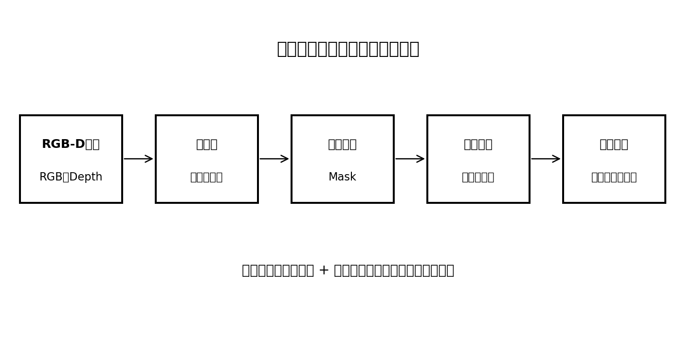
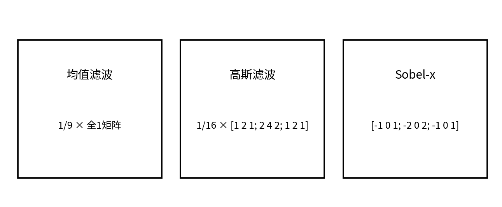
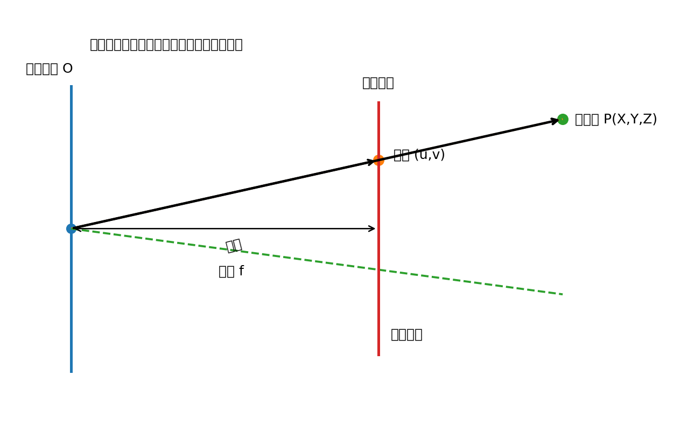
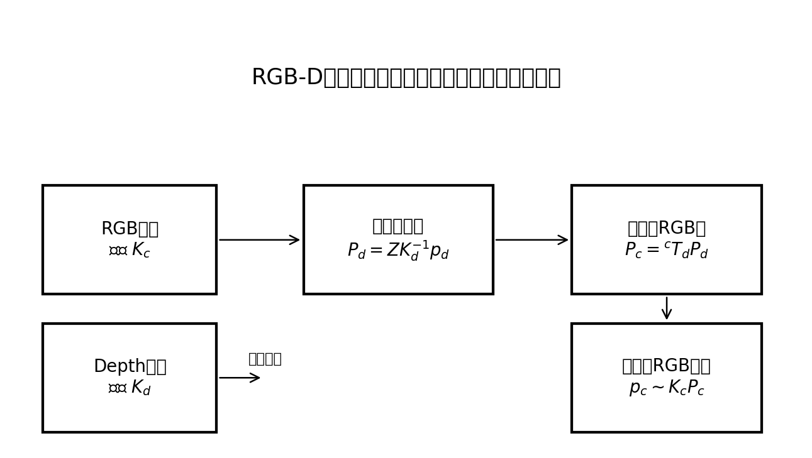
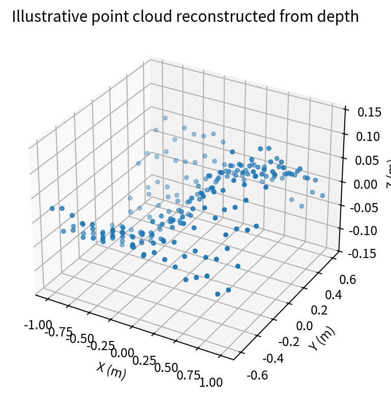
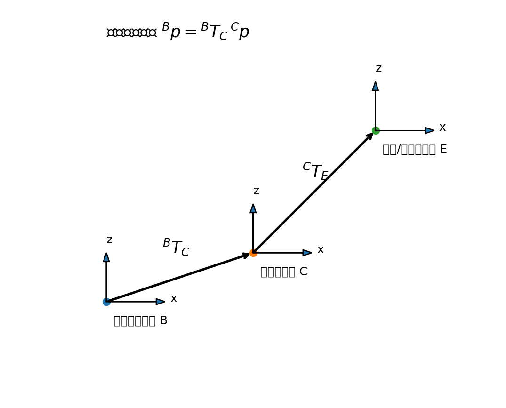

# 计算机视觉与 RGB-D 相机：面向双臂机器人衣物折叠的系统学习笔记

> **适用对象**：自动化专业本科生；毕业设计方向为双臂 Franka 机器人、RGB-D 视觉感知、衣物识别与抓取、双臂协同折叠，以及后续 VLA 模型适配。  
> **学习目标**：从图像像素出发，理解如何识别衣物、提取轮廓与关键点、利用深度恢复三维位置、标定相机与机器人坐标系，并将视觉结果变成机器人可以执行的抓取目标。  
> **说明**：本文中的图片均为帮助理解而绘制的原理示意图，不代表某一具体相机或实验平台的实测结果。公式使用标准 LaTeX 数学定界符，适用于支持 MathJax/KaTeX 的 Markdown 阅读器。

---

## 目录

1. [本章在毕业设计中的位置](#1-本章在毕业设计中的位置)
2. [计算机视觉整体认知](#2-计算机视觉整体认知)
3. [数字图像基础](#3-数字图像基础)
4. [颜色空间与衣物颜色分割](#4-颜色空间与衣物颜色分割)
5. [图像滤波与增强](#5-图像滤波与增强)
6. [边缘检测、轮廓与形态学](#6-边缘检测轮廓与形态学)
7. [角点、特征点与关键点](#7-角点特征点与关键点)
8. [目标检测与图像分割](#8-目标检测与图像分割)
9. [相机成像模型与针孔模型](#9-相机成像模型与针孔模型)
10. [相机内参与畸变校正](#10-相机内参与畸变校正)
11. [深度相机与 RGB-D 数据](#11-深度相机与-rgb-d-数据)
12. [深度图处理与 RGB-Depth 配准](#12-深度图处理与-rgb-depth-配准)
13. [像素坐标到三维坐标：反投影推导](#13-像素坐标到三维坐标反投影推导)
14. [点云生成与处理](#14-点云生成与处理)
15. [坐标系与齐次变换](#15-坐标系与齐次变换)
16. [相机标定与手眼标定](#16-相机标定与手眼标定)
17. [面向衣物的视觉感知](#17-面向衣物的视觉感知)
18. [衣物抓取点与折叠轴估计](#18-衣物抓取点与折叠轴估计)
19. [衣物状态识别与闭环反馈](#19-衣物状态识别与闭环反馈)
20. [从视觉结果到 Franka 机器人动作](#20-从视觉结果到-franka-机器人动作)
21. [完整工程流水线与 ROS 2 节点设计](#21-完整工程流水线与-ros-2-节点设计)
22. [实验设计、评价指标与故障排查](#22-实验设计评价指标与故障排查)
23. [学习路线与阶段验收](#23-学习路线与阶段验收)
24. [核心公式速查表](#24-核心公式速查表)
25. [术语表与推荐资料](#25-术语表与推荐资料)
26. [自测题与实践任务](#26-自测题与实践任务)

---

# 1. 本章在毕业设计中的位置

你的毕业设计不是单纯做图像分类，而是要让机器人通过相机观察桌面上的衣物，理解衣物当前的几何状态，估计可以抓取的位置，再把目标点转换到机器人坐标系中，最后驱动左右机械臂协同操作。

整个链路可以概括为：

**相机采集 → 图像预处理 → 衣物分割 → 轮廓/关键点提取 → 深度查询 → 三维反投影 → 坐标变换 → 抓取规划 → 机器人执行 → 再次观察。**



这条链路中每一步解决的问题不同：

| 环节 | 输入 | 输出 | 主要问题 |
|---|---|---|---|
| 图像采集 | 相机硬件 | RGB、Depth | 图像是否清晰、时间是否同步 |
| 预处理 | 原始图像 | 去噪、校正后的图像 | 噪声、畸变、无效深度 |
| 衣物分割 | RGB/Depth | 衣物掩膜 Mask | 哪些像素属于衣物 |
| 几何提取 | Mask | 轮廓、边缘、角点 | 衣物边界在哪里 |
| 三维定位 | 像素点、深度 | 相机坐标系三维点 | 这个点在空间哪里 |
| 坐标变换 | 相机坐标点 | 机器人基座坐标点 | 机器人应该去哪里 |
| 抓取规划 | 三维目标点、状态 | 末端目标位姿 | 怎样安全地抓取 |
| 闭环反馈 | 执行后图像 | 新状态估计 | 动作是否达到预期 |

**必须建立的概念：视觉算法输出的像素点不是机器人可以直接执行的坐标。**  
机器人需要的是以米为单位、表达在机器人基座坐标系或工具坐标系中的三维位置和姿态。视觉模块必须经过深度反投影和坐标变换，才能向机器人控制模块提供可用目标。

## 1.1 本章的学习边界

本章优先学习以下内容：

- 2D 图像：读取、保存、像素坐标、颜色空间、滤波、边缘、轮廓、角点。
- RGB-D：深度含义、相机内外参、深度图处理、RGB-Depth 配准。
- 三维重建：像素到相机坐标系、点云生成与过滤。
- 标定：相机内参标定、相机外参、手眼标定。
- 衣物感知：衣物区域、轮廓、角点、边缘、折叠轴、抓取点和状态变化。
- 工程实现：OpenCV、RealSense（若实验室使用）、ROS 2、Franka 坐标系。

本章暂不要求你从零训练大型分割网络，也不要求开发完整的三维重建系统。先用可靠的传统视觉方法建立基线，再根据数据质量和任务难度决定是否引入深度学习分割或 VLA。

---

# 2. 计算机视觉整体认知

## 2.1 什么是计算机视觉

计算机视觉（Computer Vision）研究如何让计算机从图像或视频中提取有意义的信息。人看到一张桌面照片，会自然理解“桌子上有一块毛巾，毛巾左上角在这里，边缘大致沿这个方向”。计算机不会天然理解这些语义，需要算法把原始像素转化成结构化信息。

一张彩色图像可以看作一个三维数组：

$$
I \in \mathbb{R}^{H\times W\times 3}
$$

其中：

- $H$：图像高度（像素数）。
- $W$：图像宽度（像素数）。
- 3：红、绿、蓝三个颜色通道。
- $I(v,u,c)$：第 $v$ 行、第 $u$ 列、第 $c$ 个通道的像素值。

计算机视觉任务可以分为不同层次：

1. **低层视觉**：去噪、增强、边缘检测。
2. **中层视觉**：轮廓、角点、特征描述。
3. **高层视觉**：目标检测、语义分割、实例分割、姿态或关键点估计。
4. **三维视觉**：深度估计、点云、空间定位、三维重建。
5. **机器人视觉**：把视觉结果转换成机器人可执行的目标。

## 2.2 视觉、深度和机器人控制之间的关系

以抓取毛巾左上角为例：

- RGB 图像告诉我们：左上角在图像的哪个像素。
- Depth 图像告诉我们：这个像素对应的表面离相机多远。
- 相机内参把像素和深度转换为相机坐标系中的三维点。
- 相机外参/手眼标定把相机坐标系中的点转换到机器人基座坐标系。
- 机器人运动学和规划器把目标点转化为机械臂运动。

所以整个过程不是“识别一个点就能抓”，而是：

$$
(u,v)
\xrightarrow{\text{深度}}
(u,v,Z)
\xrightarrow{\text{内参}}
{}^{C}\mathbf p
\xrightarrow{\text{外参}}
{}^{B}\mathbf p
\xrightarrow{\text{规划}}
q_{\text{target}}
$$

这里 $C$ 表示 Camera，相机坐标系；$B$ 表示 Base，机器人基座坐标系。

---

# 3. 数字图像基础

## 3.1 像素与图像坐标

数字图像由离散像素组成。通常使用：

- $u$：横向坐标，向右增加。
- $v$：纵向坐标，向下增加。

注意：图像坐标原点一般位于左上角，而数学平面常把纵轴向上作为正方向。因此在处理图像几何时，要特别留意纵坐标方向。

像素位置写成：

$$
\mathbf p =
\begin{bmatrix}
u\\v
\end{bmatrix}
$$

像素值可能是：

- 灰度图：一个强度值，常见范围为 $0\sim255$。
- RGB 图：三个通道值。
- 深度图：一个距离或深度数值，单位依设备设置而定。
- 二值掩膜：0 表示背景，1 或 255 表示目标区域。

## 3.2 分辨率、视场角与像素尺度

分辨率 $W\times H$ 表示横向和纵向像素数量。分辨率越高，不一定意味着空间测量一定越准确；实际精度还受镜头、焦距、噪声、深度测量原理和标定质量影响。

水平视场角为 $\theta_x$，相机到平面的距离为 $Z$，则平面上覆盖的宽度近似为：

$$
L_x = 2Z\tan\left(\frac{\theta_x}{2}\right)
$$

若图像宽度为 $W$，则平均每个像素对应的平面尺度约为：

$$
s_x = \frac{L_x}{W}
$$

例如，视场宽度约为 $0.8\,\mathrm m$，图像宽度为 1280 像素，则平均尺度约为：

$$
s_x=\frac{0.8}{1280}=0.000625\,\mathrm m/pixel
$$

即约 $0.625\,\mathrm{mm/pixel}$。这只是理想平面近似，不能直接当作整个场景的精确测量误差。

## 3.3 图像数据类型

OpenCV 中常见数据类型：

| 类型 | 含义 | 常见用途 |
|---|---|---|
| `uint8` | 0–255 的无符号整数 | RGB、灰度、掩膜 |
| `uint16` | 0–65535 的无符号整数 | 某些深度图原始数据 |
| `float32` | 32 位浮点数 | 米制深度、概率图、点云 |
| `bool` | True/False | 二值逻辑掩膜 |

**非常重要：深度图不能不加判断地转成 `uint8`。**  
这样可能把真实深度范围压缩或截断，导致距离信息丢失。应先确认相机驱动给出的数据类型、单位和无效值编码。

## 3.4 OpenCV 图像读取

```python
import cv2

# OpenCV 默认读取彩色图像时使用 BGR 通道顺序
image = cv2.imread("cloth.jpg", cv2.IMREAD_COLOR)

if image is None:
    raise RuntimeError("图像读取失败，请检查路径")

print(image.shape)  # (H, W, 3)
print(image.dtype)  # 通常为 uint8

# BGR 转 RGB，便于与部分深度学习库配合
rgb = cv2.cvtColor(image, cv2.COLOR_BGR2RGB)

# 灰度图
gray = cv2.cvtColor(image, cv2.COLOR_BGR2GRAY)

cv2.imwrite("gray.png", gray)
```

常见错误：

- 忘记 OpenCV 默认是 BGR，而不是 RGB。
- 图像路径错误但没有检查 `None`。
- 把行列顺序理解反：`shape` 是 `(height, width, channels)`。
- 把图像坐标 `(u,v)` 和数组索引 `image[v,u]` 混淆。

---

# 4. 颜色空间与衣物颜色分割

## 4.1 RGB 颜色空间

RGB 通过红、绿、蓝三个通道表达颜色。每个通道通常取值 0–255。

RGB 的问题是：亮度变化会同时影响三个通道。例如同一块蓝色布料在阴影下会变暗，RGB 阈值可能无法稳定识别。

## 4.2 HSV 颜色空间

HSV 将颜色表示为：

- $H$：Hue，色调。
- $S$：Saturation，饱和度。
- $V$：Value，明度。

它把“颜色是什么”和“颜色有多亮”部分分开，因此在简单颜色分割中比较方便。

HSV 适合做初步颜色阈值，但不能认为它能解决所有衣物分割问题。白色、灰色、黑色衣物的饱和度低；不同光源也会改变色调和明度。

## 4.3 HSV 阈值分割

设像素 HSV 值为 $(H,S,V)$，若：

$$
H_{\min}\le H\le H_{\max}
$$

$$
S_{\min}\le S\le S_{\max}
$$

$$
V_{\min}\le V\le V_{\max}
$$

则将该像素判为目标颜色区域。

```python
import cv2
import numpy as np

bgr = cv2.imread("cloth.jpg")
hsv = cv2.cvtColor(bgr, cv2.COLOR_BGR2HSV)

lower = np.array([0, 30, 30], dtype=np.uint8)
upper = np.array([20, 255, 255], dtype=np.uint8)

mask = cv2.inRange(hsv, lower, upper)
result = cv2.bitwise_and(bgr, bgr, mask=mask)

cv2.imwrite("mask.png", mask)
cv2.imwrite("segmented.png", result)
```

阈值只是示例，必须根据实验室光照、相机白平衡、衣物颜色调整。

## 4.4 为什么单纯颜色阈值不够

衣物可能出现：

- 颜色与桌面相近；
- 阴影区域被误分为背景；
- 图案、印花产生多个区域；
- 白色衣物与高亮桌面难以区分；
- 衣物折叠后出现重叠和遮挡。

因此更稳妥的思路是融合多个线索：

$$
P(\text{cloth}\mid I,D)
$$

其中 $I$ 表示 RGB 外观，$D$ 表示深度信息。可综合颜色、纹理、深度差、边缘连续性和学习模型输出。

---

# 5. 图像滤波与增强

图像滤波的主要目标是抑制噪声、保留有用结构或突出边缘。

## 5.1 卷积的基本概念

卷积核（Kernel）是一个小矩阵，在图像上滑动，对邻域像素进行加权求和。

二维离散卷积可写成：

$$
I'(u,v)=\sum_{i=-k}^{k}\sum_{j=-k}^{k}
K(i,j)I(u-i,v-j)
$$

其中：

- $I$：原始图像。
- $K$：卷积核。
- $I'$：滤波后的图像。
- $k$：核半径。

直观理解：输出像素由周围一小块区域共同决定。



## 5.2 均值滤波

均值滤波把邻域像素取平均：

$$
I'(u,v)=\frac{1}{N}\sum_{(i,j)\in\Omega}I(u+i,v+j)
$$

例如 $3\times3$ 核：

$$
K=\frac{1}{9}
\begin{bmatrix}
1&1&1\\
1&1&1\\
1&1&1
\end{bmatrix}
$$

优点：简单、能削弱随机噪声。  
缺点：容易模糊边缘，衣物轮廓可能变得不清晰。

## 5.3 高斯滤波

高斯滤波根据距离中心的远近分配权重：

$$
G(x,y)=\frac{1}{2\pi\sigma^2}
\exp\left(-\frac{x^2+y^2}{2\sigma^2}\right)
$$

离中心越近，权重通常越大。二维高斯核可分离为两个一维核，因此计算效率较高。

OpenCV：

```python
blur = cv2.GaussianBlur(image, (5, 5), sigmaX=1.0)
```

参数含义：

- `(5,5)`：卷积核大小，通常使用奇数。
- `sigmaX`：水平方向标准差；纵向未单独指定时按规则推导。

## 5.4 中值滤波

中值滤波将邻域像素排序，取中间值：

$$
I'(u,v)=\operatorname{median}\{I(u+i,v+j)\}
$$

它对椒盐噪声特别有效，而且通常比均值滤波更能保留边缘。

```python
median = cv2.medianBlur(image, 5)
```

## 5.5 深度图滤波与普通图像滤波的区别

深度图中的噪声不只是普通亮度噪声，还可能包括：

- 无效深度；
- 边缘飞点；
- 多路径干扰；
- 反光、透明或吸光材料导致的测量异常；
- 前后景深度混合。

对深度图做普通均值滤波，可能把前景和背景的深度平均到一起，制造出不存在的中间表面。因此深度图常采用边缘保留滤波、双边滤波、时域滤波、孔洞填补等方法。

## 5.6 双边滤波

双边滤波同时考虑空间距离和像素值差异：

$$
I'(p)=\frac{1}{W_p}
\sum_{q\in\Omega}
I(q)\,
\exp\left(-\frac{\|p-q\|^2}{2\sigma_s^2}\right)
\exp\left(-\frac{|I(p)-I(q)|^2}{2\sigma_r^2}\right)
$$

其中 $W_p$ 是归一化系数。空间距离近且像素值相似的点权重大；跨越明显边缘的点权重小。

## 5.7 直方图均衡化

灰度图直方图统计各灰度级出现频率。若图像灰度集中在较窄范围，可能对比度较低。

设灰度随机变量为 $r$，累计分布函数为：

$$
s=T(r)=\int_0^r p_r(w)\,dw
$$

离散情况下：

$$
s_k=(L-1)\sum_{j=0}^{k}p_r(r_j)
$$

其中 $L$ 是灰度级数，常见为 256。

直方图均衡化可以改善整体对比度，但也可能放大噪声。局部自适应直方图均衡化（CLAHE）更适合处理局部亮度差异。

---

# 6. 边缘检测、轮廓与形态学

## 6.1 图像梯度

边缘通常对应图像亮度变化较快的位置。连续图像 $I(x,y)$ 的梯度为：

$$
\nabla I=
\begin{bmatrix}
\frac{\partial I}{\partial x}\\
\frac{\partial I}{\partial y}
\end{bmatrix}
$$

梯度幅值：

$$
G=\sqrt{G_x^2+G_y^2}
$$

梯度方向：

$$
\theta=\operatorname{atan2}(G_y,G_x)
$$

离散图像通过差分近似偏导数。Sobel 算子常用于估计水平和垂直梯度。

## 6.2 Sobel 算子

$$
K_x=
\begin{bmatrix}
-1&0&1\\
-2&0&2\\
-1&0&1
\end{bmatrix},
\quad
K_y=
\begin{bmatrix}
-1&-2&-1\\
0&0&0\\
1&2&1
\end{bmatrix}
$$

分别与图像卷积得到 $G_x,G_y$。

```python
gray = cv2.cvtColor(image, cv2.COLOR_BGR2GRAY)
gx = cv2.Sobel(gray, cv2.CV_32F, 1, 0, ksize=3)
gy = cv2.Sobel(gray, cv2.CV_32F, 0, 1, ksize=3)
magnitude = cv2.magnitude(gx, gy)
```

## 6.3 Canny 边缘检测

Canny 算法通常包括：

1. 高斯平滑，降低噪声。
2. 计算梯度幅值和方向。
3. 非极大值抑制，使边缘变细。
4. 双阈值检测。
5. 滞后连接：强边缘保留，弱边缘若与强边缘连通也保留。

```python
edges = cv2.Canny(gray, threshold1=50, threshold2=150)
```

阈值太低会产生大量噪声边缘；阈值太高会漏掉衣物边界。需要结合实际图像调节。

## 6.4 轮廓（Contour）

轮廓是二值图像中连续边界点的集合。先得到衣物二值掩膜，再用轮廓提取算法获取边界。

```python
contours, hierarchy = cv2.findContours(
    mask,
    cv2.RETR_EXTERNAL,
    cv2.CHAIN_APPROX_SIMPLE
)

largest = max(contours, key=cv2.contourArea)
```

常用几何量：

**面积：**

$$
A=\operatorname{Area}(C)
$$

**周长：**

$$
P=\sum_{i=1}^{N-1}\|p_{i+1}-p_i\|
$$

**边界框：**

$$
(x_{\min},y_{\min},w,h)
$$

**质心：**

若二值区域的空间矩为 $m_{pq}$，则：

$$
\bar{x}=\frac{m_{10}}{m_{00}},
\qquad
\bar{y}=\frac{m_{01}}{m_{00}}
$$

质心可表示衣物整体中心，但不一定是合适抓取点。

## 6.5 图像形态学

形态学通过结构元素对二值区域进行几何操作。

**腐蚀（Erosion）**：缩小前景区域，去除小噪点、分离窄连接。

**膨胀（Dilation）**：扩大前景区域，填补小间隙、连接邻近区域。

**开运算（Opening）**：先腐蚀再膨胀，常用于去除小噪点：

$$
A\circ B=(A\ominus B)\oplus B
$$

**闭运算（Closing）**：先膨胀再腐蚀，常用于填补小孔洞：

$$
A\bullet B=(A\oplus B)\ominus B
$$

注意：结构元素过大可能破坏衣物的细长边缘或把相邻衣物区域错误连接。

---

# 7. 角点、特征点与关键点

## 7.1 三者有什么区别

- **角点（Corner）**：局部图像强度在两个方向都明显变化的点。
- **特征点（Feature Point）**：可重复检测、便于匹配的局部显著点。
- **任务关键点（Task Keypoint）**：对当前任务有语义意义的位置，例如毛巾四角、T恤肩点、袖口点、折叠轴端点。

传统角点算法检测到的点，不一定就是衣物真正需要抓取的角点。任务关键点往往需要结合衣物轮廓、拓扑关系或学习模型来判断。

## 7.2 Harris 角点检测原理

在局部窗口内，图像平移 $(u,v)$ 后的灰度变化为：

$$
E(u,v)=\sum_{x,y}w(x,y)
[I(x+u,y+v)-I(x,y)]^2
$$

对小位移进行一阶近似：

$$
I(x+u,y+v)\approx I(x,y)+I_xu+I_yv
$$

代入并整理：

$$
E(u,v)\approx
\begin{bmatrix}u&v\end{bmatrix}
M
\begin{bmatrix}u\\v\end{bmatrix}
$$

其中：

$$
M=
\sum_{x,y}w(x,y)
\begin{bmatrix}
I_x^2&I_xI_y\\
I_xI_y&I_y^2
\end{bmatrix}
$$

矩阵 $M$ 的两个特征值 $\lambda_1,\lambda_2$ 表示两个主方向上的灰度变化：

- 两个都小：平坦区域。
- 一个大、一个小：边缘。
- 两个都大：角点。

Harris 响应：

$$
R=\det(M)-k[\operatorname{trace}(M)]^2
$$

通常 $k$ 取一个较小常数。$R$ 大且为正时更可能是角点。

## 7.3 Shi-Tomasi 角点

Shi-Tomasi 使用：

$$
R=\min(\lambda_1,\lambda_2)
$$

两个方向都变化明显时响应较大。OpenCV 中可用 `goodFeaturesToTrack`。

```python
corners = cv2.goodFeaturesToTrack(
    gray,
    maxCorners=100,
    qualityLevel=0.01,
    minDistance=10
)
```

## 7.4 为什么衣物角点很难

矩形纸片的四角通常清楚，而柔性衣物会弯曲、褶皱、遮挡，角点可能被折叠到内部。毛巾的几何角点可能对应轮廓曲率突变位置，但如果布料被揉皱，单纯寻找轮廓角点会产生很多假候选点。

实用策略：

1. 先分割出衣物 Mask。
2. 计算外轮廓并进行适度平滑。
3. 提取凸包或多边形近似。
4. 根据局部曲率、轮廓方向变化找候选角点。
5. 使用深度和任务先验筛选。
6. 通过视觉模型或人工标注训练关键点检测器，作为后续升级。

---

# 8. 目标检测与图像分割

## 8.1 目标检测

目标检测回答：“图像中有什么物体？物体大致在哪里？”

常见输出是边界框：

$$
B=(x_{\min},y_{\min},x_{\max},y_{\max})
$$

检测框只描述矩形区域，不代表衣物真实轮廓。对于衣物折叠，边界框通常不够，因为抓取点、边缘和折叠轴都依赖精细几何形状。

## 8.2 语义分割

语义分割给每个像素分配类别，例如：

- 0：背景；
- 1：衣物。

模型输出可以表示为：

$$
S(u,v)\in\{0,1,\ldots,C-1\}
$$

或每类概率：

$$
P(c\mid I(u,v))
$$

衣物二值掩膜可由：

$$
M(u,v)=
\begin{cases}
1,&P(\text{cloth}\mid I(u,v))>\tau\\
0,&\text{otherwise}
\end{cases}
$$

## 8.3 实例分割

当场景中有多件衣物时，语义分割可能把所有衣物都标成同一类；实例分割则区分每一件衣物。

对单件毛巾的基础实验，语义分割或传统阈值方法可能足够；多件衣物或衣物重叠时，实例分割更有价值。

## 8.4 分割评价指标

**交并比（IoU）：**

$$
IoU=\frac{|M_{\text{pred}}\cap M_{\text{gt}}|}
{|M_{\text{pred}}\cup M_{\text{gt}}|}
$$

**精确率（Precision）：**

$$
Precision=\frac{TP}{TP+FP}
$$

**召回率（Recall）：**

$$
Recall=\frac{TP}{TP+FN}
$$

**F1：**

$$
F1=2\frac{Precision\cdot Recall}{Precision+Recall}
$$

其中 TP 是正确识别的衣物像素，FP 是误把背景识别为衣物的像素，FN 是漏掉的衣物像素。

对机器人抓取来说，整体 IoU 高并不一定意味着抓取点准确。例如掩膜主体区域很准，但角点偏差很大，仍可能导致抓取失败。因此需要额外评价关键点定位误差。

---

# 9. 相机成像模型与针孔模型

## 9.1 针孔成像的直观理解

相机可以近似理解为一个小孔：空间中的光线通过光心，在成像平面形成图像。三维世界被投影到二维平面，因此深度信息在普通 RGB 图像中丢失。



## 9.2 从相似三角形推导投影关系

设相机坐标系中三维点为：

$$
P_C=(X,Y,Z)
$$

焦距为 $f$。根据相似三角形：

$$
\frac{x}{f}=\frac{X}{Z},
\qquad
\frac{y}{f}=\frac{Y}{Z}
$$

所以：

$$
x=f\frac{X}{Z},
\qquad
y=f\frac{Y}{Z}
$$

这里 $x,y$ 是以物理长度表示的成像平面坐标。数字图像使用像素单位，需要通过像素尺度和主点偏移转换。

## 9.3 相机内参矩阵

相机内参矩阵为：

$$
K=
\begin{bmatrix}
f_x&s&c_x\\
0&f_y&c_y\\
0&0&1
\end{bmatrix}
$$

其中：

- $f_x,f_y$：以像素为单位的焦距。
- $c_x,c_y$：主点坐标，通常接近图像中心。
- $s$：像素轴倾斜参数，现代相机通常接近 0。

若忽略倾斜项：

$$
u=f_x\frac{X}{Z}+c_x
$$

$$
v=f_y\frac{Y}{Z}+c_y
$$

齐次形式：

$$
\lambda
\begin{bmatrix}u\\v\\1\end{bmatrix}
=
K
\begin{bmatrix}X\\Y\\Z\end{bmatrix}
$$

其中 $\lambda=Z$（在标准针孔模型、相机坐标系定义下）。

## 9.4 内参和外参的区别

- **内参**描述相机自身成像关系：焦距、主点、像素轴关系、畸变。
- **外参**描述相机相对于某个世界坐标系的位置和姿态。

内参解决“空间点如何投影到图像”；外参解决“相机在世界哪里、朝向哪里”。

---

# 10. 相机内参与畸变校正

## 10.1 为什么镜头会畸变

理想针孔模型假设光线直线传播且镜头无畸变。真实镜头会产生几何畸变，常见有：

- 径向畸变：图像越靠近边缘，畸变越明显。
- 切向畸变：镜头与成像平面不完全平行或装配偏差导致。

径向畸变常用：

$$
x_d=x(1+k_1r^2+k_2r^4+k_3r^6)
$$

$$
y_d=y(1+k_1r^2+k_2r^4+k_3r^6)
$$

其中：

$$
r^2=x^2+y^2
$$

切向畸变常见表达：

$$
x_{d}=x+2p_1xy+p_2(r^2+2x^2)
$$

$$
y_{d}=y+p_1(r^2+2y^2)+2p_2xy
$$

$k_i$ 是径向畸变系数，$p_i$ 是切向畸变系数。

## 10.2 棋盘格标定原理

相机标定通常使用已知几何尺寸的棋盘格。棋盘格角点在标定板坐标系中的三维坐标已知（通常位于同一平面），通过多张不同姿态的图像检测角点，建立三维点与二维像素点的对应关系，优化相机内参、畸变参数以及每张图像对应的外参。

投影模型：

$$
s\mathbf p=K[R\mid t]\mathbf P
$$

其中：

- $\mathbf P$：标定板坐标系中的三维点。
- $R,t$：标定板相对于相机的姿态。
- $K$：相机内参。
- $\mathbf p$：图像像素点。

标定通过最小化重投影误差完成：

$$
E=\sum_{i=1}^{N}
\left\|
\mathbf p_i^{\text{obs}}-
\mathbf p_i^{\text{proj}}
\right\|^2
$$

## 10.3 重投影误差是什么

把已知三维标定点通过当前估计的相机参数投影回图像，得到预测像素位置；再与实际检测到的角点比较。二者距离就是重投影误差。

$$
e_i=
\left\|
\mathbf p_i^{\text{obs}}-
\mathbf p_i^{\text{proj}}
\right\|_2
$$

平均重投影误差：

$$
\bar e=\frac{1}{N}\sum_{i=1}^{N}e_i
$$

误差越小通常越好，但不能只看一个数字：标定板姿态覆盖是否充分、图像边缘是否覆盖、角点检测是否可靠，同样重要。

---

# 11. 深度相机与 RGB-D 数据

## 11.1 RGB-D 是什么

RGB-D 相机同时提供：

- RGB：颜色图像。
- D：Depth，深度图。

RGB 图像描述外观；深度图描述每个像素对应表面与相机之间的距离或深度量。

深度图可以写为：

$$
D(u,v)=Z
$$

但必须确认设备给出的深度到底是：

1. 沿相机光轴方向的 $Z$ 深度；
2. 相机光心到点的欧氏距离（Range）；
3. 经过缩放编码的整数值。

大多数机器人深度相机 SDK 提供的是沿光轴的深度值，但不能凭经验假设，必须查设备文档。

## 11.2 深度相机的常见技术路线

| 技术 | 基本原理 | 特点 |
|---|---|---|
| 双目立体视觉 | 两个相机观察同一点，通过视差估计深度 | 被动成像，受纹理和光照影响 |
| 结构光 | 投射已知红外图案，观察图案变形 | 近距离效果较好，受环境光影响 |
| ToF | 发射调制光，测量往返时间或相位差 | 可直接测距，可能有多路径误差 |
| 主动立体 | 红外投射辅助双目匹配 | 对低纹理表面更友好 |

## 11.3 双目深度推导

设两个相机基线距离为 $B$，焦距为 $f$，同一点在左右图像中的水平像素位置分别为 $u_L,u_R$。视差：

$$
d=u_L-u_R
$$

根据相似三角形：

$$
\frac{B}{Z}=\frac{d}{f}
$$

得到：

$$
Z=\frac{fB}{d}
$$

结论：

- 视差越大，物体越近。
- 视差越小，物体越远。
- 远距离时视差变小，深度误差通常更敏感。

若视差误差为 $\delta d$，对深度函数求导：

$$
\frac{\partial Z}{\partial d}=-\frac{fB}{d^2}
$$

一阶误差近似：

$$
|\delta Z|\approx\frac{fB}{d^2}|\delta d|
$$

这说明视差越小（距离越远），同样的像素视差误差会带来更大的深度误差。

## 11.4 ToF 深度测量直观原理

光从相机发出，照射物体后反射返回。若测量往返时间 $\Delta t$，则距离近似为：

$$
Z=\frac{c\Delta t}{2}
$$

其中 $c$ 为光速，除以 2 是因为光走了往返路程。实际 ToF 相机可能通过调制光相位差测量，而不是直接测量极短的飞行时间。

## 11.5 深度图中的无效值

深度图常见异常：

- 0：可能表示无效深度。
- 超出量程：无法可靠测量。
- 物体边缘：前景与背景混合。
- 反光、透明、黑色或吸光表面：可能测量失败。
- 遮挡区域：相机看不到真实表面。

使用深度前必须做有效性检查：

```python
valid = (depth_m > 0.10) & (depth_m < 2.00)
```

这里 0.10 m 和 2.00 m 只是示例，应根据相机量程、桌面距离和机器人工作空间设定。

---

# 12. 深度图处理与 RGB-Depth 配准

## 12.1 为什么 RGB 与 Depth 可能不对齐

RGB 传感器和深度传感器可能具有不同的：

- 光心位置；
- 焦距和视场角；
- 分辨率；
- 镜头畸变；
- 坐标系方向。

所以 RGB 图像中像素 $(u_c,v_c)$ 对应的物体点，不一定在 Depth 图像的同一个像素 $(u_c,v_c)$ 上。

## 12.2 RGB-Depth 配准的本质

配准（Registration/Alignment）就是将一个传感器坐标系中的测量，映射到另一个传感器的图像坐标系中。



设深度相机坐标系为 $D$，RGB 相机坐标系为 $C$。

深度像素：

$$
\mathbf p_d=
\begin{bmatrix}u_d\\v_d\\1\end{bmatrix}
$$

深度为 $Z_d$，先利用深度相机内参反投影：

$$
{}^D\mathbf P=
Z_d K_d^{-1}\mathbf p_d
$$

再使用两个相机之间的外参：

$$
{}^C\mathbf P=
{}^C T_D\,{}^D\mathbf P
$$

最后投影到 RGB 图像：

$$
\tilde{\mathbf p}_c=K_c\,{}^C\mathbf P
$$

归一化得到：

$$
u_c=\frac{\tilde p_{c,1}}{\tilde p_{c,3}},
\qquad
v_c=\frac{\tilde p_{c,2}}{\tilde p_{c,3}}
$$

这就是几何配准的核心过程。

## 12.3 对齐后的深度查询

如果 SDK 已经提供对齐到彩色图像的深度图，那么在彩色图像中检测到 $(u,v)$ 后，可以在对齐深度图中查询附近深度。

但要注意：

- 必须确认深度图确实对齐到了 RGB，而不是反过来。
- 对齐后的深度图分辨率通常与目标图像一致。
- 对齐会涉及重采样和遮挡处理。
- 目标边缘处深度可能仍不可靠。
- 不能只取单个像素，建议在小邻域内取有效深度中值。

## 12.4 为什么用邻域中值

设关键点周围窗口的有效深度集合为：

$$
\mathcal D=\{D(u+i,v+j)\}
$$

使用：

$$
Z=\operatorname{median}(\mathcal D)
$$

比单点查询更能抵抗孤立噪声。但窗口不能过大，否则可能把衣物、桌面和背景混在一起。实际可先尝试 $3\times3$ 或 $5\times5$，再根据分辨率与物体尺寸调整。

---

# 13. 像素坐标到三维坐标：反投影推导

这是本章最重要的数学内容之一。你必须真正理解，而不是只记住公式。

## 13.1 从投影公式反推三维坐标

针孔模型：

$$
u=f_x\frac{X}{Z}+c_x
$$

$$
v=f_y\frac{Y}{Z}+c_y
$$

移项：

$$
u-c_x=f_x\frac{X}{Z}
$$

因此：

$$
X=\frac{(u-c_x)Z}{f_x}
$$

同理：

$$
Y=\frac{(v-c_y)Z}{f_y}
$$

深度相机给出 $Z$，所以三维点为：

$$
{}^C\mathbf P=
\begin{bmatrix}
X\\Y\\Z
\end{bmatrix}
=
\begin{bmatrix}
\frac{(u-c_x)Z}{f_x}\\
\frac{(v-c_y)Z}{f_y}\\
Z
\end{bmatrix}
$$

这就是像素到相机坐标系三维点的反投影公式。

## 13.2 齐次矩阵形式

$$
\begin{bmatrix}
X\\Y\\Z
\end{bmatrix}
=
Z
\begin{bmatrix}
1/f_x&0&-c_x/f_x\\
0&1/f_y&-c_y/f_y\\
0&0&1
\end{bmatrix}
\begin{bmatrix}
u\\v\\1
\end{bmatrix}
$$

也可以简写为：

$$
{}^C\mathbf P=ZK^{-1}\mathbf p
$$

其中：

$$
\mathbf p=[u,v,1]^T
$$

注意：如果相机模型有畸变，应先对像素坐标进行去畸变，或使用 SDK 提供的反投影函数。

## 13.3 数值例子

假设：

$$
f_x=600,\quad f_y=600
$$

$$
c_x=640,\quad c_y=360
$$

某衣物抓取点像素坐标：

$$
(u,v)=(700,400)
$$

深度：

$$
Z=0.8\,\mathrm m
$$

则：

$$
X=\frac{(700-640)\times0.8}{600}
=0.08\,\mathrm m
$$

$$
Y=\frac{(400-360)\times0.8}{600}
\approx0.0533\,\mathrm m
$$

所以相机坐标系下：

$$
{}^C\mathbf P=
\begin{bmatrix}
0.08\\0.0533\\0.8
\end{bmatrix}\mathrm m
$$

解释：

- 点位于相机光轴右侧约 8 cm；
- 在相机坐标系的 $Y$ 正方向约 5.33 cm；
- 距离相机光心沿光轴约 80 cm。

坐标轴正方向必须以相机驱动的坐标系定义为准，不能把不同相机的坐标约定混为一谈。

## 13.4 Python 反投影实现

```python
import numpy as np

def pixel_to_camera(u, v, depth_m, fx, fy, cx, cy):
    """
    将像素坐标和米制深度转换为相机坐标系三维点。
    注意：depth_m 必须是沿光轴的 Z 深度。
    """
    if depth_m <= 0 or not np.isfinite(depth_m):
        raise ValueError("无效深度")

    X = (u - cx) * depth_m / fx
    Y = (v - cy) * depth_m / fy
    Z = depth_m

    return np.array([X, Y, Z], dtype=np.float64)
```

## 13.5 反投影的误差来源

三维坐标由像素、深度和内参共同决定。以：

$$
X=\frac{(u-c_x)Z}{f_x}
$$

为例，微小误差传播近似：

$$
\delta X\approx
\frac{\partial X}{\partial u}\delta u+
\frac{\partial X}{\partial c_x}\delta c_x+
\frac{\partial X}{\partial Z}\delta Z+
\frac{\partial X}{\partial f_x}\delta f_x
$$

各偏导为：

$$
\frac{\partial X}{\partial u}=\frac{Z}{f_x}
$$

$$
\frac{\partial X}{\partial c_x}=-\frac{Z}{f_x}
$$

$$
\frac{\partial X}{\partial Z}=\frac{u-c_x}{f_x}
$$

$$
\frac{\partial X}{\partial f_x}
=-\frac{(u-c_x)Z}{f_x^2}
$$

这说明像素定位误差、深度误差、内参误差都会传递到三维定位误差。对抓取来说，深度边缘异常和关键点偏差往往是很重要的误差来源。

---

# 14. 点云生成与处理

## 14.1 什么是点云

点云（Point Cloud）是一组三维空间点：

$$
\mathcal P=\{\mathbf P_1,\mathbf P_2,\ldots,\mathbf P_N\}
$$

每个点通常包含：

$$
\mathbf P_i=(X_i,Y_i,Z_i)
$$

还可以附加 RGB 颜色、法向量、置信度等属性。



## 14.2 从深度图生成点云

对每个有效像素 $(u,v)$，使用内参和深度反投影：

$$
X_{u,v}=\frac{(u-c_x)D(u,v)}{f_x}
$$

$$
Y_{u,v}=\frac{(v-c_y)D(u,v)}{f_y}
$$

$$
Z_{u,v}=D(u,v)
$$

将所有有效像素对应的三维点组合起来，即得到点云。

```python
import numpy as np

def depth_to_point_cloud(depth_m, fx, fy, cx, cy, stride=2):
    h, w = depth_m.shape
    v, u = np.mgrid[0:h:stride, 0:w:stride]
    z = depth_m[0:h:stride, 0:w:stride]

    valid = np.isfinite(z) & (z > 0)
    u = u[valid].astype(np.float32)
    v = v[valid].astype(np.float32)
    z = z[valid].astype(np.float32)

    x = (u - cx) * z / fx
    y = (v - cy) * z / fy

    return np.stack([x, y, z], axis=1)
```

`stride` 用于降采样。步长越大，点越少，计算越快，但细节也会减少。

## 14.3 点云常见处理

- **直通滤波**：保留指定空间范围内的点。
- **体素降采样**：将空间划分为小立方体，每个体素用代表点近似。
- **统计离群点移除**：根据邻域距离统计剔除孤立噪点。
- **半径离群点移除**：统计固定半径内邻居数量。
- **平面分割**：拟合桌面平面，区分桌面与衣物。
- **法向量估计**：估计表面局部方向。

## 14.4 桌面平面分割

桌面可以近似为平面：

$$
ax+by+cz+d=0
$$

点 $(x,y,z)$ 到平面的距离：

$$
d_{\text{plane}}=
\frac{|ax+by+cz+d|}
{\sqrt{a^2+b^2+c^2}}
$$

若距离小于阈值，可判为桌面点。RANSAC 可以从含噪点云中稳健估计平面。

但衣物贴在桌面上时，衣物与桌面高度差可能很小，深度噪声可能使两者难以分开。因此平面分割最好结合 RGB、轮廓和局部高度信息，不要只依赖一个高度阈值。

---

# 15. 坐标系与齐次变换

## 15.1 为什么机器人必须有多个坐标系

在机器人系统中常见坐标系：

- $B$：机器人基座坐标系（Base）。
- $E$：机械臂末端/法兰坐标系（End-effector）。
- $G$：夹爪工具坐标系（Gripper/Tool）。
- $C$：相机坐标系（Camera）。
- $W$：世界或工作台坐标系（World）。
- $O$：衣物或物体局部坐标系（Object）。



同一个物理点，在不同坐标系中数值不同。只有明确坐标系，三维坐标才有意义。

## 15.2 旋转矩阵

绕 $x$ 轴旋转角度 $\alpha$：

$$
R_x(\alpha)=
\begin{bmatrix}
1&0&0\\
0&\cos\alpha&-\sin\alpha\\
0&\sin\alpha&\cos\alpha
\end{bmatrix}
$$

绕 $y$ 轴：

$$
R_y(\beta)=
\begin{bmatrix}
\cos\beta&0&\sin\beta\\
0&1&0\\
-\sin\beta&0&\cos\beta
\end{bmatrix}
$$

绕 $z$ 轴：

$$
R_z(\gamma)=
\begin{bmatrix}
\cos\gamma&-\sin\gamma&0\\
\sin\gamma&\cos\gamma&0\\
0&0&1
\end{bmatrix}
$$

旋转矩阵满足：

$$
R^TR=I,\qquad \det(R)=1
$$

旋转矩阵的列向量可理解为新坐标系三个轴在旧坐标系中的方向。

## 15.3 齐次变换矩阵

旋转和平移组合为：

$$
T=
\begin{bmatrix}
R&t\\
0&1
\end{bmatrix}
$$

其中 $R\in\mathbb R^{3\times3}$，$t\in\mathbb R^{3}$。

点的齐次坐标：

$$
\tilde{\mathbf p}=
\begin{bmatrix}x\\y\\z\\1\end{bmatrix}
$$

坐标变换：

$$
{}^A\tilde{\mathbf p}
=
{}^AT_B\,{}^B\tilde{\mathbf p}
$$

这里 ${}^AT_B$ 表示“把在 B 坐标系表达的点转换为 A 坐标系表达”。

## 15.4 变换方向一定要读清楚

$$
{}^B\mathbf p={}^BT_C\,{}^C\mathbf p
$$

意思是：已知点在相机坐标系 $C$ 下的坐标，乘以相机到机器人基座的变换，得到机器人基座坐标系 $B$ 下的坐标。

反向变换：

$$
{}^CT_B=({}^BT_C)^{-1}
$$

若：

$$
T=
\begin{bmatrix}R&t\\0&1\end{bmatrix}
$$

则：

$$
T^{-1}=
\begin{bmatrix}
R^T&-R^Tt\\
0&1
\end{bmatrix}
$$

常见错误：把 ${}^BT_C$ 和 ${}^CT_B$ 写反，或者把平移向量直接相加而忽略旋转。

## 15.5 多坐标系变换链

若相机固定在机器人末端（眼在手上）：

$$
{}^BT_C={}^BT_E\,{}^ET_C
$$

若相机固定在工作台上（眼在手外），相机到基座的关系通常是固定的：

$$
{}^BT_C=\text{constant}
$$

对你的衣物折叠项目，若相机固定在桌面上方，通常更容易先做眼在手外（Eye-to-Hand）方案；如果相机装在末端，则需要眼在手上（Eye-in-Hand）标定。

---

# 16. 相机标定与手眼标定

## 16.1 相机标定

相机标定的目标是估计内参和畸变参数，使像素与空间几何之间的映射尽可能准确。常用棋盘格或 ChArUco 标定板。

建议：

1. 使用尺寸准确的标定板。
2. 从多个距离、角度和图像区域拍摄。
3. 避免所有图片都正对标定板。
4. 保证角点清晰、无明显运动模糊。
5. 检查重投影误差。
6. 保存相机型号、分辨率、内参、畸变参数和标定日期。

## 16.2 手眼标定的目的

手眼标定（Hand-Eye Calibration）是确定相机与机器人之间的空间关系。

典型方程：

$$
AX=XB
$$

其中 $X$ 是待求的相机与机器人末端之间的固定变换；$A,B$ 来自机器人不同姿态下的相对运动。

具体 $A,B,X$ 的定义取决于眼在手上或眼在手外的建模约定，使用某个算法前必须先确认变换方向。

## 16.3 眼在手上（Eye-in-Hand）

相机安装在机械臂末端，机器人末端移动时相机也移动。标定需要采集多个机器人末端姿态以及标定板在相机中的观测。

典型关系中，末端与基座的变换随时间变化，而相机与末端之间的变换固定。

## 16.4 眼在手外（Eye-to-Hand）

相机固定在工作台或外部支架上，机器人末端运动，观察固定标定板。相机与基座之间的关系固定。

对桌面衣物折叠任务，固定俯视相机能提供较稳定的全局观察，适合先做基线系统。

## 16.5 标定验证不能省略

不要只看标定程序是否输出了矩阵。应使用已知位置的标定点验证：

1. 在桌面放置标定点或已知尺寸标定物。
2. 通过相机测量其三维位置。
3. 转换到机器人基座坐标系。
4. 用机器人末端或测量工具验证空间位置。
5. 计算误差并检查误差是否随位置变化。

平均位置误差：

$$
e_{\text{mean}}=
\frac{1}{N}\sum_{i=1}^{N}
\left\|
\mathbf p_i^{\text{robot}}-
\mathbf p_i^{\text{reference}}
\right\|_2
$$

最大误差：

$$
e_{\max}=\max_i
\left\|
\mathbf p_i^{\text{robot}}-
\mathbf p_i^{\text{reference}}
\right\|_2
$$

---

# 17. 面向衣物的视觉感知

## 17.1 为什么衣物是特殊物体

衣物属于柔性可变形物体（Deformable Object）。与刚性物体相比，它有以下特点：

- 形状会随重力、接触和抓取变化；
- 同一件衣物没有固定的刚体姿态；
- 会产生褶皱、自遮挡和多层重叠；
- 边缘和角点可能被遮挡；
- 抓取点变化会改变后续形态；
- 视觉观察和机器人动作之间存在明显的状态变化。

因此不能简单把衣物当作一个固定的长方体来定位。

## 17.2 衣物感知的建议分层

**第一级：衣物是否存在？**  
判断工作区域中是否出现衣物。

**第二级：衣物在哪里？**  
得到衣物的二维掩膜和外轮廓。

**第三级：衣物几何结构是什么？**  
提取角点、边缘、主方向、局部褶皱和折叠线索。

**第四级：哪些位置可以抓？**  
排除桌面边界、遮挡区、过薄或过厚的多层区域，选择可达且安全的抓取点。

**第五级：当前衣物处于什么任务状态？**  
例如未展开、已展开、已抓取、正在拉展、已对齐、已完成一次折叠。

## 17.3 衣物掩膜的几何特征

设衣物掩膜为 $M(u,v)$。可计算：

- 面积；
- 质心；
- 外轮廓；
- 凸包；
- 最小外接矩形；
- 主方向；
- 边界曲率；
- 角点候选。

主方向可以通过二阶中心矩估计。先计算中心化坐标：

$$
x'=u-\bar u,\qquad y'=v-\bar v
$$

构造协方差矩阵：

$$
\Sigma=
\begin{bmatrix}
\mathbb E[x'^2]&\mathbb E[x'y']\\
\mathbb E[x'y']&\mathbb E[y'^2]
\end{bmatrix}
$$

最大特征值对应的特征向量给出区域延展最明显的方向，可作为衣物主方向的初步估计。

注意：主方向只反映整体形状分布，不一定等于真正的折叠方向。对于近似正方形毛巾，两个主方向可能接近，方向估计会不稳定。

## 17.4 轮廓平滑与多边形近似

衣物边界容易受到褶皱和像素噪声影响。可先对轮廓进行平滑，再用 Douglas-Peucker 算法进行多边形近似：

$$
\epsilon=\alpha P
$$

其中 $P$ 是轮廓周长，$\alpha$ 是比例参数。较大的 $\epsilon$ 会保留较少顶点，较小的 $\epsilon$ 会保留更多细节。

对毛巾角点识别，可将多边形顶点作为候选，但需要结合角度、凸性、边长和深度进一步筛选。

---

# 18. 衣物抓取点与折叠轴估计

## 18.1 抓取点不是简单的角点

理想抓取点需要同时满足：

1. 位于衣物区域内；
2. 夹爪能够接近；
3. 有足够的布料面积供夹持；
4. 不在严重褶皱或多层不确定区域；
5. 机器人末端能够到达；
6. 抓取姿态与夹爪方向合理；
7. 左右臂协作时不会互相碰撞。

因此可将抓取点选择看作一个多因素优化问题：

$$
p^*=\arg\max_{p\in\mathcal C}S(p)
$$

其中 $\mathcal C$ 是候选抓取点集合，$S(p)$ 是评分函数。

例如：

$$
S(p)=
w_1S_{\text{inside}}+
w_2S_{\text{edge}}+
w_3S_{\text{depth}}+
w_4S_{\text{reach}}-
w_5S_{\text{collision}}
$$

各项分别评价是否在衣物内、是否靠近目标边缘、深度是否可靠、机器人是否可达、是否存在碰撞风险。权重需要通过实验调整。

## 18.2 为什么常考虑衣物角点

对矩形毛巾，角点通常能代表边界结构，抓住两个合适角点后，双臂可以拉展毛巾。角点还可用于估计边缘方向和对折关系。

但角点不一定总是最优抓取点：角点可能被折入内部、卷曲或多层重叠。实际系统应同时检查局部深度、轮廓形态和抓取可行性。

## 18.3 折叠轴的几何表达

在二维图像平面中，一条直线可写为：

$$
ax+by+c=0
$$

若折叠轴经过点 $p_0=(x_0,y_0)$，方向向量为 $\mathbf d=(d_x,d_y)$，则：

$$
\mathbf p(t)=\mathbf p_0+t\mathbf d
$$

折叠操作可以理解为将折叠轴一侧的区域翻转到另一侧。对于理想平面几何，点关于直线的镜像可通过投影计算。

设直线单位法向量为 $\mathbf n$，直线上一点为 $\mathbf p_0$，点 $\mathbf p$ 到直线的有符号法向距离为：

$$
d=\mathbf n^T(\mathbf p-\mathbf p_0)
$$

镜像点：

$$
\mathbf p'=\mathbf p-2d\mathbf n
$$

这可以用于构造理想折叠目标位置。但真实衣物有厚度、摩擦、褶皱和动态形变，几何镜像只提供初始目标，不代表实际布料一定按理想方式运动。

## 18.4 双臂抓取点的配对

对近似矩形毛巾，可以先估计四个角点 $P_1,P_2,P_3,P_4$，再根据任务选择左右抓取点。需要保证：

- 左右抓取点位于同一条边或满足预定几何关系；
- 两夹爪的运动方向协调；
- 拉展时避免一侧先移动造成衣物旋转；
- 折叠时目标点满足左右臂可达性；
- 双臂运动轨迹不发生碰撞。

不要只用二维图像中的“左、右”决定机器人左臂和右臂。相机视角、机器人安装方向和坐标轴方向可能不同，必须经过三维坐标和工作空间映射。

---

# 19. 衣物状态识别与闭环反馈

## 19.1 为什么需要状态识别

柔性物体操作不是一次性开环动作。机器人抓住衣物后，衣物可能滑动、变形、旋转或折叠失败。执行动作后必须再次观察，判断实际状态是否符合预期。

## 19.2 状态机示例

可先把衣物折叠任务设计为有限状态机：

```text
WAIT
  |
  v
DETECT_CLOTH
  |
  v
ESTIMATE_KEYPOINTS
  |
  v
PLAN_GRASP
  |
  v
BIMANUAL_GRASP
  |
  v
SPREAD_CLOTH
  |
  v
ESTIMATE_FOLD_AXIS
  |
  v
FOLD
  |
  v
VERIFY_RESULT
  |          \
成功          失败
  |            |
  v            v
DONE       REOBSERVE / RETRY
```

每个状态都应该有进入条件、执行动作、退出条件和超时处理。

## 19.3 折叠前后状态变化

可比较：

- 掩膜面积；
- 轮廓形状；
- 主方向；
- 角点位置；
- 衣物边界间距离；
- 折叠后边缘对齐误差；
- 局部深度层数或高度变化。

例如，若目标是沿中线对折，可比较折叠后两条对应边的距离：

$$
e_{\text{align}}=
\frac{1}{N}\sum_{i=1}^{N}
\|\mathbf a_i-\mathbf b_i\|_2
$$

其中 $\mathbf a_i,\mathbf b_i$ 是两条应当重合边上的对应采样点。实际应用中需要先完成边缘对应关系匹配。

## 19.4 开环与闭环

开环：根据初始图像规划全部动作，执行期间不再观察。

闭环：每完成一个动作或动作片段，重新获取图像，更新衣物状态，再规划下一步。

对衣物这种强形变物体，闭环通常更可靠。VLA 可以负责高层动作策略，但机器人执行后仍应使用视觉反馈确认状态。

---

# 20. 从视觉结果到 Franka 机器人动作

## 20.1 视觉模块的标准输出

建议视觉模块不要只输出一个像素坐标，而是输出结构化结果：

```python
perception_result = {
    "timestamp": 0.0,
    "cloth_mask": None,
    "keypoints_pixel": [],
    "keypoints_camera_m": [],
    "keypoints_base_m": [],
    "fold_axis_pixel": None,
    "fold_axis_camera": None,
    "confidence": 0.0,
    "valid": False
}
```

实际 ROS 2 消息应使用明确的数据类型和坐标系标识，例如 `geometry_msgs/PointStamped`、`PoseStamped` 或自定义消息，并填充时间戳与 `frame_id`。

## 20.2 视觉坐标转机器人坐标

假设已经得到相机坐标系下的点：

$$
{}^C\mathbf P=
\begin{bmatrix}X_C\\Y_C\\Z_C\end{bmatrix}
$$

已知相机到机器人基座变换：

$$
{}^BT_C=
\begin{bmatrix}
R_{BC}&t_{BC}\\
0&1
\end{bmatrix}
$$

则：

$$
\begin{bmatrix}
{}^B\mathbf P\\1
\end{bmatrix}
=
{}^BT_C
\begin{bmatrix}
{}^C\mathbf P\\1
\end{bmatrix}
$$

展开：

$$
{}^B\mathbf P=R_{BC}{}^C\mathbf P+t_{BC}
$$

这是机器人抓取定位的关键步骤。

## 20.3 位置不等于位姿

三维位置只有 $x,y,z$，而机器人末端通常还需要姿态：

$$
\mathbf x=
[x,y,z,\phi,\theta,\psi]^T
$$

或使用四元数：

$$
q=[q_x,q_y,q_z,q_w]
$$

夹爪抓取布料时，夹爪的接近方向、开口方向和工具坐标系都很重要。视觉模块可以估计局部边缘方向或表面法向，规划模块据此构造抓取姿态。

## 20.4 抓取前的安全检查

在发送目标之前至少检查：

- 目标深度有效；
- 目标点在机器人工作空间内；
- 目标点没有落在桌面下方；
- 左右臂目标点没有过近；
- 夹爪姿态合理；
- 规划器能够找到无碰撞路径；
- 速度、加速度和力矩限制满足实验室安全要求。

不要直接把神经网络输出未经检查地发送给真实机器人。

---

# 21. 完整工程流水线与 ROS 2 节点设计

## 21.1 建议的软件模块

```text
perception/
├── image_processing/
│   ├── color_conversion.py
│   ├── filtering.py
│   └── morphology.py
├── cloth_detection/
│   ├── segmentation.py
│   └── contour.py
├── keypoint_detection/
│   ├── corners.py
│   └── grasp_points.py
└── camera_calibration/
    ├── intrinsics.py
    ├── rgbd_alignment.py
    └── hand_eye.py

datasets/
├── images/
├── depth/
├── annotations/
└── demonstrations/

robot/
├── coordinate_transform/
├── kinematics/
└── motion_planning/

experiments/
├── exp01_rgbd_acquisition/
├── exp02_cloth_segmentation/
├── exp03_keypoint_3d_localization/
└── exp04_grasp_point_validation/
```

## 21.2 推荐 ROS 2 节点划分

| 节点 | 订阅 | 发布 |
|---|---|---|
| camera_node | 无/硬件输入 | RGB、Depth、CameraInfo |
| alignment_node | RGB、Depth、CameraInfo | 对齐深度 |
| cloth_perception_node | RGB、Depth | Mask、轮廓、关键点 |
| 3d_localization_node | 关键点、Depth、CameraInfo、TF | 三维点 |
| task_planner_node | 三维点、机器人状态 | 抓取/折叠目标 |
| motion_control_node | 运动目标 | 控制指令、执行状态 |
| logger_node | 图像、状态、动作 | 数据文件/rosbag |

## 21.3 时间同步为什么重要

假设 RGB 图像在 $t_1$ 采集，深度图在 $t_2$ 采集，而机器人在两者之间发生了运动或衣物发生变化，那么直接把它们配对可能产生错误。

因此需要：

- 使用硬件同步（若设备支持）；
- 使用时间戳近似匹配；
- 检查消息延迟；
- 记录 RGB、Depth、Robot State 的时间戳；
- 对动态操作考虑运动补偿或只使用同一时刻附近的数据。

---

# 22. 实验设计、评价指标与故障排查

## 22.1 必做实验 EXP01：RGB-D 数据采集

目标：确认相机可以稳定输出 RGB、Depth、CameraInfo。

记录：

- 相机型号；
- 分辨率；
- 帧率；
- 深度单位；
- 内参；
- RGB 与 Depth 时间戳；
- 有效深度比例；
- 桌面不同位置的深度测量值。

验收标准：能够连续采集并保存数据；同一静止物体的深度测量没有明显跳变；能够正确解释深度单位。

## 22.2 必做实验 EXP02：衣物分割与轮廓

目标：从桌面背景中分离毛巾。

至少测试：

- 不同颜色毛巾；
- 不同光照；
- 不同摆放角度；
- 有轻微褶皱的情况；
- 毛巾与桌面颜色接近的情况。

保存原图、掩膜、轮廓叠加图和参数配置。

## 22.3 必做实验 EXP03：关键点三维定位

目标：选择衣物角点或人工标记点，完成像素到相机三维坐标，再转换到机器人基座坐标。

评价：

$$
e_i=\|\mathbf p_i^{\text{estimated}}-\mathbf p_i^{\text{reference}}\|_2
$$

报告平均误差、最大误差和标准差。

## 22.4 必做实验 EXP04：机器人抓取点验证

目标：把视觉定位点发送给机器人，在安全低速条件下验证末端能否到达目标位置。

记录：

- 视觉预测位置；
- 机器人目标位置；
- 实际接近位置；
- 抓取成功/失败；
- 失败原因。

## 22.5 故障排查表

| 现象 | 可能原因 | 检查方法 |
|---|---|---|
| RGB 与深度图错位 | 未配准、坐标系错误 | 检查对齐方向和 CameraInfo |
| 三维点左右颠倒 | 坐标轴约定错误 | 检查相机坐标系定义 |
| 深度数值异常大 | 毫米/米单位混淆 | 查驱动单位和 scale |
| 抓取点漂移 | 分割边界不稳、深度噪声 | 查看原图、Mask、局部深度 |
| 机器人到达位置偏差 | 外参或手眼标定错误 | 用已知标定点验证 |
| 轮廓断裂 | 阈值、光照、噪声问题 | 检查灰度/HSV 和形态学 |
| 角点过多 | 轮廓噪声、近似阈值过小 | 平滑轮廓并调整 epsilon |
| 点云出现桌面“墙面” | 深度边缘混合、无效值 | 检查深度滤波和有效范围 |
| 左右臂目标互换 | 图像左右与机器人左右混淆 | 统一坐标变换并做标定验证 |
| 视觉结果延迟 | 节点队列、推理耗时、同步问题 | 记录时间戳与处理耗时 |

---

# 23. 学习路线与阶段验收

建议按“先能看图，再能定位，再能控制”的顺序推进。

## 阶段 A：2D 图像基础（约 4–6 天）

学习：

- 图像矩阵、像素坐标；
- BGR/RGB/灰度/HSV；
- 滤波、增强；
- 阈值分割；
- 形态学；
- 边缘与轮廓。

验收：输入一张毛巾图片，输出清晰的二值掩膜、轮廓和角点候选。

## 阶段 B：相机模型和标定（约 4–6 天）

学习：

- 针孔模型；
- 内参、外参；
- 畸变；
- 棋盘格标定；
- 重投影误差。

验收：能解释相机内参矩阵每个元素的物理意义，并能完成一次标定。

## 阶段 C：RGB-D 与三维重建（约 5–7 天）

学习：

- 深度测量原理；
- 深度单位和无效值；
- RGB-Depth 对齐；
- 像素反投影；
- 点云生成与过滤。

验收：从一个衣物关键点像素坐标和深度值，计算相机坐标系三维点；能够生成点云。

## 阶段 D：机器人坐标标定（约 5–7 天）

学习：

- 坐标系；
- 旋转矩阵；
- 齐次变换；
- TF2；
- 手眼标定；
- 标定误差验证。

验收：将相机坐标系中的点转换到机器人基座坐标系，并通过已知点验证误差。

## 阶段 E：衣物感知与抓取定位（约 7–10 天）

学习：

- 衣物分割；
- 轮廓和角点；
- 折叠轴；
- 抓取点筛选；
- 状态识别；
- 闭环反馈。

验收：在桌面上放置毛巾，程序能够输出衣物掩膜、关键点像素坐标、三维坐标和置信度。

> 时间是集中学习的参考值。若对图像处理或机器人坐标系不熟悉，应延长对应阶段；不要为了赶进度跳过坐标标定和真实机器人验证。

---

# 24. 核心公式速查表

| 主题 | 公式 | 用途 |
|---|---|---|
| 针孔投影 | $u=f_xX/Z+c_x$ | 三维点投影到像素 |
| 针孔投影 | $v=f_yY/Z+c_y$ | 三维点投影到像素 |
| 像素反投影 | $X=(u-c_x)Z/f_x$ | 像素转三维 |
| 像素反投影 | $Y=(v-c_y)Z/f_y$ | 像素转三维 |
| 矩阵反投影 | ${}^C P=ZK^{-1}p$ | 批量三维重建 |
| 双目深度 | $Z=fB/d$ | 由视差求深度 |
| 旋转正交性 | $R^TR=I$ | 检查旋转矩阵 |
| 齐次变换 | $T=\begin{bmatrix}R&t\\0&1\end{bmatrix}$ | 坐标系转换 |
| 坐标转换 | ${}^BP={}^BT_C{}^CP$ | 相机点转机器人点 |
| 逆变换 | $T^{-1}=\begin{bmatrix}R^T&-R^Tt\\0&1\end{bmatrix}$ | 反向坐标转换 |
| Harris | $R=\det(M)-k(\operatorname{tr}M)^2$ | 角点检测 |
| IoU | $\frac{|A\cap B|}{|A\cup B|}$ | 分割评价 |
| 点到平面距离 | $\frac{|ax+by+cz+d|}{\sqrt{a^2+b^2+c^2}}$ | 桌面分割 |
| 折叠镜像 | $p'=p-2[n^T(p-p_0)]n$ | 理想平面折叠几何 |

---

# 25. 术语表与推荐资料

## 25.1 术语表

| 英文 | 中文 | 含义 |
|---|---|---|
| Computer Vision | 计算机视觉 | 从图像提取信息 |
| Pixel | 像素 | 图像最小离散单元 |
| Intrinsics | 相机内参 | 相机成像参数 |
| Extrinsics | 相机外参 | 相机相对其他坐标系的位姿 |
| Distortion | 畸变 | 镜头造成的几何偏差 |
| Depth Map | 深度图 | 每像素的深度测量 |
| RGB-D | 彩色-深度 | 同时包含颜色和深度的数据 |
| Registration | 配准 | 不同传感器数据映射到统一坐标 |
| Back-projection | 反投影 | 像素与深度恢复三维点 |
| Point Cloud | 点云 | 三维空间点集合 |
| Segmentation | 分割 | 为像素分配区域/类别 |
| Contour | 轮廓 | 目标边界 |
| Keypoint | 关键点 | 对任务有意义的特征位置 |
| Hand-Eye Calibration | 手眼标定 | 求相机与机器人之间的变换 |
| Eye-in-Hand | 眼在手上 | 相机装在机器人末端 |
| Eye-to-Hand | 眼在手外 | 相机固定在外部 |
| Reprojection Error | 重投影误差 | 预测像素与观测像素的差 |
| Deformable Object | 可变形物体 | 形状会因外力变化的物体 |
| Mask | 掩膜 | 标记目标像素的图像 |
| Morphology | 形态学 | 基于结构元素的图像几何处理 |

## 25.2 推荐教材

1. **Learning OpenCV 4: Computer Vision with Python and C++**  
   适合学习 OpenCV 的图像处理、特征检测和视觉算法。重点看图像处理、滤波、边缘、轮廓、特征点等内容。

2. **Computer Vision: Algorithms and Applications, 2nd Edition — Richard Szeliski**  
   计算机视觉经典教材，适合查阅相机模型、几何、图像特征和三维视觉。可在线阅读作者提供的版本。

3. **Multiple View Geometry in Computer Vision — Hartley & Zisserman**  
   更偏数学和多视图几何。当前阶段只需选择性学习相机模型、投影几何和标定相关章节。

4. **《数字图像处理》— Gonzalez & Woods**  
   用于理解图像增强、滤波、分割、形态学等基础理论。

## 25.3 官方文档与工具

- OpenCV 官方文档：<https://docs.opencv.org/>
- OpenCV Python 教程：<https://docs.opencv.org/4.x/d6/d00/tutorial_py_root.html>
- RealSense ROS 2 Wrapper：<https://github.com/IntelRealSense/realsense-ros>
- RealSense 开发文档：<https://dev.realsenseai.com/>
- ROS 2 官方教程：<https://docs.ros.org/en/jazzy/Tutorials.html>
- TF2 教程：<https://docs.ros.org/en/jazzy/Concepts/Intermediate/About-Tf2.html>
- Open3D 文档：<https://www.open3d.org/docs/release/>
- MoveIt 2 文档：<https://moveit.picknik.ai/main/index.html>

**版本提醒**：先确认实验室 Ubuntu、ROS 2、相机 SDK、相机驱动和 Franka 软件栈版本，再安装对应依赖。不要在真实机器人控制电脑上随意升级系统或驱动。

---

# 26. 自测题与实践任务

## 26.1 概念自测

1. 为什么 RGB 图像不能直接提供真实三维距离？
2. 相机内参和外参分别描述什么？
3. 为什么 RGB 图像像素和 Depth 图像像素可能不对应？
4. 针孔模型中，为什么 $X=(u-c_x)Z/f_x$？
5. 深度图中的 0 值一定表示物体距离为 0 吗？
6. 为什么不能把深度图直接转换成 8 位灰度图后用于测量？
7. 轮廓、角点和任务关键点有什么区别？
8. 为什么衣物角点不一定是最合适的抓取点？
9. 为什么视觉定位点必须转换到机器人基座坐标系？
10. 为什么衣物折叠需要闭环反馈，而不是只执行一次预设轨迹？

## 26.2 数学练习

已知相机内参：

$$
K=
\begin{bmatrix}
700&0&640\\
0&700&360\\
0&0&1
\end{bmatrix}
$$

像素坐标为 $(740,410)$，深度为 $0.6\,\mathrm m$。

求：

1. 相机坐标系下的 $X,Y,Z$。
2. 若相机到机器人基座的变换为给定的 $R,t$，如何计算基座坐标？
3. 如果像素定位误差为 2 px，深度误差为 5 mm，会对三维位置造成怎样的影响？

## 26.3 编程实践

**任务一：图像处理**

输入一张桌面毛巾照片，完成：

- BGR 转 HSV；
- 颜色阈值分割；
- 开闭运算；
- 最大轮廓提取；
- 轮廓绘制；
- 质心计算。

**任务二：相机反投影**

输入相机内参、像素点和深度，输出相机坐标系三维点。用数值例子检查计算是否正确。

**任务三：点云**

将一张深度图转换为点云，过滤无效点并可视化。

**任务四：坐标变换**

构造一个已知旋转和平移的齐次矩阵，将相机坐标点转换到机器人基座坐标系；再用逆矩阵转换回来，验证误差接近数值精度范围。

**任务五：衣物关键点定位**

在毛巾图像上标注四个角点，读取每个角点附近的有效深度，计算三维坐标并保存为 CSV。

## 26.4 本章最终验收标准

完成本章后，你应该能够独立完成下面这条链路：

```text
输入：桌面上的毛巾 RGB-D 数据
    ↓
识别：提取衣物区域 Mask
    ↓
几何：提取轮廓、角点和候选抓取点
    ↓
深度：查询关键点邻域的有效深度
    ↓
三维：反投影得到相机坐标系三维点
    ↓
标定：通过外参/手眼变换转到机器人基座坐标系
    ↓
输出：带时间戳、坐标系和置信度的抓取目标
    ↓
验证：机器人在安全条件下到达目标附近
```

达到这个程度，就完成了毕业设计中计算机视觉与 RGB-D 感知模块的核心基础。之后再把视觉输出接入双臂协同规划、模仿学习和 VLA 模型。

---

## 学习时最容易混淆的五件事（最后再强调一次）

1. **像素坐标不是三维坐标。** 像素只说明图像中的位置，必须结合深度和内参才能恢复三维位置。
2. **深度不是所有情况下的欧氏距离。** 必须确认 SDK 输出的是 Z-depth 还是 range。
3. **RGB 与 Depth 不一定天然对齐。** 要确认传感器标定和对齐方向。
4. **相机坐标系不等于机器人坐标系。** 必须通过外参或手眼标定转换。
5. **检测到角点不等于找到可靠抓取点。** 还要考虑布料形变、夹爪可达性、深度质量和双臂碰撞。

> 建议学习顺序：先完成第 3–8 章的 2D 视觉实践，再完成第 9–16 章的 RGB-D 和三维定位，最后完成第 17–22 章的衣物感知与机器人验证。每学完一个模块，都要留下可运行代码、输入输出图片和实验记录。
