# 老虎机问题
## 机器学习分类与强化学习
监督学习：提供输入和输出的数据对

无监督学习：目标是找到隐藏在数据中的结构和模式

强化学习：智能代理和环境相互作用


$$
三者对比
\begin{cases}
 监督学习：使用带有输入和输出（正确答案标签）的成对数据，学
习如何将输入转化为输出。\\
 无监督学习：使用没有“正确答案标签”的数据来学习数据中的基
本结构。\\
强化学习：学习如何使用智能代理在与环境互动时收集的数据获得
更高的奖励。
\end{cases}
$$

## 老虎机问题（具有强化学习所处理的问题的基本特征）

### 老虎机算法
```python
求平均值实现
import numpy as np
np. random.seed(0) #固定随机数种子
rewards =[]
for n in range(1, 11): # 从1到 10
rewa rd = np. random. rand() # 虚拟的奖励
rewards. append (rewa rd)#往列表的末尾追加一个元素。
Q = sum(rewards) / n
print(Q)
```
### 代码改进
```python
Q = 0
for n in ranged, 11):
reward = np.random.rand()
Q = Q + (reward - Q) / n
print(Q)
```

### 玩家策略
强化学习算法最终归结为如何在“利用”和“探索”之间取得平衡。 为了取得这种平衡，人们提出了各种算法。这些算法既有简单的，也有复
杂的，其中最基本、最常用的是s-greedy算法。
<span style="color: #ff4444;">esp-greedy算法：</span>以e的概率［如以s = 0.1
（10%）的概率］进行“探索”，以1-e的概率进行“利用”的方法。
## 老虎机算法实现
### 老虎机的实现
老虎机的价值——老虎机返回的奖励的期望值——老虎机的胜率
定义为Bandit类

```python
import numpy as np
class Bandit:
def init (self, arms=10):
self. rates = np. random. rand(arms)# 初始化：arms=10台老虎机，self.rates 是【实例自己存的胜率数组】
def play(self, arm):
rate = self.rates[arm]
if rate > np.random.rand():# ✅ 从实例自己的rates里面取出这台机器的胜率
return 1
else:
return 0
```
实现
```python
bandit = Bandit()
for i in range(3):
print(bandit.play(0))
```
只考虑第0台老虎机
```python
bandit = Bandit()
Q = 0
for n in ranged, 11):
reward = bandit. play(0) # 玩第 0 台老虎机
Q += (rewa rd - Q) / n
print(Q)
```
计算
10台老虎机中每台老虎机价值的估计值
```python
bandit = Bandit()
Qs = np.zeros(10)
ns = np.zeros(10)
for n in range(10):
action = np. random. randint(0, 10) # 随机行动
rewa rd = bandit.play(action)
ns[action] += 1
Qs[action] += (rewa rd - Qs[action]) / ns[action]
print(Qs)
```
### 智能代理的实现
选择行动算法(基于$\varepsilon\text{-greedy}$
算法)
```python
class Agent:
    def __init__(self, epsilon, action_size=10):
        self.epsilon = epsilon          # ε：探索概率
        self.Qs = np.zeros(action_size) # Qs：每个动作的估计Q值，初始全0
        self.ns = np.zeros(action_size) # ns：每个动作被选择的次数，初始全0

    def update(self, action, reward):
        self.ns[action] += 1  # 该动作计数+1
        # 增量式平均公式，更新Q值
        self.Qs[action] += (reward - self.Qs[action]) / self.ns[action]

    def get_action(self):
        if np.random.rand() < self.epsilon:
            # 探索：随机选一个臂
            return np.random.randint(0, len(self.Qs))
        # 利用：选当前Q最大的臂
        return np.argmax(self.Qs)
```


# 马尔可夫决策过程MDP（情况随智能代理的行动而变化的问题）

## MDP
决策过程是智能代理通过与环境互动决定其行动的过程

机器人就是“智能代理”，它的周围是“环境”。
智能代理目标：实现奖励总和最大化。
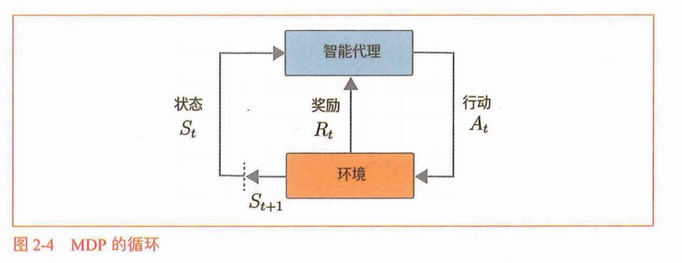

## 环境和智能代理的数学表示
### 状态迁移
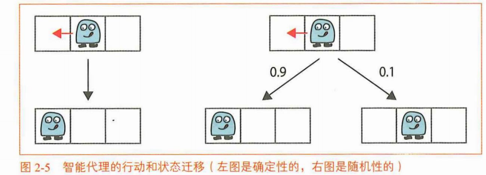
行动表示为函数形式：
$$s' = f(s,a)$$
$f(s,a)$ 是一个给定输入状态 $s$ 和行动 $a$，输出下一个状态 $s'$ 的函数。这个 $f(s,a)$ 被称为状态迁移函数。
随机性状态迁移—状态迁移概率

$$p(s' \mid s, a)$$
对于当前问题，条件对应于在状态选择了行动a。
马尔科夫性——状态迁移不需要过去的信息——此前处于什么状态以及执行
了哪些行动
### 奖励函数
定义：$$r(s,a,s')$$
当智能代理处于状态 $s$、执行行动 $a$、转移到下一个状态 $s'$ 时，得到的奖励由函数 $r(s,a,s')$ 定义。

### 智能代理的策略
策略表示智能代理如何决定其行动。策略的关键在于它使得智能代理仅根据当前状态来决定其行动。
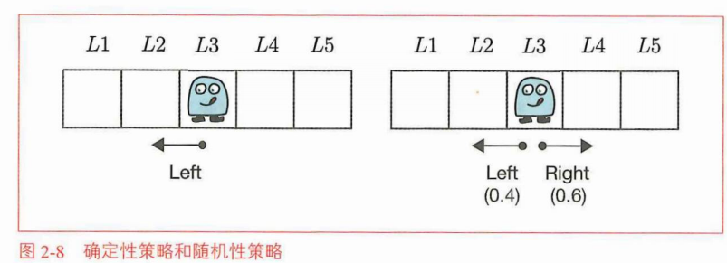
确定性策略定义：
$$a = \mu(s)$$
$\mu(s)$是以给定的状态作为参数并返回行动a的函数。
由随机性策略：
$$\pi(a \mid s)$$
$\pi(a \mid s)$表示在状态s下采取行动a的概率。
$$\pi(a=\text{Left} \mid s=L3) = 0.4$$
$$\pi(a=\text{Right} \mid s=L3) = 0.6$$

## MDP目标
MDP目标：是找到最优策略（optimal policy）。
### 回台制任务和连续性任务
回合制任务是有“结束”的问题。连续性任务则是没有“结束”的问题。
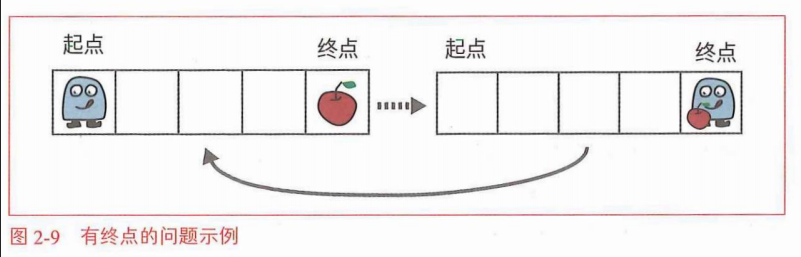
### 收益
收益：
$$G_t = R_t + \gamma R_{t+1} + \gamma^2 R_{t+2} + \cdots$$
- $S_t$：t时刻状态
- $A_t$：t时刻动作
- $R_t$：t时刻得到的奖励
- $\pi$：策略（根据状态选动作的规则）
- $S_{t+1}$：下一个时刻的状态
收益被表示为智能代理获得的奖励之和。不过，随着时间的推移，奖励会被y指数级削弱。这个y被称为折现率。
设置折现率可以防止收益的发散（针对连续性任务）。
### 状态的价值函数
收益的期望值的数学式：
$$v_\pi(s) = \mathbb{E}\left[G_t \mid S_t = s, \pi\right]$$
$$v_\pi(s) = \mathbb{E}_\pi\left[G_t \mid S_t = s\right]$$
- $v_\pi(s)$：策略 $\pi$ 下状态 $s$ 的价值
- $\mathbb{E}$：数学期望
- $G_t$：时刻 $t$ 之后的总收益
- $S_t = s$：t时刻当前状态为 $s$
- $\pi$：智能代理执行的策略
智能代理的策略7T被作为条件给出。
### 最优策略和最优价值函数
最优策略 $\boldsymbol{\pi^*}$
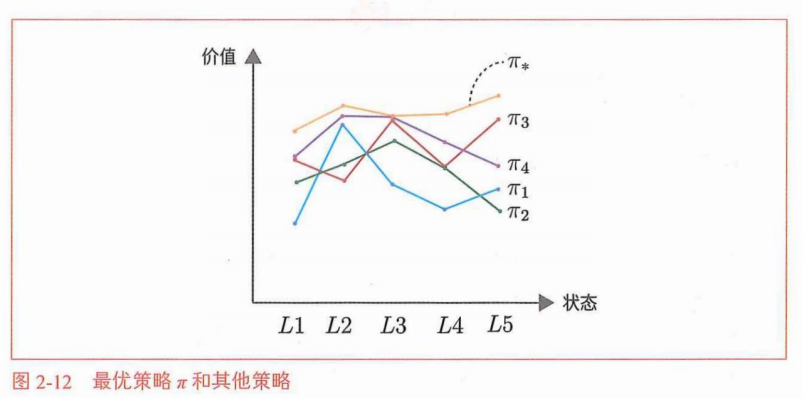
定义：对于所有状态，该策略对应的状态价值函数都大于等于其他任意策略的状态价值函数，也就是能拿到最大期望收益的策略。   
重要事实   
在MDP中，至少存在一个最优策略。此外，最优策略是确定性策略。在确定性策略中，每个状态下的行动是唯一确定的。用数学式可以表示为函数$\pi^*$，有 $a = \pi^*(s)$ 成立，当输入状态 $s$ 时，会输出行动 $a$。  
最优策略的状态价值函数叫作最优状态价值函数（optimal state-value
function）。使用$v^*$来表示最优状态价值函数。  

## MDP例子

### 回溯线形图

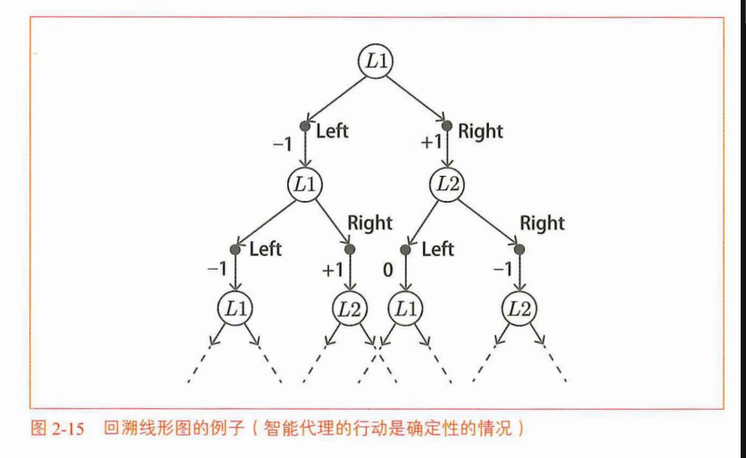
### 找出最优策略
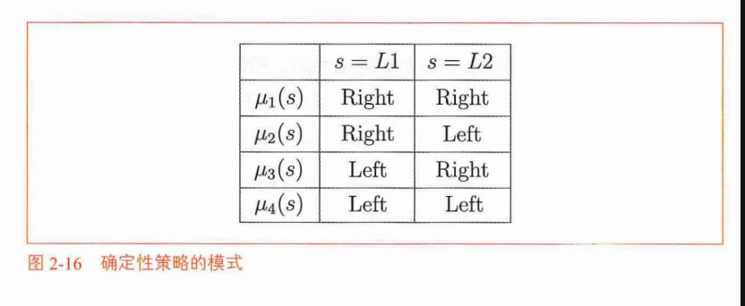
$$
\begin{align*}
v_{\mu_1}(s = L1) &= 1 + 0.9\times(-1) + 0.9^2\times(-1) + \cdots \\
&= 1 - 0.9\big(1 + 0.9 + 0.9^2 + \cdots\big) \\
&= 1 - \frac{0.9}{1 - 0.9} \\
&= -8
\end{align*}
$$
```python
v = 1
for i in ranged, 100):
V += -1 * (0.9 ♦* i)
print(V)#-7.9997
```
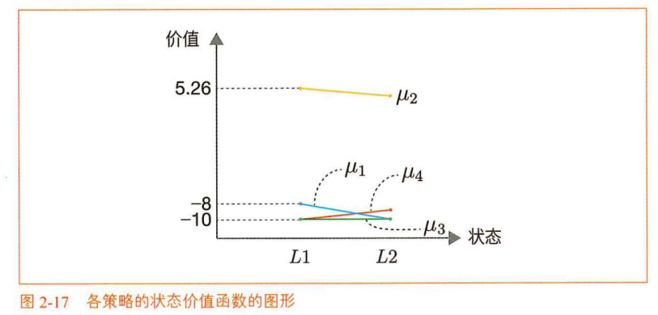
图中可以看出，在所有状态下，策略 $\mu_2$ 的状态价值函数的值都高于其他策略。因此，策略 $\mu_2$ 就是我们期望的最优策略。策略 $\mu_2$ 交替执行左右移动，不会撞到墙，在这个过程中可以持续获得奖励。由于已经得到了最优策略，我们也就实现了MDP的目标。

# 贝尔曼方程
## 贝尔曼方程推导
### 概率和期望值
### 贝尔曼方程推导
收益（回报）：
$$
G_t = R_t + \gamma R_{t+1} + \gamma^2 R_{t+2} + \cdots
$$
- $G_t$：从时刻 $t$ 开始的**回报（总收益）**
- $R_t$：第 $t$ 步获得的即时奖励
- $\gamma$：折现率（$0\le \gamma \le 1$），越往后的奖励价值越低
将t+1代入上式：
$$
G_{t+1} = R_{t+1} + \gamma R_{t+2} + \gamma^2 R_{t+3} + \cdots
$$
则：
$$
\begin{align*}
G_t &= R_t + \gamma R_{t+1} + \gamma^2 R_{t+2} + \cdots \\
&= R_t + \gamma \big(R_{t+1} + \gamma R_{t+2} + \cdots\big) \\
&= R_t + \gamma G_{t+1}
\end{align*}
$$  
收益 $G_t$ 代表**从时刻 $t$ 开始，未来所有奖励的折现总和**，不只是当前时刻的奖励 $R_t$。
$$G_t = R_t + \gamma R_{t+1} + \gamma^2 R_{t+2} + \dots$$
强化学习中智能体选择动作，需要兼顾当下奖励和未来长期奖励，因此 $t$ 时刻的收益需要纳入 $t+1,t+2,\dots$ 后续时刻的奖励；
$\gamma$ 为折现率，对远期奖励做衰减，一方面代表未来奖励价值更低，另一方面防止连续任务下收益无穷大、数值发散。

状态价值函数（收益的期望值）：
$$
\begin{align*}
v_\pi(s) &= \mathbb{E}_\pi\left[G_t \mid S_t = s\right] \\
&= \mathbb{E}_\pi\left[R_t + \gamma G_{t+1} \mid S_t = s\right] \\
&= \mathbb{E}_\pi\left[R_t \mid S_t = s\right] + \gamma \mathbb{E}_\pi\left[G_{t+1} \mid S_t = s\right]
\end{align*}
$$  
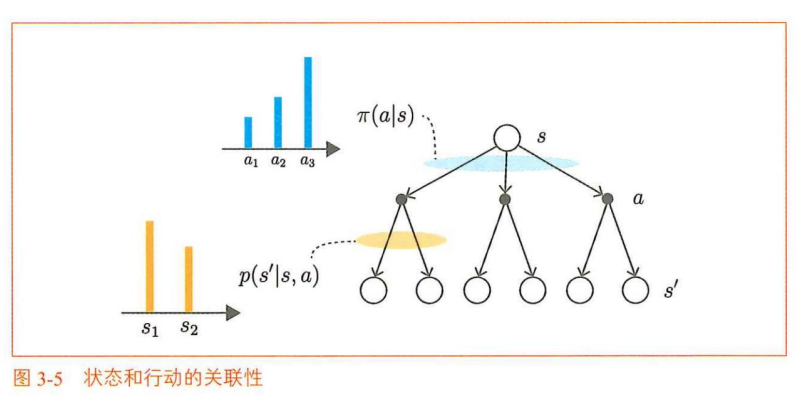
图3-5 状态和行动的关联性
马尔可夫决策过程分为两层随机过程：
1. 策略 $\pi(a|s)$：给定当前状态 $s$，以概率分布选择动作 $a$；蓝色柱状代表各个动作的选择概率。
2. 状态转移 $p(s'|s,a)$：在状态 $s$ 执行动作 $a$ 后，以概率分布转移到下一状态 $s'$；橙色柱状代表转移到不同后继状态的概率。

流程：状态 $s$ →（按策略抽样动作）→ 动作 $a$ →（按转移概率抽样）→ 新状态 $s'$
结论：下一状态 $s'$ 由智能体选择的动作 $a$，以及环境的转移随机性共同决定，由 $p(s' \mid s,a)$ 描述这个概率关系。  
贝尔曼方程：  
$$
\begin{aligned}
v_\pi(s) &= \mathbb{E}_\pi\left[R_t \mid S_t = s\right] + \gamma \mathbb{E}_\pi\left[G_{t+1} \mid S_t = s\right] \\
&= \sum_{a,s'} \pi(a|s)p(s'|s,a)r(s,a,s') + \gamma \sum_{a,s'} \pi(a|s)p(s'|s,a)v_\pi(s') \\
&= \sum_{a,s'} \pi(a|s)p(s'|s,a)\left\{r(s,a,s') + \gamma v_\pi(s')\right\}
\end{aligned}
$$

贝尔曼方程是表示状态 $s$ 的价值函数和下一个可能的状态 $s'$ 的价值函数之间关系的式子。这个贝尔曼方程对所有状态 $s$ 和所有策略 $\pi$ 都成立。

## 贝尔曼方程的例子
### 有两个方格的世界
注:这次的问题中的状态迁移是确定性的。也就是说，状态的迁移由函数 $f(s,a)$ 决定，而不是概率 $p(s' \mid s,a)$。
- 如果 $s' = f(s,a)$，则 $p(s' \mid s,a) = 1$。
- 如果 $s' \neq f(s,a)$，则 $p(s' \mid s,a) = 0$。
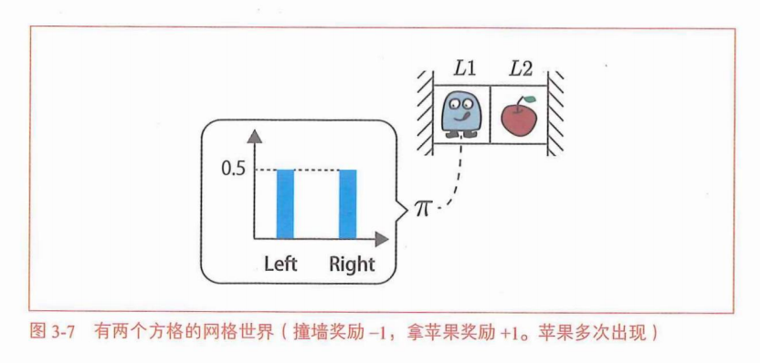
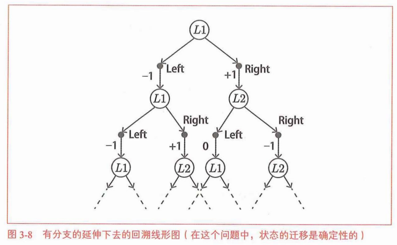

当 $s' = f(s,a)$ 时
$$
v_\pi(s) = \sum_{a} \pi(a \mid s)\left\{r(s,a,s') + \gamma v_\pi(s')\right\}
$$
状态L1下的贝尔曼方程：
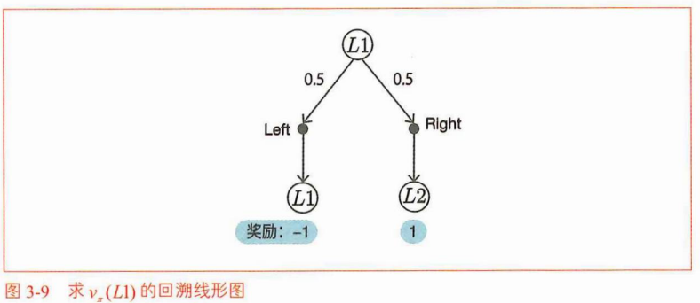
贝尔曼方程表示为如下形式：
$$
v_\pi(L1) = 0.5\left\{-1 + 0.9v_\pi(L1)\right\} + 0.5\left\{1 + 0.9v_\pi(L2)\right\}
$$
$$
-0.55v_\pi(L1) + 0.45v_\pi(L2) = 0
$$
状态L2下的贝尔曼方程：
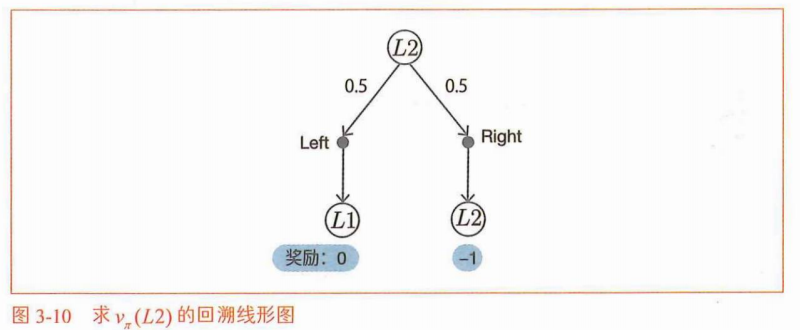
$$
v_\pi(L2) = 0.5\{0 + 0.9v_\pi(L1)\} + 0.5\{-1 + 0.9v_\pi(L2)\}
$$
$$
0.45v_\pi(L1) - 0.55v_\pi(L2) = 0.5
$$
联立：
$$
\begin{cases}
-0.55v_\pi(L1) + 0.45v_\pi(L2) = 0 \\
0.45v_\pi(L1) - 0.55v_\pi(L2) = 0.5
\end{cases}
$$
$$
\begin{cases}
v_\pi(L1) = -2.25 \\
v_\pi(L2) = -2.75
\end{cases}
$$
这就是随机性策略的状态价值函数。这意味着，当采取随机性策略时，处于状态 $L1$ 的情况下，未来期望收益为 $-2.25$。随机移动有可能撞墙，从而获得负奖励，该结果是合理的。$v_\pi(L1)$ 的值大于 $v_\pi(L2)$ 也很好理解：$L1$ 旁边就是苹果，执行动作时有50%的概率拿到苹果。
### 贝尔曼方程意义
贝尔曼方程能够将无限的计算转换为有限的联立方程。

## 行动价值函数与贝尔曼方程
### 行动价值函数
状态价值函数：
$$
v_\pi(s) = \mathbb{E}_\pi\left[G_t \mid S_t = s\right]
$$
状态价值函数有两个条件，分别是状态 $s$ 和策略 $\pi$。
行动价值函数：
$$
q_\pi(s,a) = \mathbb{E}_\pi\left[G_t \mid S_t = s, A_t = a\right]
$$
其中：a表示行动
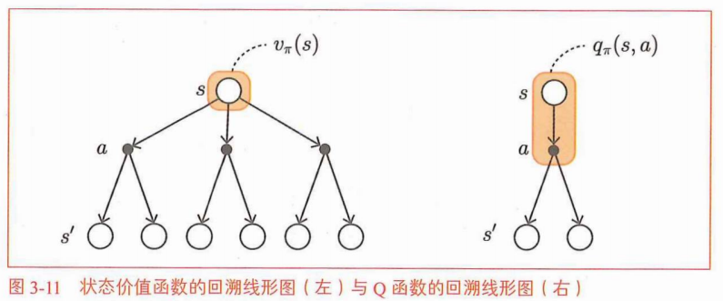
$$
\pi(a_1 \mid s)q_\pi(s,a_1) + \pi(a_2 \mid s)q_\pi(s,a_2) + \pi(a_3 \mid s)q_\pi(s,a_3)
=\sum_{a\in\{a_1,a_2,a_3\}} \pi(a \mid s)q_\pi(s,a)
$$
$$
v_\pi(s)=\sum_{a\in\{a_1,a_2,a_3\}} \pi(a \mid s)q_\pi(s,a)
$$
$$
v_\pi(s) = \sum_{a} \pi(a \mid s) q_\pi(s,a)
$$
### 行动价值函数的贝尔曼方程
$$
\begin{aligned}
q_\pi(s,a) &= \mathbb{E}_\pi\left[G_t \mid S_t = s,\, A_t = a\right] \\
&= \mathbb{E}_\pi\left[R_t + \gamma G_{t+1} \mid S_t = s,\, A_t = a\right]
\end{aligned}
$$
$$
\begin{aligned}
q_\pi(s,a) &= \mathbb{E}_\pi\left[R_t + \gamma G_{t+1} \mid S_t = s,A_t = a\right] \\
&= \sum_{s'} p(s' \mid s,a) \left\{ r(s,a,s') + \gamma \sum_{a'} \pi(a' \mid s')\, q_\pi(s',a') \right\}
\end{aligned}
$$
- $q_\pi(s,a)$：动作价值函数，状态$s$执行动作$a$，后续遵循策略$\pi$，得到的期望回报
- $\mathbb{E}_\pi[\cdot]$：按照策略$\pi$求数学期望
- $R_t$：$t$时刻获得的即时奖励
- $G_{t+1}$：$t+1$时刻起的未来总回报
- $\gamma$：折现率，$0\le\gamma\le1$，降低远期奖励的权重
- $p(s' \mid s,a)$：状态转移概率，状态$s$执行动作$a$，转移到$s'$的概率
- $r(s,a,s')$：从$s$执行$a$转移到$s'$获得的即时奖励
- $\pi(a' \mid s')$：策略，在状态$s'$选择动作$a'$的概率
- $s'$：下一状态；$a'$：下一状态选择的动作

## 贝尔曼最优方程
### 状态价值函数的贝尔曼最优方程
$$
v_*(s) = \sum_{a}\pi_*(a \mid s)\sum_{s'} p(s' \mid s,a) \left\{ r(s,a,s') + \gamma v_*(s') \right\}
$$
- $\pi_*(a \mid s)$：最优策略，在状态$s$下选择动作$a$的概率，遵循该策略可以获得最大的期望回报
贝尔曼最优方程：
$$
v_*(s) = \max_{a}\sum_{s'} p(s' \mid s,a) \left\{ r(s,a,s') + \gamma v_*(s') \right\}
$$
### Q函数的贝尔曼最优方程
$$
q_*(s,a) = \sum_{s'} p(s' \mid s,a) \left\{ r(s,a,s') + \gamma \max_{a'} q_*(s',a') \right\}
$$

## 贝尔曼最优方程的示例
### 应用内尔曼最优方程
当 $s' = f(s,a)$ 时
$
v_*(s) = \max_{a}\left\{ r(s,a,s') + \gamma v_*(s') \right\}
$
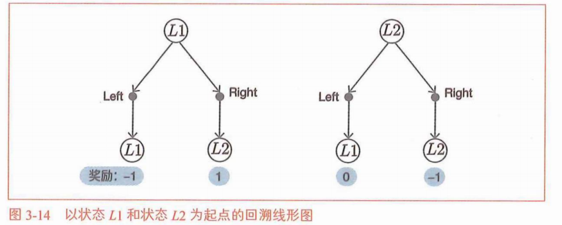
$$
v_*(L1) = \max
\begin{cases}
-1 + 0.9v_*(L1), \\
1 + 0.9v_*(L2)
\end{cases}
$$
$$
v_*(L2) = \max
\begin{cases}
0.9v_*(L1), \\
-1 + 0.9v_*(L2)
\end{cases}
$$
$$
v_*(L1) = 5.26
$$
$$
v_*(L2) = 4.73
$$
### 得到最优策略
状态s下的最优行动：
$$
\mu_*(s) = \arg\max_{a} q_*(s,a)
$$
$$
q_\pi(s,a) = \sum_{s'} p(s' \mid s,a) \big\{ r(s,a,s') + \gamma v_\pi(s') \big\}
$$
$$
\mu_*(s) = \arg\max_{a}\sum_{s'} p(s' \mid s,a) \big\{ r(s,a,s') + \gamma v_*(s') \big\}
$$
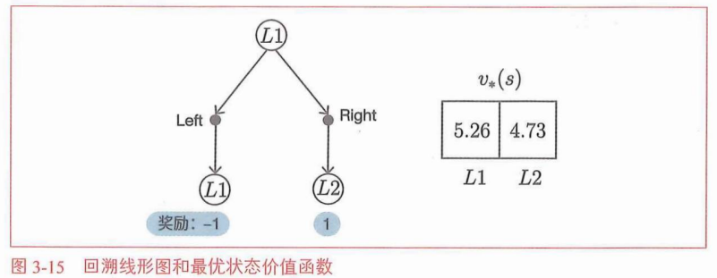
可以采取的行动有 Left 和 Right 这两个。此时如果采取行动 Left，那么智能代理就会进入状态 $s_1$，并获得奖励 $-1$。
$$
-1 + 0.9v_*(s_1) = -1 + 0.9 \times 5.26 = 3.734
$$
另外，如果采取了行动 Right，那么智能代理就会进入状态 $s_2$，并获得奖励 $1$。
$$
1 + 0.9v_*(s_2) = 1 + 0.9 \times 4.73 = 5.257
$$
如果在这两个值之间选择带来最大值的行动，那就是行动 Right。这意味着在状态 $s$ 下的最佳行动是 Right。
通过同样的计算可知在状态 $s_2$ 下的最佳行动是 Left。这样就求出了最优策略。


## 小 结
强化学习的最终目标是得到最优策略。我们在本章中还学习了贝尔曼最优方程。贝尔曼最优方程是对最优策略成立的特殊的贝尔曼方程。只要知道最优策略的价值函数，就很容易得到最优策略。
【贝尔曼方程】
$$
v_\pi(s)=\sum_{a,s'}\pi(a\mid s)p(s'\mid s,a)\big\{r(s,a,s')+\gamma v_\pi(s')\big\}
$$
$$
q_\pi(s,a)=\sum_{s'}p(s'\mid s,a)\left\{r(s,a,s')+\gamma\sum_{a'}\pi(a'\mid s')q_\pi(s',a')\right\}
$$
【贝尔曼最优方程】
$$
v_*(s)=\max_{a}\sum_{s'}p(s'\mid s,a)\big\{r(s,a,s')+\gamma v_*(s')\big\}
$$
$$
q_*(s,a)=\sum_{s'}p(s'\mid s,a)\left\{r(s,a,s')+\gamma\max_{a'}q_*(s',a')\right\}
$$
【最优策略】
$$
\begin{aligned}
\mu_*(s) &= \arg\max_{a} q_*(s,a) \\
&= \arg\max_{a}\sum_{s'}p(s'\mid s,a)\big\{r(s,a,s')+\gamma v_*(s')\big\}
\end{aligned}
$$

# 动态规划法——DP
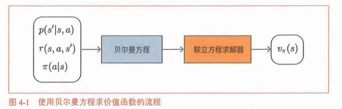
## 动态规划法和策略评估
强化学习两项任务：策略评估、策略控制。
策略评估是求给定策略 $\pi$ 的价值函数 $v_\pi(s)$ 和 $q_\pi(s,a)$。而策略控制是控制策略并将其调整为最优策略。
### 的动态规划法简介
$$
V_{k+1}(s)=\sum_{a,s'}\pi(a\mid s)p(s'\mid s,a)\big\{r(s,a,s')+\gamma V_k(s')\big\} \tag{4.2}
$$
这里用 $V_{k+1}(s)$ 表示第 $k+1$ 次进行更新的价值函数，用 $V_k(s)$ 表示第 $k$ 次进行更新的价值函数。$V_{k+1}(s)$ 和 $V_k(s)$ 是“推测值”，它们与真正的价值函数 $v(s)$ 不同。因此，我们用大写的 $V$ 来表示它们。
自举法：用估计值 $V_k(s')$ 来改进另一个估计值 $V_{k+1}(s)$。
### 尝试迭代策略评估
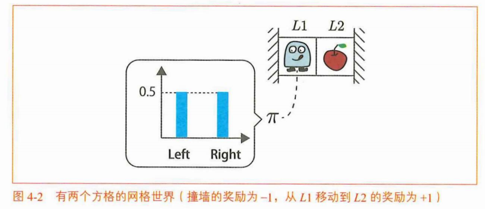
这个问题中的状态迁移是确定性的。也就是说，如果在状态 $s$ 下执行了行动 $a$，那么下一个状态 $s'$ 就只有一个。用数学式来描述就是下一个状态 $s'$ 是由函数 $f(s,a)$ 唯一确定的。
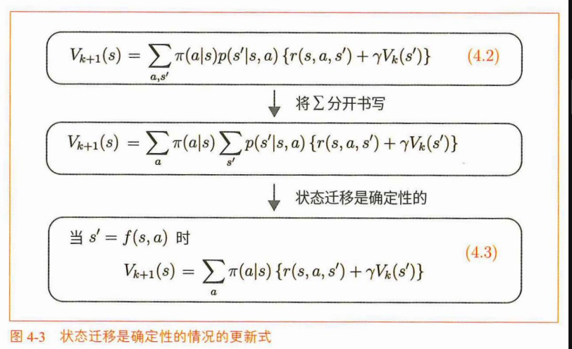
### 迭代策略评估的其他实现方式

同步更新实现DP：
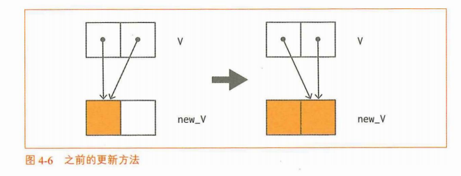
```python
V = {'L1': 0.0, 'L2': 0.0}
new_V = V.copy()

cnt = 0 # 记录更新了几次
while True:
    new_V['L1'] = 0.5 * (-1 + 0.9 * V['L1']) + 0.5 * (1 + 0.9 * V['L2'])
    new_V['L2'] = 0.5 * (0 + 0.9 * V['L1']) + 0.5 * (-1 + 0.9 * V['L2'])

    # 更新量的最大值
    delta = abs(new_V['L1'] - V['L1'])
    delta = max(delta, abs(new_V['L2'] - V['L2']))

    V = new_V.copy()

    cnt += 1
    if delta < 0.0001:
        print(V)
        print(cnt)
        break
```
覆盖方式实现DP：
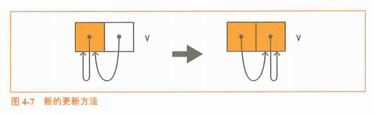
```python
V = {'L1': 0.0, 'L2': 0.0}

cnt = 0
while True:
    t = 0.5 * (-1 + 0.9 * V['L1']) + 0.5 * (1 + 0.9 * V['L2'])
    delta = abs(t - V['L1'])
    V['L1'] = t

    t = 0.5 * (0 + 0.9 * V['L1']) + 0.5 * (-1 + 0.9 * V['L2'])
    delta = max(delta, abs(t - V['L2']))
    V['L2'] = t

    cnt += 1
    if delta < 0.0001:
        print(V)
        print(cnt)
        break
```

## 解决更大问题
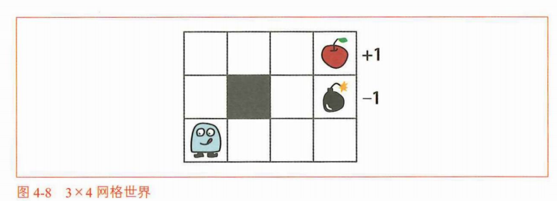
### GridWorld 类的实现
详见代码部分
### defaultdict 的用法
### 迭代策略评估的实现

## 策略迭代法
### 策略的改进
- 最优策略 $\mu_*(s)$：在每个状态下，能使智能体获得最大长期期望回报的动作选择规则，是强化学习求解的最终目标。
- 最优策略的状态价值函数 $v_*(s)$：也叫最优状态价值函数，表示在状态 $s$ 下，全程遵循最优策略行动，所能获得的最大期望回报。
- 最优策略的行动价值函数 $q_*(s,a)$：也叫最优动作价值函数，表示在状态 $s$ 执行动作 $a$ 之后，后续全程遵循最优策略，所能获得的最大期望回报。
最优策略（贪婪策略）：
$$
\begin{aligned}
\mu_*(s) &= \arg\max_{a} q_*(s,a) \\
&= \arg\max_{a}\sum_{s'} p(s' \mid s,a) \big\{ r(s,a,s') + \gamma v_*(s') \big\}
\end{aligned}
$$
- 第一行：最优策略的直观定义，在状态 $s$ 下，选取使最优动作价值函数 $q_*(s,a)$ 最大的动作 $a$。
- 第二行：展开形式，将 $q_*(s,a)$ 替换为状态转移、即时奖励与最优状态价值的折现求和形式，可直接通过 $v_*(s)$ 求解最优策略。  

$$
\begin{aligned}
\mu'(s) &= \arg\max_{a} q_\mu(s,a) \\
&= \arg\max_{a}\sum_{s'} p(s' \mid s,a) \big\{ r(s,a,s') + \gamma v_\mu(s') \big\}
\end{aligned}
$$
式子中各部分的含义如下：
- 当前策略 $\mu(s)$：当前正在使用的确定性策略，决定每个状态下智能体选择的动作。
- 策略 $\mu(s)$ 的状态价值函数 $v_\mu(s)$：遵循当前策略 $\mu$ 行动时，状态 $s$ 对应的期望回报。
- 新的策略 $\mu'(s)$：基于当前策略的价值函数，通过贪心改进得到的更优策略。
综上所述，策略的贪婪化意味着：
- 策略总是被改进；
- 如果该策略没有被改进（更新），那么它就是最优策略。
### 重复评估和改进
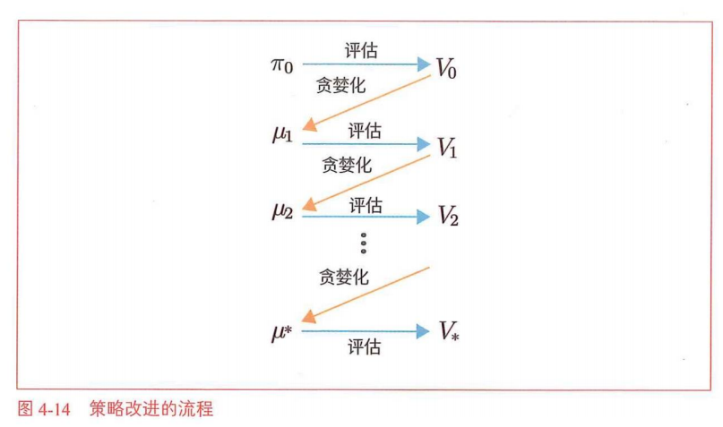

## 实施策略迭代法
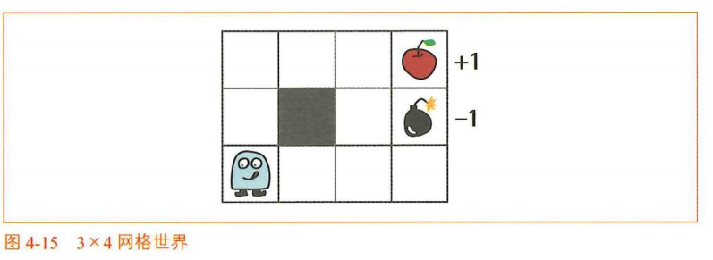
### 策略改进
$$
\mu'(s) = \arg\max_{a}\sum_{s'} p(s' \mid s,a) \big\{ r(s,a,s') + \gamma v_\mu(s') \big\}
$$
另外，这个问题中的状态迁移是唯一的（确定性的）。因此，策略的贪婪化可以做如下简化。
当 $s' = f(s,a)$ 时
$$
\mu'(s) = \arg\max_{a}\big\{ r(s,a,s') + \gamma v_\mu(s') \big\} \tag{4.8}
$$
### 重复评估和改进

## 价值迭代法

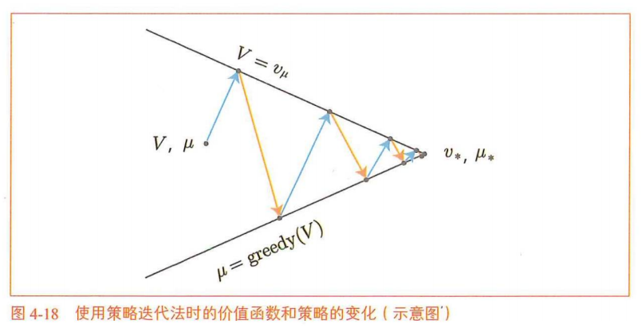
