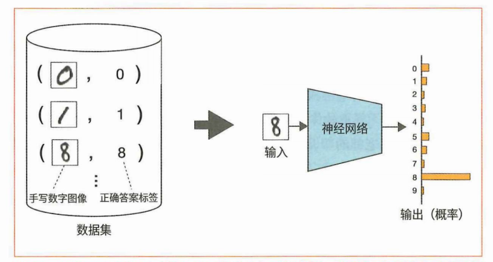
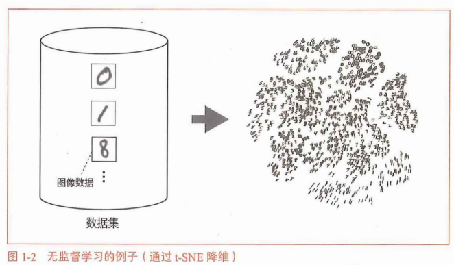
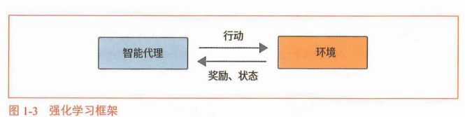
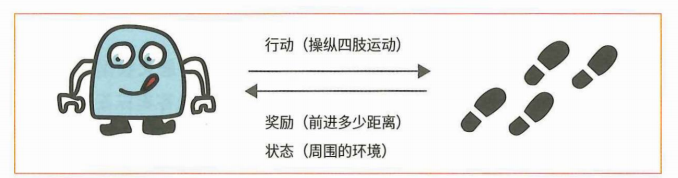
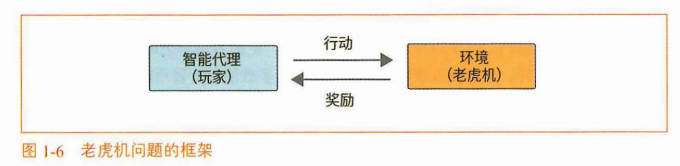

# 老虎机问题
## 机器学习分类与强化学习
监督学习：提供输入和输出的数据对

无监督学习：目标是找到隐藏在数据中的结构和模式

强化学习：智能代理和环境相互作用


$$
三者对比=
\begin{cases}
 监督学习：使用带有输入和输出（正确答案标签）的成对数据，学
习如何将输入转化为输出。\\
 无监督学习：使用没有“正确答案标签”的数据来学习数据中的基
本结构。\\
强化学习：学习如何使用智能代理在与环境互动时收集的数据获得
更高的奖励。
\end{cases}
$$

## 老虎机问题（具有强化学习所处理的问题的基本特征）

## 老虎机算法
```python
求平均值实现
import numpy as np
np. random.seed(0) #固定随机数种子
rewards =[]
for n in range(1, 11): # 从1到 10
rewa rd = np. random. rand() # 虚拟的奖励
rewa rds. append (rewa rd)
Q = sum(rewards) / n
print(Q)
```

