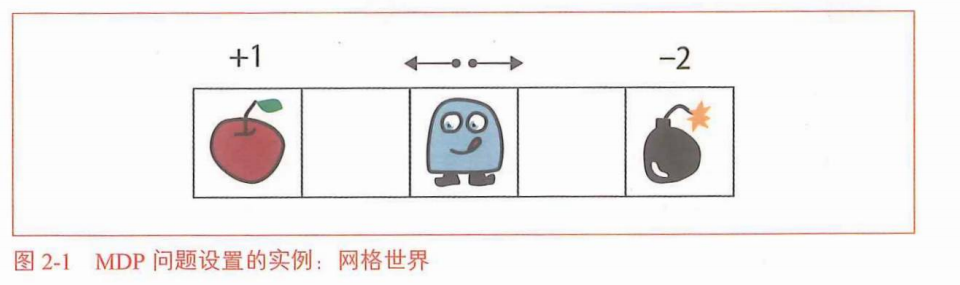
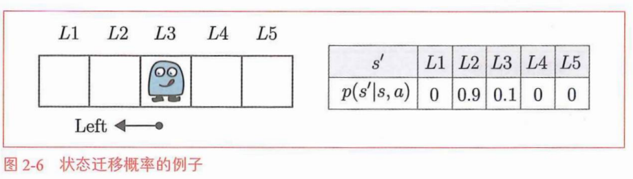
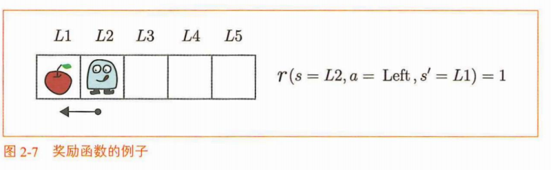
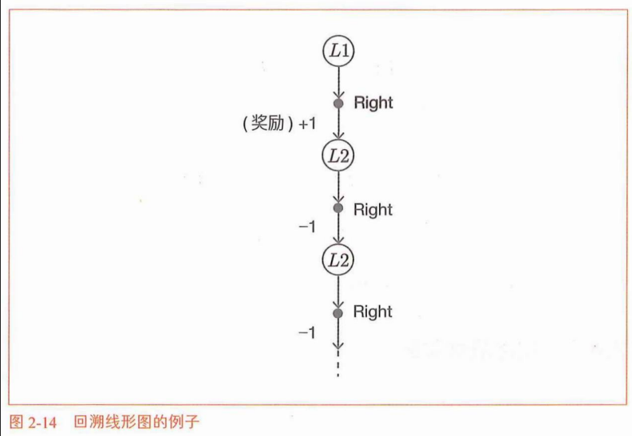

# 老虎机问题
## 机器学习分类与强化学习
监督学习：提供输入和输出的数据对

无监督学习：目标是找到隐藏在数据中的结构和模式

强化学习：智能代理和环境相互作用


$$
三者对比
\begin{cases}
 监督学习：使用带有输入和输出（正确答案标签）的成对数据，学
习如何将输入转化为输出。\\
 无监督学习：使用没有“正确答案标签”的数据来学习数据中的基
本结构。\\
强化学习：学习如何使用智能代理在与环境互动时收集的数据获得
更高的奖励。
\end{cases}
$$

## 老虎机问题（具有强化学习所处理的问题的基本特征）

### 老虎机算法
```python
求平均值实现
import numpy as np
np. random.seed(0) #固定随机数种子
rewards =[]
for n in range(1, 11): # 从1到 10
rewa rd = np. random. rand() # 虚拟的奖励
rewards. append (rewa rd)#往列表的末尾追加一个元素。
Q = sum(rewards) / n
print(Q)
```
### 代码改进
```python
Q = 0
for n in ranged, 11):
reward = np.random.rand()
Q = Q + (reward - Q) / n
print(Q)
```

### 玩家策略
强化学习算法最终归结为如何在“利用”和“探索”之间取得平衡。 为了取得这种平衡，人们提出了各种算法。这些算法既有简单的，也有复
杂的，其中最基本、最常用的是s-greedy算法。
<span style="color: #ff4444;">esp-greedy算法：</span>以e的概率［如以s = 0.1
（10%）的概率］进行“探索”，以1-e的概率进行“利用”的方法。
## 老虎机算法实现
### 老虎机的实现
老虎机的价值——老虎机返回的奖励的期望值——老虎机的胜率
定义为Bandit类

```python
import numpy as np
class Bandit:
def init (self, arms=10):
self. rates = np. random. rand(arms)# 初始化：arms=10台老虎机，self.rates 是【实例自己存的胜率数组】
def play(self, arm):
rate = self.rates[arm]
if rate > np.random.rand():# ✅ 从实例自己的rates里面取出这台机器的胜率
return 1
else:
return 0
```
实现
```python
bandit = Bandit()
for i in range(3):
print(bandit.play(0))
```
只考虑第0台老虎机
```python
bandit = Bandit()
Q = 0
for n in ranged, 11):
reward = bandit. play(0) # 玩第 0 台老虎机
Q += (rewa rd - Q) / n
print(Q)
```
计算
10台老虎机中每台老虎机价值的估计值
```python
bandit = Bandit()
Qs = np.zeros(10)
ns = np.zeros(10)
for n in range(10):
action = np. random. randint(0, 10) # 随机行动
rewa rd = bandit.play(action)
ns[action] += 1
Qs[action] += (rewa rd - Qs[action]) / ns[action]
print(Qs)
```
### 智能代理的实现
选择行动算法(基于$\varepsilon\text{-greedy}$
算法)
```python
class Agent:
    def __init__(self, epsilon, action_size=10):
        self.epsilon = epsilon          # ε：探索概率
        self.Qs = np.zeros(action_size) # Qs：每个动作的估计Q值，初始全0
        self.ns = np.zeros(action_size) # ns：每个动作被选择的次数，初始全0

    def update(self, action, reward):
        self.ns[action] += 1  # 该动作计数+1
        # 增量式平均公式，更新Q值
        self.Qs[action] += (reward - self.Qs[action]) / self.ns[action]

    def get_action(self):
        if np.random.rand() < self.epsilon:
            # 探索：随机选一个臂
            return np.random.randint(0, len(self.Qs))
        # 利用：选当前Q最大的臂
        return np.argmax(self.Qs)
```


# 马尔可夫决策过程MDP（情况随智能代理的行动而变化的问题）

## MDP
决策过程是智能代理通过与环境互动决定其行动的过程

机器人就是“智能代理”，它的周围是“环境”。
智能代理目标：实现奖励总和最大化。


## 环境和智能代理的数学表示
### 状态迁移

行动表示为函数形式：
$$s' = f(s,a)$$
$f(s,a)$ 是一个给定输入状态 $s$ 和行动 $a$，输出下一个状态 $s'$ 的函数。这个 $f(s,a)$ 被称为状态迁移函数。
随机性状态迁移—状态迁移概率

$$p(s' \mid s, a)$$
对于当前问题，条件对应于在状态选择了行动a。
马尔科夫性——状态迁移不需要过去的信息——此前处于什么状态以及执行
了哪些行动
### 奖励函数
定义：$$r(s,a,s')$$
当智能代理处于状态 $s$、执行行动 $a$、转移到下一个状态 $s'$ 时，得到的奖励由函数 $r(s,a,s')$ 定义。

### 智能代理的策略
策略表示智能代理如何决定其行动。策略的关键在于它使得智能代理仅根据当前状态来决定其行动。

确定性策略定义：
$$a = \mu(s)$$
$\mu(s)$是以给定的状态作为参数并返回行动a的函数。
由随机性策略：
$$\pi(a \mid s)$$
$\pi(a \mid s)$表示在状态s下采取行动a的概率。
$$\pi(a=\text{Left} \mid s=L3) = 0.4$$
$$\pi(a=\text{Right} \mid s=L3) = 0.6$$

## MDP目标
MDP目标：是找到最优策略（optimal policy）。
### 回台制任务和连续性任务
回合制任务是有“结束”的问题。连续性任务则是没有“结束”的问题。

### 收益
收益：
$$G_t = R_t + \gamma R_{t+1} + \gamma^2 R_{t+2} + \cdots$$
- $S_t$：t时刻状态
- $A_t$：t时刻动作
- $R_t$：t时刻得到的奖励
- $\pi$：策略（根据状态选动作的规则）
- $S_{t+1}$：下一个时刻的状态
收益被表示为智能代理获得的奖励之和。不过，随着时间的推移，奖励会被y指数级削弱。这个y被称为折现率。
设置折现率可以防止收益的发散（针对连续性任务）。
### 状态的价值函数
收益的期望值的数学式：
$$v_\pi(s) = \mathbb{E}\left[G_t \mid S_t = s, \pi\right]$$
$$v_\pi(s) = \mathbb{E}_\pi\left[G_t \mid S_t = s\right]$$
- $v_\pi(s)$：策略 $\pi$ 下状态 $s$ 的价值
- $\mathbb{E}$：数学期望
- $G_t$：时刻 $t$ 之后的总收益
- $S_t = s$：t时刻当前状态为 $s$
- $\pi$：智能代理执行的策略
智能代理的策略7T被作为条件给出。
### 最优策略和最优价值函数
最优策略 $\boldsymbol{\pi^*}$

定义：对于所有状态，该策略对应的状态价值函数都大于等于其他任意策略的状态价值函数，也就是能拿到最大期望收益的策略。   
重要事实   
在MDP中，至少存在一个最优策略。此外，最优策略是确定性策略。在确定性策略中，每个状态下的行动是唯一确定的。用数学式可以表示为函数$\pi^*$，有 $a = \pi^*(s)$ 成立，当输入状态 $s$ 时，会输出行动 $a$。  
最优策略的状态价值函数叫作最优状态价值函数（optimal state-value
function）。使用$v^*$来表示最优状态价值函数。  

## MDP例子

### 回溯线形图


### 找出最优策略

$$
\begin{align*}
v_{\mu_1}(s = L1) &= 1 + 0.9\times(-1) + 0.9^2\times(-1) + \cdots \\
&= 1 - 0.9\big(1 + 0.9 + 0.9^2 + \cdots\big) \\
&= 1 - \frac{0.9}{1 - 0.9} \\
&= -8
\end{align*}
$$
```python
v = 1
for i in ranged, 100):
V += -1 * (0.9 ♦* i)
print(V)#-7.9997
```

图中可以看出，在所有状态下，策略 $\mu_2$ 的状态价值函数的值都高于其他策略。因此，策略 $\mu_2$ 就是我们期望的最优策略。策略 $\mu_2$ 交替执行左右移动，不会撞到墙，在这个过程中可以持续获得奖励。由于已经得到了最优策略，我们也就实现了MDP的目标。

# 贝尔曼方程
## 贝尔曼方程推导
### 概率和期望值
### 贝尔曼方程推导
收益（回报）：
$$
G_t = R_t + \gamma R_{t+1} + \gamma^2 R_{t+2} + \cdots
$$
- $G_t$：从时刻 $t$ 开始的**回报（总收益）**
- $R_t$：第 $t$ 步获得的即时奖励
- $\gamma$：折现率（$0\le \gamma \le 1$），越往后的奖励价值越低
将t+1代入上式：
$$
G_{t+1} = R_{t+1} + \gamma R_{t+2} + \gamma^2 R_{t+3} + \cdots
$$
则：
$$
\begin{align*}
G_t &= R_t + \gamma R_{t+1} + \gamma^2 R_{t+2} + \cdots \\
&= R_t + \gamma \big(R_{t+1} + \gamma R_{t+2} + \cdots\big) \\
&= R_t + \gamma G_{t+1}
\end{align*}
$$  
状态价值函数（收益的期望值）：
$$
\begin{align*}
v_\pi(s) &= \mathbb{E}_\pi\left[G_t \mid S_t = s\right] \\
&= \mathbb{E}_\pi\left[R_t + \gamma G_{t+1} \mid S_t = s\right] \\
&= \mathbb{E}_\pi\left[R_t \mid S_t = s\right] + \gamma \mathbb{E}_\pi\left[G_{t+1} \mid S_t = s\right]
\end{align*}
$$  


