# 《深度学习进阶：自然语言处理》全书知识体系与精读笔记

> **原书**：斋藤康毅著，陆宇杰译，《深度学习进阶：自然语言处理》，人民邮电出版社，2020 年。  
> **整理目标**：按原书 8 章与 3 个附录组织知识，串起概念、数学公式、算法步骤、代码实现、模型比较、适用场景和易错点，帮助从“看懂”走向“能手写、能解释、能改进”。  
> **阅读约定**：正文以原书内容为主；为便于学习，增加了必要的数学推导、形状说明、直觉解释和学习检查项。对于原书仅作概述的主题（尤其 Transformer），会明确标注范围，不把概览误当成完整推导。本文插图是重新绘制的教学示意图，不是原书页面截图。

---

## 如何使用这份笔记

1. **先看路线图，再按章节读**：每章都在解决上一章遗留的问题。建议顺序阅读，不要只背公式。
2. **公式与代码对应着看**：每个公式都要能指出输入张量的形状、参数形状、输出形状，以及反向传播的方向。
3. **边读边复现**：原书的核心方法是“从零开始创建”。建议用 NumPy 自己实现预处理、共现矩阵、CBOW、Embedding、RNN、LSTM、seq2seq 与 Attention。
4. **学习时自问三个问题**：模型要解决什么问题？它的关键机制是什么？它又带来了什么新限制？

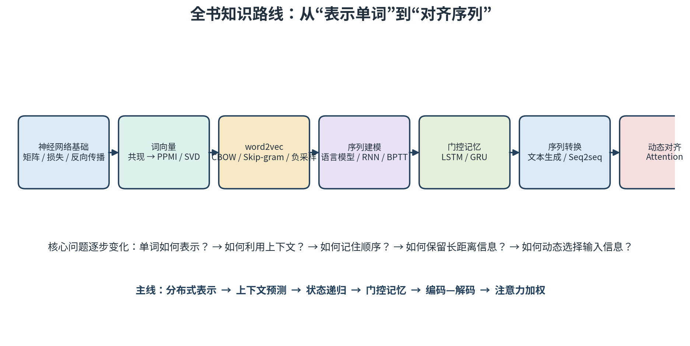

## 目录

- [全书主线与核心结论](#全书主线与核心结论)
- [符号、维度与基础约定](#符号维度与基础约定)
- [第 1 章 神经网络的复习](#第-1-章-神经网络的复习)
- [第 2 章 自然语言和单词的分布式表示](#第-2-章-自然语言和单词的分布式表示)
- [第 3 章 word2vec](#第-3-章-word2vec)
- [第 4 章 word2vec 的高速化](#第-4-章-word2vec-的高速化)
- [第 5 章 RNN](#第-5-章-rnn)
- [第 6 章 Gated RNN：LSTM 与 GRU](#第-6-章-gated-rnnlstm-与-gru)
- [第 7 章 基于 RNN 生成文本](#第-7-章-基于-rnn-生成文本)
- [第 8 章 Attention](#第-8-章-attention)
- [附录 A sigmoid 与 tanh 的导数](#附录-a-sigmoid-与-tanh-的导数)
- [附录 B WordNet](#附录-b-wordnet)
- [附录 C GRU](#附录-c-gru)
- [全书知识联系：从词向量到 Attention](#全书的知识联系从词向量到-attention)
- [全书核心公式速查表](#全书核心公式速查表)
- [从零复现全书模型：建议代码路线](#从零复现全书模型建议代码路线)
- [易错点与诊断清单](#易错点与诊断清单)
- [自测题：检验是否真正理解](#自测题检验是否真正理解)
- [术语表](#术语表)

---

# 全书主线与核心结论

本书围绕一个持续推进的问题展开：**如何把自然语言中的离散单词和有顺序的文本，转换成神经网络可以学习、计算和生成的表示？**

整体技术路线如下：

1. **神经网络基础**：掌握矩阵计算、前向传播、损失函数、链式法则和反向传播，为后续手写模型打基础。
2. **计数式词表示**：利用分布式假设，通过上下文共现统计构造词向量；再用 PMI/PPMI 和 SVD 改善词向量质量。
3. **预测式词表示**：用 CBOW/Skip-gram 预测上下文或目标词，让网络参数自动编码词语的语义和语法关系。
4. **大词表计算优化**：Embedding 避免 one-hot 全矩阵乘法；负采样用少量正负样本近似全词表分类。
5. **序列建模**：RNN 将过去的信息压入隐藏状态，语言模型据此估计下一个词的概率。
6. **长期依赖建模**：普通 RNN 容易发生梯度消失/爆炸；LSTM/GRU 使用门控机制控制信息和梯度流动。
7. **序列到序列转换**：Encoder 将输入序列编码，Decoder 根据编码逐步生成目标序列。
8. **动态对齐**：Attention 为每个输出位置重新计算对输入各位置的权重，不再把整句信息压缩在单个固定向量中。

## 一张图看清技术之间的关系

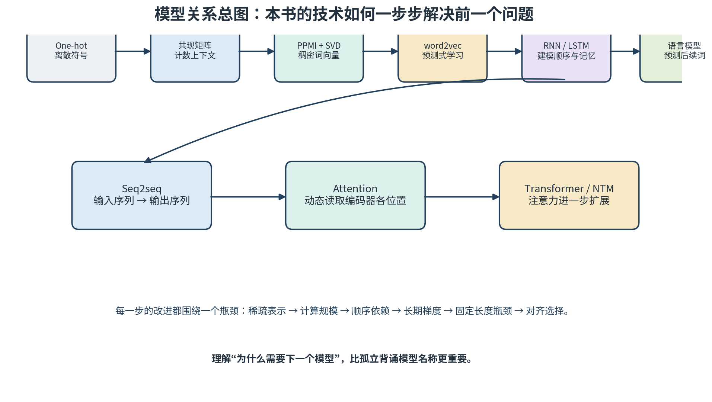

## 本书的关键思想

- **分布式假设**：一个词的含义，可以从它周围经常出现哪些词推测出来。
- **预测任务可以学习表示**：CBOW/Skip-gram 的直接目标是预测词，但训练后得到的中间权重可以作为词向量。
- **时间顺序需要状态**：只看局部窗口的模型难以完整保留历史顺序，RNN 用隐藏状态承接过去。
- **梯度通路决定长期学习能力**：RNN 在时间方向重复矩阵变换，容易导致梯度指数级变化；LSTM 的记忆单元提供更顺畅的梯度通路。
- **固定长度编码是瓶颈**：早期 seq2seq 把任意长度输入压成一个定长向量，长序列信息容易损失；Attention 改为每个输出时刻读取全部编码器状态。
- **可微的软选择可以学习**：Attention 不进行不可微的硬选择，而是计算一组归一化权重，对所有编码器状态做加权和。

---

# 符号、维度与基础约定

本书实现时常把向量作为**行向量**处理。记号可能因不同教材或框架而不同，本笔记尽量沿用书中的思路。

| 符号 | 含义 | 常见形状（行批量约定） |
|---|---|---|
| `V` | 词汇表大小 | 标量 |
| `D` | 词向量维度 | 标量 |
| `H` | 隐藏状态维度 | 标量 |
| `N` | mini-batch 样本数 | 标量 |
| `T` | 时间步数/序列长度 | 标量 |
| `x` | 输入向量或输入批次 | `(N, D)` 等 |
| `W` | 权重矩阵 | 由输入、输出维度决定 |
| `h_t` | 时刻 `t` 的隐藏状态 | `(N, H)` |
| `c_t` | LSTM 时刻 `t` 的记忆单元 | `(N, H)` |
| `⊙` | 对应元素相乘（Hadamard 积） | 两个形状相同的张量 |
| `σ(x)` | sigmoid 函数 | 与输入形状相同 |
| `tanh(x)` | 双曲正切 | 与输入形状相同 |
| `softmax(s)` | 将得分转换为概率分布 | 归一化轴上的概率和为 1 |

**形状检查四条规则**：

1. 若 `A` 形状为 `(N, D)`，`W` 形状为 `(D, H)`，则 `A @ W` 形状为 `(N, H)`。
2. 矩阵乘法要求左矩阵的列数等于右矩阵的行数。
3. 对应元素运算要求形状一致，或满足 NumPy 广播规则。
4. 反向传播时，梯度形状必须与对应变量形状一致；多个分支回传到同一变量的梯度要相加。

---

# 第 1 章 神经网络的复习

本章是后续所有算法的工具箱：矩阵运算负责前向计算，计算图负责组织操作，反向传播负责求梯度，优化器负责更新参数。

## 1.1 数学和 Python 的复习

### 1.1.1 向量、矩阵与张量

- **标量**：一个数。
- **向量**：一维数组；在本书实现习惯下，常明确作为形状 `(1, D)` 的行向量。
- **矩阵**：二维数组，形状为 `(行数, 列数)`。
- **张量**：向量、矩阵向更高维的推广。比如一批句子的词向量可以是三维张量 `(N, T, D)`。

NumPy 常用属性：

```python
x = np.array([1, 2, 3])
W = np.array([[1, 2, 3], [4, 5, 6]])

x.shape  # (3,)
x.ndim   # 1
W.shape  # (2, 3)
W.ndim   # 2
```

二维矩阵中的横向排列称为行（row），纵向排列称为列（column）。`shape` 是调试神经网络时最重要的检查点之一。

### 1.1.2 对应元素运算

`+`、`-`、`*` 对 NumPy 数组通常执行逐元素运算，而不是矩阵乘法：

```python
A + B  # 对应位置相加
A * B  # 对应位置相乘
```

矩阵乘法使用 `np.dot(A, B)` 或 `A @ B`。不要把逐元素乘法 `*` 与矩阵乘法 `@` 混淆。

### 1.1.3 广播（Broadcast）

广播允许形状不同、但维度兼容的数组逐元素运算。例如：

```python
A = np.array([[1, 2], [3, 4]])
A * 10
# [[10, 20], [30, 40]]

b = np.array([10, 20])
A * b
# [[10, 40], [30, 80]]
```

直觉上，标量或较小数组在缺失维度上“扩展”到兼容形状，再执行逐元素计算。广播常用于偏置相加、门控乘法、Attention 权重扩展等。

### 1.1.4 向量内积与矩阵乘积

向量内积：

$$
\mathbf{x}\cdot\mathbf{y}=\sum_{i=1}^{D}x_i y_i
$$

当两个向量长度相同，内积衡量它们的方向关系。若先将向量归一化为单位长度，则内积就是余弦相似度。

矩阵乘积：若 `A` 为 `(M, D)`，`B` 为 `(D, H)`，则：

$$
C=AB,\qquad C\in\mathbb{R}^{M\times H}
$$

矩阵乘积的每个元素由左矩阵的一行与右矩阵的一列做内积得到。

### 1.1.5 矩阵形状检查

例如：

$$
(3\times 2)\cdot(2\times 4)=(3\times 4)
$$

中间的维度 `2` 必须相同，输出由左侧行数 `3` 和右侧列数 `4` 决定。建议每次实现新层时，在纸上先写出输入、参数、输出及其反向梯度的形状。

## 1.2 神经网络的推理

### 1.2.1 神经网络全貌

神经网络可以视为一个函数，将输入变换为输出。典型三层结构为：

- 输入层：接收特征。
- 隐藏层：组合输入，提取中间表示。
- 输出层：产生分类得分或其他任务结果。

相邻层之间通过权重连接。一个仿射变换写作：

$$
\mathbf{y}=\mathbf{x}W+\mathbf{b}
$$

随后通过激活函数引入非线性：

$$
\mathbf{h}=f(\mathbf{x}W+\mathbf{b})
$$

若整个网络只有线性变换，多个线性层叠加仍可合并为一个线性变换；激活函数使模型能表达更复杂的非线性关系。

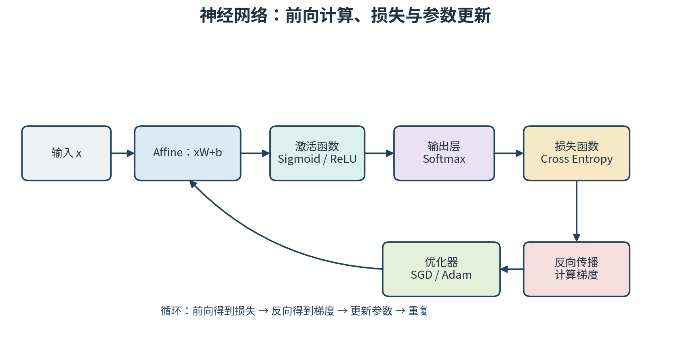

### 1.2.2 层的类化与正向传播

原书把神经网络的基本处理模块封装为层（Layer），常见接口：

```python
class SomeLayer:
    def __init__(self, ...):
        self.params = []  # 可学习参数
        self.grads = []   # 对应参数的梯度

    def forward(self, x):
        # 正向计算，缓存反向传播需要的信息
        return y

    def backward(self, dout):
        # 接收上游梯度，返回输入梯度
        return dx
```

这样做有几个优点：

- 把复杂网络拆成可组合的小模块。
- 每层只负责自己的前向与反向计算。
- 网络类负责按顺序连接层，并汇总 `params` 和 `grads`。
- 参数更新器不必知道层内部是如何计算的。

这套接口随后被 MatMul、Embedding、RNN、LSTM、Attention 等模块沿用。

## 1.3 神经网络的学习

推理阶段只要求输出；学习阶段还要计算预测与正确答案之间的差异，并据此调整参数。

### 1.3.1 损失函数

**均方误差（MSE）**常用于回归：

$$
L=\frac{1}{2}\sum_k(y_k-t_k)^2
$$

其中 `y` 是预测，`t` 是目标值。系数 `1/2` 是为了求导时抵消平方的系数。

**Softmax**将得分转换成概率：

$$
y_k=\frac{\exp(s_k)}{\sum_j\exp(s_j)}
$$

因此 `y_k` 位于 0 到 1 之间，并且所有类别的概率和为 1。实际实现常先减去最大得分以提升数值稳定性：

$$
\operatorname{softmax}(\mathbf{s})_k=
\frac{\exp(s_k-\max_j s_j)}{\sum_i\exp(s_i-\max_j s_j)}
$$

**交叉熵误差（Cross Entropy Error）**：

$$
L=-\sum_k t_k\log y_k
$$

当标签是 one-hot 向量时，只有正确类别对应的 `t_k=1`，所以交叉熵只取正确类别概率的负对数：

$$
L=-\log y_{\text{正确类别}}
$$

mini-batch 平均损失：

$$
L=-\frac{1}{N}\sum_{n=1}^{N}\sum_k t_{nk}\log y_{nk}
$$

**理解重点**：正确类别的预测概率越接近 1，损失越接近 0；正确类别概率越低，损失越大。分类训练中常把 Softmax 与交叉熵合并为 `SoftmaxWithLoss` 层，使反向传播更简洁。

### 1.3.2 导数与梯度

导数表示输入发生微小变化时，输出变化的速度。多变量函数中，各个偏导数组成梯度：

$$
\nabla_{\mathbf{x}}L=
\left(\frac{\partial L}{\partial x_1},\ldots,
\frac{\partial L}{\partial x_D}\right)
$$

梯度指向函数增长最快的方向；因此在最小化损失时，沿负梯度方向更新。

### 1.3.3 链式法则

若 `y=f(x)`，`z=g(y)`，则：

$$
\frac{\partial z}{\partial x}=
\frac{\partial z}{\partial y}\frac{\partial y}{\partial x}
$$

深度神经网络就是由大量可微模块串联而成，反向传播按链式法则从损失层向输入方向传递梯度。

### 1.3.4 计算图与基本节点

计算图把计算表示为节点和数据流。前向传播计算数值，反向传播计算梯度。

- **加法节点**：`y=x0+x1`。反向传播把上游梯度原样传给两个输入。
- **乘法节点**：`y=x0*x1`。反向传播时，`dx0=dout*x1`，`dx1=dout*x0`。
- **Repeat 节点**：把一个数据复制多份；反向传播把复制分支的梯度累加。
- **Sum 节点**：沿指定轴求和；反向传播把梯度复制回被求和的位置。
- **MatMul 节点**：矩阵乘法；其反向传播需要使用正向输入的转置。

对于行向量约定，若：

$$
Y=XW,\quad X\in\mathbb{R}^{N\times D},\quad W\in\mathbb{R}^{D\times H},\quad Y\in\mathbb{R}^{N\times H}
$$

令上游梯度为 `dY`，则：

$$
dX=dY W^T
$$

$$
dW=X^T dY
$$

这两个公式的形状分别是 `(N,D)` 和 `(D,H)`，与对应输入和参数一致。

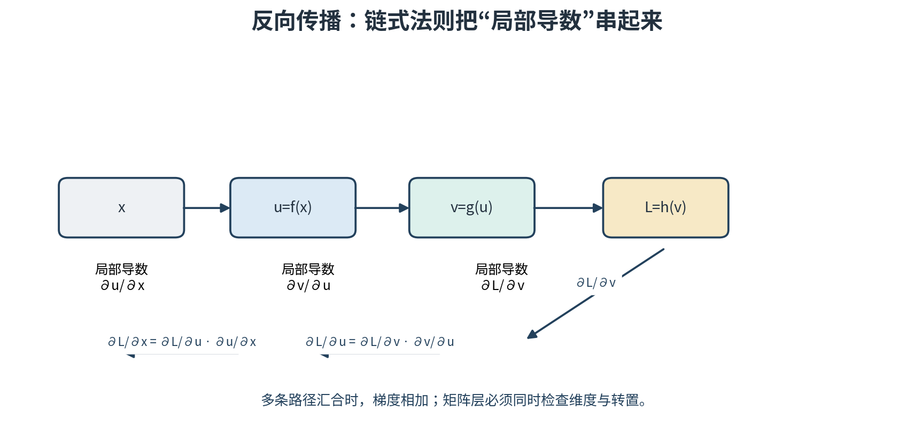

### 1.3.5 梯度的推导与反向传播实现

实现某个层时，推荐按这四步来做：

1. 写清楚正向计算式。
2. 保存反向传播需要的输入或中间值。
3. 对每个输入按链式法则求局部导数。
4. 检查输出梯度的形状，并处理分支梯度相加。

尤其要注意：同一个变量如果被多个分支使用，其梯度是各条路径贡献的总和；Embedding 中同一个词 ID 如果被重复取出，其梯度也要累加到同一行。

### 1.3.6 权重更新

最基础的随机梯度下降（SGD）：

$$
W\leftarrow W-\eta\frac{\partial L}{\partial W}
$$

其中 `η` 是学习率。mini-batch 学习的典型步骤：

1. 从训练数据中抽取一批样本。
2. 前向传播计算预测与损失。
3. 反向传播计算梯度。
4. 优化器根据梯度更新参数。
5. 重复多个迭代/epoch，并监控训练与验证指标。

学习率过大可能导致损失震荡或发散；过小则收敛缓慢。训练数据、模型结构、初始化与优化器都会影响训练表现。

## 1.4 使用神经网络解决问题

### 1.4.1 螺旋状数据集

书中用螺旋状二维数据作为多分类示例。它的类别边界不是简单直线，因此可以检验网络是否学会非线性决策边界。

### 1.4.2 神经网络实现

以层为单位组网：Affine/MatMul 层负责线性变换，激活层负责非线性，SoftmaxWithLoss 负责分类损失。前向、反向与参数汇总都遵循统一接口。

### 1.4.3 学习代码

一般要明确：训练数据、模型、优化器、batch_size、max_epoch、学习率等超参数。训练循环中，每次取 batch、调用 forward/backward、更新参数，并记录损失。

### 1.4.4 Trainer 类

`Trainer` 将训练的通用流程封装起来，包括 mini-batch 生成、梯度计算、参数更新和评估/记录。封装 Trainer 的意义在于把“训练流程”和“模型结构”分离，后续章节可以复用。

## 1.5 计算的高速化

### 1.5.1 位精度

原书讨论了 `float32` 与 `float64`：

- `float64` 精度更高，但每个数占用更多内存。
- `float32` 内存占用较低，许多神经网络训练场景已足够。
- 数据量大、矩阵计算多时，选择适当精度能显著影响速度和内存占用。

### 1.5.2 GPU 与 CuPy

GPU 适合大规模并行数值计算，特别是矩阵运算。原书介绍 CuPy，其数组接口与 NumPy 相似，可把部分数组计算放到 NVIDIA GPU 上执行。需要注意：

- GPU 加速不意味着所有代码都会更快；小规模计算可能受数据传输开销影响。
- 数据和计算要尽量留在 GPU 上，频繁 CPU/GPU 来回传输会抵消收益。
- 本书以 NumPy 为基础，CuPy 是可选加速手段。

## 1.6 本章小结与掌握标准

本章的核心不是记住某个网络，而是掌握**层、前向、反向、参数、梯度**这套组织方式。读完本章应能：

- 看出矩阵乘法是否维度匹配。
- 手写 Softmax 与交叉熵的前向计算。
- 解释链式法则为何能从输出端反向求导。
- 写出 MatMul 层的 `dX` 与 `dW`。
- 说明 mini-batch、epoch、学习率、优化器的作用。

---

# 第 2 章 自然语言和单词的分布式表示

本章先从传统方法出发，讨论如何让计算机表示单词含义。主线是：**自然语言文本 → 词 ID → 上下文统计 → 共现矩阵 → PPMI → SVD → 稠密词向量**。

## 2.1 什么是自然语言处理（NLP）

自然语言是人类日常使用的语言，如中文、日语和英语。自然语言处理（Natural Language Processing, NLP）研究如何让计算机处理和理解人类语言。

自然语言不同于编程语言：

- 编程语言通常有严格语法和确定的解释规则。
- 自然语言存在歧义、同义表达、语境依赖、新词和语义变化。
- 同一个词在不同上下文中可能有不同含义。

本书聚焦深度学习视角下的词表示、语言模型、文本生成与序列转换，并不覆盖 NLP 的全部分支。

## 2.2 同义词词典

早期可通过人工构建的词典表达词语之间的关系。WordNet 是书中介绍的代表：将词按词义分组，并建立上位词、下位词等语义关系。

### 2.2.1 WordNet 的基本想法

- 单词对应多个词义时，需要区分具体词义。
- 同义词簇（synset）把具有相近意义的词放在一起。
- 词之间还能通过语义网络建立上下位关系。

### 2.2.2 同义词词典的局限

1. **人工维护成本高**：需要专家持续补充新词和新义。
2. **覆盖困难**：词汇量巨大，逐个维护不现实。
3. **表达能力有限**：细微语义差别与具体上下文不容易通过固定词典表示。
4. **领域依赖**：专业语料中的词义和关系可能与通用词典不同。

因此，书中转向从语料库自动提取词义信息。

## 2.3 基于计数的方法

### 2.3.1 语料库预处理

语料库（corpus）是大量文本的集合。最基础的预处理包括：规范化、分词、构建词典、将词转换成 ID。

示例文本：

```python
text = 'You say goodbye and I say hello.'
text = text.lower()
text = text.replace('.', ' .')
words = text.split(' ')
# ['you', 'say', 'goodbye', 'and', 'i', 'say', 'hello', '.']
```

建立双向映射：

```python
word_to_id = {}
id_to_word = {}
for word in words:
    if word not in word_to_id:
        new_id = len(word_to_id)
        word_to_id[word] = new_id
        id_to_word[new_id] = word

corpus = np.array([word_to_id[w] for w in words])
```

三个核心数据结构：

- `corpus`：按文本顺序排列的单词 ID。
- `word_to_id`：单词到 ID 的字典。
- `id_to_word`：ID 到单词的字典。

本书示例采用简单的小写和标点切分，是为了讲解原理；真实任务需考虑更复杂的分词、Unicode、大小写、标点、词形变化、数字、未知词和特殊符号处理。

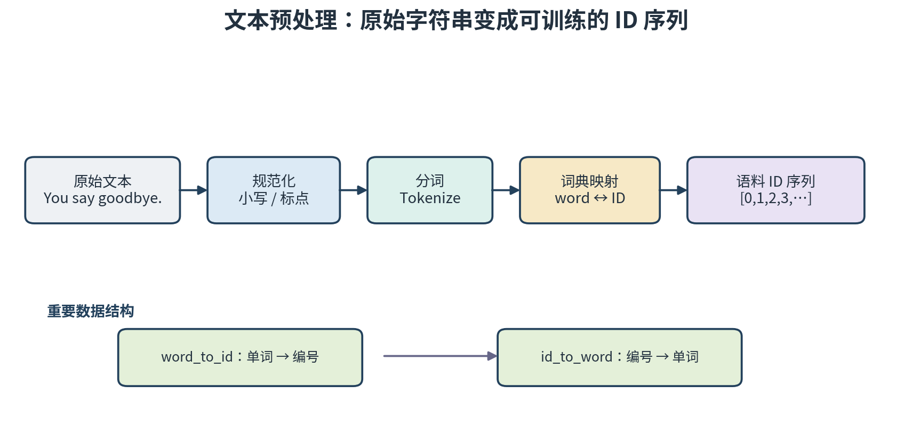

### 2.3.2 单词的分布式表示

**单词的分布式表示（distributed representation）**：用固定长度的稠密实数向量表示一个词。比如：

$$
\mathbf{v}_{\text{word}}=[0.21,-0.45,0.83,\ldots]
$$

“稠密”意味着向量中多数元素是非零实数。与 one-hot 表示相比，稠密向量维度通常较低，并能通过向量距离/相似度表达词语关系。

### 2.3.3 分布式假设

**分布式假设（Distributional Hypothesis）**：一个单词的含义可以由它周围出现的单词形成。相似含义或相似语法功能的词，往往出现在相似上下文中。

例如：

- `I drink beer.`
- `We drink wine.`
- `I guzzle beer.`
- `We guzzle wine.`

`drink` 与 `guzzle` 周围的词分布相似，因此可以推测它们在语义上有相近之处。

**上下文（context）**：目标词周围的词。**窗口大小（window size）**决定左右各看多少个词。窗口为 1，使用左右各一个词；窗口为 2，使用左右各两个词。

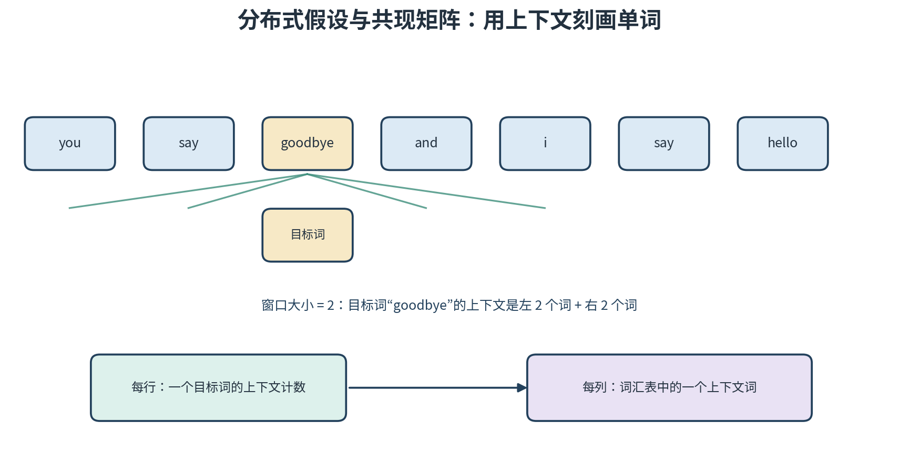

### 2.3.4 共现矩阵

最直接的统计方法是：对每个目标词，统计它的上下文中各词出现多少次。把每个词的上下文计数作为一行，所有行堆叠为矩阵，称为**共现矩阵（co-occurrence matrix）**。

若词表大小为 `V`，共现矩阵通常为：

$$
C\in\mathbb{R}^{V\times V}
$$

其中 `C[i,j]` 表示目标词 `i` 的上下文中词 `j` 出现的次数。

构造思路：

```python
def create_co_matrix(corpus, vocab_size, window_size=1):
    C = np.zeros((vocab_size, vocab_size), dtype=np.int32)
    for idx, word_id in enumerate(corpus):
        for distance in range(1, window_size + 1):
            left = idx - distance
            right = idx + distance
            if left >= 0:
                C[word_id, corpus[left]] += 1
            if right < len(corpus):
                C[word_id, corpus[right]] += 1
    return C
```

注意：边界位置的上下文可能不足窗口大小；原书示例不使用复杂句界规则。窗口越大，统计中能包含更远的语境，但也可能引入更宽泛、更弱的关系。

### 2.3.5 向量间的相似度：余弦相似度

对两个向量 `x` 和 `y`，余弦相似度为：

$$
\operatorname{cos\_sim}(x,y)=
\frac{x\cdot y}{\|x\|\|y\|}
=
\frac{\sum_i x_i y_i}
{\sqrt{\sum_i x_i^2}\sqrt{\sum_i y_i^2}}
$$

- 值越接近 `1`，方向越相似。
- 值接近 `0`，方向近似正交。
- 值越接近 `-1`，方向越相反。

代码实现通常给分母加一个极小值 `eps`，避免零向量导致除零：

```python
def cos_similarity(x, y, eps=1e-8):
    nx = x / (np.sqrt(np.sum(x * x)) + eps)
    ny = y / (np.sqrt(np.sum(y * y)) + eps)
    return np.dot(nx, ny)
```

### 2.3.6 相似单词排序

`most_similar()` 的基本流程：

1. 根据查询词找到词 ID。
2. 取出查询词对应的向量。
3. 计算它与词表中每个词向量的余弦相似度。
4. 排除查询词自身。
5. 按相似度从高到低排序并返回前 `top` 个词。

小语料库的共现统计容易出现不符合直觉的相似词；这通常不是余弦公式错了，而是数据量不足、上下文覆盖有限或统计被高频词干扰。

## 2.4 基于计数的方法的改进

### 2.4.1 点互信息 PMI

原始共现次数会偏爱高频词。例如 `the` 与很多词都能有较高共现次数，但这不代表它们语义相关。PMI 对比“共同出现”与“各自独立出现”的概率：

$$
\operatorname{PMI}(x,y)=\log_2\frac{P(x,y)}{P(x)P(y)}
$$

解释：

- `P(x,y)`：词 `x` 与 `y` 共同出现的概率。
- `P(x)P(y)`：若两词相互独立时的联合概率基准。
- PMI 越高，二者共现越不能被“单独高频”解释，关联越强。

利用共现矩阵改写：

$$
\operatorname{PMI}(x,y)=
\log_2\frac{C(x,y)N}{C(x)C(y)}
$$

`N` 为语料库总计数，`C(x,y)` 为共现次数，`C(x)`、`C(y)` 为相应词的边缘计数。

**PMI 的问题**：若共现次数为 0，则 `log(0)=-∞`；负 PMI 也不适合直接作为非负关联权重。

因此使用**正点互信息（PPMI）**：

$$
\operatorname{PPMI}(x,y)=\max(0,\operatorname{PMI}(x,y))
$$

代码核心：

```python
pmi = np.log2(C[i, j] * N / (C[i].sum() * C[:, j].sum()) + eps)
M[i, j] = max(0, pmi)
```

这里 `eps` 防止对数中的零值问题。实现时要确保 `C(x)`、`C(y)` 的边缘计数和行列定义保持一致。

### 2.4.2 降维

PPMI 矩阵的维度仍然是词汇量 `V`，当 `V` 很大时，处理 `V` 维向量成本高；而且矩阵往往很稀疏，很多元素为 0。

降维的目标不是随意删维度，而是尽可能保留数据中重要的信息，用更少的维度表达原数据。输出通常由稀疏高维表示转为稠密低维表示。

### 2.4.3 基于 SVD 的降维

奇异值分解（Singular Value Decomposition, SVD）：

$$
X=U\Sigma V^T
$$

- `U`：左奇异向量构成的正交矩阵。
- `Σ`：对角矩阵，对角线是按大小排列的奇异值。
- `V`：右奇异向量构成的正交矩阵。

直觉上，奇异值代表对应方向的重要性。截取较大的前 `D` 个方向，可得到低维近似表示。原书的实现用 `np.linalg.svd(W)` 分解 PPMI 矩阵，并把 `U` 的前若干列作为词向量：

```python
U, S, V = np.linalg.svd(W)
word_vecs = U[:, :wordvec_size]
```

这是原书为了说明原理而采用的简化实现。实际大规模词表下，完整 SVD 的计算和内存成本很高，通常会采用截断/随机化等更合适的数值算法。

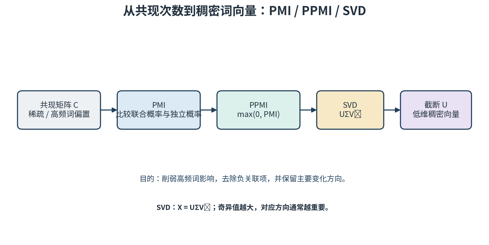

### 2.4.4 PTB 数据集

Penn Treebank（PTB）是本书后续实验使用的语料数据集。原书强调用它作为更实际的训练、验证和评价材料。预处理后的语料包含词 ID 序列，稀有词可被 `<unk>` 代替，数字在某些预处理设置下被统一替换为 `N`，句子边界用 `<eos>` 等符号处理。

### 2.4.5 基于 PTB 的评价

将 PTB 预处理后的语料用于共现矩阵、PPMI 和 SVD，再计算相似词。相比单句小语料，更大的语料更容易呈现稳定的语义与语法关系。

## 2.5 本章小结与掌握标准

本章完成了从自然语言文本到向量的第一次转换：

```text
文本 → 分词 → 单词 ID → 上下文窗口 → 共现矩阵
    → PMI / PPMI → SVD → 低维稠密词向量
```

应能回答：

- 为什么词义可以从上下文推断？
- 共现矩阵的行、列分别代表什么？
- 为什么原始共现次数会被高频词干扰？
- PMI 与 PPMI 的差异是什么？
- SVD 为什么能帮助降维？
- 余弦相似度与欧氏距离分别在比较什么？

---

# 第 3 章 word2vec

第 2 章使用共现矩阵进行“事后统计”；第 3 章改用神经网络，从预测任务中学习词向量。核心模型是 CBOW 与 Skip-gram。

## 3.1 基于推理的方法与神经网络

### 3.1.1 基于计数方法的问题

基于计数的方法的典型流程是：统计共现 → PMI/PPMI → SVD。它的优点是概念直观、能够直接从统计量得到词向量；主要问题包括：

- 每次要对语料库进行统计，语料库扩大、词表扩大时，矩阵和分解的成本迅速增加。
- 新语料加入后，统计量与降维通常需要重新处理。
- 大词表下，高维共现矩阵非常稀疏。

### 3.1.2 基于推理的方法概要

基于推理（prediction-based / inference-based）的方法：构建一个模型，让它根据某些词预测目标词，训练中不断调整权重。训练好的权重就包含了词的分布式表示。

二者的共同点：都利用上下文信息，都基于分布式假设。区别在于：

- 计数法：显式统计上下文出现次数，再对矩阵加工。
- 推理法：用可训练的神经网络拟合上下文与目标词的关系。

### 3.1.3 神经网络中单词的处理方法

词本身是离散符号，神经网络不能直接把字符串当作连续数值计算，因此需要先将词 ID 转为向量。最基础的是 one-hot 表示。

若词表大小为 `V`，词 ID 为 `k`，则 one-hot 向量长度为 `V`，只有第 `k` 位为 1，其余为 0：

$$
\mathbf{x}_k=[0,\ldots,0,1,0,\ldots,0]\in\mathbb{R}^{V}
$$

若权重矩阵 `W_in` 形状为 `(V,D)`，则：

$$
\mathbf{x}_k W_{in}=W_{in}[k,:]
$$

因为 one-hot 只有一个 1，这个矩阵乘法等价于从 `W_in` 中取出对应行。

## 3.2 简单的 word2vec：CBOW 模型

### 3.2.1 CBOW 的推理

CBOW（Continuous Bag-of-Words）根据上下文预测中心的目标词。

例如：

```text
输入上下文：you  [目标词]  goodbye
目标词：say
```

设左右上下文词的 one-hot 向量为 `c_1,...,c_C`，输入权重为 `W_in`，输出权重为 `W_out`。每个上下文词经过共享的输入权重得到词向量：

$$
\mathbf{h}_i=\mathbf{c}_i W_{in}
$$

然后把上下文向量求平均：

$$
\mathbf{h}=\frac{1}{C}\sum_{i=1}^{C}\mathbf{h}_i
$$

再映射到词表得分：

$$
\mathbf{s}=\mathbf{h}W_{out}
$$

应用 Softmax 得到目标词概率：

$$
P(w_{target}=k\mid context)=\operatorname{softmax}(\mathbf{s})_k
$$

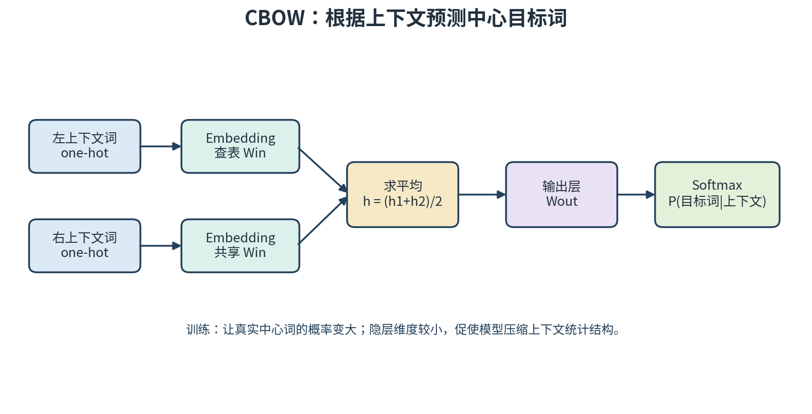

**为什么中间层维度要比词表小？** 词表维度可能很大，而隐藏层维度 `D` 较小，网络必须把预测所需的信息压缩进较低维表示，这个中间表示就是学习到的稠密词向量。

CBOW 没有必须使用的非线性激活层；原书的简单实现主要由 MatMul、加法、平均与输出层组成。多个输入 MatMul 层共享同一个 `W_in`。

### 3.2.2 CBOW 的学习

CBOW 的训练标签是上下文之间真实出现的中心词。输出得分经过 Softmax 后得到词表概率，再用交叉熵误差计算损失：

$$
L=-\log P(w_{target}\mid context)
$$

通过反向传播更新 `W_in` 与 `W_out`，使真实目标词的预测概率变大。

训练的直接目标是预测正确的中心词，但学习后的 `W_in` 行向量会编码词语的上下文模式，因此成为词向量。

### 3.2.3 word2vec 的权重与分布式表示

CBOW 有两组主要权重：

- `W_in`：输入侧权重，形状 `(V,D)`；每一行对应一个词的输入表示。
- `W_out`：输出侧权重，形状 `(D,V)`；每一列也可以视为一个词的表示。

原书讨论了三种取向：只用输入侧、只用输出侧、或组合两侧权重。书中采用常见做法，使用输入侧 `W_in` 作为最终词向量。

## 3.3 学习数据的准备

### 3.3.1 上下文与目标词

给定词 ID 序列 `corpus` 和窗口大小 `window_size`，依次选择一个目标词，取它左右窗口内的词作为上下文。

例：`you say goodbye and i say hello`，窗口为 1：

| 上下文 | 目标词 |
|---|---|
| `you, goodbye` | `say` |
| `say, and` | `goodbye` |
| `goodbye, i` | `and` |

一般地，对于第 `t` 个位置，目标词为 `w_t`，上下文是窗口中的邻近词。每个位置滑动一次，即可生成多个训练样本。

### 3.3.2 转换为 one-hot 表示

若词表大小为 `V`：

- 上下文数据通常形状为 `(样本数, 上下文数)` 的词 ID 矩阵。
- one-hot 化后，形状会增加最后一个词表维度，得到 `(样本数, 上下文数, V)`。
- 目标词也转为 `(样本数,V)` 的 one-hot 标签，或直接保留 ID 交给损失层处理。

实现时要留意：上下文左右位置的顺序在构造数据时存在，但 CBOW 原书的求平均结构会弱化/忽略词序。

## 3.4 CBOW 模型的实现

实现模块：

1. 为每个上下文输入创建 MatMul 层，所有层共享 `W_in`。
2. 正向时，将各个上下文的向量相加，再除以上下文数量。
3. 将平均向量输入输出 MatMul 层，计算词表得分。
4. 将得分与目标词交给 SoftmaxWithLoss 层。
5. 反向传播时，多个上下文分支的梯度会汇总到共享的 `W_in`。

注意参数共享：同一个矩阵被多个层对象引用时，梯度也必须累加到同一份参数上，而不是每个上下文各自更新一份互不相关的权重。

## 3.5 word2vec 的补充说明

### 3.5.1 CBOW 与概率

从概率视角，CBOW 建模的是：

$$
P(w_t\mid w_{t-c},\ldots,w_{t-1},w_{t+1},\ldots,w_{t+c})
$$

模型以交叉熵损失训练，使真实中心词在给定上下文下的条件概率尽可能大。

### 3.5.2 Skip-gram 模型

Skip-gram 与 CBOW 的方向相反：**给定中心词，预测它周围的上下文词**。

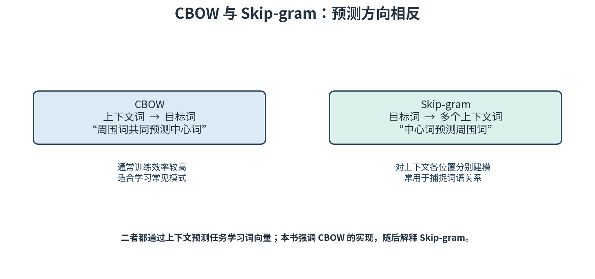

若中心词向量为 `v_c`，输出权重为 `W_out`，对每个上下文位置分别预测：

$$
P(w_{context,i}\mid w_{center})
=\operatorname{softmax}(\mathbf{v}_{center}W_{out})_{w_{context,i}}
$$

总损失可以看作各个上下文位置损失之和：

$$
L=-\sum_{i\in context}\log P(w_i\mid w_{center})
$$

### 3.5.3 基于计数与基于推理

| 对比维度 | 计数法（共现 / PPMI / SVD） | 预测法（word2vec） |
|---|---|---|
| 核心操作 | 统计上下文出现次数 | 训练网络预测目标/上下文词 |
| 表示来源 | PPMI 矩阵及其降维结果 | 网络中的可学习权重 |
| 上下文假设 | 依赖邻近词分布 | 依赖邻近词分布 |
| 主要计算 | 构建矩阵、矩阵分解 | mini-batch、梯度更新 |
| 学习过程 | 统计后处理 | 通过预测目标逐步学习 |
| 共通结果 | 相似上下文的词在向量空间中靠近 | 相似上下文的词在向量空间中靠近 |

## 3.6 本章小结与掌握标准

本章最重要的认识：**词向量不是人工给出的语义标签，而是模型为了完成上下文预测任务而学出的中间参数。**

应能：

- 解释 CBOW 与 Skip-gram 的输入输出方向。
- 推导 CBOW 的平均上下文表示、输出得分和交叉熵损失。
- 指出 `W_in` 的哪一维对应词、哪一维对应隐藏特征。
- 从语料 ID 序列生成上下文与目标词训练样本。
- 解释为什么语料库领域会影响学到的词向量。

---

# 第 4 章 word2vec 的高速化

第 3 章的简化 CBOW 在小词表上容易理解，但当词汇量达到几十万或百万时，one-hot 矩阵乘法和全词表 Softmax 都会变得昂贵。本章的两项核心改进：**Embedding 层**和**负采样（Negative Sampling）**。

## 4.1 word2vec 的改进①：Embedding 层

### 4.1.1 为什么需要 Embedding

若词表大小 `V` 很大，one-hot 向量长度就是 `V`。计算 `one_hot @ W` 本质上只取权重矩阵中的一行，却可能先构造、处理大量的 0。

Embedding 层直接按 ID 查表，避免无意义的稀疏乘法：

$$
\operatorname{Embedding}(id)=W[id,:]
$$

其中：

- `W` 形状为 `(V,D)`。
- 输入是词 ID（或一批词 ID）。
- 输出为对应的词向量。

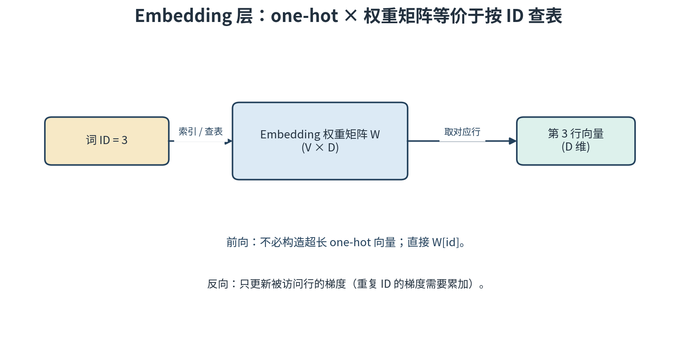

### 4.1.2 Embedding 层的实现与反向传播

前向传播：

```python
out = W[idx]
```

反向传播：只将上游梯度写回被访问的行。若同一个词 ID 在一个 batch 中出现多次，对应行的梯度必须累加：

```python
dW = np.zeros_like(W)
np.add.at(dW, idx, dout)
```

（实际工程中也可以用等价的 scatter-add 或按索引聚合实现。）

复杂度直觉：前向只取批次中需要的词向量，而不是对整个词表做稠密矩阵乘法。Embedding 的参数仍然是大矩阵，但不再每个样本都计算所有词行。

## 4.2 word2vec 的改进②：负采样

### 4.2.1 中间层之后的计算问题

即使 Embedding 已经避免了 one-hot 全矩阵乘法，普通 CBOW 的输出层仍要对全部词汇计算得分：

$$
\mathbf{s}=\mathbf{h}W_{out},\quad W_{out}\in\mathbb{R}^{D\times V}
$$

然后再对 `V` 个得分执行 Softmax 与归一化。词表越大，输出层计算越贵。

### 4.2.2 从多分类到二分类

普通 Softmax 训练是“从整个词表中挑一个正确词”的多分类问题。负采样改为：

- 对真实目标词（正例），希望模型输出“是”。
- 对少数抽样出来的错误词（负例），希望模型输出“否”。

模型不再对所有候选词计算完整的概率分布，而是只对正例和有限个负例做二分类学习。

### 4.2.3 Sigmoid 与交叉熵误差

Sigmoid 函数：

$$
\sigma(x)=\frac{1}{1+e^{-x}}
$$

将得分压缩为 0 到 1 之间的概率。二分类交叉熵：

$$
L=-(t\log y+(1-t)\log(1-y))
$$

其中 `t∈{0,1}`，`y=σ(score)`。

- 正例 `t=1`：损失为 `-log(y)`，希望 `y` 越大越好。
- 负例 `t=0`：损失为 `-log(1-y)`，希望 `y` 越小越好。

Sigmoid 与二元交叉熵组合后，反向传播对得分的梯度具有简洁形式 `y-t`。

### 4.2.4 多分类到二分类的实现逻辑

对上下文表示 `h` 与某个目标词输出向量 `v_w`，先做内积：

$$
s_w=\mathbf{h}\cdot\mathbf{v}_w
$$

再经过 Sigmoid：

$$
y_w=\sigma(s_w)
$$

随后用标签 1 或 0 计算二元交叉熵。对正例、负例都执行这一流程。

### 4.2.5 负采样的损失

设真实目标词为 `w_pos`，采样得到 `K` 个负例 `w_1^-,...,w_K^-`。令对应得分为 `s_pos` 和 `s_k^-`，则单个样本的典型损失可以写成：

$$
L=-\log\sigma(s_{pos})
-\sum_{k=1}^{K}\log\sigma(-s_k^-)
$$

第一项鼓励正例得分为正且较大；第二项鼓励负例得分为负且较小。等价地，可理解为对正例标签 1、负例标签 0 的多个 SigmoidWithLoss 损失求和。

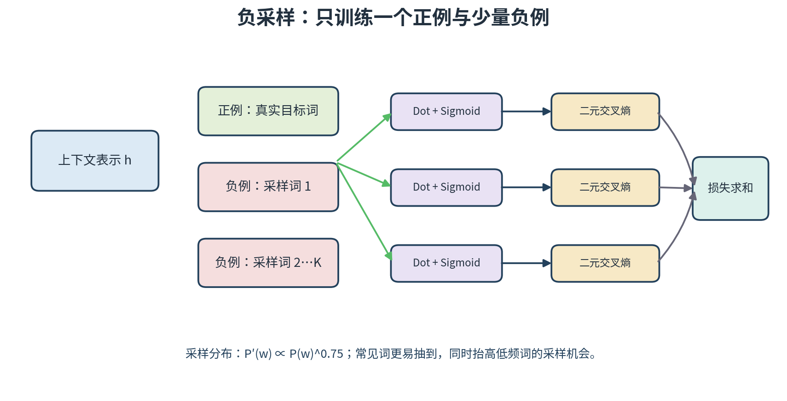

**为什么不把所有错误词都当作负例？** 因为词表可能非常大；若训练时仍考虑全部负例，就没有解决输出层随词表线性增长的主要瓶颈。负采样只使用少量负例，书中示例通常取 5 或 10 个。

### 4.2.6 负采样的抽样方法

负例应从语料统计出的词频分布中抽取，而不是完全均匀随机。常见词更容易被抽到，低频词较难抽到。word2vec 对原始词频概率 `P(w)` 做 0.75 次方调整：

$$
P'(w_i)=\frac{P(w_i)^{0.75}}{\sum_jP(w_j)^{0.75}}
$$

作用：提高低频词被采样的相对机会，避免负例只由极高频词构成。0.75 是经验设置，不是由理论唯一推导出的常数。

`UnigramSampler` 的典型输入：

- `corpus`：词 ID 序列，用来统计词频。
- `power=0.75`：词频分布的幂指数。
- `sample_size`：每个正例对应采样几个负例。

`get_negative_sample(target)` 根据正例 ID 抽取不等于正例的负例。

### 4.2.7 负采样层的实现

`NegativeSamplingLoss` 内部通常包含：

1. 一个 UnigramSampler，用于抽负例。
2. 一个正例 SigmoidWithLoss 层。
3. 若干个负例 SigmoidWithLoss 层。
4. 共享的输出权重，用于计算上下文表示与目标词向量的内积。

前向时复制上下文表示并分别与正/负词向量计算得分；损失求和。反向时，来自多个正负分支的梯度会相加。

## 4.3 改进版 word2vec 的学习

### 4.3.1 改进版 CBOW

新 CBOW 把输入侧 MatMul 换成 Embedding，把输出 SoftmaxWithLoss 换成 NegativeSamplingLoss。整体仍然遵循：上下文词向量 → 聚合成 `h` → 预测目标词 → 计算损失。

### 4.3.2 学习代码

训练流程与常规神经网络相同：

1. 准备语料、词 ID、训练上下文和目标词。
2. 建立模型与优化器。
3. 抽取 mini-batch。
4. 计算前向损失与反向梯度。
5. 更新权重，重复训练。
6. 根据训练目标和验证结果评价词向量。

### 4.3.3 CBOW 模型的评价

原书在 PTB 数据上训练改进版 CBOW，并观察相似词结果。可以看到词义相近、语法功能相近或同一类别的词往往在向量空间中靠近。

## 4.4 word2vec 的其他话题

### 4.4.1 word2vec 的应用

词向量可作为下游 NLP 模型的输入特征，例如文本分类、情感分析、序列标注等。使用已训练词向量初始化下游任务，是一种迁移学习思路：先在较大语料中学习通用表示，再在目标任务上训练。

书中还强调，word2vec 的表示方式不局限于文本，类似思想可以用于语音、图像和视频等领域中的离散对象或局部上下文。

### 4.4.2 单词向量的评价方法

原书介绍两类评价：

1. **人工相似度评价**：人给词对的相似度打分，再比较人工分数与词向量余弦相似度的相关性。
2. **类推任务（analogy）**：例如 `king : queen = man : ?`，通过向量加减方向完成类推，统计正确率。

向量类推背后的直觉是某些关系在向量空间表现为相似偏移方向，例如：

$$
\mathbf{v}_{king}-\mathbf{v}_{man}+\mathbf{v}_{woman}\approx\mathbf{v}_{queen}
$$

**评价注意事项**：

- 语料越大，通常越容易学出稳定表示。
- 不同模型、维度与语料会带来不同效果。
- 向量维度并非越大越好。
- 某项类推基准得分高，不保证在所有下游任务上都最好；评价要结合实际应用。

## 4.5 本章小结与掌握标准

本章把大词表训练拆为两个加速点：

- Embedding：从 one-hot 稀疏乘法变成按 ID 查表。
- Negative Sampling：从全词表多分类变成正例加有限负例的二分类。

应能写出并解释：

- Embedding 前向和梯度累加。
- Sigmoid 与二元交叉熵。
- 负采样的正例、负例损失。
- `P'(w)∝P(w)^0.75` 的用途。
- CBOW/Skip-gram 向量如何用于类推与下游任务。

---

# 第 5 章 RNN

前馈网络的输入与输出之间没有天然的时间循环结构。对于文本这样的序列，前一个词往往影响后一个词。RNN（Recurrent Neural Network，循环神经网络）通过隐藏状态把过去信息传给当前时刻。本章从概率语言模型引出 RNN，并实现 RNNLM。

## 5.1 概率和语言模型

### 5.1.1 概率视角下的 word2vec

CBOW 可以表示为条件概率模型。例如窗口为 1 时：

$$
P(w_t\mid w_{t-1},w_{t+1})
$$

若只看左侧两个词：

$$
P(w_t\mid w_{t-2},w_{t-1})
$$

相应训练损失：

$$
L=-\log P(w_t\mid w_{t-2},w_{t-1})
$$

模型通过最小化该损失学习参数。注意：CBOW 的初衷是获得词向量，本书此处把它扩展为语言模型视角，是为了引出 RNN。

### 5.1.2 语言模型（Language Model）

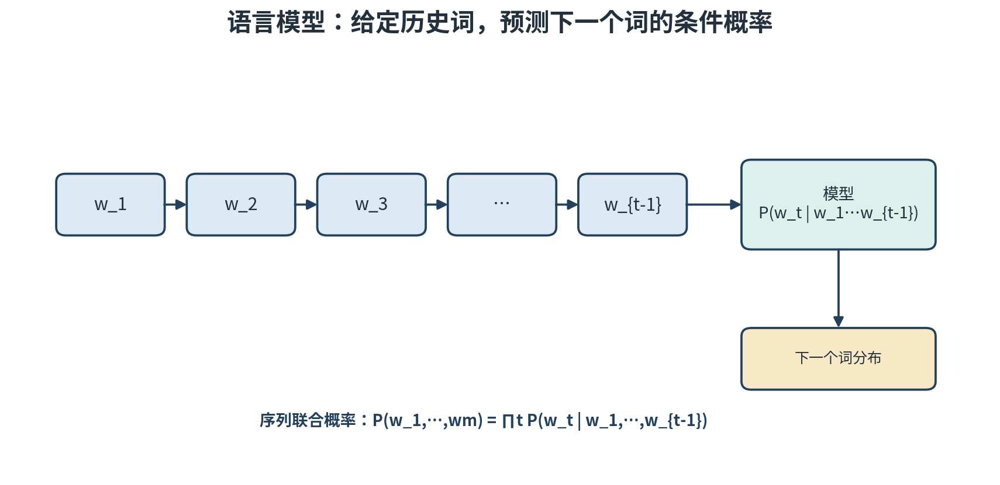

语言模型给一个词序列分配概率。给定序列 `w_1,...,w_m`，其联合概率为：

$$
P(w_1,\ldots,w_m)
$$

利用概率乘法定理：

$$
P(A,B)=P(A\mid B)P(B)
$$

可以把联合概率分解为一系列条件概率的乘积：

$$
P(w_1,\ldots,w_m)=
\prod_{t=1}^{m}P(w_t\mid w_1,\ldots,w_{t-1})
$$

这就是语言模型的基本形式：**在给定此前全部词的条件下，估计下一个词出现的概率**。

### 5.1.3 将 CBOW 用作语言模型的局限

可以把完整条件上下文近似成固定窗口：

$$
P(w_1,\ldots,w_m)\approx
\prod_{t=1}^{m}P(w_t\mid w_{t-c},\ldots,w_{t-1})
$$

这相当于 n-gram / 固定长度上下文的思想。局限：

1. 只能看到固定窗口内的历史；更早的信息被忽略。
2. 原书 CBOW 对上下文向量求和/平均，会弱化词序区别。
3. 若通过拼接保留位置，参数规模会随上下文窗口增大。

RNN 的目标是利用递归状态，将不同长度历史压缩进隐藏状态，而不是显式固定为一个小窗口。

## 5.2 RNN 的结构

### 5.2.1 循环神经网络

RNN 层接收当前输入 `x_t` 和上一时刻隐藏状态 `h_{t-1}`，生成当前隐藏状态 `h_t`。其核心公式：

$$
\boxed{\mathbf{h}_t=	anh(\mathbf{h}_{t-1}W_h+\mathbf{x}_tW_x+\mathbf{b})}
$$

其中：

- `x_t`：当前时间步输入，例如当前词的 Embedding。
- `h_{t-1}`：过去信息的压缩状态。
- `W_x`：当前输入到隐藏状态的权重。
- `W_h`：前一隐藏状态到当前隐藏状态的循环权重。
- `b`：偏置。
- `tanh`：非线性变换。

RNN 的主要特征：同一个 `W_x`、`W_h` 和 `b` 在所有时间步共享；状态沿时间递推，因此同一层可以处理不同长度序列。

### 5.2.2 展开循环

把循环按时间展开后，RNN 看起来像多个层串联：

```text
x0 → RNN → h0 → RNN → h1 → RNN → h2 → ...
```

但这些时间位置不是不同参数的层，而是**同一组参数在不同时间步的重复使用**。

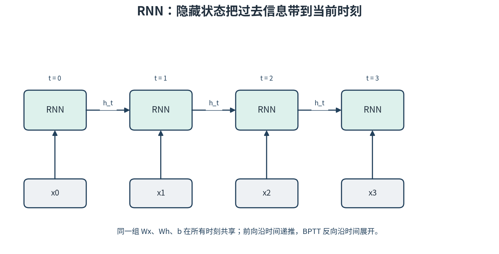

### 5.2.3 BPTT（Backpropagation Through Time）

将 RNN 展开后，可以按普通神经网络方式反向传播。由于梯度跨时间步向过去传递，所以称为基于时间的反向传播（BPTT）。

如果序列很长：

- 前向需要保存多个时间步的中间状态。
- 反向传播需要经过大量时间步。
- 计算和内存开销随时间跨度增长。
- 梯度可能逐步变小或变大。

RNN 的 BPTT 与普通反向传播本质一致，额外难点来自时间方向的重复结构与长序列。

### 5.2.4 Truncated BPTT（截断 BPTT）

一种工程化方法是把长序列切成若干块，只在每个块内部做反向传播，称为 Truncated BPTT。

**关键区别：截断的是反向传播路径，而不是前向传播状态。**

- 前向状态会从前一个块延续到下一个块，保证模型仍能沿时间读入连续序列。
- 反向梯度不穿过块边界，降低每次反向传播的时间跨度和内存需求。
- 因此，训练 batch 必须按时间顺序组织，不能像普通独立样本那样随意打乱时间位置。

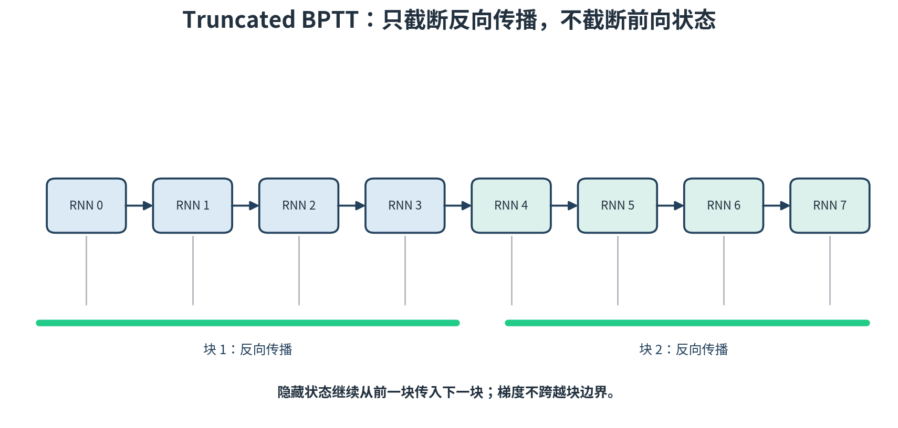

### 5.2.5 Truncated BPTT 的 mini-batch 学习

为了同时处理多条时间流，常将语料序列按 batch 维度切开：每个 batch 的样本从不同偏移位置开始，随后按时间向前取连续片段。

典型逻辑：

1. 根据语料长度和 batch_size 确定每条时间流的起点。
2. 每次取 `time_size` 个连续 token 组成一个小块。
3. 处理完当前块后，保留每条流的隐藏状态，送入下一块。
4. 反向传播只覆盖当前块，更新参数。

必须保证每条流下一块紧接前一块，才能让状态承载连续上下文。

## 5.3 RNN 的实现

### 5.3.1 RNN 层的实现

单步 RNN 层的前向：

$$
T= XW_x+H_{prev}W_h+b
$$

$$
H=\tanh(T)
$$

若 mini-batch 有 `N` 个样本，输入维度 `D`、隐藏维度 `H`：

| 数据 | 形状 |
|---|---|
| `X` | `(N,D)` |
| `W_x` | `(D,H)` |
| `H_prev` | `(N,H)` |
| `W_h` | `(H,H)` |
| `b` | `(H,)` |
| `H` | `(N,H)` |

反向传播时，设上游梯度为 `dH`。先经过 tanh 导数：

$$
dT=dH\odot(1-H^2)
$$

再得到：

$$
dW_x=X^T dT,\qquad dW_h=H_{prev}^T dT,\qquad db=\sum_{n}dT_n
$$

$$
dX=dT W_x^T,\qquad dH_{prev}=dT W_h^T
$$

一个 RNN 单元的梯度既要传给当前输入，也要传回上一时间步状态。

### 5.3.2 Time RNN 层的实现

`TimeRNN` 把单步 RNN 沿时间维度循环展开并封装起来。输入通常为：

$$
X\in\mathbb{R}^{N\times T\times D}
$$

输出：

$$
Hs\in\mathbb{R}^{N\times T\times H}
$$

要点：

- 所有时间步共享同一组 `W_x`、`W_h`、`b`。
- 正向按照 `t=0,...,T-1` 顺序计算。
- 反向按照时间逆序计算。
- 同一参数在多个时间步产生的梯度需要累加。
- `stateful=True` 时，跨 batch 保留隐藏状态；`stateful=False` 时，按 batch 重置状态。

## 5.4 处理时序数据的层

### 5.4.1 RNNLM 的全貌

基于 RNN 的语言模型通常包含：

1. **Embedding**：将词 ID 转为词向量。
2. **Time RNN**：依序吸收词向量并生成每个时间步的隐藏状态。
3. **Time Affine**：将隐藏状态映射为词表得分。
4. **Time SoftmaxWithLoss**：逐时间步与目标词比较，计算平均损失。

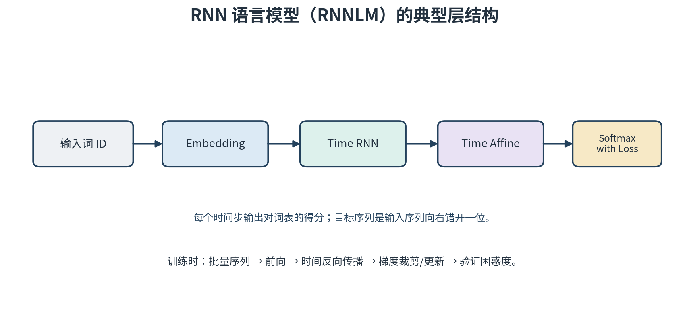

### 5.4.2 Time 层的实现

Time 层的思路是：把单步层在时间轴上重复调用，并沿时间维度组织输出与梯度。Embedding、Affine、SoftmaxWithLoss 等都可以做成 Time 版本。

- `TimeEmbedding`：处理 `(N,T)` 的词 ID，输出 `(N,T,D)`。
- `TimeAffine`：处理 `(N,T,H)`，输出 `(N,T,V)` 得分。
- `TimeSoftmaxWithLoss`：把每个时间步目标词与得分比较，再对有效元素或 batch/time 做平均。

这样模型的上层就能一次接收完整序列张量，而不必手动逐步连接每一个单词。

## 5.5 RNNLM 的学习与评价

### 5.5.1 RNNLM 的实现

RNNLM 的输入序列与目标序列错开一位：

```text
输入：w0, w1, w2, w3, ...
目标：w1, w2, w3, w4, ...
```

即模型读入当前位置及历史，预测下一位置的词。隐藏状态沿时间传递，Softmax 在每个时间步给出词表概率。

### 5.5.2 语言模型的评价：困惑度（Perplexity）

困惑度是语言模型常用评价指标。若测试集中有 `N` 个预测位置，每个位置目标词概率为 `p_n`，则：

$$
\operatorname{PPL}=\exp\left(-\frac{1}{N}\sum_{n=1}^{N}\log p_n\right)
$$

它等于平均负对数似然（交叉熵）的指数形式。

直觉：困惑度可以理解为模型在预测下一个词时平均面临的“有效候选数量”。

- 困惑度越低，模型给真实下一个词的概率通常越高。
- 困惑度为 1 是理想极限，意味着模型总能把概率质量集中到正确词上。
- 词表、分词、数据集、预处理与评估方式不同，困惑度不可直接横向比较。

### 5.5.3 RNNLM 学习代码

学习流程与普通神经网络相同，但 batch 要按序列流组织，并使用截断 BPTT。

### 5.5.4 RNNLM 的 Trainer 类

原书的 `RnnlmTrainer` 将下列处理封装起来：

- 按顺序生成 mini-batch。
- 调用模型前向和反向传播。
- 进行梯度裁剪（后续章节将重点解释）。
- 使用优化器更新参数。
- 按设定间隔计算困惑度。

## 5.6 本章小结与掌握标准

本章建立了“序列状态”与“语言模型”的对应关系。应能：

- 写出 RNN 的状态更新公式并解释各参数。
- 解释循环展开后为什么仍然共享参数。
- 说明 BPTT 与 Truncated BPTT 的差异。
- 解释为什么截断反向传播后仍要保留前向隐藏状态。
- 描述 RNNLM 中 Embedding、Time RNN、Time Affine、Time SoftmaxWithLoss 的数据流。
- 写出困惑度公式并解释它与平均交叉熵的关系。

---

# 第 6 章 Gated RNN：LSTM 与 GRU

第 5 章的普通 RNN 能传递过去信息，但时间跨度很长时，梯度容易消失或爆炸。本章先分析问题来源，再用门控循环网络（Gated RNN）改善信息与梯度流动。重点是 LSTM，GRU 在附录 C 介绍。

## 6.1 RNN 的问题

### 6.1.1 RNN 复习

普通 RNN：

$$
\mathbf{h}_t=\tanh(\mathbf{x}_tW_x+\mathbf{h}_{t-1}W_h+\mathbf{b})
$$

它把历史压缩在 `h_t` 中。若某个早期词对很久之后的预测很重要，模型必须让相关梯度沿许多时间步返回。

### 6.1.2 梯度消失与梯度爆炸

- **梯度消失（vanishing gradients）**：反向梯度沿时间传播时变得极小，早期时刻对应的参数难以得到有效更新，模型难以学习长期依赖。
- **梯度爆炸（exploding gradients）**：梯度沿时间传播时变得极大，可能导致参数更新异常、数值溢出甚至出现 NaN。

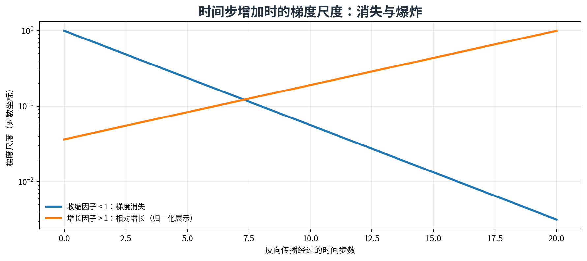

### 6.1.3 原因：tanh 与循环矩阵的反复作用

反向传播经过 tanh 时，导数为：

$$
\frac{d}{dx}\tanh(x)=1-\tanh^2(x)
$$

该导数不超过 1，并且当输入进入饱和区域时会变得很小。连续经过多个 tanh 节点，梯度可能不断缩小。

此外，若暂时忽略 tanh，只观察循环矩阵，梯度会重复乘以 `W_h^T`：

$$
dh_{t-k}\sim dh_t(W_h^T)^k
$$

若将 `W_h` 简化成标量：

- 绝对值小于 1，重复乘会趋于 0。
- 绝对值大于 1，重复乘会不断放大。

矩阵情形下，奇异值（尤其最大奇异值）的大小与梯度尺度变化有关。最大奇异值大于 1 时，可能出现爆炸；整体收缩时，可能出现消失。实际是否发生还与方向、数据和激活状态等因素有关。

### 6.1.4 梯度爆炸的对策：梯度裁剪

梯度裁剪（Gradient Clipping）把整体梯度范数限制在给定阈值内。设所有参数梯度组合为 `g`，阈值为 `threshold`：

$$
\text{若 }\|g\|\ge threshold,\qquad
\hat g=\frac{threshold}{\|g\|}g
$$

否则保持原梯度。它保留梯度方向，只缩小过大的范数。

伪代码：

```python
grad_norm = np.sqrt(sum(np.sum(g * g) for g in grads))
if grad_norm >= max_norm:
    rate = max_norm / (grad_norm + 1e-6)
    for g in grads:
        g *= rate
```

梯度裁剪主要解决爆炸，不从根本上解决长期依赖中的梯度消失。

## 6.2 梯度消失与 LSTM

LSTM（Long Short-Term Memory，长短期记忆网络）通过额外的记忆单元 `c_t` 和门控结构控制信息保留、写入与输出。

### 6.2.1 LSTM 的接口

与简单 RNN 相比，LSTM 除隐藏状态 `h_t` 外，还有一条记忆单元状态 `c_t`：

- `h_t`：对外输出的隐藏状态，供下一层和下一时间步使用。
- `c_t`：内部记忆通道，用于保存相对长期的信息。

### 6.2.2 LSTM 的整体结构

LSTM 有三个门和一个候选记忆：

- 遗忘门 `f`：控制旧记忆保留多少。
- 输入门 `i`：控制新信息写入多少。
- 输出门 `o`：控制记忆中哪些信息暴露为隐藏状态。
- 候选记忆 `g`：提供可写入的新内容。

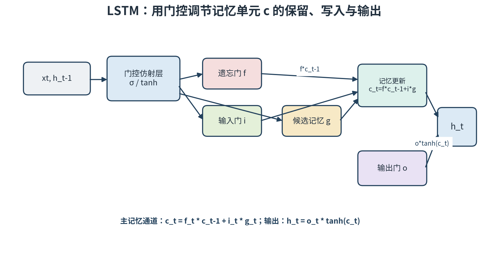

### 6.2.3 输出门

输出门先由输入和上一隐藏状态计算：

$$
\mathbf{o}_t=\sigma(\mathbf{x}_tW_x^{(o)}+\mathbf{h}_{t-1}W_h^{(o)}+\mathbf{b}^{(o)})
$$

然后用它控制记忆单元的可见程度：

$$
\mathbf{h}_t=\mathbf{o}_t\odot\tanh(\mathbf{c}_t)
$$

`σ` 的值在 0 到 1 之间，因此可以看成逐元素的开关比例。

### 6.2.4 遗忘门

$$
\mathbf{f}_t=\sigma(\mathbf{x}_tW_x^{(f)}+\mathbf{h}_{t-1}W_h^{(f)}+\mathbf{b}^{(f)})
$$

用遗忘门控制上一时刻的记忆：

$$
\mathbf{c}_{old}=\mathbf{f}_t\odot\mathbf{c}_{t-1}
$$

`f_t` 越接近 1，对应记忆分量越多地被保留；越接近 0，则越多地被遗忘。

### 6.2.5 新的记忆单元（候选记忆）

$$
\mathbf{g}_t=\tanh(\mathbf{x}_tW_x^{(g)}+\mathbf{h}_{t-1}W_h^{(g)}+\mathbf{b}^{(g)})
$$

候选记忆 `g_t` 提供新内容。它采用 tanh，将内容限制在 `[-1,1]` 范围，供记忆单元写入。

### 6.2.6 输入门

$$
\mathbf{i}_t=\sigma(\mathbf{x}_tW_x^{(i)}+\mathbf{h}_{t-1}W_h^{(i)}+\mathbf{b}^{(i)})
$$

输入门控制候选记忆写入多少。记忆单元更新为：

$$
\boxed{\mathbf{c}_t=\mathbf{f}_t\odot\mathbf{c}_{t-1}+\mathbf{i}_t\odot\mathbf{g}_t}
$$

完整 LSTM 公式可合在一起：

$$
\begin{aligned}
\mathbf{f}_t&=\sigma(\mathbf{x}_tW_x^{(f)}+\mathbf{h}_{t-1}W_h^{(f)}+\mathbf{b}^{(f)})\\
\mathbf{i}_t&=\sigma(\mathbf{x}_tW_x^{(i)}+\mathbf{h}_{t-1}W_h^{(i)}+\mathbf{b}^{(i)})\\
\mathbf{g}_t&=\tanh(\mathbf{x}_tW_x^{(g)}+\mathbf{h}_{t-1}W_h^{(g)}+\mathbf{b}^{(g)})\\
\mathbf{o}_t&=\sigma(\mathbf{x}_tW_x^{(o)}+\mathbf{h}_{t-1}W_h^{(o)}+\mathbf{b}^{(o)})\\
\mathbf{c}_t&=\mathbf{f}_t\odot\mathbf{c}_{t-1}+\mathbf{i}_t\odot\mathbf{g}_t\\
\mathbf{h}_t&=\mathbf{o}_t\odot\tanh(\mathbf{c}_t)
\end{aligned}
$$

**记忆口诀**：遗忘门决定“旧的留下多少”，输入门决定“新的写入多少”，输出门决定“内部记忆展示多少”。

### 6.2.7 LSTM 的梯度流动

LSTM 能改善梯度消失的关键，在于记忆单元有一条加法更新通路：

$$
c_t=f_t\odot c_{t-1}+i_t\odot g_t
$$

反向传播沿 `c_t → c_{t-1}` 的路径时，主要受到遗忘门 `f_t` 的逐元素控制；加法节点不会像普通 RNN 那样反复乘同一个循环矩阵。若遗忘门让某个分量接近 1，该分量的记忆和梯度就更容易向过去保留。

这不是说 LSTM 在任何情况下都绝不会梯度消失，而是它提供了比普通 RNN 更适合长期信息传播的结构性通路。

## 6.3 LSTM 的实现

四个门的仿射变换可以合并计算，减少重复矩阵乘法。把四组输入权重拼接成 `W_x`，把四组循环权重拼接成 `W_h`，并把偏置拼接成 `b`：

$$
A=XW_x+H_{prev}W_h+b
$$

若隐藏维度为 `H`，则拼接后的输出宽度为 `4H`，随后拆成 `f,g,i,o` 四段，再分别应用 sigmoid/tanh。

参数形状常见为：

- `W_x`: `(D, 4H)`
- `W_h`: `(H, 4H)`
- `b`: `(4H,)`

`TimeLSTM` 与 `TimeRNN` 类似，负责沿时间轴重复调用 LSTM，并累加共享参数在所有时间步产生的梯度。实现时要缓存每个时间步需要的门值和状态。

## 6.4 使用 LSTM 的语言模型

将上一章 RNNLM 中的 TimeRNN 替换为 TimeLSTM，其余结构基本保持：

```text
TimeEmbedding → TimeLSTM → TimeAffine → TimeSoftmaxWithLoss
```

LSTM 的隐藏状态与记忆单元都要在连续 chunk 之间妥善处理。评估测试集困惑度时，需要留意状态是否应重置，避免把测试序列不该共享的信息带入。

原书使用 PTB 数据集训练并以困惑度评价。重点不是把某次实验数值当作永恒标准，而是观察训练后困惑度下降，以及改进模型如何继续降低困惑度。

## 6.5 进一步改进 RNNLM

### 6.5.1 LSTM 层的多层化

把多个 LSTM 层纵向堆叠：上一层所有时间步的隐藏状态作为下一层输入。深层网络能够组合更复杂的序列特征。

层数是超参数，需要根据数据量、模型复杂度和计算资源选择。原书指出，在 PTB 语言模型实验中，2–4 层 LSTM 可以取得较好结果，并举出更深层模型的研究案例。

### 6.5.2 Dropout 抑制过拟合

Dropout 在训练时随机屏蔽部分神经元/连接，使网络不能过度依赖某些单元，从而改善泛化。

RNN 特别要考虑时间方向的信息累积：

- 若每个时间步独立地随机丢弃信息，噪声可能随时间推进而不断积累。
- 原书建议优先在网络的**深度方向**（层与层之间）使用常规 Dropout，而不要简单在时间方向每步插入独立 Dropout。
- 变分 Dropout（Variational Dropout）可在同一层的时间步间共享相同 mask，使时间方向的 Dropout 更稳定；原书介绍其思想，但实验中采用常规 Dropout。

### 6.5.3 权重共享（Weight Tying）

语言模型中，Embedding 层权重与 Softmax 前的 Affine 层权重可以共享。

若词表大小为 `V`，隐藏维度为 `H`：

- Embedding 权重为 `(V,H)`。
- Affine 输出权重为 `(H,V)`。

将 Affine 的权重设为 Embedding 权重的转置，即可共享参数：

$$
W_{affine}=W_{embed}^T
$$

好处：

- 减少参数数量。
- 降低模型复杂度，有助于减轻过拟合。
- 让输入表示与输出分类空间使用相互关联的表示结构。

### 6.5.4 更好的 RNNLM

原书的 BetterRnnlm 综合了三项技巧：

1. 多层 LSTM。
2. Dropout（重点放在深度方向）。
3. Embedding 与输出 Affine 权重共享。

这说明改进并不一定来自一个神秘的新层，也可以通过结构深度、正则化与参数共享共同完成。

### 6.5.5 前沿研究

原书在此展示当时语言模型研究中的更优结果，并指出多层 LSTM、正则化、权重共享以及与 Attention 有关的缓存/指针机制等技巧曾被用于提升困惑度表现。该部分是 2020 年出版时的研究背景介绍，不代表当前语言模型领域的完整最新进展。

## 6.6 本章小结与掌握标准

本章的核心是“门控如何改善信息通路”。应能：

- 解释普通 RNN 梯度消失/爆炸的原因。
- 写出梯度裁剪公式，并说明它主要防止梯度爆炸。
- 写出 LSTM 的 4 个门/候选量以及 `c_t`、`h_t` 更新式。
- 解释 LSTM 记忆单元加法通路的意义。
- 解释 TimeLSTM 为什么要共享参数、为什么要累加梯度。
- 说明堆叠 LSTM、Dropout、权重共享各自改善什么问题。

---

# 第 7 章：基于 RNN 生成文本

本章从“预测下一个词”自然过渡到“生成一段文本”，再进一步解决“输入一个序列、输出另一个序列”的问题。核心模型是语言模型与 Encoder–Decoder（seq2seq）。

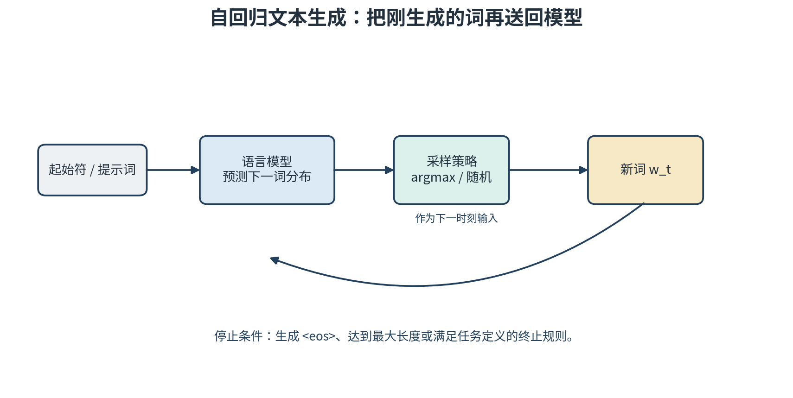

## 7.1 使用语言模型生成文本

### 7.1.1 自回归生成的基本步骤

训练好的语言模型接收已有上下文，输出下一个 token 的概率分布：

$$
P(w_{t+1}\mid w_1,\ldots,w_t)
$$

生成时不再提供正确答案，而是把模型自己的输出接回输入，反复执行：

1. 给模型一个起始上下文或起始 token。
2. 计算下一 token 的 Softmax 概率分布。
3. 从概率分布中选取 token。
4. 将选出的 token 追加到上下文。
5. 重复，直到达到长度上限或生成 `<eos>`。

两种常见选择方式：

- **贪心选择（greedy）**：每次选择概率最大的 token，结果确定、可复现，但容易陷入局部最优，文本变化少。
- **按概率采样**：按 Softmax 给出的概率抽样，高概率词更容易出现、低概率词也有机会出现，文本更有变化。

书中通过 `np.random.choice()` 按概率抽样。若概率向量为 `p`，则采样结果满足 `P(w_i)=p_i`。生成多样性来自采样过程本身；书中没有把温度、Top-k、Top-p 作为重点算法展开，因此不要把它们当作本章核心内容。

### 7.1.2 文本生成的实现逻辑

推理网络的结构与语言模型相同：

```text
Embedding → LSTM → Affine → Softmax 概率
                 ↑
            上一时刻状态
```

训练时使用真实序列进行 teacher forcing；生成时把本轮生成的 token 作为下一轮输入。两种阶段的区别如下：

| 阶段 | 当前输入 | 下一步输入 | 目标 |
|---|---|---|---|
| 训练 | 真实语料 token | 下一位置真实 token | 计算损失、反向传播 |
| 生成 | 起始 token / 已生成 token | 本轮模型生成 token | 逐步构造新序列 |

要注意：**训练时看到的是真实前缀，生成时看到的是模型自己生成的前缀**。因此训练效果好并不保证长文本生成一定稳定，前面一个错误 token 可能影响之后整段生成。

### 7.1.3 使用更好的语言模型

第 6 章构建的 BetterRnnlm 可以用于生成文本。它通过多层 LSTM、Dropout 与权重共享改进语言模型。生成过程不因模型结构变好而改变：仍是预测分布、采样、反馈、循环。

## 7.2 seq2seq：把一个时序数据转换为另一个时序数据

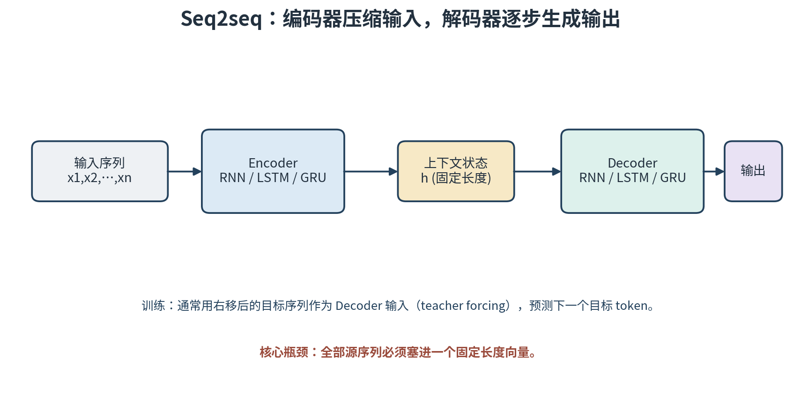

### 7.2.1 Encoder–Decoder 原理

seq2seq（sequence to sequence）也称 Encoder–Decoder 模型。它由两个模块组成：

- **Encoder（编码器）**：按时间顺序读取输入序列，将其转换为内部表示。
- **Decoder（解码器）**：以编码结果为条件，自回归地产生输出序列。

设输入 token 序列为 \(x_1,\ldots,x_T\)，编码器逐步更新隐藏状态：

$$
h_t^{enc}=f_{enc}(x_t,h_{t-1}^{enc})
$$

基础 seq2seq 将最后隐藏状态作为固定长度的语义向量：

$$
c=h_T^{enc}
$$

解码器以该向量初始化状态或作为条件，并根据前一输出预测下一个 token：

$$
h_t^{dec}=f_{dec}(y_{t-1},h_{t-1}^{dec};c)
$$

$$
P(y_t\mid y_1,\ldots,y_{t-1},x)=\operatorname{Softmax}(W_o h_t^{dec}+b_o)
$$

直观理解：Encoder 把输入“读懂并编码”，Decoder 根据编码信息“组织并说出”目标序列。机器翻译是典型例子，但它并不局限于自然语言。

### 7.2.2 固定长度向量的瓶颈

基础 Encoder 把任意长度输入压缩为一个固定维度向量。输入越长，需要保留的信息越多，单个固定维度向量就越容易形成信息瓶颈。这是第 8 章引入 Attention 的直接动机。

### 7.2.3 可变长度序列

输入与目标序列可以有不同长度，批处理时通常需要把不同长度序列补齐到统一长度。补齐 token（padding）不能被当作真实语义内容；计算损失时应屏蔽补齐位置，或使用有效长度控制计算。书中的加法数据集实验以规则化字符序列为例，重点说明模型如何处理输入输出时间长度不同的问题。

特殊 token 的作用：

- `<eos>`：在序列末尾作为结束标记；在解码器中也可以兼作启动信号（书中示例采用这种安排）。
- `<pad>`：批处理时填充长度，不应对其计算普通目标损失。
- `<unk>`：工程实现中常用于表示词表外 token；它不是本章结构推导的重点。

### 7.2.4 加法数据集

书中使用字符级加法数据集检验 seq2seq 是否学会算法式映射，例如输入两个数字字符串及加号，输出其和。选择该任务的好处是：

- 输入与输出都是序列；
- 输出长度可能随输入变化；
- 正确答案明确，可以直接计算整条序列的精确匹配率；
- 模型若学会的是映射规律，而非只记住固定模板，就能处理未见过的组合。

## 7.3 seq2seq 的实现

### 7.3.1 Encoder

Encoder 通常由 Embedding 与 LSTM 组成：

```text
输入 token ID → Embedding → LSTM → 最后隐藏状态 h
```

最后的隐藏状态被传递给 Decoder，作为输入序列的压缩表示。Encoder 不需要预测词表分布，因此没有输出 Softmax 分类层。

### 7.3.2 Decoder

Decoder 的核心结构：

```text
起始 token / 前一 token
      ↓
  Embedding → LSTM（接收 Encoder 的 h）→ Affine → Softmax
```

训练时，目标序列需要错开一位：

```python
decoder_xs = ts[:, :-1]  # 输入：起始符到倒数第二个目标 token
decoder_ts = ts[:, 1:]   # 监督：第一个目标 token 到结束符
```

这样每个时刻都用前一个目标 token 预测下一个目标 token。生成时没有真实 `decoder_xs`，而是把已生成 token 逐步反馈。

### 7.3.3 Seq2seq 组合

整体前向流程：

1. `h = encoder.forward(xs)`；
2. `score = decoder.forward(decoder_xs, h)`；
3. 使用时序 Softmax 与交叉熵计算目标序列损失。

反向传播时，损失先经过 Softmax with Loss，再进入 Decoder；Decoder 对条件向量 `h` 的梯度继续传回 Encoder。也就是说，编码器不是独立预训练后固定不动，而是与解码器通过同一目标端到端联合学习。

### 7.3.4 评价方式

书中在加法任务上使用生成序列与正确答案逐条比较，计算整条结果完全正确的比例（sequence accuracy）。这比只看单字符准确率严格：只要一个位置出错，整条序列就计为错误。

## 7.4 seq2seq 的两种改进

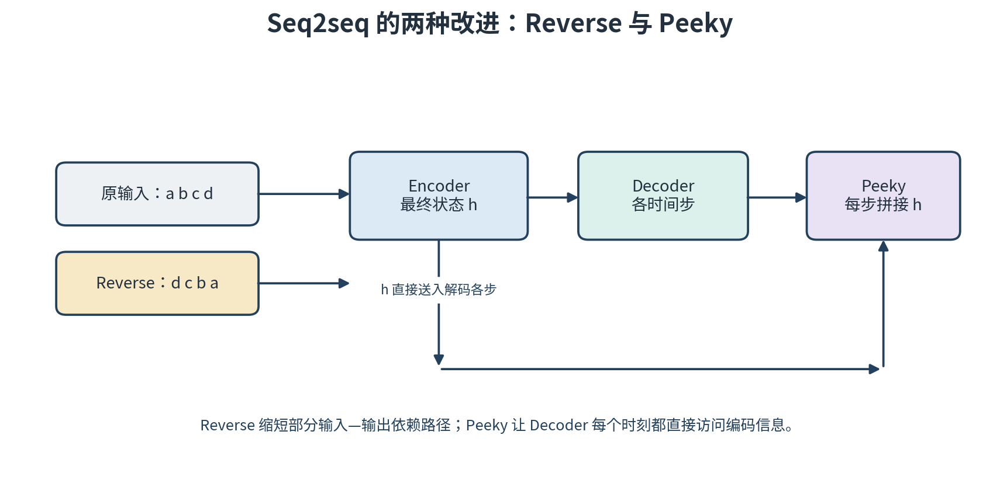

### 7.4.1 Reverse：反转输入序列

把 Encoder 的输入顺序反转：

$$
(x_1,x_2,\ldots,x_T)\rightarrow(x_T,\ldots,x_2,x_1)
$$

其直觉是缩短某些输入 token 与对应输出 token 之间的时间距离，使相关信息的梯度传播路径更短、更直接。书中加法任务的实验显示，Reverse 能改善学习进展；但效果依赖任务，不是所有任务都必然受益。

### 7.4.2 Peeky：让 Decoder 多处使用编码信息

普通 seq2seq 主要在解码器初始状态使用 Encoder 的最终向量 `h`。Peeky 把 `h` 进一步复制并拼接到 Decoder 每个时间步的输入/隐藏表示以及输出 Affine 层的输入，使解码器在生成每个 token 时都能直接访问编码信息。

拼接记为：

$$
[u;v]=\operatorname{concat}(u,v)
$$

Peeky 能更充分地利用编码信息，但也会增加参数量和计算量。Reverse 与 Peeky 是在固定向量瓶颈框架内的改良；第 8 章 Attention 则直接改变信息访问方式。

## 7.5 seq2seq 的应用

### 7.5.1 聊天机器人

把用户输入的话语作为 Encoder 输入，把机器人回复作为 Decoder 目标序列。实际系统还需要对话上下文、候选回复质量、事实一致性、安全过滤等机制；书中用它说明序列到序列框架的应用可能性，而不是提供可直接上线的完整聊天机器人。

### 7.5.2 算法学习

加法实验说明神经网络可以从样例中学习一种输入输出映射。进一步的算法学习任务可以考察模型究竟是记忆训练样例，还是学到了可组合的操作规律。

### 7.5.3 自动图像描述

可以用 CNN 对图像编码，再将特征交给 RNN/Decoder 逐词生成描述。它沿用 Encoder–Decoder 思想，但 Encoder 的输入由文本序列变成图像特征。

## 7.6 本章小结与掌握标准

应能清楚回答：

- 语言模型怎样从下一个 token 的分布生成整段文本？
- 训练时 teacher forcing 与推理时自回归反馈有何不同？
- Encoder、Decoder 各自负责什么？固定长度向量为什么会形成瓶颈？
- 为什么目标输入、目标标签要错开一位？
- Reverse 与 Peeky 分别改变了信息传播的哪一部分？
- 什么任务适合表达为 seq2seq？

---

# 第 8 章：Attention

Attention 是全书结构上的关键转折：从“把整段输入压缩为一个向量”转向“解码每个输出 token 时，动态选择需要的输入信息”。

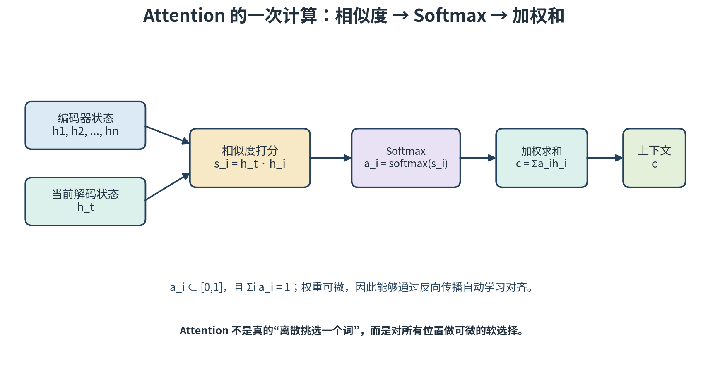

## 8.1 Attention 的结构

### 8.1.1 seq2seq 的固定向量瓶颈

基础 seq2seq 只传递 Encoder 最后一个隐藏状态。无论输入长短都要挤进同样维度的向量，长序列的信息容易丢失。即使使用 Peeky，信息来源仍然是那个压缩向量，并未从根本上消除瓶颈。

### 8.1.2 改进 Encoder：输出所有时刻的隐藏状态

不再只返回最后一个隐藏状态，而是保留各时刻的隐藏状态：

$$
H=[h_1^{enc},h_2^{enc},\ldots,h_T^{enc}]
$$

每个向量包含当前 token 及其前文的上下文信息。输入有多少个时间步，就会对应多少个编码向量，因此表示长度随输入长度改变。

### 8.1.3 Attention Weight：计算与当前输出有关的权重

在 Decoder 的时间步 \(t\)，使用当前隐藏状态 \(q_t\)（书中记作解码器的隐藏状态 `h`）与 Encoder 各时刻向量 \(h_i^{enc}\) 计算相关性分数。书中采用内积作为示例：

$$
s_{t,i}=q_t\cdot h_i^{enc}
$$

把分数归一化为权重：

$$
a_{t,i}=\frac{\exp(s_{t,i})}{\sum_{j=1}^{T}\exp(s_{t,j})}
$$

因此：

$$
0\le a_{t,i}\le 1,\qquad \sum_{i=1}^{T}a_{t,i}=1
$$

权重越大，表示当前 Decoder 状态越“关注”对应 Encoder 时间步的信息。权重是模型学习得到的，而不是人工给定的对齐表。

### 8.1.4 Weight Sum：计算上下文向量

将 Encoder 的所有隐藏状态按权重求和：

$$
c_t=\sum_{i=1}^{T}a_{t,i}h_i^{enc}
$$

`c_t` 是当前 Decoder 时刻专属的上下文向量。与固定向量不同，输出序列的每个位置都有自己的 `c_t`，因此每个输出 token 可以关注不同输入位置。

### 8.1.5 把 Attention 放进 Decoder

每个解码时刻的计算可以理解为：

1. Decoder 的 LSTM 根据前一 token 与状态产生当前隐藏状态 `q_t`。
2. Attention Weight 用 `q_t` 与所有 Encoder 隐藏状态算相似度，并经 Softmax 得到 `a_t`。
3. Weight Sum 用 `a_t` 对 Encoder 隐藏状态加权求和，得到 `c_t`。
4. 将 `c_t` 与 Decoder 的隐藏状态拼接后送入 Affine/Softmax，预测输出 token。

Attention 层由两个逻辑子层构成：**Attention Weight** 与 **Weight Sum**。正向传播缓存权重，便于可视化；反向传播时，梯度既会流向 Encoder 隐藏状态，也会经权重计算路径流向 Decoder 隐藏状态。

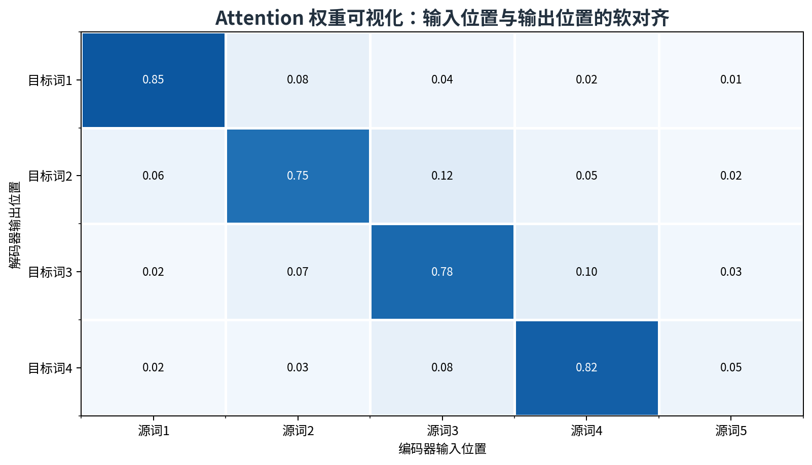

### 8.1.6 维度检查

书中批处理张量的典型形状：

| 张量 | 形状 | 含义 |
|---|---:|---|
| `hs` | `(N,T,H)` | N 个样本、T 个输入位置、H 维编码向量 |
| `h` / `q` | `(N,H)` | Decoder 当前隐藏状态 |
| `s` | `(N,T)` | 每个输入位置的相关性分数 |
| `a` | `(N,T)` | Softmax 后的注意力权重 |
| `c` | `(N,H)` | 加权和上下文向量 |

这一形状检查可用于排查拼接维度、矩阵乘法与批处理轴上的错误。

## 8.2 带 Attention 的 seq2seq 实现

### 8.2.1 Attention Encoder

Encoder 返回所有时间步的隐藏状态 `hs`，而不是仅返回最后一步。实现通常是 Embedding + TimeLSTM，输出形状为 `(N,T,H)`。

### 8.2.2 Attention Decoder

Decoder 保留 Embedding 与 TimeLSTM，在其后增加 Time Attention。每个输出时刻都会计算当前上下文向量；再把上下文和 Decoder 隐状态拼接，经过 TimeAffine 得到词表分数。

### 8.2.3 AttentionSeq2seq

整体上仍由 Encoder、Decoder 和时序 Softmax Loss 组合构成。与普通 Seq2seq 的主要差别是 Encoder 返回 `hs`，Decoder 接收完整 `hs`，并在每个时间步调用 Attention。

## 8.3 Attention 的评价与可视化

### 8.3.1 日期格式转换问题

书中使用日期格式转换任务进行实验：输入可能是多种形式的日期字符串，输出为统一格式。任务具有输入输出位置间存在明显对应关系的特点，适合观察 Attention 是否学会对齐。

### 8.3.2 学习与评价

训练流程仍是常规的 mini-batch、前向计算、反向传播和参数更新。区别是模型通过 Attention 学习输入输出各位置的关联。整条输出字符串完全匹配可作为直观评价指标。

### 8.3.3 可视化注意力权重

把每个输出时间步的注意力权重按矩阵展示：

- 横轴：输入序列的位置；
- 纵轴：输出序列的位置；
- 单元格亮度/强度：对应注意力权重。

若模型学会合理对齐，矩阵中会出现可解释的集中区域或带状结构。注意力可视化能帮助理解模型关注哪里，但**不能简单等同于模型完整的因果解释**：高权重表示信息访问分配，不自动证明模型真正以人类方式理解了该 token。

## 8.4 Attention 的其他话题

### 8.4.1 双向 RNN

单向 RNN 在位置 `t` 的隐藏状态主要包含当前位置及其左侧上下文；双向 RNN 同时从左向右、从右向左处理输入，再组合两个方向的表示：

$$
h_t=[\overrightarrow{h_t};\overleftarrow{h_t}]
$$

这样每个位置可利用左右两侧上下文。对于机器翻译等编码完整输入后再解码的任务，双向编码器尤其自然；对于严格在线、只能看到过去的预测任务，则不能随意使用未来上下文。

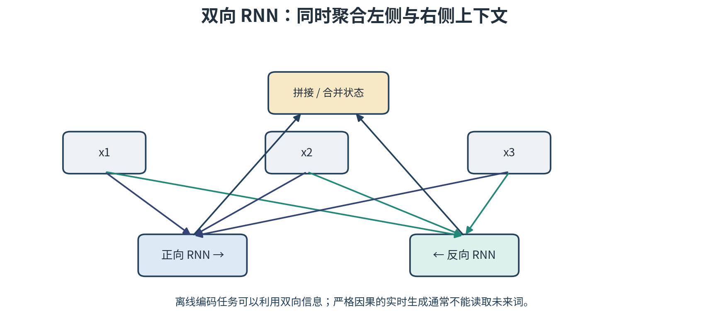

### 8.4.2 Attention 层的使用方法

Attention 不只属于翻译。只要有两组向量且需要动态选择相关信息，就可以考虑 Attention。其基本组件仍是“相关性分数 → Softmax 权重 → 加权和”。不同任务可以换用不同的分数函数或输入结构；本书重点介绍基于内积的实现。

### 8.4.3 深层 seq2seq 与 Skip Connection

将多层 RNN/LSTM 堆叠可以提升表达能力，但深层网络的梯度传播和优化可能更困难。Skip connection（跳跃连接）把较早层的信息绕过中间层直接传到更深层，改善信息/梯度传递。它与 Attention 的作用不同：Skip connection 是层间/路径上的信息捷径；Attention 是根据当前查询动态选择输入位置。

## 8.5 Attention 的应用

### 8.5.1 GNMT

GNMT（Google Neural Machine Translation）是神经机器翻译系统的代表性案例。书中借它说明 Attention 与深层 RNN 编码器/解码器组合后可以服务于大规模机器翻译。应把它作为体系结构应用案例理解，不必把书中的简述当作完整的工业系统实现规格。

### 8.5.2 Transformer

Transformer 是书中展示的另一种重要 Attention 应用。与 RNN 按时间步递归处理不同，Transformer 以 Attention 为核心构建序列表示，能够在序列维度上并行计算。书中对 Transformer 是概念性介绍，重点是认识 Attention 可以脱离传统 RNN 框架成为模型的核心；本书并未完整推导 Transformer 的所有组件。

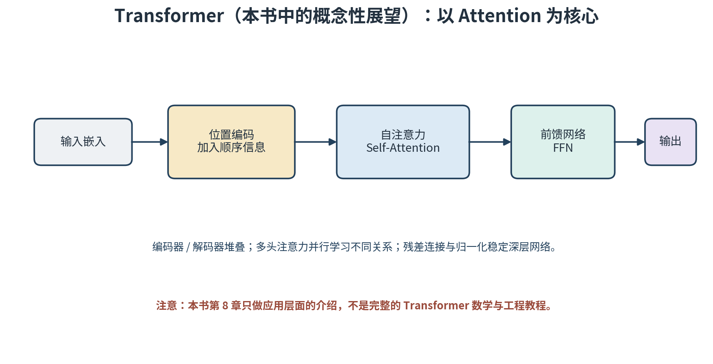

学习时可先记住其方向性差别：

- RNN：用递归状态逐步传递序列信息；
- Attention：直接计算位置间关联并聚合信息；
- Transformer：以自注意力及前馈网络等模块堆叠为核心，不依赖 RNN 的逐步循环。

### 8.5.3 NTM

NTM（Neural Turing Machine，神经图灵机）将神经网络与外部可读写存储器结合。Attention 的“按内容分配权重并加权读取”思路可以用于读取内存，也可扩展到对外部存储的读写控制。书中用 NTM 说明 Attention 思想不仅用于翻译，还能用于神经网络访问外部记忆。

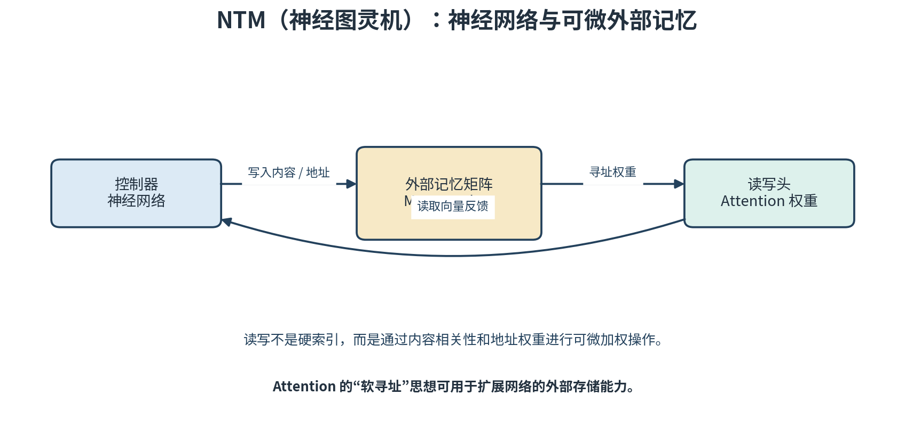

## 8.6 本章小结与掌握标准

应能独立推导并解释：

- seq2seq 的固定长度瓶颈是什么；
- 为什么 Encoder 要返回所有时刻的隐藏状态；
- Attention Score、Softmax 权重、Context Vector 的三步计算；
- 注意力权重为什么和为 1；
- Attention 的前向与反向梯度分别流向哪里；
- 如何解释和阅读注意力对齐热力图；
- 双向 RNN、Skip Connection、GNMT、Transformer、NTM 分别与 Attention 有什么联系。

---

# 附录 A：sigmoid 与 tanh 的导数

这两个导数在 LSTM 门控和 RNN 的反向传播中频繁出现。

## A.1 Sigmoid

$$
\sigma(x)=\frac{1}{1+e^{-x}}
$$

$$
\boxed{\sigma'(x)=\sigma(x)(1-\sigma(x))}
$$

推导要点：令 `y = 1/(1+e^{-x})`，按复合函数求导即可。由于输出范围为 `(0,1)`，且导数最大值为 `1/4`，当输入绝对值很大时输出接近 0 或 1，导数接近 0，容易导致梯度变小。

## A.2 tanh

$$
\tanh(x)=\frac{e^x-e^{-x}}{e^x+e^{-x}}
$$

$$
\boxed{\tanh'(x)=1-\tanh^2(x)}
$$

`tanh` 输出范围为 `(-1,1)`，以 0 为中心；饱和区同样会使导数接近 0。LSTM 中 sigmoid 通常用于门控比例，tanh 通常用于产生有正负方向的候选信息。

---

# 附录 B：WordNet 与词义关系

WordNet 是英语词汇语义网络。它并非简单地把“相似词”放在一张列表中，而是把词按词义组织成 synset（同义词集），并以语义关系连接这些词义。

## B.1 安装与基本使用

书中使用 NLTK 调用 WordNet。安装与导入示例：

```bash
pip install nltk
```

```python
from nltk.corpus import wordnet

# 查询一个词可能对应的词义集合
synsets = wordnet.synsets('car')

# 查看某个词义的定义、词元名称
s = synsets[0]
print(s.name())
print(s.definition())
print(s.lemma_names())
```

同一个单词可能存在多种词义，因此不能只依赖字符串本身。应先确定具体 synset，再讨论语义关系。

## B.2 语义网络与层次关系

WordNet 中可查询上位词（hypernym）、下位词（hyponym）等关系。比如某个具体概念可以沿上位词路径逐步到达更抽象的类别。它能用于同义词探索、词义关系分析与传统 NLP 特征构造。

## B.3 语义相似度

书中介绍基于 WordNet 层次路径的相似度。`path_similarity()` 根据两个 synset 在语义网络中的路径关系给出相似度估计，典型结果在 0 到 1 范围内（具体行为取决于词义节点及库的实现）。示例：

```python
s1 = wordnet.synset('car.n.01')
s2 = wordnet.synset('vehicle.n.01')
score = s1.path_similarity(s2)
print(score)
```

使用时要记住：词义消歧是前提；词典层次结构的相似度不等于语料中的上下文相似度。WordNet 是人工构建的语义知识资源，与第 2 章从语料统计自动学习向量的方法形成对照。

---

# 附录 C：GRU（门控循环单元）

GRU 是另一类门控 RNN。书中在附录介绍其接口和计算图，用于与 LSTM 对照。

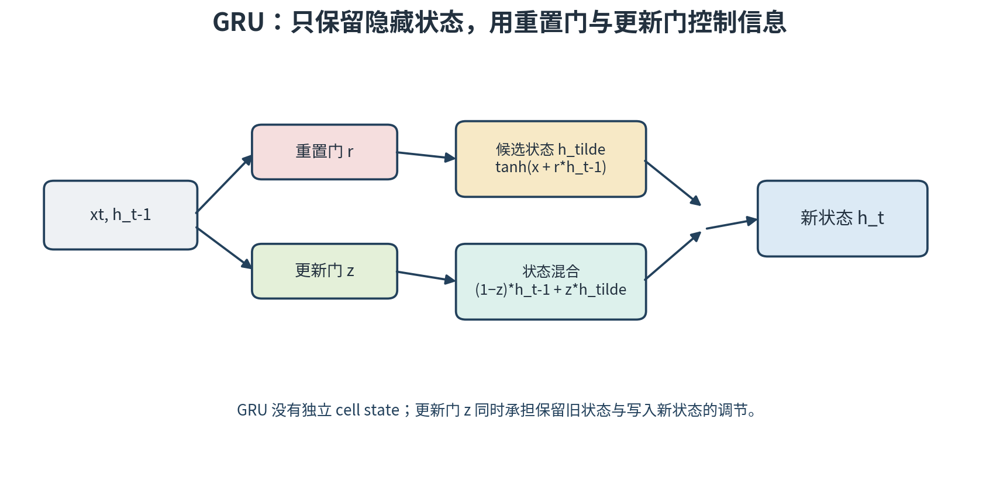

## C.1 GRU 的核心结构

GRU 主要包含重置门（reset gate）与更新门（update gate），没有 LSTM 那样独立的记忆单元 `c_t`。一种与书中计算图相对应的写法为：

$$
z_t=\sigma(x_tW_x^{(z)}+h_{t-1}W_h^{(z)}+b^{(z)})
$$

$$
r_t=\sigma(x_tW_x^{(r)}+h_{t-1}W_h^{(r)}+b^{(r)})
$$

$$
\tilde h_t=\tanh\left(x_tW_x+(r_t\odot h_{t-1})W_h+b\right)
$$

$$
\boxed{h_t=(1-z_t)\odot h_{t-1}+z_t\odot\tilde h_t}
$$

其中：

- `z_t`：更新门，控制旧状态与候选状态的混合比例；
- `r_t`：重置门，控制计算候选状态时保留多少过去信息；
- `h~_t`：候选隐藏状态；
- `⊙`：对应元素相乘。

**记忆法：**重置门影响“生成候选状态时，过去信息参与多少”；更新门影响“最终状态保留旧状态还是采用新候选状态”。不同教材对更新门符号与插值方向可能采用互补记法，比较公式时必须看清定义，不能只看门的名称。

## C.2 GRU 与 LSTM 对比

| 比较维度 | LSTM | GRU |
|---|---|---|
| 状态 | 隐藏状态 `h_t` + 记忆单元 `c_t` | 只有隐藏状态 `h_t` |
| 门控 | 输入门、遗忘门、输出门 | 更新门、重置门 |
| 结构 | 相对复杂，显式控制记忆单元 | 相对简洁，门较少 |
| 参数量/计算 | 通常较多 | 通常较少 |
| 选择 | 适合需要显式记忆通路的设计 | 可作为较轻量的门控循环单元 |

不能仅凭结构复杂程度断言哪个模型一定效果更好。需要根据数据规模、任务、算力与验证集表现比较。

---

# 全书的知识联系：从词向量到 Attention


全书不是孤立介绍若干模型，而是逐步解决前一种方法留下的问题：

| 阶段 | 代表方法 | 主要解决的问题 | 局限或下一步动机 |
|---|---|---|---|
| 词义表示 | 词典 / 共现矩阵 / PPMI-SVD | 如何把词变为可计算的向量 | 词典需人工维护；统计方法扩展与稀疏问题 |
| 分布式表示学习 | CBOW / Skip-gram | 从上下文预测目标词，自动学习词向量 | 大词表 Softmax 计算昂贵 |
| 训练加速 | Embedding / Negative Sampling | 避免稠密 one-hot 乘法与全词表分类 | 仍然只得到静态词向量，缺乏序列状态 |
| 序列建模 | RNN / RNNLM | 将过去信息递归传递，预测下一个词 | 长依赖训练中梯度消失/爆炸 |
| 门控记忆 | LSTM / GRU | 控制信息写入、保留、输出 | 递归计算仍按时间步进行；序列到序列仍有压缩问题 |
| 序列转换 | seq2seq | 将一个序列编码为另一个序列 | 单一固定长度向量成为信息瓶颈 |
| 动态信息选择 | Attention | 每个输出时刻按需访问输入位置 | 可扩展为更通用的注意力架构 |
| 更广泛应用 | GNMT / Transformer / NTM | 把 Attention 用于翻译、序列建模、外部存储 | 需要继续学习后续专门理论与工程细节 |

## 关键概念间的五条主线

1. **分布式假设 → 共现矩阵 → 词向量**：词的含义可由其上下文使用模式反映；相似上下文会促使词向量相近。
2. **CBOW/Skip-gram → Embedding/负采样**：建模目标不变，改变计算结构与训练近似方式以适应大词表。
3. **语言模型 → RNN → LSTM/GRU**：从预测下一个词出发，需要状态记忆序列；再通过门控解决普通 RNN 长时间反向传播不稳定的问题。
4. **RNNLM → seq2seq → Attention**：先从单序列预测扩展到输入输出序列转换；再由固定上下文改为每个输出动态检索输入信息。
5. **Attention → Transformer/NTM**：注意力从 RNN 解码器中的一个层，扩展为序列关系建模和外部存储访问的一般机制。

---

# 全书核心公式速查表

| 主题 | 公式 | 公式表达的意思 |
|---|---|---|
| 向量内积 | `x·y = Σ_i x_i y_i` | 两个向量对应元素乘积求和 |
| 全连接 | `y=xW+b` | 线性变换 |
| Softmax | `y_k=e^{x_k}/Σ_j e^{x_j}` | 将分数归一化为概率 |
| 交叉熵 | `L=-Σ_k t_k log y_k` | 衡量预测分布与正确标签的差异 |
| 梯度下降 | `θ←θ-η∇_θL` | 沿损失下降方向更新参数 |
| 余弦相似度 | `cos(x,y)=x·y/(||x||||y||)` | 忽略长度后比较方向 |
| PMI | `PMI(x,y)=log[P(x,y)/(P(x)P(y))]` | 衡量共现是否高于独立预期 |
| PPMI | `max(0,PMI)` | 只保留正向关联 |
| CBOW | `h=(1/C)Σ_i v(w_i)` | 上下文词向量平均后预测目标词 |
| Skip-gram | `P(w_{t+j}|w_t)` | 用中心词预测周围上下文 |
| Sigmoid | `σ(x)=1/(1+e^{-x})` | 门控/二分类输出 |
| 二分类交叉熵 | `L=-[t log y+(1-t)log(1-y)]` | 正负样本判别损失 |
| 负采样目标 | `-logσ(s_pos)-Σ_j logσ(-s_neg,j)` | 拉高正例得分、压低负例得分 |
| 语言模型分解 | `P(w_1,...,w_T)=Π_tP(w_t|w_{<t})` | 联合概率按链式法则分解 |
| RNN | `h_t=tanh(x_tW_x+h_{t-1}W_h+b)` | 当前状态由输入和前一状态共同决定 |
| 梯度裁剪 | `g←g·(threshold/||g||)`（超阈值时） | 限制梯度范数 |
| LSTM 输出门 | `o_t=σ(x_tW_x^o+h_{t-1}W_h^o+b^o)` | 控制记忆单元信息对外暴露多少 |
| LSTM 遗忘门 | `f_t=σ(x_tW_x^f+h_{t-1}W_h^f+b^f)` | 控制旧记忆保留比例 |
| LSTM 候选 | `g_t=tanh(x_tW_x^g+h_{t-1}W_h^g+b^g)` | 候选新记忆 |
| LSTM 输入门 | `i_t=σ(x_tW_x^i+h_{t-1}W_h^i+b^i)` | 控制写入多少新记忆 |
| LSTM 记忆 | `c_t=f_t⊙c_{t-1}+i_t⊙g_t` | 旧记忆保留与新记忆写入 |
| LSTM 隐状态 | `h_t=o_t⊙tanh(c_t)` | 门控后的可见状态 |
| 困惑度 | `PPL=exp(-平均 log P)` | 语言模型预测不确定性的指标，越低通常越好 |
| Attention score | `s_{t,i}=q_t·h_i^{enc}` | Decoder 对输入位置打分 |
| Attention 权重 | `a_{t,i}=softmax_i(s_{t,i})` | 归一化的输入关注分布 |
| Context | `c_t=Σ_i a_{t,i}h_i^{enc}` | 当前输出时刻的动态上下文 |
| 双向状态 | `h_t=[→h_t;←h_t]` | 拼接前向和后向表示 |

> 说明：公式速查表省略了部分矩阵维度、批处理维度与偏置广播细节。实际编码时，应根据所在层的输入/输出 shape 做一致性检查。

---

# 从零复现全书模型：建议代码路线

下列路线对应原书“从零创建”的学习方法。先保证小规模数据、短序列和单元测试通过，再扩大词表、隐藏维度与训练集。

## 1. 工程结构

```text
project/
├── common/
│   ├── layers.py        # MatMul, Affine, SoftmaxWithLoss, Embedding 等
│   ├── time_layers.py   # TimeEmbedding, TimeRNN, TimeLSTM, TimeAffine 等
│   ├── optimizer.py     # SGD, Adam 等优化器
│   ├── trainer.py       # 通用训练器
│   └── util.py          # 预处理、梯度裁剪、评价函数
├── dataset/
│   └── ptb.py           # PTB 语料加载
├── ch02/                # 共现矩阵、PPMI、SVD
├── ch03/                # CBOW / Skip-gram
├── ch04/                # Embedding / Negative Sampling
├── ch05/                # SimpleRnnlm
├── ch06/                # LSTM / BetterRnnlm
├── ch07/                # Seq2seq / PeekySeq2seq
└── ch08/                # AttentionSeq2seq
```

## 2. 推荐实现顺序

1. **数学与基本层**：先实现 MatMul、Affine、SoftmaxWithLoss，验证前向 shape 和反向梯度。
2. **文本处理**：实现 `preprocess()`、`create_co_matrix()`、`cos_similarity()`、`most_similar()`。
3. **静态词向量**：实现 PPMI/SVD，再实现 CBOW；小语料先跑通，再做 Embedding 和负采样加速。
4. **RNN**：实现单步 RNN、TimeRNN、BPTT 与截断 BPTT，训练简单 RNNLM。
5. **门控网络**：实现 LSTM、TimeLSTM；在相同数据集和评价协议下比较 RNNLM 与 LSTM LM。
6. **序列生成**：实现采样循环，确保能从起始 token 生成直到 `<eos>` 或长度上限。
7. **seq2seq**：先完成加法数据集上的普通 Encoder–Decoder，再逐一比较 Reverse 与 Peeky。
8. **Attention**：独立实现 Attention Weight 与 Weight Sum，做数值检查和可视化，再集成进 seq2seq。

## 3. 建议的最小单元测试

- 矩阵乘积：检查 `A.shape=(N,D)`、`W.shape=(D,H)`、`Y.shape=(N,H)`。
- Softmax：每行概率和约等于 1；输入整体加同一个常数时概率不变。
- Embedding：查表结果与权重对应行相同；重复 ID 的梯度应累加而非覆盖。
- RNN/LSTM：输入输出 shape 正确；单步与 Time 层逐时刻循环结果一致。
- BPTT：用数值微分抽样检查解析梯度。
- PPL：若目标 token 概率整体提高，平均负对数似然与 PPL 应下降。
- seq2seq：Decoder 训练输入与标签相差一个时间步；`<eos>` 能终止生成。
- Attention：权重非负、每个样本沿输入时间轴求和约为 1；若所有输入向量相同，权重变化不应改变 Context 的向量方向/内容。

---

# 易错点与诊断清单

| 现象 | 常见原因 | 检查方向 |
|---|---|---|
| 矩阵乘法 shape error | 把行列方向弄反 | 明确每个矩阵最后两维，检查内维相等 |
| Embedding 梯度不正确 | 对重复词 ID 使用赋值覆盖 | 使用累加操作（如 `np.add.at`） |
| PPMI 出现负无穷或 NaN | 某个词频/共现计数为 0 | 加平滑或只对有效正计数计算；检查对数输入 |
| 词向量相似词很奇怪 | 语料太小、停用词影响、词频分布偏斜 | 扩大语料、检查窗口、PPMI 与降维设置 |
| CBOW 学习慢 | 每次对整个大词表做 Softmax | 使用 Embedding 与负采样 |
| RNN 训练损失突然变 NaN | 梯度爆炸或数值不稳定 | 检查梯度范数、学习率、初始化与梯度裁剪 |
| RNN 不能记住远距离信息 | 梯度消失 | 比较 LSTM/GRU，检查序列长度与状态处理 |
| RNNLM PPL 异常 | 数据错位、隐藏状态重置不当、目标移位错误 | 检查 `xs` 与 `ts` 是否错开一位、状态是否跨 batch 合理延续 |
| 生成结果重复或退化 | 贪心策略过强、模型过拟合或分布尖锐 | 对比采样与贪心，检查模型与训练语料 |
| seq2seq 训练不收敛 | Decoder 输入目标错位或编码信息不足 | 检查 start/eos、Reverse、Peeky 及数据预处理 |
| Attention 权重全平均 | Score 未学习、mask 或维度轴错误 | 检查分数、Softmax 轴、梯度传播与训练数据 |
| Attention 图像看似错位 | token 顺序与绘图轴标签不一致 | 同时检查 Encoder 输入顺序和 Decoder 目标顺序 |

---

# 自测题：检验是否真正理解

建议先遮住答案独立作答，再对照要点检查。题目从概念到公式再到建模设计逐步提升。

## A. 概念题

1. 分布式假设是什么？它如何支持从上下文学习词向量？
2. 同义词词典法与基于计数的方法各有什么优缺点？
3. CBOW 与 Skip-gram 的输入、预测目标分别是什么？
4. 为什么 Embedding 层能替代 one-hot 与稠密矩阵乘法？
5. 为什么负采样能降低 word2vec 的训练成本？
6. RNN 与普通前馈网络处理序列时最本质的区别是什么？
7. 为什么 BPTT 会在长序列上产生梯度消失/爆炸问题？
8. LSTM 中 `c_t` 与 `h_t` 有何区别？
9. GRU 相比 LSTM 少了什么状态结构？
10. 为什么 seq2seq 可以处理输入与输出长度不相同的任务？
11. Reverse 与 Peeky 分别改变了什么？
12. Attention 如何突破固定长度向量瓶颈？

## B. 公式推导题

1. 从 `y=xW` 推导 `∂L/∂x=(∂L/∂y)W^T`。
2. 写出 PMI 与 PPMI，并解释为什么需要 PPMI。
3. 写出 CBOW 的上下文平均向量与负采样损失。
4. 从概率链式法则推导语言模型的序列概率。
5. 写出 RNN 隐藏状态递推式及 BPTT 中的时间依赖。
6. 写出 LSTM 四个门/候选量及记忆状态更新公式。
7. 写出 Attention 的 score、归一化权重和 context vector。
8. 写出 sigmoid 与 tanh 的导数。

## C. 设计题

1. 词汇量从 1 万变为 100 万，CBOW 中哪些计算会成为瓶颈？如何按书中方法优化？
2. 需要预测很长文本的下一个词，应如何比较 RNN、LSTM 与 GRU？
3. 需要把一段输入转成不同长度输出，如何构建 Encoder–Decoder？
4. 当输入句子变长时，为什么 Attention 通常比只传递最终隐藏状态更有优势？
5. 如果 Attention 热力图一直呈均匀分布，你会从哪些维度排查？

<details>
<summary>自测题参考要点（点击展开）</summary>

- 分布式假设：相似上下文中的词往往具有相似含义；从上下文统计中构造或学习向量。
- 词典法：可解释、人工语义关系明确，但覆盖维护成本高、难表示细微和新语义；计数法自动从语料抽取，但受语料和频率分布影响。
- CBOW：上下文预测中心词；Skip-gram：中心词预测上下文。
- Embedding：把 ID 当作矩阵行索引直接查表；反向传播只更新被选行。
- 负采样：只训练正例和少数采样负例，避免对全词表逐类计算。
- RNN：状态递归携带历史信息；前馈网络不具备该循环状态通路。
- BPTT：时间步的 Jacobian 连乘，反复乘小于 1 的因子导致消失，乘大于 1 的因子导致爆炸。
- LSTM：`c_t` 是内部长期记忆通路；`h_t` 是当前对外输出状态。
- GRU：没有独立 `c_t`，通过 reset/update 两个门调节隐藏状态。
- seq2seq：Encoder 与 Decoder 分别处理输入、输出，输出按自回归方式逐步生成。
- Reverse：反转源序列；Peeky：把编码向量广播给 Decoder 的多个层/时刻。
- Attention：每个输出步对所有 Encoder 状态算权重并加权求和。
- `∂L/∂x=(∂L/∂y)W^T`；`PMI=log(P(x,y)/(P(x)P(y)))`；`PPMI=max(0,PMI)`。
- CBOW：`h=(1/C)Σ_i v(w_i)`；负采样损失：`-logσ(s_pos)-Σ_jlogσ(-s_neg,j)`。
- 语言模型：`P(w_1,...,w_T)=Π_tP(w_t|w_1,...,w_{t-1})`。
- RNN：`h_t=tanh(x_tW_x+h_{t-1}W_h+b)`。
- LSTM：`f=σ(...)`，`g=tanh(...)`，`i=σ(...)`，`o=σ(...)`，`c=f⊙c_prev+i⊙g`，`h=o⊙tanh(c)`。
- Attention：`s_i=q·h_i`，`a_i=softmax(s_i)`，`c=Σ_i a_i h_i`。
- sigmoid 导数：`σ(1-σ)`；tanh 导数：`1-tanh²`。

</details>

---

# 术语表

| 英文 | 中文 | 在本书中的含义 |
|---|---|---|
| NLP | 自然语言处理 | 让计算机处理人类语言的技术领域 |
| Corpus | 语料库 | 用于统计或训练的文本集合 |
| Vocabulary | 词表 | 词与 token ID 的映射集合 |
| One-hot | 独热表示 | 只有目标位置为 1 的稀疏向量 |
| Distributed Representation | 分布式表示 | 用稠密向量表示词的语义/用法特征 |
| Co-occurrence | 共现 | 两词在指定上下文窗口中共同出现 |
| PMI / PPMI | 点互信息 / 正点互信息 | 衡量词对的统计关联程度 |
| SVD | 奇异值分解 | 将矩阵分解为低维因子，用于降维 |
| CBOW | 连续词袋模型 | 根据上下文预测中心目标词 |
| Skip-gram | 跳字模型 | 根据中心词预测上下文词 |
| Embedding | 嵌入层 | 通过 ID 查表取得稠密向量 |
| Negative Sampling | 负采样 | 只用正例和少数负例近似训练目标 |
| RNN | 循环神经网络 | 通过递归隐藏状态处理序列 |
| BPTT | 随时间反向传播 | 对展开后的 RNN 沿时间轴反向传播 |
| Truncated BPTT | 截断 BPTT | 把长序列分块反向传播 |
| LSTM | 长短期记忆网络 | 通过门控与记忆单元改善长期依赖学习 |
| GRU | 门控循环单元 | 以更新门和重置门控制隐藏状态 |
| PPL | 困惑度 | 语言模型的预测不确定性指标 |
| Encoder | 编码器 | 将输入序列转为内部表示 |
| Decoder | 解码器 | 根据条件逐步生成目标序列 |
| seq2seq | 序列到序列 | 输入序列转换为输出序列的模型框架 |
| Teacher Forcing | 教师强制 | 训练解码器时输入真实前一 token |
| Reverse | 输入反转 | 反转源序列次序以改善信息传播距离 |
| Peeky | 偷窥结构 | 在 Decoder 多处使用 Encoder 的固定向量 |
| Attention | 注意力机制 | 根据当前查询动态选择并聚合输入信息 |
| Alignment | 对齐 | 输入与输出位置之间的对应关系 |
| Context Vector | 上下文向量 | Attention 对输入表示加权求和得到的向量 |
| Bidirectional RNN | 双向 RNN | 同时利用前向和后向上下文 |
| Skip Connection | 跳跃连接 | 跨层传递信息与梯度的连接路径 |
| Transformer | Transformer | 以 Attention 为核心的序列模型架构 |
| NTM | 神经图灵机 | 结合神经网络与外部可读写存储器 |
| WordNet | WordNet 词汇网络 | 以 synset 和语义关系组织词义的知识资源 |

---

# 学习顺序与最终验收标准

如果希望真正“吃透”，建议按以下次序完成，而不是只背模型名称：

1. **画图**：不看笔记，画出 CBOW、RNN 展开、LSTM、seq2seq、Attention 的结构图。
2. **写式子**：不查资料，写出 PPMI、CBOW、负采样、RNN、LSTM、GRU、Attention 的核心公式。
3. **说原因**：解释每个新方法是为了解决上一方法的哪一个具体问题。
4. **看维度**：对每个前向传播步骤标注 batch、time、feature、vocabulary 维度。
5. **做实验**：至少跑通一个小语料词向量实验、一个 PTB 语言模型实验、一个加法 seq2seq 实验和一个日期转换 Attention 实验。
6. **做对比**：对比 CBOW/Skip-gram、RNN/LSTM/GRU、普通 seq2seq/Reverse/Peeky/Attention，并记录同一数据划分下的训练曲线和评价指标。

当你能做到“解释动机、推导公式、画出数据流、写出主要代码、解释失败现象、比较替代方法”，才算真正掌握了本书的核心体系。

---

## 关于本笔记的范围

本笔记按原书目录覆盖 8 章和附录 A/B/C 的主要概念、关键公式、模型结构、实现思路、实验与章节间联系，并对公式符号、张量形状和易错点做了学习型整理。它是**学习笔记与知识体系重组**，不是原书逐页逐字复刻，也不包含原书所有代码清单、每个实验输出与全部图片。对于原书仅作概览介绍的 GNMT、Transformer、NTM 等主题，笔记也明确按概念层级整理，没有把它们扩写成书中并未提供的完整教程。

文中自绘图均为教学示意图，用于解释机制；图片不是原书扫描页。若要保留图片，请将本 Markdown 文件与同级 `figures/` 文件夹一起使用，或直接解压配套 ZIP 资料包。
