# 本书理论部分
# 老虎机问题
## 机器学习分类与强化学习
监督学习：提供输入和输出的数据对
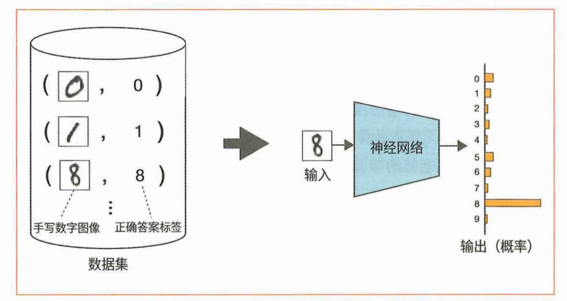
无监督学习：目标是找到隐藏在数据中的结构和模式
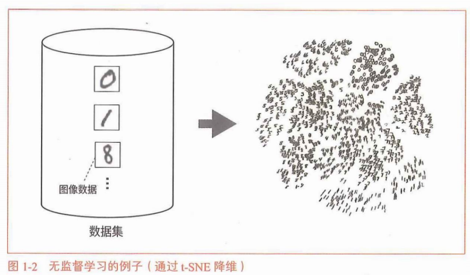
强化学习：智能代理和环境相互作用


$$
三者对比
\begin{cases}
 监督学习：使用带有输入和输出（正确答案标签）的成对数据，学
习如何将输入转化为输出。\\
 无监督学习：使用没有“正确答案标签”的数据来学习数据中的基
本结构。\\
强化学习：学习如何使用智能代理在与环境互动时收集的数据获得
更高的奖励。
\end{cases}
$$

## 老虎机问题（具有强化学习所处理的问题的基本特征）

### 老虎机算法
```python
求平均值实现
import numpy as np
np. random.seed(0) #固定随机数种子
rewards =[]
for n in range(1, 11): # 从1到 10
rewa rd = np. random. rand() # 虚拟的奖励
rewards. append (rewa rd)#往列表的末尾追加一个元素。
Q = sum(rewards) / n
print(Q)
```
### 代码改进
```python
Q = 0
for n in ranged, 11):
reward = np.random.rand()
Q = Q + (reward - Q) / n
print(Q)
```

### 玩家策略
强化学习算法最终归结为如何在“利用”和“探索”之间取得平衡。 为了取得这种平衡，人们提出了各种算法。这些算法既有简单的，也有复
杂的，其中最基本、最常用的是esp-greedy算法。  
<span style="color: #ff4444;">esp-greedy算法：</span>以esp的概率［如以s = 0.1
（10%）的概率］进行“探索”，以1-esp的概率进行“利用”的方法。
## 老虎机算法实现
### 老虎机的实现
老虎机的价值——老虎机返回的奖励的期望值——老虎机的胜率
定义为Bandit类

```python
import numpy as np
class Bandit:
def init (self, arms=10):
self. rates = np. random. rand(arms)# 初始化：arms=10台老虎机，self.rates 是【实例自己存的胜率数组】
def play(self, arm):
rate = self.rates[arm]
if rate > np.random.rand():# ✅ 从实例自己的rates里面取出这台机器的胜率
return 1
else:
return 0
```
实现
```python
bandit = Bandit()
for i in range(3):
print(bandit.play(0))
```
只考虑第0台老虎机
```python
bandit = Bandit()
Q = 0
for n in ranged, 11):
reward = bandit. play(0) # 玩第 0 台老虎机
Q += (rewa rd - Q) / n
print(Q)
```
计算
10台老虎机中每台老虎机价值的估计值
```python
bandit = Bandit()
Qs = np.zeros(10)
ns = np.zeros(10)
for n in range(10):
action = np. random. randint(0, 10) # 随机行动
rewa rd = bandit.play(action)
ns[action] += 1
Qs[action] += (rewa rd - Qs[action]) / ns[action]
print(Qs)
```
### 智能代理的实现
选择行动算法(基于$\varepsilon\text{-greedy}$
算法)
```python
class Agent:
    def __init__(self, epsilon, action_size=10):
        self.epsilon = epsilon          # ε：探索概率
        self.Qs = np.zeros(action_size) # Qs：每个动作的估计Q值，初始全0
        self.ns = np.zeros(action_size) # ns：每个动作被选择的次数，初始全0

    def update(self, action, reward):
        self.ns[action] += 1  # 该动作计数+1
        # 增量式平均公式，更新Q值
        self.Qs[action] += (reward - self.Qs[action]) / self.ns[action]

    def get_action(self):
        if np.random.rand() < self.epsilon:
            # 探索：随机选一个臂
            return np.random.randint(0, len(self.Qs))
        # 利用：选当前Q最大的臂
        return np.argmax(self.Qs)
```


# 马尔可夫决策过程MDP（情况随智能代理的行动而变化的问题）

## MDP
决策过程是智能代理通过与环境互动决定其行动的过程
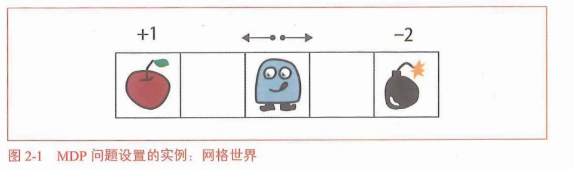
机器人就是“智能代理”，它的周围是“环境”。
智能代理目标：实现奖励总和最大化。
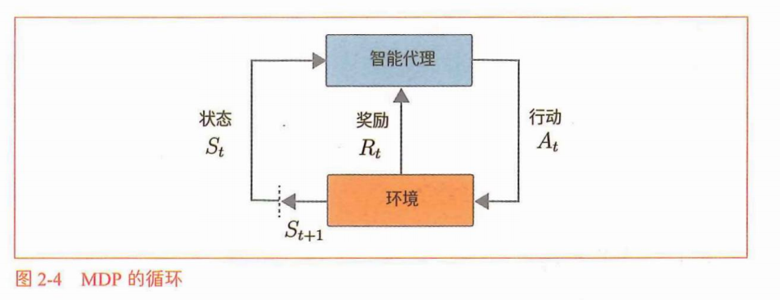

## 环境和智能代理的数学表示
### 状态迁移
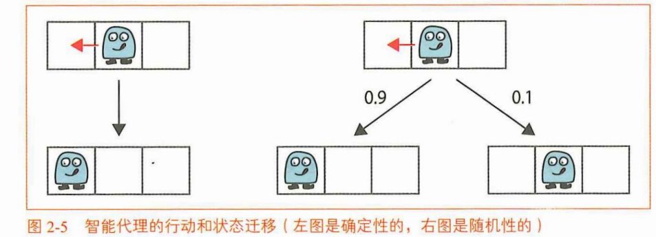
行动表示为函数形式：
$$s' = f(s,a)$$
$f(s,a)$ 是一个给定输入状态 $s$ 和行动 $a$，输出下一个状态 $s'$ 的函数。这个 $f(s,a)$ 被称为状态迁移函数。  
随机性状态迁移—状态迁移概率
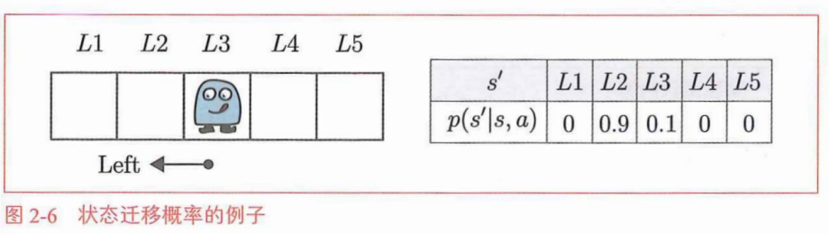
$$p(s' \mid s, a)$$
对于当前问题，条件对应于在状态选择了行动a。  
马尔科夫性——状态迁移不需要过去的信息——此前处于什么状态以及执行了哪些行动
### 奖励函数
定义：$$r(s,a,s')$$
当智能代理处于状态 $s$、执行行动 $a$、转移到下一个状态 $s'$ 时，得到的奖励由函数 $r(s,a,s')$ 定义。
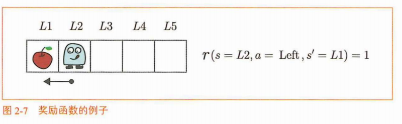
### 智能代理的策略
策略表示智能代理如何决定其行动。策略的关键在于它使得智能代理仅根据当前状态来决定其行动。
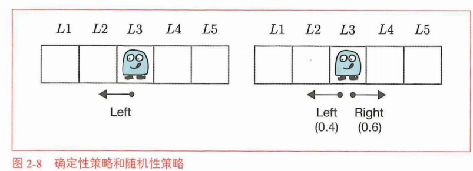
确定性策略定义：
$$a = \mu(s)$$
$\mu(s)$是以给定的状态作为参数并返回行动a的函数。   
由随机性策略：
$$\pi(a \mid s)$$
$\pi(a \mid s)$表示在状态s下采取行动a的概率。
$$\pi(a=\text{Left} \mid s=L3) = 0.4$$
$$\pi(a=\text{Right} \mid s=L3) = 0.6$$

## MDP目标
MDP目标：找到最优策略（optimal policy）。
### 回合制任务和连续性任务
回合制任务是有“结束”的问题。连续性任务则是没有“结束”的问题。
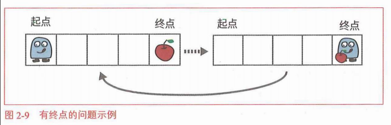
### 收益
收益：
$$G_t = R_t + \gamma R_{t+1} + \gamma^2 R_{t+2} + \cdots$$
- $S_t$：t时刻状态
- $A_t$：t时刻动作
- $R_t$：t时刻得到的奖励
- $\pi$：策略（根据状态选动作的规则）
- $S_{t+1}$：下一个时刻的状态    
收益被表示为智能代理获得的奖励之和。不过，随着时间的推移，奖励会被y指数级削弱。这个γ被称为折现率。
设置折现率可以防止收益的发散（针对连续性任务）。
### 状态的价值函数
收益的期望值的数学式：
$$v_\pi(s) = \mathbb{E}\left[G_t \mid S_t = s, \pi\right]$$
$$v_\pi(s) = \mathbb{E}_\pi\left[G_t \mid S_t = s\right]$$
- $v_\pi(s)$：策略 $\pi$ 下状态 $s$ 的价值
- $\mathbb{E}$：数学期望
- $G_t$：时刻 $t$ 之后的总收益
- $S_t = s$：t时刻当前状态为 $s$
- $\pi$：智能代理执行的策略
智能代理的策略Π被作为条件给出。
### 最优策略和最优价值函数
最优策略 $\boldsymbol{\pi^*}$
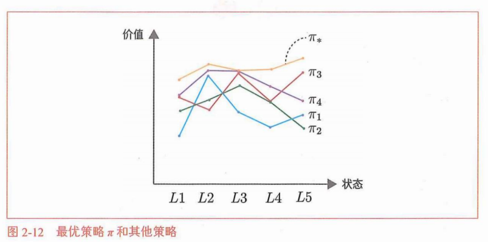
定义：对于所有状态，该策略对应的状态价值函数都大于等于其他任意策略的状态价值函数，也就是能拿到最大期望收益的策略。   
重要事实   
在MDP中，至少存在一个最优策略。此外，最优策略是确定性策略。在确定性策略中，每个状态下的行动是唯一确定的。用数学式可以表示为函数$\pi^*$，有 $a = \pi^*(s)$ 成立，当输入状态 $s$ 时，会输出行动 $a$。  
最优策略的状态价值函数叫作最优状态价值函数（optimal state-value
function）。使用$v^*$来表示最优状态价值函数。  

## MDP例子

### 回溯线形图
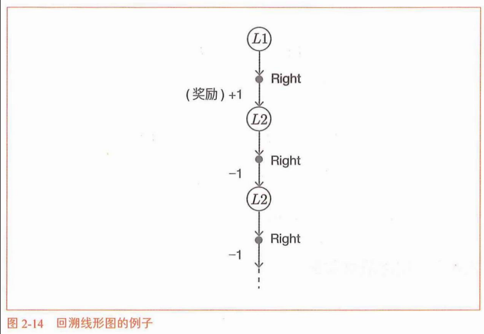
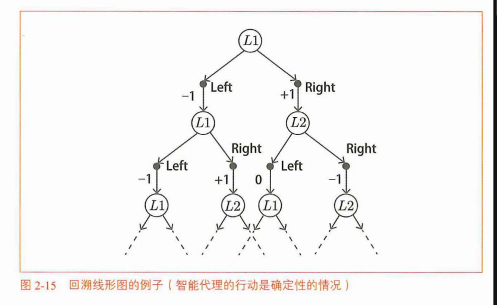
### 找出最优策略
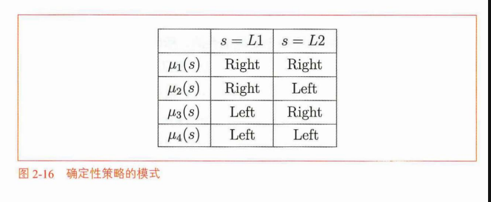
$$
\begin{align*}
v_{\mu_1}(s = L1) &= 1 + 0.9\times(-1) + 0.9^2\times(-1) + \cdots \\
&= 1 - 0.9\big(1 + 0.9 + 0.9^2 + \cdots\big) \\
&= 1 - \frac{0.9}{1 - 0.9} \\
&= -8
\end{align*}
$$
```python
v = 1
for i in ranged, 100):
V += -1 * (0.9 ♦* i)
print(V)#-7.9997
```
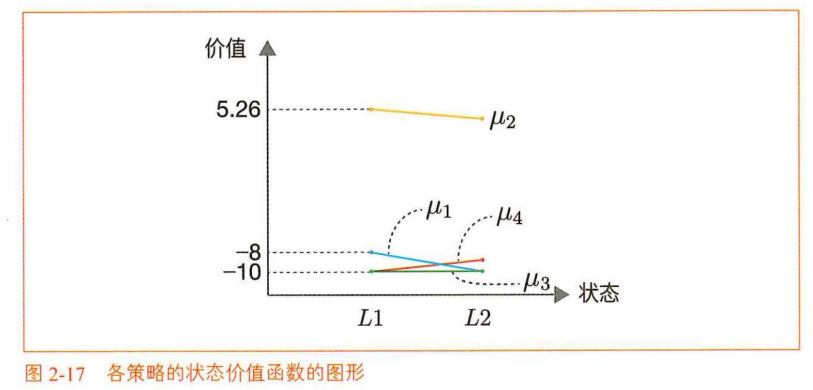
图中可以看出，在所有状态下，策略 $\mu_2$ 的状态价值函数的值都高于其他策略。因此，策略 $\mu_2$ 就是我们期望的最优策略。策略 $\mu_2$ 交替执行左右移动，不会撞到墙，在这个过程中可以持续获得奖励。由于已经得到了最优策略，我们也就实现了MDP的目标。

# 贝尔曼方程
## 贝尔曼方程推导
### 概率和期望值
### 贝尔曼方程推导
收益（回报）：
$$
G_t = R_t + \gamma R_{t+1} + \gamma^2 R_{t+2} + \cdots
$$
- $G_t$：从时刻 $t$ 开始的**回报（总收益）**
- $R_t$：第 $t$ 步获得的即时奖励
- $\gamma$：折现率（$0\le \gamma \le 1$），越往后的奖励价值越低
将t+1代入上式：
$$
G_{t+1} = R_{t+1} + \gamma R_{t+2} + \gamma^2 R_{t+3} + \cdots
$$
则：
$$
\begin{align*}
G_t &= R_t + \gamma R_{t+1} + \gamma^2 R_{t+2} + \cdots \\
&= R_t + \gamma \big(R_{t+1} + \gamma R_{t+2} + \cdots\big) \\
&= R_t + \gamma G_{t+1}
\end{align*}
$$  
收益 $G_t$ 代表**从时刻 $t$ 开始，未来所有奖励的折现总和**，不只是当前时刻的奖励 $R_t$。
$$G_t = R_t + \gamma R_{t+1} + \gamma^2 R_{t+2} + \dots$$
强化学习中智能体选择动作，需要兼顾当下奖励和未来长期奖励，因此 $t$ 时刻的收益需要纳入 $t+1,t+2,\dots$ 后续时刻的奖励；
$\gamma$ 为折现率，对远期奖励做衰减，一方面代表未来奖励价值更低，另一方面防止连续任务下收益无穷大、数值发散。

状态价值函数（收益的期望值）：
$$
\begin{align*}
v_\pi(s) &= \mathbb{E}_\pi\left[G_t \mid S_t = s\right] \\
&= \mathbb{E}_\pi\left[R_t + \gamma G_{t+1} \mid S_t = s\right] \\
&= \mathbb{E}_\pi\left[R_t \mid S_t = s\right] + \gamma \mathbb{E}_\pi\left[G_{t+1} \mid S_t = s\right]
\end{align*}
$$  
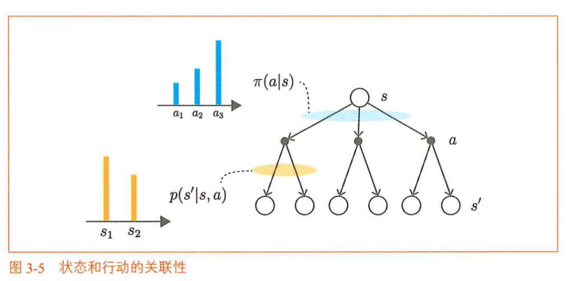  
马尔可夫决策过程分为两层随机过程：
1. 策略 $\pi(a|s)$：给定当前状态 $s$，以概率分布选择动作 $a$；蓝色柱状代表各个动作的选择概率。
2. 状态转移 $p(s'|s,a)$：在状态 $s$ 执行动作 $a$ 后，以概率分布转移到下一状态 $s'$；橙色柱状代表转移到不同后继状态的概率。

流程：状态 $s$ →（按策略抽样动作）→ 动作 $a$ →（按转移概率抽样）→ 新状态 $s'$
结论：下一状态 $s'$ 由智能体选择的动作 $a$，以及环境的转移随机性共同决定，由 $p(s' \mid s,a)$ 描述这个概率关系。  
贝尔曼方程：  
$$
\begin{aligned}
v_\pi(s) &= \mathbb{E}_\pi\left[R_t \mid S_t = s\right] + \gamma \mathbb{E}_\pi\left[G_{t+1} \mid S_t = s\right] \\
&= \sum_{a,s'} \pi(a|s)p(s'|s,a)r(s,a,s') + \gamma \sum_{a,s'} \pi(a|s)p(s'|s,a)v_\pi(s') \\
&= \sum_{a,s'} \pi(a|s)p(s'|s,a)\left\{r(s,a,s') + \gamma v_\pi(s')\right\}
\end{aligned}
$$

贝尔曼方程是表示状态 $s$ 的价值函数和下一个可能的状态 $s'$ 的价值函数之间关系的式子。这个贝尔曼方程对所有状态 $s$ 和所有策略 $\pi$ 都成立。

## 贝尔曼方程的例子
### 两个方格的世界
注:这次的问题中的状态迁移是确定性的。也就是说，状态的迁移由函数 $f(s,a)$ 决定，而不是概率 $p(s' \mid s,a)$。
- 如果 $s' = f(s,a)$，则 $p(s' \mid s,a) = 1$。
- 如果 $s' \neq f(s,a)$，则 $p(s' \mid s,a) = 0$。
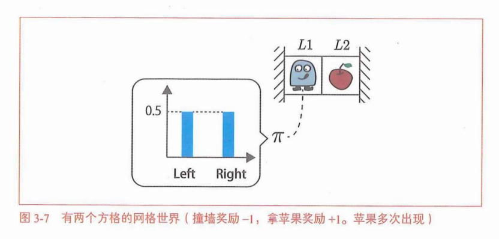
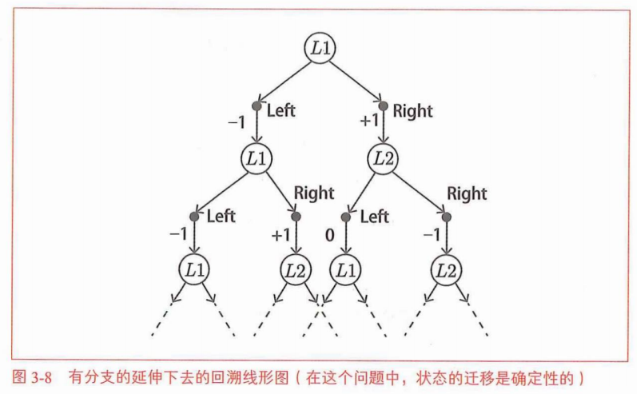

当 $s' = f(s,a)$ 时
$$
v_\pi(s) = \sum_{a} \pi(a \mid s)\left\{r(s,a,s') + \gamma v_\pi(s')\right\}
$$
状态L1下的贝尔曼方程：
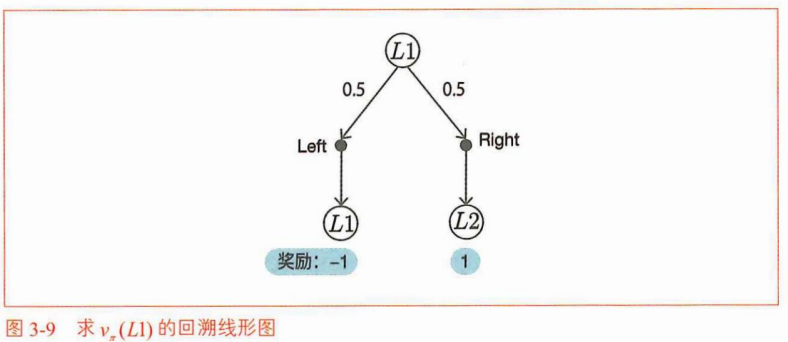
贝尔曼方程表示为如下形式：
$$
v_\pi(L1) = 0.5\left\{-1 + 0.9v_\pi(L1)\right\} + 0.5\left\{1 + 0.9v_\pi(L2)\right\}
$$
$$
-0.55v_\pi(L1) + 0.45v_\pi(L2) = 0
$$
状态L2下的贝尔曼方程：
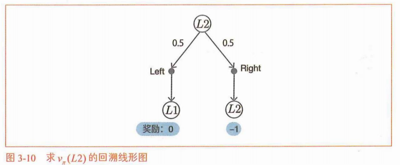
$$
v_\pi(L2) = 0.5\{0 + 0.9v_\pi(L1)\} + 0.5\{-1 + 0.9v_\pi(L2)\}
$$
$$
0.45v_\pi(L1) - 0.55v_\pi(L2) = 0.5
$$
联立：
$$
\begin{cases}
-0.55v_\pi(L1) + 0.45v_\pi(L2) = 0 \\
0.45v_\pi(L1) - 0.55v_\pi(L2) = 0.5
\end{cases}
$$
$$
\begin{cases}
v_\pi(L1) = -2.25 \\
v_\pi(L2) = -2.75
\end{cases}
$$
这就是随机性策略的状态价值函数。这意味着，当采取随机性策略时，处于状态 $L1$ 的情况下，未来期望收益为 $-2.25$。随机移动有可能撞墙，从而获得负奖励，该结果是合理的。$v_\pi(L1)$ 的值大于 $v_\pi(L2)$ 也很好理解：$L1$ 旁边就是苹果，执行动作时有50%的概率拿到苹果。
### 贝尔曼方程意义
贝尔曼方程能够将无限的计算转换为有限的联立方程。

## 行动价值函数与贝尔曼方程
### 行动价值函数
状态价值函数：
$$
v_\pi(s) = \mathbb{E}_\pi\left[G_t \mid S_t = s\right]
$$
状态价值函数有两个条件，分别是状态 $s$ 和策略 $\pi$。
行动价值函数：
$$
q_\pi(s,a) = \mathbb{E}_\pi\left[G_t \mid S_t = s, A_t = a\right]
$$
其中：a表示行动
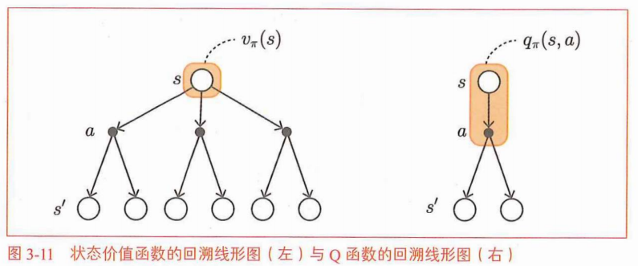
$$
\pi(a_1 \mid s)q_\pi(s,a_1) + \pi(a_2 \mid s)q_\pi(s,a_2) + \pi(a_3 \mid s)q_\pi(s,a_3)
=\sum_{a\in\{a_1,a_2,a_3\}} \pi(a \mid s)q_\pi(s,a)
$$
$$
v_\pi(s)=\sum_{a\in\{a_1,a_2,a_3\}} \pi(a \mid s)q_\pi(s,a)
$$
$$
v_\pi(s) = \sum_{a} \pi(a \mid s) q_\pi(s,a)
$$
### 行动价值函数的贝尔曼方程
$$
\begin{aligned}
q_\pi(s,a) &= \mathbb{E}_\pi\left[G_t \mid S_t = s,\, A_t = a\right] \\
&= \mathbb{E}_\pi\left[R_t + \gamma G_{t+1} \mid S_t = s,\, A_t = a\right]
\end{aligned}
$$
$$
\begin{aligned}
q_\pi(s,a) &= \mathbb{E}_\pi\left[R_t + \gamma G_{t+1} \mid S_t = s,A_t = a\right] \\
&= \sum_{s'} p(s' \mid s,a) \left\{ r(s,a,s') + \gamma \sum_{a'} \pi(a' \mid s')\, q_\pi(s',a') \right\}
\end{aligned}
$$
- $q_\pi(s,a)$：动作价值函数，状态$s$执行动作$a$，后续遵循策略$\pi$，得到的期望回报
- $\mathbb{E}_\pi[\cdot]$：按照策略$\pi$求数学期望
- $R_t$：$t$时刻获得的即时奖励
- $G_{t+1}$：$t+1$时刻起的未来总回报
- $\gamma$：折现率，$0\le\gamma\le1$，降低远期奖励的权重
- $p(s' \mid s,a)$：状态转移概率，状态$s$执行动作$a$，转移到$s'$的概率
- $r(s,a,s')$：从$s$执行$a$转移到$s'$获得的即时奖励
- $\pi(a' \mid s')$：策略，在状态$s'$选择动作$a'$的概率
- $s'$：下一状态；$a'$：下一状态选择的动作

## 贝尔曼最优方程
### 状态价值函数的贝尔曼最优方程
$$
v_*(s) = \sum_{a}\pi_*(a \mid s)\sum_{s'} p(s' \mid s,a) \left\{ r(s,a,s') + \gamma v_*(s') \right\}
$$
- $\pi_*(a \mid s)$：最优策略，在状态$s$下选择动作$a$的概率，遵循该策略可以获得最大的期望回报  
贝尔曼最优方程：
$$
v_*(s) = \max_{a}\sum_{s'} p(s' \mid s,a) \left\{ r(s,a,s') + \gamma v_*(s') \right\}
$$
### Q函数的贝尔曼最优方程
$$
q_*(s,a) = \sum_{s'} p(s' \mid s,a) \left\{ r(s,a,s') + \gamma \max_{a'} q_*(s',a') \right\}
$$

## 贝尔曼最优方程的示例
### 应用内尔曼最优方程
当 $s' = f(s,a)$ 时
$$
v_*(s) = \max_{a}\left\{ r(s,a,s') + \gamma v_*(s') \right\}
$$
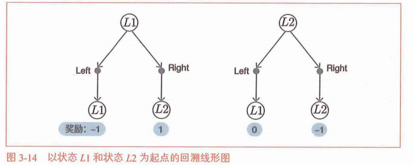
$$
v_*(L1) = \max
\begin{cases}
-1 + 0.9v_*(L1), \\
1 + 0.9v_*(L2)
\end{cases}
$$
$$
v_*(L2) = \max
\begin{cases}
0.9v_*(L1), \\
-1 + 0.9v_*(L2)
\end{cases}
$$
$$
v_*(L1) = 5.26
$$
$$
v_*(L2) = 4.73
$$
### 得到最优策略
状态s下的最优行动：
$$
\mu_*(s) = \arg\max_{a} q_*(s,a)
$$
$$
q_\pi(s,a) = \sum_{s'} p(s' \mid s,a) \big\{ r(s,a,s') + \gamma v_\pi(s') \big\}
$$
$$
\mu_*(s) = \arg\max_{a}\sum_{s'} p(s' \mid s,a) \big\{ r(s,a,s') + \gamma v_*(s') \big\}
$$
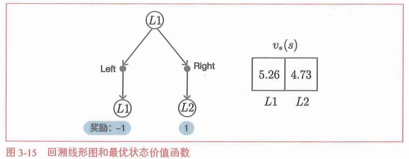
可以采取的行动有 Left 和 Right 这两个。此时如果采取行动 Left，那么智能代理就会进入状态 $s_1$，并获得奖励 $-1$。
$$
-1 + 0.9v_*(s_1) = -1 + 0.9 \times 5.26 = 3.734
$$
另外，如果采取了行动 Right，那么智能代理就会进入状态 $s_2$，并获得奖励 $1$。
$$
1 + 0.9v_*(s_2) = 1 + 0.9 \times 4.73 = 5.257
$$
如果在这两个值之间选择带来最大值的行动，那就是行动 Right。这意味着在状态 $s$ 下的最佳行动是 Right。
通过同样的计算可知在状态 $s_2$ 下的最佳行动是 Left。这样就求出了最优策略。


## 小 结
强化学习的最终目标是得到最优策略。我们在本章中还学习了贝尔曼最优方程。贝尔曼最优方程是对最优策略成立的特殊的贝尔曼方程。只要知道最优策略的价值函数，就很容易得到最优策略。  
【贝尔曼方程】
$$
v_\pi(s)=\sum_{a,s'}\pi(a\mid s)p(s'\mid s,a)\big\{r(s,a,s')+\gamma v_\pi(s')\big\}
$$
$$
q_\pi(s,a)=\sum_{s'}p(s'\mid s,a)\left\{r(s,a,s')+\gamma\sum_{a'}\pi(a'\mid s')q_\pi(s',a')\right\}
$$
【贝尔曼最优方程】
$$
v_*(s)=\max_{a}\sum_{s'}p(s'\mid s,a)\big\{r(s,a,s')+\gamma v_*(s')\big\}
$$
$$
q_*(s,a)=\sum_{s'}p(s'\mid s,a)\left\{r(s,a,s')+\gamma\max_{a'}q_*(s',a')\right\}
$$
【最优策略】
$$
\begin{aligned}
\mu_*(s) &= \arg\max_{a} q_*(s,a) \\
&= \arg\max_{a}\sum_{s'}p(s'\mid s,a)\big\{r(s,a,s')+\gamma v_*(s')\big\}
\end{aligned}
$$


# 动态规划法——DP
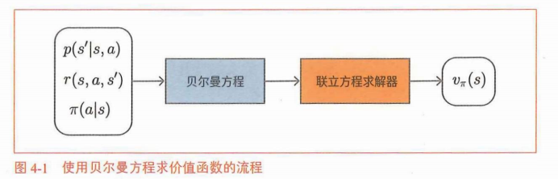
## 动态规划法和策略评估
强化学习两项任务：策略评估、策略控制。
策略评估是求给定策略 $\pi$ 的价值函数 $v_\pi(s)$ 和 $q_\pi(s,a)$。而策略控制是控制策略并将其调整为最优策略。
### 动态规划法简介
$$
V_{k+1}(s)=\sum_{a,s'}\pi(a\mid s)p(s'\mid s,a)\big\{r(s,a,s')+\gamma V_k(s')\big\} \
$$

这里用 $V_{k+1}(s)$ 表示第 $k+1$ 次进行更新的价值函数，用 $V_k(s)$ 表示第 $k$ 次进行更新的价值函数。$V_{k+1}(s)$ 和 $V_k(s)$ 是“推测值”，它们与真正的价值函数 $v(s)$ 不同。因此，我们用大写的 $V$ 来表示它们。  
自举法：用估计值 $V_k(s')$ 来改进另一个估计值 $V_{k+1}(s)$。
### 尝试迭代策略评估
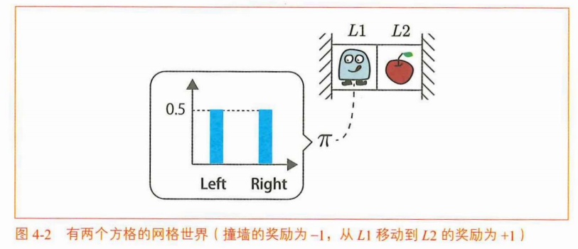  
这个问题中的状态迁移是确定性的。也就是说，如果在状态 $s$ 下执行了行动 $a$，那么下一个状态 $s'$ 就只有一个。用数学式来描述就是下一个状态 $s'$ 是由函数 $f(s,a)$ 唯一确定的。
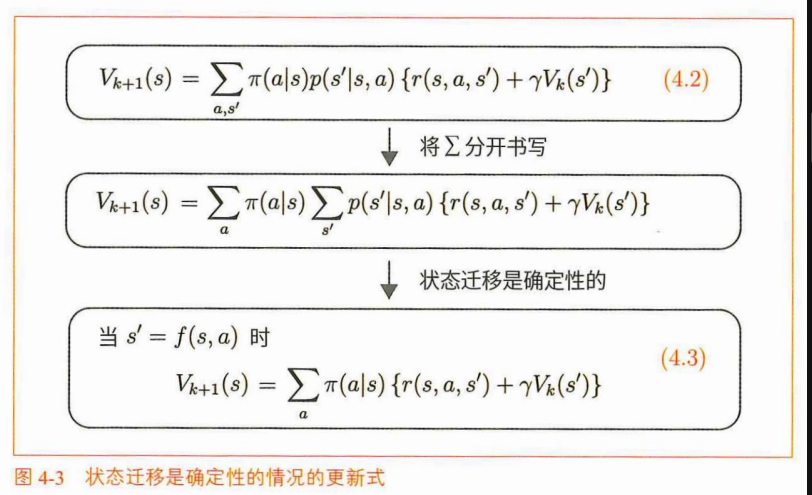
### 迭代策略评估的其他实现方式

同步更新实现DP：  
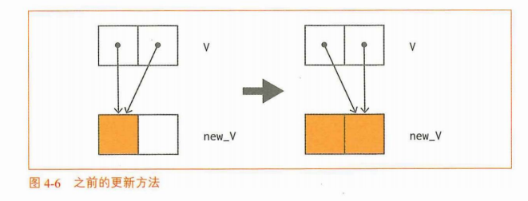
```python
V = {'L1': 0.0, 'L2': 0.0}
new_V = V.copy()

cnt = 0 # 记录更新了几次
while True:
    new_V['L1'] = 0.5 * (-1 + 0.9 * V['L1']) + 0.5 * (1 + 0.9 * V['L2'])
    new_V['L2'] = 0.5 * (0 + 0.9 * V['L1']) + 0.5 * (-1 + 0.9 * V['L2'])

    # 更新量的最大值
    delta = abs(new_V['L1'] - V['L1'])
    delta = max(delta, abs(new_V['L2'] - V['L2']))

    V = new_V.copy()

    cnt += 1
    if delta < 0.0001:
        print(V)
        print(cnt)
        break
```  

覆盖方式实现DP：  
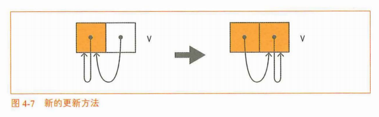
```python
V = {'L1': 0.0, 'L2': 0.0}

cnt = 0
while True:
    t = 0.5 * (-1 + 0.9 * V['L1']) + 0.5 * (1 + 0.9 * V['L2'])
    delta = abs(t - V['L1'])
    V['L1'] = t

    t = 0.5 * (0 + 0.9 * V['L1']) + 0.5 * (-1 + 0.9 * V['L2'])
    delta = max(delta, abs(t - V['L2']))
    V['L2'] = t

    cnt += 1
    if delta < 0.0001:
        print(V)
        print(cnt)
        break
```

## 解决更大问题
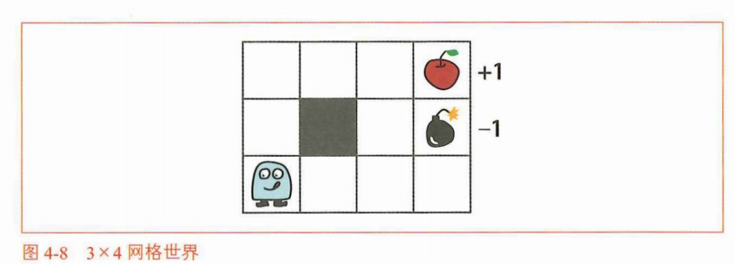
### GridWorld 类的实现
详见代码部分
### defaultdict 的用法
### 迭代策略评估的实现

## 策略迭代法
### 策略的改进
- 最优策略 $\mu_*(s)$：在每个状态下，能使智能体获得最大长期期望回报的动作选择规则，是强化学习求解的最终目标。
- 最优策略的状态价值函数 $v_*(s)$：也叫最优状态价值函数，表示在状态 $s$ 下，全程遵循最优策略行动，所能获得的最大期望回报。
- 最优策略的行动价值函数 $q_*(s,a)$：也叫最优动作价值函数，表示在状态 $s$ 执行动作 $a$ 之后，后续全程遵循最优策略，所能获得的最大期望回报。  
最优策略（贪婪策略）：
$$
\begin{aligned}
\mu_*(s) &= \arg\max_{a} q_*(s,a) \\
&= \arg\max_{a}\sum_{s'} p(s' \mid s,a) \big\{ r(s,a,s') + \gamma v_*(s') \big\}
\end{aligned}
$$
- 第一行：最优策略的直观定义，在状态 $s$ 下，选取使最优动作价值函数 $q_*(s,a)$ 最大的动作 $a$。
- 第二行：展开形式，将 $q_*(s,a)$ 替换为状态转移、即时奖励与最优状态价值的折现求和形式，可直接通过 $v_*(s)$ 求解最优策略。  

$$
\begin{aligned}
\mu'(s) &= \arg\max_{a} q_\mu(s,a) \\
&= \arg\max_{a}\sum_{s'} p(s' \mid s,a) \big\{ r(s,a,s') + \gamma v_\mu(s') \big\}
\end{aligned}
$$  
式子中各部分的含义如下：
- 当前策略 $\mu(s)$：当前正在使用的确定性策略，决定每个状态下智能体选择的动作。
- 策略 $\mu(s)$ 的状态价值函数 $v_\mu(s)$：遵循当前策略 $\mu$ 行动时，状态 $s$ 对应的期望回报。
- 新的策略 $\mu'(s)$：基于当前策略的价值函数，通过贪心改进得到的更优策略。  
综上所述，策略的贪婪化意味着：
- 策略总是被改进；
- 如果该策略没有被改进（更新），那么它就是最优策略。
### 重复评估和改进
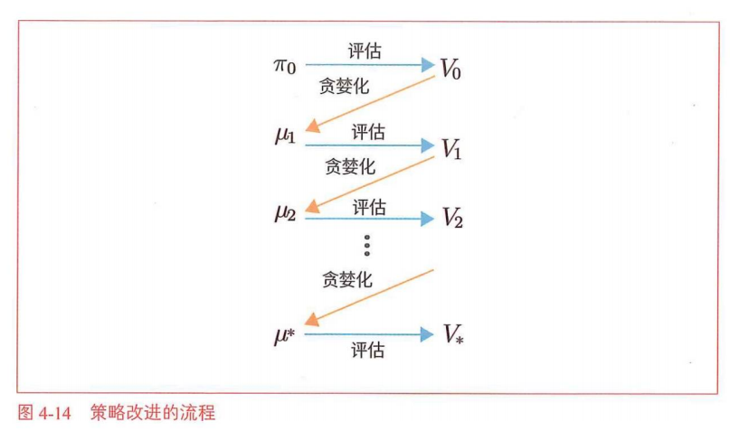

## 实施策略迭代法
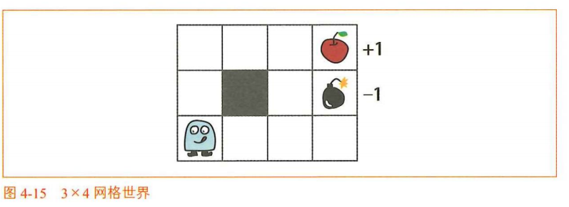
### 策略改进
$$
\mu'(s) = \arg\max_{a}\sum_{s'} p(s' \mid s,a) \big\{ r(s,a,s') + \gamma v_\mu(s') \big\}
$$
另外，这个问题中的状态迁移是唯一的（确定性的）。因此，策略的贪婪化可以做如下简化。
当 $s' = f(s,a)$ 时
$$
\mu'(s) = \arg\max_{a}\big\{ r(s,a,s') + \gamma v_\mu(s') \big\} \tag{4.8}
$$
### 重复评估和改进

## 价值迭代法

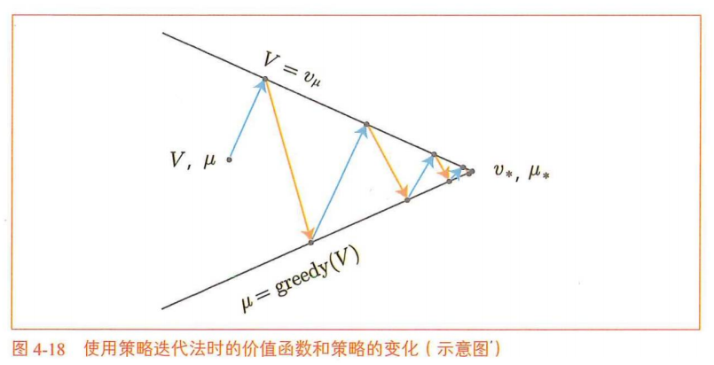


# 蒙特卡洛方法
蒙特卡洛方法是对数据进行反复采样并根据结果进行估计的方法的总称。
## 蒙特卡洛方法的基础知识
### 骰子的点数和
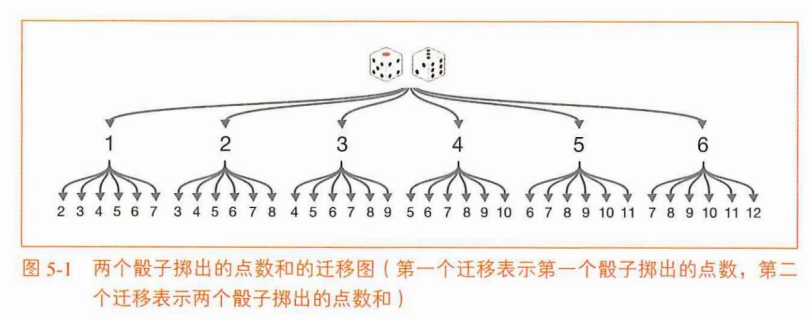
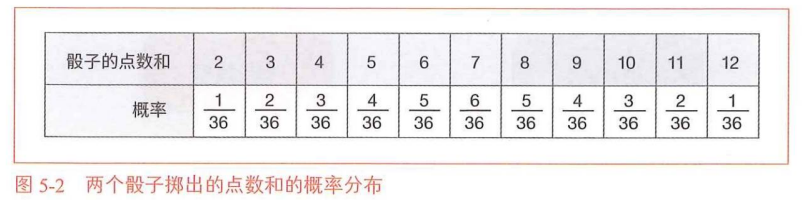
```python
ps = {2: 1/36, 3: 2/36, 4: 3/36, 5: 4/36, 6: 5/36, 7: 6/36,
      8: 5/36, 9: 4/36, 10: 3/36, 11: 2/36, 12: 1/36}
V = 0
for x, p in ps.items():
    V += x * p
print(V)
```
```
- `ps` 是字典：`{2: 1/36, 3: 2/36, ...}`
- 字典的 `.items()` 会把字典拆成一组一组的 `(键, 值)` 元组：`(2, 1/36)`、`(3, 2/36)`、`(4, 3/36)`……
- `for x, p` 就是把每一组元组拆开：
- [x] **x** 接收字典的键（点数和）
- [x] **p** 接收字典的值（对应概率）
```
### 分布模型和样本模型
分布模型要求明确地持有概率分布，样本模型则要求能够进行采样
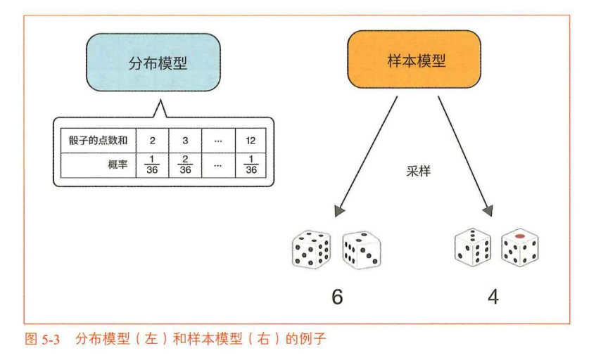
蒙特卡洛法：使用样本模型来计算期望值。具体的方法就是做大量的采样并取
平均值。
### 蒙特卡洛法的实现
```python
import numpy as np

def sample(dices=2):
    x=0
    for _ in range(dices):
        x+=np.random.choice([1, 2, 3, 4, 5, 6])
    return x

trial=100

samples=[]
for _ in range(trial):
    s=sample()
    samples.append(s)

V=sum(samples)/len(samples)#求平均值
print(V)#6.98
```
考每次获得样本数据时求平均值
```python
trial = 1000
samples =[]
for in range(trial):
    s = sample()
    samples.append(s)
    V = sum(samples) / len(samples) # 每次都计算平均值
    print(V)
```
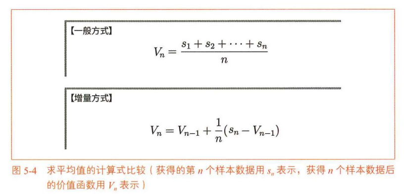

## 使用蒙特卡洛方法评估策略
### 使用蒙特卡洛方法计算价值函数
价值函数：
$$
v_\pi(s) = \mathbb{E}_\pi[G \mid s]
$$
$$
V_\pi(s) = \frac{G^{(1)} + G^{(2)} + \dots + G^{(n)}}{n} \
$$
式中，$G$ 表示从状态 $s$ 出发所能获得的回报，$G^{(i)}$ 表示第 $i$ 条回合轨迹中得到的回报。  
蒙特卡洛方法的核心思路：从状态 $s$ 出发，运行 $n$ 条完整的回合轨迹，将所有轨迹回报取算术平均值，以此近似该状态的价值 $V_\pi(s)$。  
注：蒙特卡洛方法只能用于回合制任务。由于连续性任务没有"结束"。是因为式子中$G^{(1)}$、$G^{(2)}$ 等收益的样本数据将无法确定。  
智能代理从状态S开始根据策略$\pi$采取行动的结果
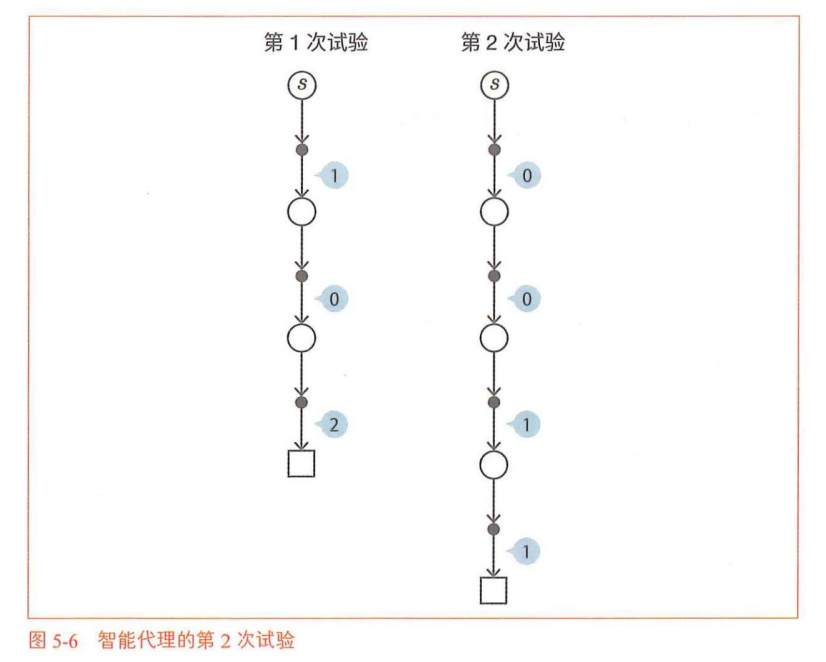
$$
\frac{G^{(1)} + G^{(2)}}{2} = \frac{3 + 2}{2} = 2.5
$$
$V_\pi(s)$ 是 2.5。  
### 求所有状态的价值函数
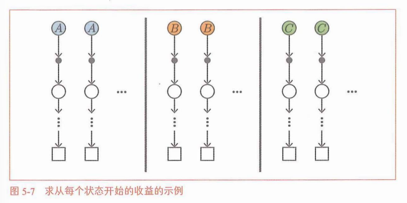
从状态 $A$ 开始获得的收益（样本数据）仅用于计算 $V_\pi(A)$，而不能计算其他价值函数。  
更高效方法：
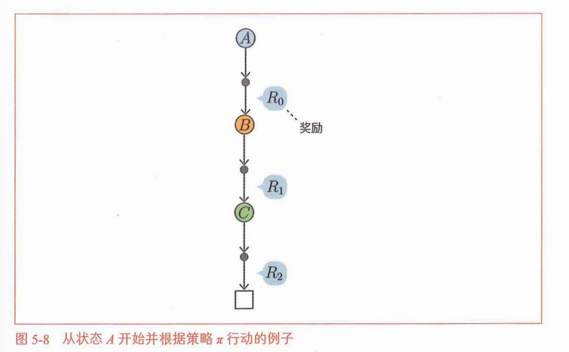
$$
G_A =R_1+\gamma R_1 + \gamma^2R_2
$$
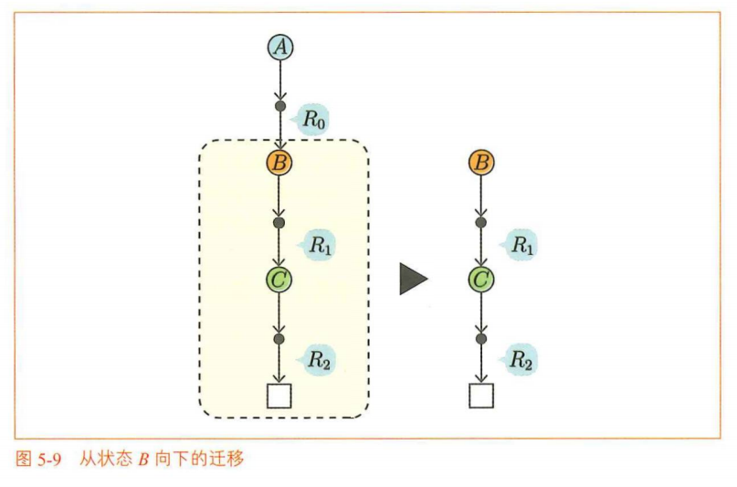
$$
G_B = R_1 + \gamma R_2
$$
$$
G_C = R_2
$$  
### 蒙特卡洛方法的高效实现
$$
\begin{aligned}
G_A &= R_0 + \gamma G_B \\
G_B &= R_1 + \gamma G_C \\
G_C &= R_2
\end{aligned}
$$

## 蒙特卡洛方法的实现
待解决问题
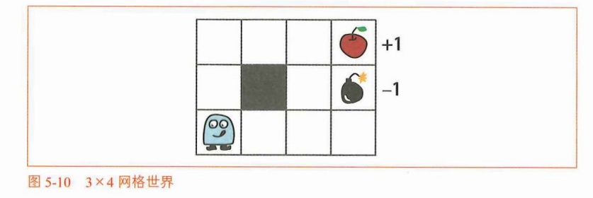
### step 方法
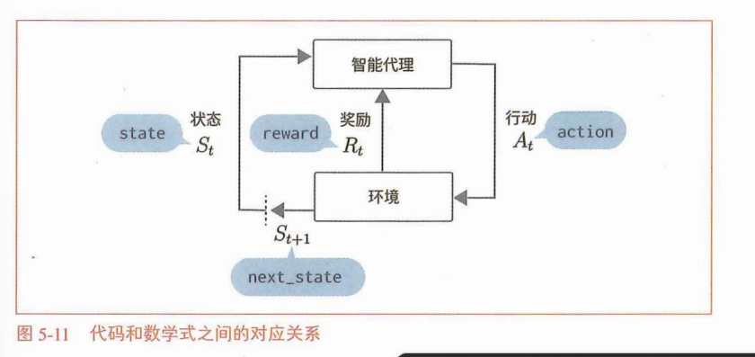
设当前时刻为 $t$，$S_t$ 对应于 state，$A_t$ 对应于 action。
智能代理在时刻 $t$ 采取行动，获得奖励 $R_t$，并进入下一个状态 $S_{t+1}$。此时获得的奖励 $R_t$ 对应于 reward，下一个状态 $S_{t+1}$ 对应于 $\text{next\_state}$。  
### 智能代理类的实现
### 运行蒙特卡洛方法

## 使用蒙特卡洛方法的策略控制
### 评估和改进
最优策略是交替重复进行评估和改进而得到的。在评估阶段，对策略进行评估以获得价值函数。在改进阶段，通过价值函数的贪婪化来改进策略。通过交替重复这两个过程，我们逐渐接近最优策略和最优价值函数。
#### 对状态价值函数的评估
一般方式：
$$V_n(s) = \frac{G^{(1)} + G^{(2)} + \dots + G^{(n)}}{n}$$

增量方式：
$$V_n(s) = V_{n-1}(s) + \frac{1}{n}\big\{G^{(n)} - V_{n-1}(s)\big\}$$

#### 对 Q 函数的评估
一般方式：
$$Q_n(s,a) = \frac{G^{(1)} + G^{(2)} + \dots + G^{(n)}}{n}$$

增量方式：
$$Q_n(s,a) = Q_{n-1}(s,a) + \frac{1}{n}\big\{G^{(n)} - Q_{n-1}(s,a)\big\}$$
#### 名词解释
- $V_n(s)$：采样 $n$ 条轨迹之后，状态 $s$ 的状态价值估计值
- $Q_n(s,a)$：采样 $n$ 条轨迹之后，$(s,a)$ 状态动作对的动作价值估计值
- $G^{(i)}$：第 $i$ 条轨迹从当前状态开始的回报（Return）
- 一般方式：蒙特卡洛平均，直接求所有回报的算术平均值
- 增量方式：增量更新公式，不需要保存全部历史回报，每拿到一条新回报就迭代更新估计值，节省内存

### 使用蒙特卡洛方法实现策略控制
### $\varepsilon$-greedy 算法（第1个修改）
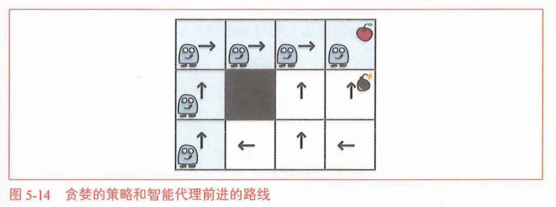
$\varepsilon$-greedy 是让智能代理进行探索的一种方法。通过在智能代理的行动中增加一点儿随机性，该方法基本上会使智能代理选择 Q 函数值最大的行动，同时以较低的概率选择随机行动。这样做可以防止出现智能代理只选择固定的状态和行动的问题。（在理想情况下，智能代理有望通过所有状态，并覆盖所有行动。）而且在大多数情况下，由于可以采取贪婪的行动，因此会获得近似于最优的策略。
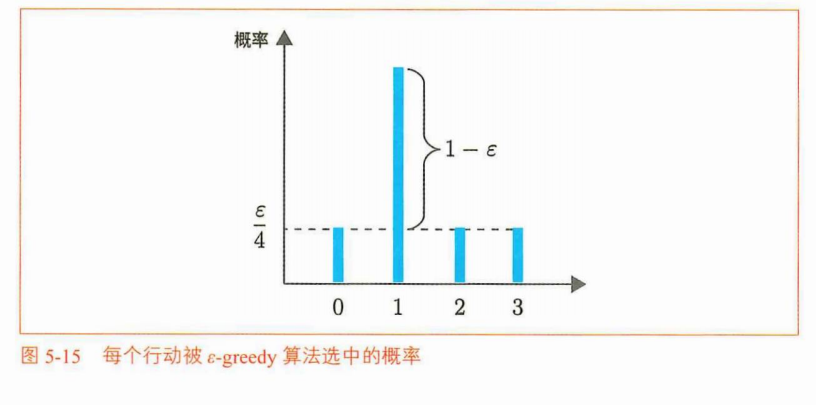
### 修改为固定值α的方式(第2个修改)
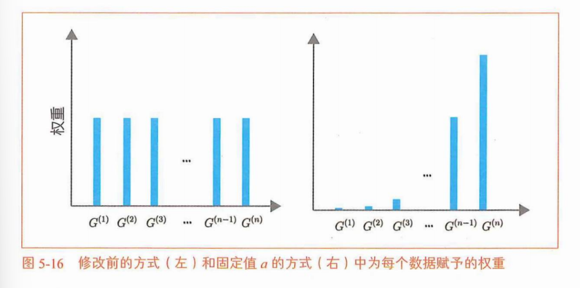
### ［修改版］使用蒙特卡洛方法实现策略迭代法

## 异策略型和重要性采样
### 同策略型和异策略型
异策略型(off-policy)：基于从其他地方获得的经验改进了自己的策略。  
同策略型(on-policy)：基于自己的经验改进自己的策略。
### 重要性采样
重要性采样：利用从其他概率分布中采样的数据来计算某个概率分布的期望值。  
设 $x$ 是随机变量，$x$ 的概率用 $\pi(x)$ 表示。期望值的式子如下所示：
$$
\mathbb{E}_\pi[x] = \sum_x x\pi(x)
$$
sampling: $$x^{(i)} \sim \pi \quad (i=1,2,\dots,n)$$
$$
\mathbb{E}_\pi[x] \approx \frac{x^{(1)} + x^{(2)} + \dots + x^{(n)}}{n}
$$
式子中的符号 $x^{(i)} \sim \pi$ 表示第 $i$ 个数据 $x^{(i)}$ 是从概率分布 $\pi$ 中采样的。
$$
\begin{aligned}
\mathbb{E}_\pi[x] &= \sum x\pi(x) \\
&= \sum x \frac{b(x)}{b(x)}\pi(x) \\
&= \sum x \frac{\pi(x)}{b(x)} b(x)
\end{aligned}
\begin{aligned}
\mathbb{E}_\pi[x] &= \sum x \frac{\pi(x)}{b(x)} b(x) \\
&= \mathbb{E}_b\left[ x \frac{\pi(x)}{b(x)} \right]
\end{aligned}
$$
#### 名词解释
- $\mathbb{E}_\pi[x]$：在目标分布 $\pi$ 下 $x$ 的期望
- $\mathbb{E}_b[\cdot]$：在提议分布 $b$ 下求期望
- $\pi(x)$：目标分布（我们想要的分布）
- $b(x)$：提议分布（实际用来采样的分布）
- $\dfrac{\pi(x)}{b(x)}$：重要性权重
> 说明：重要性采样核心公式，不需要从 $\pi$ 采样，只需要从 $b$ 采样，再乘上重要性权重，就能算出 $\pi$ 下的期望。   

$$sampling: x^{(i)} \sim b \quad (i=1,2,\dots,n)$$
$$
\mathbb{E}_\pi[x] \approx \frac{\rho(x^{(1)})x^{(1)} + \rho(x^{(2)})x^{(2)} + \dots + \rho(x^{(n)})x^{(n)}}{n}
$$  
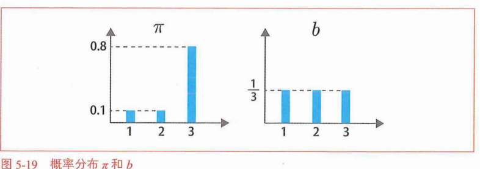
### 如何减小方差
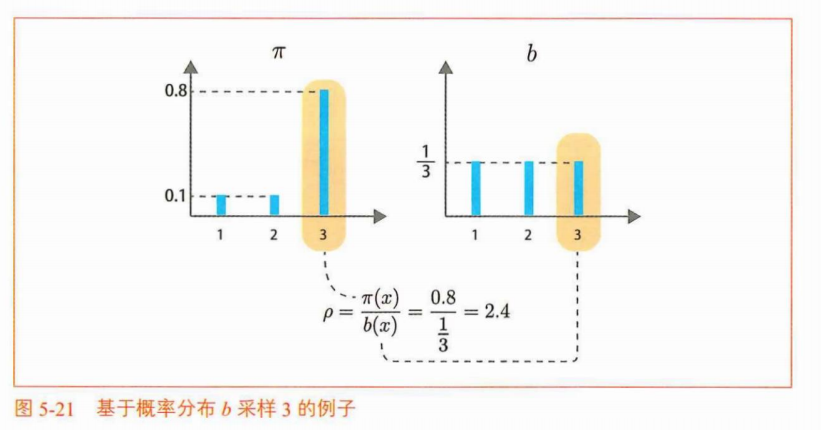

## 小结
蒙特卡洛方法 & 同策略/异策略  
强化学习的核心是智能体与环境交互、利用交互经验优化策略；  
本章使用**蒙特卡洛方法**，基于真实交互经验近似求解价值函数。
1. 流程：评估Q函数 → 基于Q函数改进策略，交替迭代优化策略；
2. 探索与利用：不使用完全贪婪策略，采用 $\varepsilon$-greedy 平衡**利用（选当前最优动作）**和**探索（尝试新动作）**；
3. 策略分类：
    - 目标策略：最终要学习、优化的策略
    - 行为策略：智能体实际用来和环境交互、产生样本的策略
    - 同策略：目标策略 = 行为策略
    - 异策略：目标策略、行为策略分开，借助**重要性采样**，用行为策略收集的样本，计算目标策略的期望。  


# TD方法（Temporal Differenc）
该方法不需要等待回合的结束，每过一定的时间就会进行策略的评估和改进。  
## 使用TD方法评估策
蒙特卡洛法：MC  
动态规划法：DP  
TD方法  
### TD方法的推导
$$
\begin{aligned}
v_\pi(s) &= \mathbb{E}_\pi\left[G_t \mid S_t = s\right] \\
&= \mathbb{E}_\pi\left[R_t + \gamma G_{t+1} \mid S_t = s\right]
\end{aligned}
$$
- 蒙特卡洛（MC）方法：从式 $v_\pi(s)=\mathbb{E}_\pi\left[G_t \mid S_t = s\right]$ 导出。
  > 蒙特卡洛关注**完整回报 $G_t$**，需要拿到一条完整轨迹的总回报，用样本回报的均值估计价值。
- 动态规划（DP）方法：从式 $v_\pi(s)=\mathbb{E}_\pi\left[R_t + \gamma G_{t+1} \mid S_t = s\right]$ 导出。
  > 动态规划利用递推关系，把当前价值拆成**即时奖励+下一时刻折现价值**，不需要等轨迹结束，自举（bootstrap）更新。
MC方法不进行期望值的计算，而是通过对实际获得的收益的样本数据取平均来近似式的期望值。有两种类型的“平均”：样本均值和指数移动平均。为了实现指数移动平均，每当获得新的收益时，都要用固定值a来进行更新。这个过程可以用如下数学式表示：
$$
V'_\pi(S_t) = V_\pi(S_t) + \alpha \big\{G_t - V_\pi(S_t)\big\} \
$$
这是**蒙特卡洛增量式更新公式**：以真实回报 $G_t$ 作为目标，让价值估计向真实回报缓慢靠近；$\alpha$ 越大，单次更新步子越大。
> 说明：设 $V_\pi$ 为当前的价值函数，$V'_\pi$ 为更新后的价值函数。以 $G_t$ 为目标，对当前的价值函数 $V_\pi$ 进行更新。我们通过 $\alpha$ 来调整朝着 $G_t$ 方向的更新量。

接下来是DP方法，DP方法计算期望值。与MC方法不同， DP方法需要根据数学式计算期望值。数学式如下所示：
$$
\begin{aligned}
v_\pi(s) &= \mathbb{E}_\pi\left[R_t + \gamma G_{t+1} \mid S_t = s\right] \\
&= \sum_{a,s'} \pi(a|s)\,p(s'|s,a)\big\{r(s,a,s') + \gamma v_\pi(s')\big\}
\end{aligned} \
$$

> 说明：上面的式子使用状态迁移概率 $p(s'|s,a)$ 和奖励函数 $r(s,a,s')$ 计算期望值。顺带一提，上式是贝尔曼方程。DP 方法可以依次更新价值函数。更新式如下所示：
$$
V'_\pi(s) = \sum_{a,s'} \pi(a|s)\,p(s'|s,a)\big\{r(s,a,s') + \gamma V_\pi(s')\big\}
$$
> 式中的要点在于当前状态的价值函数是使用下一状态的价值函数来更新的。这个过程的特点在于需要考虑所有的迁移。与 MC 方法相比，DP 方法的特点更加清晰，如图所示。  

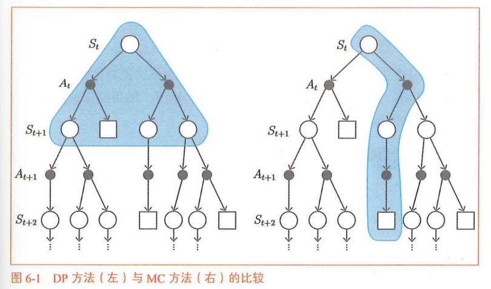
#### DP（动态规划，图左蓝色区域）
蓝色区域代表：更新时枚举**所有可能的转移分支**（全部动作、全部可能下一状态）。
依靠已知MDP转移概率模型，用下一状态的价值估计值更新当前状态价值。
- ✅ 特点：**自举（bootstrap）**，用估计值更新估计值；无需等轨迹结束；遍历全部分支
- ❗ 局限：必须知道环境转移模型，模型未知时无法使用

#### MC（蒙特卡洛，图右蓝色区域）
蓝色区域代表：智能体交互采样得到的**一条真实轨迹**，只使用这条实际发生的路径。
需要等到整个回合结束，拿到完整真实回报 $G_t$，再反向更新状态价值。
- ✅ 特点：基于真实交互经验，不需要环境转移模型；不自举，使用真实回报更新
- ❗ 局限：更新延迟，必须等到回合终止之后才能更新
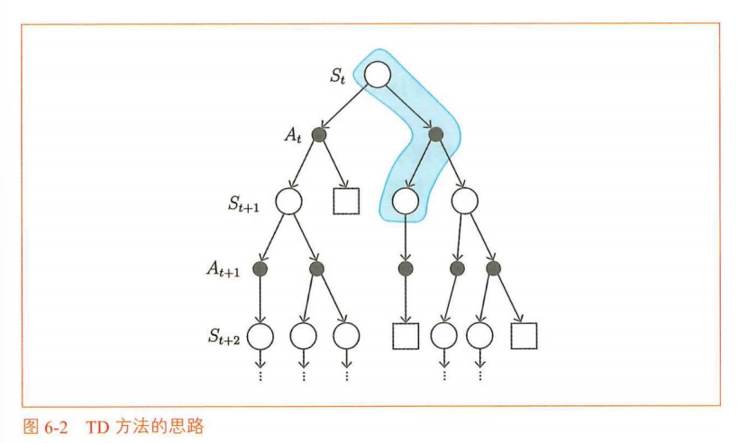
> <span style="color:red">TD方法只使用下一个行动和价值函数来更新当前的价值函数</span>  
> TD（时序差分）融合DP与MC：不需要完整回合，也不需要完整环境模型，利用单步后的奖励与下一状态价值（自举）更新当前状态价值。  

>数学式子推导TD方法
>$$
v_\pi(s) = \sum_{a,s'} \pi(a|s)p(s'|s,a)\big\{r(s,a,s') + \gamma v_\pi(s')\big\}
$$
>计算所有候选的 $r(s,a,s')+\gamma v_\pi(s')$，也就是奖励和下一个价值函数
>$$
= \mathbb{E}_\pi\left[R_t + \gamma v_\pi(S_{t+1}) \mid S_t = s\right]
$$
TD方法更新式：
$$
V_\pi'(S_t) = V_\pi(S_t) + \alpha\left\{ R_t + \gamma V_\pi(S_{t+1}) - V_\pi(S_t) \right\}
$$
式中的 $V_\pi$ 是价值函数的估计值，目标是 $R_t + \gamma V_\pi(S_{t+1})$。$R_t + \gamma V_\pi(S_{t+1})$ 叫作 **TD目标**。TD 方法会朝着 TD 目标的方向更新 $V_\pi(S_t)$。  
TD目标：$R_t + \gamma V_\pi(S_{t+1})$，用来引导当前状态价值向它靠拢更新</span>
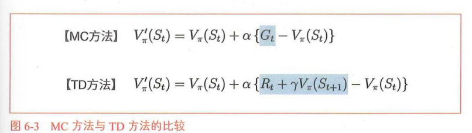
### MC方法和TD方法的比较
在 MC 方法中，更新目标是 $G_t$（完整回合的回报），需要等到回合结束才能更新价值函数；
在 TD 方法中，更新目标是 $R_t+\gamma V_\pi(S_{t+1})$，只需要下一步信息，每走一个时间步就可以更新，学习效率更高。
- MC：目标依赖一整段轨迹的累积数据，**方差更大**
- TD：仅利用单步后续信息，估计值波动更小，**方差更小**
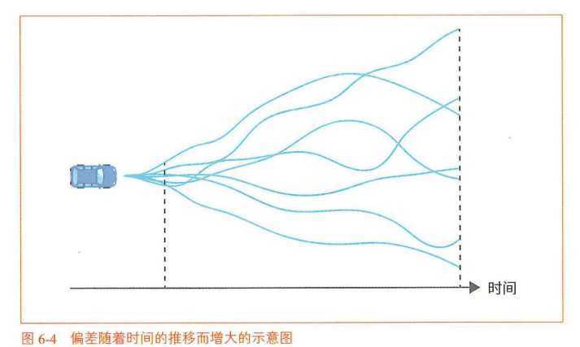
### TD方法实现

## SARSA
### 同策略型的SARSA

Q函数将**状态-动作对**视为一个整体：$t$ 时刻的状态与动作组合为 $(S_t, A_t)$，下一时刻的状态动作对为 $(S_{t+1}, A_{t+1})$。
当获得采样五元组 $(S_t, A_t, R_t, S_{t+1}, A_{t+1})$ 时，即可立即更新 $Q_\pi(S_t, A_t)$；更新完成后进入策略改进阶段，状态 $S_t$ 下的策略会基于最新的Q值进行调整，更新规则如下：
$$
\pi'(a|S_t)=
\begin{cases}
\argmax_a Q_\pi(S_t,a) & (1-\varepsilon\ \text{的概率}) \\
\text{随机行动} & (\varepsilon\ \text{的概率})
\end{cases} 
$$
### SARSA 的实现

## 异策略型的SARSA
### 异策略型和重要性采样
在异策略型的情况下，智能代理拥有两种策略，即行为策略和目标策略。 
SARSA 更新式
SARSA 用于更新动作价值函数 $Q_\pi(S_t,A_t)$，更新公式：
$$
Q'_\pi(S_t,A_t) = Q_\pi(S_t,A_t) + \alpha\left\{ R_t + \gamma Q_\pi(S_{t+1},A_{t+1}) - Q_\pi(S_t,A_t) \right\} \
$$  
改写为：
sampling：$A_{t+1} \sim \pi$
$$
Q'_\pi(S_t,A_t) = Q_\pi(S_t,A_t) + \alpha\left\{ R_t + \gamma Q_\pi(S_{t+1},A_{t+1}) - Q_\pi(S_t,A_t) \right\}
$$
定义：
$$
\rho = \frac{\pi(A_{t+1}|S_{t+1})}{b(A_{t+1}|S_{t+1})}
$$
权重ρ是策略为Π时获得TD目标的概率与策略为b时获得TD目标的概率之比。  
则：
$$sampling：A_{t+1} \sim b$$
$$
Q'_\pi(S_t,A_t) = Q_\pi(S_t,A_t) + \alpha\left\{ \rho \big(R_t + \gamma Q_\pi(S_{t+1},A_{t+1})\big) - Q_\pi(S_t,A_t) \right\}
$$
如上面的式子所示，行动基于策略b进行采样，TD目标基于权重ρ进行修正。  
### 异策略型的SARSA的实现

## Q学习
>我们实现异策略型的SARSA。在异策略型情况下，智能代理拥有两种策略，即行为策略和目标策略。这两种策略起到了不同的作用，行为策略负责探索，目标策略负责利用。这样就有希望得到最优策略。对于异策略型的SARSA，需要使用重要性采样但是重要性采样的问题是结果容易变得不稳定。  

>Q学习特征  
•采用TD方法  
•是异策略型  
•不使用重要性采样    


### 贝尔曼方程与SARSA


### 贝尔曼最优方程与Q学习
>贝尔曼最优方程：
>$$
q_*(s,a) = \sum_{s'} p(s'|s,a) \left\{ r(s,a,s') + \gamma \max_{a'} q_*(s',a') \right\}
$$  


>Q函数：
>$$
Q'(S_t,A_t) = Q(S_t,A_t) + \alpha \left\{ R_t + \gamma \max_{a} Q(S_{t+1},a) - Q(S_t,A_t) \right\}
$$
>Q学习（Q-learning）
>Q学习是一种**异策略（off-policy）**方法，包含目标策略与行为策略两种策略：
>- 行为策略 $b$：负责探索，一般采用基于当前Q函数的$\varepsilon$-greedy策略；智能体依靠该策略选取动作、采集交互样本。
>- 目标策略：直接取下一状态最大Q值，朝着最优策略更新。
智能体每次执行动作后，使用Q-learning更新公式更新Q函数。  

### Q学习实现

## 分布模型和样本模型
### 分布模型和样本模型

## 小结
1.  **TD方法核心特点**
    TD与蒙特卡洛（MC）都依靠智能体的真实交互经验评估价值函数；区别在于：
    - TD：仅需**当前+下一步**的信息即可更新价值函数，更新更及时、学习效率更高
    - MC：必须等到回合结束、拿到完整回报后才能更新

2.  **两种经典TD策略控制算法**
    - **SARSA**：典型的**同策略（on-policy）**算法
      用TD方法评估动作价值函数Q，基于$\varepsilon$-greedy策略同时完成探索与策略改进；也可通过重要性采样扩展为异策略版本。
    - **Q学习（Q-learning）**：典型的**异策略（off-policy）**算法
      由贝尔曼最优方程推导而来，无需重要性采样即可高效稳定地更新Q函数，直接向最优价值收敛，是强化学习领域最核心的算法之一。  

# 神经网络和Q学习
## DeZero 简介
### 使用 DeZero
### 多维数组（张量）和函数
### 最优化
## 线性回归
### 玩具数据集

### 线性回归的理论知识

$$
y = Wx + b
$$
均方差：
$$
L = \frac{1}{N}\sum_{i=1}^{N} (Wx_i + b - y_i)^2
$$
### 线性回归实现


## 神经网络
### 非线性数据集
生成更复杂的数据集：
```python
import numpy as np

np.random.seed(0)
x = np.random.rand(100, 1)
y = np.sin(2 * np.pi * x) + np.random.rand(100, 1)
```

### 线性变换和激活函数
>线性变换（仿射变换）：
>$$
\boldsymbol{y} = \boldsymbol{x}\boldsymbol{W} + \boldsymbol{b}
$$  

>DeZero中的线性变换函数：
>$$
\boldsymbol{y} = \boldsymbol{x}\boldsymbol{W} + \boldsymbol{b}
$$  

线性变换是对输入数据进行线性的变换，而神经网络是对线性变换的输出进行非线性的变换。进行非线性变换的函数叫作“激活函数”。  

在 DeZero 中，`F.sigmoid` 对应 sigmoid 激活函数，`F.relu` 对应 ReLU 激活函数。
$$
\sigma(x) = \frac{1}{1+e^{-x}}
$$

$$
\text{ReLU}(x) = \max(0, x)
$$

### 神经网络实现
使用实际的数据集来训练神经网络：
>#### 两层神经网络（DeZero 正弦拟合）
```python
import numpy as np
from dezero import Variable
import dezero.functions as F

# 数据集
np.random.seed(0)
x = np.random.rand(100, 1)
y = np.sin(2 * np.pi * x) + np.random.rand(100, 1)

# ① 参数初始化
I, H, O = 1, 10, 1
W1 = Variable(0.01 * np.random.randn(I, H))
b1 = Variable(np.zeros(H))
W2 = Variable(0.01 * np.random.randn(H, O))
b2 = Variable(np.zeros(O))

# ② 神经网络推理
def predict(x):
    y = F.linear(x, W1, b1)
    y = F.sigmoid(y)
    y = F.linear(y, W2, b2)
    return y

lr = 0.2
iters = 10000

# ③ 神经网络训练
for i in range(iters):
    y_pred = predict(x)
    loss = F.mean_squared_error(y, y_pred)

    W1.cleargrad()
    b1.cleargrad()
    W2.cleargrad()
    b2.cleargrad()

    loss.backward()

    W1.data -= lr * W1.grad.data
    b1.data -= lr * b1.grad.data
    W2.data -= lr * W2.grad.data
    b2.data -= lr * b2.grad.data

    if i % 1000 == 0: # 每1000次输出
        print(loss.data)  
```


### 层与模型
### 优化器（最优化方法）

## Q学习与神经网络
### 神经网络的预处理
独热向量（one-hot）：指只有一个元素为1，其他元素为0的向量。  
### 表示Q函数的神经网络

### 例子（4个动作：上、下、左、右）
- 上方网络（$Q(s,a)$）：依次输入 $(s,上)$、$(s,下)$、$(s,左)$、$(s,右)$，一共跑4次网络，得到4个Q值
- 下方网络（DQN结构）：只输入状态 $s$，仅跑1次网络，直接输出向量 $[0.7, 0.3, -0.5, 1.7]$，分别对应上、下、左、右的Q值

### 神经网络和Q学习
#### Q学习更新公式
$$
Q'(S_t,A_t) = Q(S_t,A_t) + \alpha\left\{R_t + \gamma \max_{a}Q(S_{t+1},a) - Q(S_t,A_t)\right\}
$$
##### 符号含义
- $Q(S_t,A_t)$：当前状态 $S_t$、动作 $A_t$ 的Q值
- $Q'(S_t,A_t)$：更新之后新的Q值
- $\alpha$：学习率，控制每次更新迈多大一步
- $R_t$：执行动作 $A_t$ 之后，即时获得的奖励
- $\gamma$：折扣因子，未来奖励的衰减系数
- $\max_{a}Q(S_{t+1},a)$：下一个状态 $S_{t+1}$ 下，所有动作里最大的Q值
##### 公式拆解
1. 目标值（TD目标）：$R_t + \gamma \max_{a}Q(S_{t+1},a)$
    代表：当前奖励 + 未来最优动作能拿到的折扣回报
2. TD误差：$R_t + \gamma \max_{a}Q(S_{t+1},a) - Q(S_t,A_t)$
    目标和当前Q值之间的差距
3. 更新：旧Q值 + 学习率 × TD误差
    向着目标值方向，一点点拉近当前Q值
##### 文字说明
这个式子沿着目标 $R_t + \gamma \max_{a}Q(S_{t+1},a)$ 的方向更新 $Q(S_t,A_t)$ 的值。$\alpha$ 用来控制向目标靠近的步长。
> ✅ Q学习是**异策略**：用行为策略采样轨迹，但是更新时直接取下一状态最优Q值（max），不按照当前采样动作更新。  

#### Q学习简写公式
定义TD目标：
$$
T = R_t + \gamma \max_{a}Q(S_{t+1},a)
$$

代入得到简写更新式：
$$
Q'(S_t,A_t) = Q(S_t,A_t) + \alpha\left\{T - Q(S_t,A_t)\right\}
$$
##### 符号说明
- $T$：TD目标（target）
- $T - Q(S_t,A_t)$：TD误差
- $\alpha$：学习率
##### 含义
用 $T$ 代替原来完整的目标项，式子更简洁：
新Q值 = 旧Q值 + 学习率 × TD误差
本质和上式完全一样，只是记号简化。  


## 小结（DeZero + 深度Q学习）
本章学习使用 DeZero 框架搭建神经网络。DeZero 的设计思路和 PyTorch 等现代深度学习框架一致：
- 可以像 NumPy 的 ndarray 一样处理数据
- 支持自动反向传播求导，方便实现梯度下降来更新参数

使用 DeZero 完成的任务：
1. 基础机器学习：线性回归
2. 神经网络：拟合非线性数据集，完成网络训练
3. 内置工具：提供层、优化器等组件，简化神经网络开发

最后基于神经网络实现 Q 学习：
- 底层原理和第6章基础Q学习保持一致
- 把神经网络作为Q函数的拟合器，进入深度强化学习
- 优势：解决表格型Q学习的局限，能够处理大规模的状态、动作空间  


# DQN
DQN是一种将深度学习（Deep Learning）与强化学习（Reinforcement Learning）相结合的算法。
其核心思想是：
使用深度神经网络代替传统Q-Learning中的Q表，通过神经网络逼近状态与动作之间的价值函数，使智能体能够在高维、复杂的环境中学习最优决策策略。
## OpenAI Gym
## DQN的核心技术
Q学习通常是使用估计值来更新估计值（这个原理叫作“自举”）。
DQN是Q学习和神经网络相结合的方法。它的特点是为了稳定神经网络的学习，使用了经验回放（experience replay）和目标网络（target network）这两项技术。  
### 经验回放


### 经验回放实现
### 目标网络
Q学习将 $Q(S_t,A_t)$ 更新为：
$$R_t + \gamma \max_{a}Q(S_{t+1},a)$$
也就是朝着**TD目标**更新Q函数。
- TD目标 ≈ 监督学习里的标签（标准答案）
- 区别：监督学习标签固定不变；**TD目标会随着Q函数更新而不断变化**  
TD目标的值会随着Q函数的更新而变动。这就是监督学习和Q学习的区别。  
### 目标网络实现
### 运行DQN

## DQN 与 Atari
## DQN的扩展
## 小结
DQN 的两大核心技术：
1. **经验回放**：复用历史经验数据，提升数据利用率，降低样本之间的相关性。
2. **目标网络**：用独立网络计算TD目标，固定TD目标，让神经网络训练更稳定。

DQN 经典扩展算法：
- Double DQN
- 优先级经验回放
- Dueling DQN
OpenAI Gym：提供大量标准化环境任务，接口统一，方便切换任务；本章用DQN完成倒立摆任务，同时介绍了Atari游戏的相关训练技巧。  


# 策略梯度法
Q学习、SARSA、蒙特卡洛方法等算法。这些算法大致可以被归类为基于价值的方法。  
## 最简单的策略梯度法
策略梯度法是使用梯度来更新策略的方法的总称。  
### 策略梯度法的推导
基于神经网络的策略表示为：
$$
\pi_\theta(a\mid s)
$$    
θ是将所有参数的元素排成一列的向量。  
设置目标函数：
下由“状态、行动、奖励”构成的时间序列数据：  
$$
\tau = (S_0, A_0, R_0, S_1, A_1, R_1, \dots, S_{T+1})$$
$
\tau$：叫做轨迹
收益：
$$
G(\tau) = R_0 + \gamma R_1 + \gamma^2 R_2 + \dots + \gamma^T R_T$$  
则目标函数表示为：
$$
J(\theta) = \mathbb{E}_{\tau \sim \pi_\theta}\big[G(\tau)\big]$$
收益 $G(\tau)$ 是随机变动的，所以它的期望值是目标函数。上式中期望值 $\mathbb{E}$ 的下标为 $\tau \sim \pi_\theta$，这个下标表示 $\tau$ 是基于 $\pi_\theta$ 生成的。   
策略梯度(本质上是期望)：
$$
\begin{aligned}
\nabla_\theta J(\theta) &= \nabla_\theta \mathbb{E}_{\tau \sim \pi_\theta}\big[G(\tau)\big] \\
&= \mathbb{E}_{\tau \sim \pi_\theta}\left[\sum_{t=0}^T G(\tau)\nabla_\theta \log\pi_\theta(A_t \mid S_t)\right]
\end{aligned}
$$
更新神经网络的参数：  
$$
\theta \leftarrow \theta + \alpha \nabla_\theta J(\theta)
$$  
### 策略梯度法算法  
$$
\begin{aligned}
\text{sampling: } &\ \tau^{(i)} \sim \pi_\theta \quad (i=1,2,\dots,n) \\
x^{(i)} &= \sum_{t=0}^T G(\tau^{(i)}) \nabla_\theta \log\pi_\theta\left(A_t^{(i)} \mid S_t^{(i)}\right) \\
\nabla_\theta J(\theta) &\approx \frac{x^{(1)} + x^{(2)} + \dots + x^{(n)}}{n}
\end{aligned}
$$
上面式子中的 $\tau^{(i)}$ 表示在第 $i$ 回合得到的轨迹，$A_t^{(i)}$ 表示在第 $i$ 回合的时刻 $t$ 的行动，$S_t^{(i)}$ 表示在第 $i$ 回合的时刻 $t$ 的状态。  
采样n=1时：
sampling: $$
\tau \sim \pi_\theta$$
$$
\nabla_\theta J(\theta) \approx \sum_{t=0}^{T} G(\tau) \nabla_\theta \log \pi_\theta(A_t \mid S_t)
$$  
  
根据log微分：  
$$
\nabla_\theta \log \pi_\theta(A_t|S_t) = \frac{\nabla_\theta \pi_\theta(A_t|S_t)}{\pi_\theta(A_t|S_t)}
$$
- 数学来源：对数求导链式法则 $\displaystyle \nabla\log f = \frac{\nabla f}{f}$
- 变形：$\boldsymbol{\nabla_\theta \pi_\theta(A_t|S_t) = \pi_\theta(A_t|S_t)\cdot \nabla_\theta\log\pi_\theta(A_t|S_t)}$
- 作用：策略梯度定理核心变换，把梯度改写为期望形式，**支持蒙特卡洛轨迹采样估计**  
如上式所示，$\nabla_\theta \log \pi_\theta(A_t | S_t)$ 是梯度 $\nabla_\theta \pi_\theta(A_t | S_t)$（向量）的 $\dfrac{1}{\pi_\theta(A_t | S_t)}$ 倍。因此 $\nabla_\theta \log \pi_\theta(A_t | S_t)$ 和 $\nabla_\theta \pi_\theta(A_t | S_t)$ 会指向相同的方向。也就是说，$\nabla_\theta \pi_\theta(A_t | S_t)$ 和 $\nabla_\theta \log \pi_\theta(A_t | S_t)$ 都指向在状态 $S_t$ 下采取行动 $A_t$ 的概率增加最快的方向。根据 $G(\tau)\nabla_\theta \log \pi_\theta(A_t | S_t)$，需要在该方向上乘以权重 $G(\tau)$。  
### 策略梯度法实现

## REINFORCE
### REINFORCE算法
$$
\begin{aligned}
\nabla_\theta J(\theta) &= \nabla_\theta \mathbb{E}_{\tau \sim \pi_\theta}\big[G(\tau)\big] \\
&= \mathbb{E}_{\tau \sim \pi_\theta}\left[\sum_{t=0}^T G(\tau)\nabla_\theta \log\pi_\theta(A_t \mid S_t)\right]
\end{aligned}
$$

式中的 $G(\tau)$ 是目前为止获得的所有奖励的总和（准确地说是“带折现率”的奖励的总和）。这里要思考的问题是，无论在哪个时刻 $t$，式子中都是 $G(\tau)\nabla_\theta \log\pi_\theta(A_t|S_t)$，我们始终会使用固定不变的权重 $G(\tau)$ 来增加（或减少）采取行动 $A_t$ 的概率。  
智能代理行动的好坏是根据行动之后获得的奖励总和来评估的（回顾一下价值函数的定义）。反过来说，采取某个行动之前获得的奖励与该行动的好坏无关。如果要评估在某个时刻 $t$ 采取的行动 $A_t$，那么在此之前做了什么以及获得了多少奖励都无所谓。我们是根据采取行动 $A_t$ 之后的结果（在时刻 $t$ 以后获得的奖励的总和）来判断行动 $A_t$ 的好坏的。  
式中行动 $A_t$ 的权重是 $G(\tau)$。这个权重 $G(\tau)$ 包括在时刻 $t$ 之前的奖励。也就是说，原本不相关的奖励作为噪声数据包含在内了。为了改进这一点（去除噪声数据），可以对权重 $G(\tau)$ 作如下修改。  
$$
\nabla_\theta J(\theta)=\mathbb{E}_{\tau\sim\pi_\theta}\left[\sum_{t=0}^T G_t \nabla_\theta \log\pi_\theta(A_t|S_t)\right] \
$$
$$
G_t = R_{t+1}+\gamma R_{t+2}+\dots+\gamma^{T-t-1}R_T
$$
如式所示，权重变成了 $G_t$。权重 $G_t$ 是在时刻 $t \sim T$ 获得的奖励的总和。因此，选择行动 $A_t$ 的概率将由不包含时刻 $t$ 之前的奖励的权重 $G_t$ 增强。这就是改进策略梯度法的思路。基于改进的算法叫作 REINFORCE。  
###  REINFORCE 的实现

## 基线
目的：改进REINFORCE
  
方差太大，因此我们要考虑减小方差。  
  
    
显然，方差减小了。  
>我们可以通过对某个结果减去预测值的方法来减小方差。预测值的精度越高，方差就越小。这就是基线这种方法的思路。  

### 带基线的策略梯度法
$$
\begin{aligned}
\nabla_\theta J(\theta) &= \mathbb{E}_{\tau\sim\pi_\theta}\left[\sum_{t=0}^{T} G_t \nabla_\theta \log\pi_\theta(A_t | S_t)\right] \\
&= \mathbb{E}_{\tau\sim\pi_\theta}\left[\sum_{t=0}^{T} \big(G_t - b(S_t)\big) \nabla_\theta \log\pi_\theta(A_t | S_t)\right]
\end{aligned}
$$  
式中用 $G_t-b(S_t)$ 代替了 $G_t$。这里 $b(S_t)$ 可以是任何函数。也就是说，只要输入是 $S_t$，$b(S_t)$ 是什么函数都行。这个 $b(S_t)$ 就是基线。  
$b(S_t)$ 可取任意仅由状态决定的函数，常用价值函数 $b(S_t)=V_{\pi_\theta}(S_t)$ 作为基线，能够降低方差、提升样本效率；但真实价值函数未知，因此需要额外训练价值函数。  
### 基线作用示例（倒立摆）
前提：杆子即将失衡的状态$s$，无论采取任何动作，3步后游戏必然结束；每步奖励$r=1$，$\gamma=1$。
总回报：$G_t = 1+1+1 = 3$
1. 不带基线REINFORCE：权重为$G_t=3$，会增大该动作的选择概率。但该状态无论选什么动作都会失败，这次更新是无效的。
2. 引入价值函数作为基线：该状态期望回报 $V_{\pi_\theta}(s)=3$
优势：$A_t = G_t - V_{\pi_\theta}(s) = 0$
梯度权重为0，动作概率不会更新，避免无意义训练。

> 优势函数 $A_t = G_t - V(S_t)$：衡量当前动作比该状态平均水平好多少。  

## Actor-Critic
强化学习的算法大体可分为基于价值的方法和基于策略的方法。本章前面出现的都是基于策略的方法，而DQN和SARSA是基于价值的方法。  
  
Actor-Critic是基于价值且基于策略的方法。  
### Actor-Critic 的推导
带基线的REINFORCE的目标函数的梯度的数学式：
$$
\nabla_\theta J(\theta) = \mathbb{E}_{\tau \sim \pi_\theta}\left[ \sum_{t=0}^{T} \big(G_t - b(S_t)\big)\nabla_\theta \log\pi_\theta(A_t \mid S_t) \right]
$$
>这里我们使用基于神经网络建模的价值函数作为基线。因此，我们要用到以下这些新的记号:
>- $\omega$：价值函数神经网络的权重参数
>- $V_\omega(S_t)$：用来拟合价值函数的神经网络（价值网络）  
$$
\nabla_\theta J(\theta) = \mathbb{E}_{\tau \sim \pi_\theta}\left[ \sum_{t=0}^{T} \big(G_t - V_\omega(S_t)\big)\nabla_\theta \log\pi_\theta(A_t \mid S_t) \right]
$$
  
如图所示，在训练价值函数 $V_\omega(S_t)$ 时，蒙特卡洛方法使用的是收益$G_t$，而 TD 方法使用的是 $R_t+\gamma V_\omega(S_{t+1})$。  
Actor-Critic算法：
$$
\nabla_\theta J(\theta) = \mathbb{E}_{\tau \sim \pi_\theta}\left[ \sum_{t=0}^{T} \big(R_t + \gamma V_\omega(S_{t+1}) - V_\omega(S_t)\big)\nabla_\theta \log\pi_\theta(A_t \mid S_t) \right]
$$   
### Actor-Critic 的实现  
## 基于策略的方法的优点
（1） 策略直接模型化，更高效  
我们最终想得到的是最优策略。基于价值的方法预测的是价值函数,并以其为基础确定策略。而基于策略的方法可以直接预测策略。有些问题的价值函数的形状可能很复杂，但其最优策略可能很简单。对于这样的情况，基于策略的方法有望更快地训练。  
（2） 在连续的行动空间中也能使用    
前面介绍的强化学习的问题全部是离散的行动空间。例如，对于倒立摆问题，要选择的是向右或向左这两个行动。在这样的离散行动空间中，行动是从多个非连续的候选中选择一个。但也有连续的行动空间的情况。例如，OpenAI Gym的Pendulum是在摆杆的中心施加扭矩，抬起摆杆的任务（参见下图）。在这种情况下，要施加的扭矩（如2.05或-0.24等）的连续值构成了行动空间。
    
基于价值的方法难以用于连续的行动空间的情况。可以考虑的解决方法有几种。一种方法是将连续的行动空间离散化。但是，如何离散化［这个过程叫作“量子化”（quantize）］是一个很难的问题。任务不同，合适的方法也不同。大多数情况下，好的离散化的方法需要不断尝试和寻找。  
而基于策略的方法对于连续的行动空间的情况也能轻松应对。例如， 对于神经网络的输出呈正态分布的情况，可以考虑让神经网络输出正态分布的均值和方差。根据其均值和方差进行采样，即可得到连续值，如图。  
  
(3)行动的选择概率平滑地变化  
在基于价值的方法中，智能代理的行动通常通过e-greedy算法来选择。在这种情况下，被选中的基本是Q函数值最大的行动。此时，如果Q函数的更新导致值最大的行动发生了改变，那么采取的行动也会突然改变。而基于策略的方法是通过Softmax函数确定各行动的概率。因此，在更新策略参数的过程中，各行动的概率会平滑地变化。这使得策略梯度法的训练更趋于稳定。
以上就是基于策略的方法的3个优点。需要注意的是，基于策略的方法并非总是优于基于价值的方法，它也有适合的任务和不适合的任务。另外， 无论是基于策略的方法还是基于价值的方法，实现它们的算法都有各种不同的创新。因此，在选择算法时，我们需要考虑到这些问题。

### 小结
#### 策略梯度统一形式
$$
\nabla_\theta J(\theta) = \mathbb{E}_{\tau \sim \pi_\theta}\left[ \sum_{t=0}^{T} \Phi_t \nabla_\theta \log\pi_\theta(A_t \mid S_t) \right]
$$

> 核心：不同策略梯度算法，区别只在于权重项 $\boldsymbol{\Phi_t}$

#### 四种基础策略梯度
1. $\boldsymbol{\Phi_t = G(\tau)}$：最简单的策略梯度法，整条轨迹回报作为权重，所有时刻权重相同
2. $\boldsymbol{\Phi_t = G_t}$：REINFORCE，使用时刻 $t$ 的折扣收益 $G_t$ 作为权重（蒙特卡洛）
3. $\boldsymbol{\Phi_t = G_t - b(S_t)}$：带基线的REINFORCE，减去基线，**降低方差**
4. $\boldsymbol{\Phi_t = R_t+\gamma V(S_{t+1}) - V(S_t)}$：Actor-Critic，使用TD误差作为权重，Critic网络拟合价值函数

#### 其他权重选择
- $\boldsymbol{\Phi_t = Q(S_t,A_t)}$：直接用动作价值函数作为权重
- $\boldsymbol{\Phi_t = Q(S_t,A_t)-V(S_t) = A(S_t,A_t)}$：优势函数（Advantage）
  > 优势含义：在状态 $S_t$ 采取动作 $A_t$，比该状态平均价值好多少


# 进一步学习
## 深度强化学习算法的分类
    
分类依据：**是否使用环境模型（状态转移 $p(s'|s,a)$、奖励函数 $r(s,a,s')$）**
#### 一、有模型（model-based）方法
1. 已知/提供环境模型
    - 原理：模型提前给定，智能体可以直接做规划，不需要和真实环境交互试错
    - 例子：动态规划、AlphaGo、AlphaZero
2. 自主训练环境模型
    - 原理：从环境交互得到的经验里学习、拟合环境模型，再用学到的模型做规划、优化策略
    - 例子：World Models、MBVE
    - 特点：潜力大，逼近通用智能，但建模难度高

#### 二、无模型（model-free）方法（本书重点）
不需要环境转移模型，直接和环境交互采样经验优化策略/价值，分为三类：
1. 基于策略（Policy-based）
    - 直接优化策略 $\pi(a|s)$
    - 代表：策略梯度、REINFORCE
2. 基于价值（Value-based）
    - 拟合价值函数 $V(s)$ / $Q(s,a)$，间接推导策略
    - 代表：DQN及其各类改进版
3. 混合方法（同时基于策略+价值）
    - 同时训练策略网络（Actor）+价值网络（Critic）
    - 代表：Actor-Critic

---
#### 对比汇总表
| 大类 | 子类 | 核心特点 | 代表算法 |
| ---- | ---- | ---- | ---- |
| Model-based 有模型 | 给定环境模型 | 环境模型已知，依靠规划求解 | DP、AlphaGo、AlphaZero |
| | 学习环境模型 | 自己拟合环境，用模型做想象规划 | World Models、MBVE |
| Model-free 无模型 | 基于策略 | 直接更新策略，输出动作分布 | REINFORCE、策略梯度 |
| | 基于价值 | 学习Q/价值函数，选价值最大动作 | DQN |
| | Actor-Critic混合 | Actor更新策略，Critic评估价值 | Actor-Critic |

> 补充：无模型方法工程落地成熟、效果好；有模型方法上限更高，是通用智能方向。
## 策略梯度法的改进
- **A3C / A2C**：分布式学习的Actor-Critic算法
  - A3C：异步多线程，多个worker独立采样、异步更新全局网络
  - A2C：同步版本，所有worker收集完数据再统一更新，稳定性更好
  - 共性：Actor-Critic框架，用优势函数，并行采样降低样本相关性

- **DDPG**：确定性策略梯度算法
  - 输出**确定性动作**（不是动作分布），适合连续动作空间
  - 异策略，使用经验回放；Actor输出动作，Critic评估动作价值

- **TRPO / PPO**：带约束的策略优化算法
  - 核心思想：限制新旧策略的更新幅度，防止策略一次性更新崩坏
  - TRPO：用KL散度约束，优化复杂、计算量大
  - PPO：简化约束，裁剪目标函数（clip），实现简单、效果稳定，工业最常用  

### A3C 和 A2C
A3C  
A3C的特点是asynchronous,即“异步”。这里所说的“异步”是指多个智能代理并行采取行动，异步更新参数。  
A3C训练使用的是神经网络建模的Actor-Critic学习策略。它需要使用一个全局网络和多个本地网络。  
  
1. 训练流程：多个本地网络在各自环境独立训练，把梯度发给全局网络；全局网络利用梯度异步更新权重，之后定期同步全局与本地网络权重。
2. 优点：多智能体并行训练，加快训练速度；并行独立探索得到多样化数据，降低数据相关性，训练更稳定。
3. 和DQN经验回放对比：
    - DQN依靠经验回放缓冲、随机采样来降低数据相关性；缺点：不适用于异策略算法，占用内存、计算量大。
    - A3C用并行处理降低数据相关性，**异策略算法也能用**，是主流方案。
4. 网络结构：Actor-Critic 共享神经网络权重，同一网络同时输出策略和价值函数，参数共享提升效率。  
  
A2C  
A2C是同步更新参数的方法，它不采取异步更新参数的方式。  
  
1. 训练流程：多个智能代理在独立环境运行，把同一时刻`t`的所有环境状态汇总成一个批次送入网络训练；从网络输出的策略分布采样动作，再下发给各个环境。
2. 和A3C对比：
    - A3C：**异步更新**，每个环境单独跑网络，N个环境理想下需要N块GPU。
    - A2C：**同步批量更新**，只用一份网络，单块GPU就能跑；性能和A3C接近，更容易实现，GPU利用率更高。
3. 结论：工程实践里A2C使用更多。  
### DDPG  
诸如直接对策略建模的策略梯度法之类的方法也可以用于连续的行动空间问题。  
表示策略的神经网络可以设计为输出“正态分布的平均值”（参见下图）。实际行动是从它的正态分布中采样得到的。  
   
DDPG 是 “Deep Deterministic Policy Gradient55 （深度确定性策略梯度法）的缩写。是针对连续行动空间问题而设计的算法。神经网络可以将行动作为连续值直接输出。  
  
DDPG的策略是在输入某个状态s时确定唯一的行动a的确定性的策略。  
### DDPG
- 网络定义
  - 确定性策略网络：$\mu_\theta(s)$，参数 $\theta$
  - Q值网络（DQN结构）：$Q_\phi(s,a)$，参数 $\phi$
- 参数更新分为两步：
  1. 更新策略网络参数 $\theta$：沿着**增大Q函数输出**的方向优化
  2. 更新Q网络参数 $\phi$：采用DQN的Q学习方式训练  

第一个训练过程：这是将两个神经网络组合使用，朝着使Q函数的输出变大的方向更新确定性策略 $\mu_\theta(s)$ 的参数 $\theta$ 的过程，如图。  
  
图中的重点是 $\mu_\theta(s)$ 输出的行动 $a$ 是连续值，该值可直接作$Q_\phi(s,a)$ 的输入。这样就能通过两个神经网络进行反向传播了。通过反向传播可以求梯度 $\nabla_\theta q$（这里的 $q$ 是 Q 函数的输出）。这样就能使用梯度 $\nabla_\theta q$ 更新参数 $\theta$ 了。  
第二个训练过程：在DQN中进行的Q学习。  
在 DQN 中进行的 Q 函数的更新是使 $Q_\phi(S_t,A_t)$ 的值为 $R_t + \gamma \max_a Q_\phi(S_{t+1},a)$（或接近这个值）。这里通过第一个训练，策略 $\mu_\theta(s)$ 输出了使 Q 函数变大的行动。因此，可以使用以下近似值：
$$
\max_a Q_\phi(s,a) \approx Q_\phi(s,\mu_\theta(s))
$$
求最大值 $\max_a$ 通常需要大量的计算。尤其是在行动空间连续的情况下，我们还得解决复杂的优化问题。DDPG 将 $\max_a Q_\phi(s,a)$ 替换成了 $Q_\phi(s,\mu_\theta(s))$ 的两个神经网络的前向传播（参见上图）。这样可以简化计算，有望提高训练效率。    
### TRPO 和 PPO  
### TRPO & PPO
- 策略梯度法缺陷：只知道参数更新方向，难以确定合适步长，步长不合适会导致训练崩坏或停滞。
- TRPO（信赖领域策略优化）：利用KL散度衡量新旧策略分布差异，约束KL散度不超过阈值，在约束内最大化目标函数，保证策略每次更新变化不会太大；缺点是需要计算海塞矩阵，二阶微分计算开销巨大。
- PPO（近端策略优化）：是TRPO的简化改进版本，降低计算量，同时保留TRPO的效果，是工程上更常用的算法。  
 
 ## DQN的改进算法  
   
### 分类 DQN
$$
Q_\pi(s,a) = \mathbb{E}_\pi\left[G_t \mid S_t = s,\, A_t = a\right]
$$  
  
 
- DQN：只训练收益的**期望（Q值）**，丢掉了收益的不确定性信息。
- 分布强化学习思路：不训练单个期望，直接训练收益 $Z_\pi(s,a)$ 的**概率分布**。
- 分类DQN：把收益范围切成若干离散“格子”，建模收益落在每个格子里的概率，属于分类分布。
- C51：分类DQN的别名，因为实验发现格子数量取51时，Atari游戏效果最好；需要使用分类分布版本的贝尔曼方程来更新分布。
### Noisy Network  
- DQN 使用 $\varepsilon$-greedy：以 $\varepsilon$ 概率随机探索，$1-\varepsilon$ 概率选Q值最大的贪心动作；一般随回合衰减 $\varepsilon$，但 $\varepsilon$ 是敏感超参，调参麻烦。
- Noisy Network：为了解决 $\varepsilon$ 调参问题，直接给网络引入随机性，**不再需要 $\varepsilon$-greedy**，只用贪心选择动作。
- 实现方式：输出附近的全连接层改为噪声层，权重不再是固定值，而是正态分布；每次前向传播时采样权重，天然带来探索性。  
### Rainbow  
### Rainbow
Rainbow 是把多种 DQN 改进版本整合在一起的算法，在原始DQN基础上融合：
- Double DQN：缓解过估计偏差
- 优先级经验回放：优先采样TD误差大的样本
- Dueling DQN：把Q值拆成状态价值+优势函数
- 分类DQN（C51）：建模回报的概率分布
- Noisy Network：用噪声层代替ε-greedy做探索  

使用Atari进行的实验的结果如图。  
图中的横轴是在训练中使用的图像的数量（其实实际使用的数量是横轴数值的100万倍）。纵轴是与一般人相比的标准化分数，值越大性能越好。如上图所示，与其他方法相比，Rainbow的性能有了飞跃性的提升。  
### 在Rainbow以后提出的改进算法  
## 案例研究
 深度强化学习最有名的案例是电视游戏和围棋等棋盘游戏。除此之外， 它在机器人、自动驾驶、医疗、金融、生物等各个领域都取得了成果。  
 ### 棋盘游戏
强化学习在棋盘游戏中有非常重要的应用。  
例如：
- 围棋。
- 国际象棋。
- 将棋。
- 黑白棋。
这些问题具有一个特点：
每一步行动都会改变棋盘状态，并影响未来结果。
智能体需要考虑：
现在走这一步，未来可能发生什么？
这就是强化学习和搜索算法能够发挥作用的地方。  
例如：
```text
当前棋盘状态
      |
      v
选择一个落子位置
      |
      v
对手进行回应
      |
      v
继续预测未来局面
      |
      v
评估最终收益
      |
      v
学习更好的落子策略
```
AlphaGo等系统将深度学习、强化学习和搜索等技术结合起来，取得了重要成果。
需要注意：AlphaGo不是简单的DQN，而是采用了策略网络、价值网络、蒙特卡洛树搜索等多种技术。
### 机器人控制
机器人控制是强化学习非常有潜力的应用领域。
例如：
让机械臂学会抓取一个杯子。
状态：
$$s=[x,y,z,\theta_1,\theta_2,\ldots]$$
动作：
$$a=[\Delta x,\Delta y,\Delta z,\Delta\theta]$$
奖励：
- 成功抓住杯子：获得较高奖励。
- 没有抓住：获得较低奖励。
- 发生碰撞：受到惩罚。  
机器人通过反复试验，学习怎样调整关节角度和移动方向。
本书介绍了QT-Opt机器人抓取研究案例。
其重要思想是利用大量真实机器人交互经验学习抓取策略。
### NAS：神经网络架构搜索
NAS全称：
Neural Architecture Search。
中文：神经网络架构搜索。
传统深度学习中，网络结构通常由研究人员人工设计。
例如：
```text
输入层
  |
隐藏层1
  |
隐藏层2
  |
隐藏层3
  |
输出层
```
但是：
为什么一定要使用三层？
为什么每层需要128个神经元？
为什么需要这种卷积结构？
这些都需要大量实验。
NAS的目标就是：
**让计算机自动寻找合适的神经网络结构。**
强化学习可以将网络结构的设计过程变成一个决策问题。  
例如：
- 当前选择是否增加一层？
- 下一层使用多少神经元？
- 使用哪种激活函数？
- 是否增加卷积层？
智能体不断尝试不同结构，并根据网络性能获得奖励。
最后学习出性能较好的架构。
### 其他应用
本书还讨论深度强化学习在其他领域的可能性，例如：
- 工业生产。
- 自动驾驶相关研究。
- 医疗研究。
- 金融领域。
- 生物研究。
需要强调：
这些领域的研究应用不代表强化学习已经可以直接取代成熟的工程控制、医疗决策或安全系统。
实际应用必须考虑数据、验证、安全和法规要求。


# 实验部分
蒙特卡洛方法——走完整个回合，再总结经验
实验介绍：让智能体从左上角出发，自己在4*4地图里走。只有走到右下角目标点，才算完成一个回合。完成一回合后，程序回头计算这趟路上每一步之后最终得到的累计奖励，并据此更新相应的动作价值。代码使用的是 First-visit Monte Carlo（首次访问蒙特卡洛）：同一个回合里，相同的“状态—动作”组合只用第一次出现的位置更新一次。  
  
用神经网络控制倒立摆，让杆子尽可能长时间保持平衡。 


图中纵轴 Reward 表示每回合获得的奖励。对 CartPole 来说，杆子保持平衡的时间越长，回合奖励通常越高。浅蓝线表示每回合奖励，橙色线表示最近 20 回合奖励的移动平均，蓝色虚线表示图中设置的参考水平 475。
参数调整    
>1、  
EPISODES = 500  
GAMMA = 0.99  
LEARNING_RATE = 1e-3  
BATCH_SIZE = 64  
TARGET_UPDATE_EVERY = 500  


>2、
EPISODES = 100  
GAMMA = 0.99  
LEARNING_RATE = 1e-3  
BATCH_SIZE = 64  
TARGET_UPDATE_EVERY = 500  


>3、
EPISODES = 500  
GAMMA = 0.99  
LEARNING_RATE = 1e-3  
BATCH_SIZE = 64  
TARGET_UPDATE_EVERY = 100 
  

>4、  
EPISODES = 500  
GAMMA = 0.99  
LEARNING_RATE = 1e-4  
BATCH_SIZE = 64  
TARGET_UPDATE_EVERY = 500  


结论  
   
| 组别 | EPISODES | 1-γ | γ | SIZE | TARGET | 本组目的 |
|---|---:|---:|---:|---:|---:|---|
| 原始组（图1） | 500 | 0.99 | 1e-3 | 64 | 500 | 作为基准 |
| 修改组A（图2） | 100 | 0.99 | 1e-3 | 64 | 500 | 减少训练回合数 |
| 修改组B（图3） | 500 | 0.99 | 1e-3 | 64 | 100 | 提高目标网络更新频率 |
| 修改组C（图4） | 500 | 0.99 | 1e-4 | 64 | 500 | 降低学习率 |   

本实验采用 DQN 算法对 CartPole-v1 倒立摆环境进行控制，并通过改变训练回合数、目标网络更新间隔和学习率，对算法训练效果进行对比。  
实验结果：
1. 训练回合数由500减少至100后，奖励曲线始终处于较低水平，说明训练次数不足会限制智能体积累经验和改进策略。
2. 将目标网络更新间隔由500步缩短至100步后，奖励虽有一定波动和后期提升，但整体表现没有优于原始参数组，说明目标网络更新频率并非越高越好。
3. 将学习率由 $10^{-3}$ 降低至 $10^{-4}$ 后，20回合移动平均奖励明显提高，并在训练后期保持在约160–175的水平，是本次对比中表现最好的一组。
总体来看，适当降低学习率有助于改善本次 DQN 训练效果；但所有实验的奖励仍低于475参考水平，说明当前模型尚未稳定解决该任务。由于强化学习训练存在随机性，后续还需要在多个随机种子下重复实验，以提高结论的可靠性。

```python
附录
"""使用 PyTorch 从零实现 DQN，训练 CartPole-v1 倒立摆。"""
from collections import deque
import random

import gymnasium as gym
import matplotlib.pyplot as plt
import numpy as np
import torch
from torch import nn

SEED = 42
EPISODES = 500
GAMMA = 0.99
LEARNING_RATE = 1e-3
BATCH_SIZE = 64
REPLAY_CAPACITY = 20_000
WARMUP_STEPS = 1_000
TARGET_UPDATE_EVERY = 500
EPSILON_START = 1.0
EPSILON_END = 0.05
EPSILON_DECAY_STEPS = 15_000


class ReplayBuffer:
    """经验回放：保存过去的(state, action, reward, next_state, terminated)。"""
    def __init__(self, capacity):
        self.data = deque(maxlen=capacity)

    def add(self, state, action, reward, next_state, terminated):
        self.data.append((state, action, reward, next_state, terminated))

    def sample(self, batch_size):
        batch = random.sample(self.data, batch_size)
        states, actions, rewards, next_states, terminated = zip(*batch)
        return (
            np.asarray(states, dtype=np.float32),
            np.asarray(actions, dtype=np.int64),
            np.asarray(rewards, dtype=np.float32),
            np.asarray(next_states, dtype=np.float32),
            np.asarray(terminated, dtype=np.float32),
        )

    def __len__(self):
        return len(self.data)


class QNetwork(nn.Module):
    """输入4个状态数值，输出左右两个动作各自的Q值。"""
    def __init__(self, state_dim, action_dim):
        super().__init__()
        self.net = nn.Sequential(
            nn.Linear(state_dim, 128),
            nn.ReLU(),
            nn.Linear(128, 128),
            nn.ReLU(),
            nn.Linear(128, action_dim),
        )

    def forward(self, x):
        return self.net(x)


def choose_action(state, policy_net, epsilon, action_dim, device):
    if random.random() < epsilon:
        return random.randrange(action_dim)
    with torch.no_grad():
        state_tensor = torch.as_tensor(state, dtype=torch.float32, device=device).unsqueeze(0)
        return int(policy_net(state_tensor).argmax(dim=1).item())


def optimize_model(policy_net, target_net, optimizer, replay, device):
    states, actions, rewards, next_states, terminated = replay.sample(BATCH_SIZE)
    states_t = torch.as_tensor(states, device=device)
    actions_t = torch.as_tensor(actions, device=device).unsqueeze(1)
    rewards_t = torch.as_tensor(rewards, device=device)
    next_states_t = torch.as_tensor(next_states, device=device)
    terminated_t = torch.as_tensor(terminated, device=device)

    # 当前网络预测“刚才实际执行的动作”的Q值
    current_q = policy_net(states_t).gather(1, actions_t).squeeze(1)

    # 目标网络估计下一状态的最大Q值；真正终止时不再加未来价值
    with torch.no_grad():
        next_max_q = target_net(next_states_t).max(dim=1).values
        target_q = rewards_t + GAMMA * (1.0 - terminated_t) * next_max_q

    loss = nn.functional.smooth_l1_loss(current_q, target_q)
    optimizer.zero_grad()
    loss.backward()
    nn.utils.clip_grad_norm_(policy_net.parameters(), max_norm=10.0)
    optimizer.step()
    return float(loss.item())


def main():
    random.seed(SEED)
    np.random.seed(SEED)
    torch.manual_seed(SEED)
    device = torch.device("cuda" if torch.cuda.is_available() else "cpu")
    print(f"使用设备：{device}")

    env = gym.make("CartPole-v1")
    env.action_space.seed(SEED)
    state_dim = env.observation_space.shape[0]
    action_dim = env.action_space.n

    policy_net = QNetwork(state_dim, action_dim).to(device)
    target_net = QNetwork(state_dim, action_dim).to(device)
    target_net.load_state_dict(policy_net.state_dict())
    target_net.eval()
    optimizer = torch.optim.Adam(policy_net.parameters(), lr=LEARNING_RATE)
    replay = ReplayBuffer(REPLAY_CAPACITY)

    episode_rewards = []
    total_steps = 0
    losses = []

    for episode in range(1, EPISODES + 1):
        state, _ = env.reset(seed=SEED + episode)
        episode_reward = 0.0
        terminated = truncated = False

        while not (terminated or truncated):
            epsilon_fraction = min(1.0, total_steps / EPSILON_DECAY_STEPS)
            epsilon = EPSILON_START + epsilon_fraction * (EPSILON_END - EPSILON_START)
            action = choose_action(state, policy_net, epsilon, action_dim, device)
            next_state, reward, terminated, truncated, _ = env.step(action)

            # terminated 表示任务真正失败/结束；truncated通常只是时间上限。
            # 对 truncated 仍允许从下一状态估计未来价值，因此这里只存 terminated。
            replay.add(state, action, reward, next_state, terminated)
            state = next_state
            episode_reward += reward
            total_steps += 1

            if len(replay) >= max(BATCH_SIZE, WARMUP_STEPS):
                loss = optimize_model(policy_net, target_net, optimizer, replay, device)
                losses.append(loss)

            if total_steps % TARGET_UPDATE_EVERY == 0:
                target_net.load_state_dict(policy_net.state_dict())

        episode_rewards.append(episode_reward)
        if episode % 10 == 0:
            recent = np.mean(episode_rewards[-10:])
            print(f"Episode {episode:4d} | 最近10回合平均得分={recent:6.1f} | epsilon={epsilon:.3f}")

        # CartPole-v1 单回合最高500分；达到标准后仍训练到指定回合数便于观察稳定性

    env.close()
    torch.save(policy_net.state_dict(), "dqn_cartpole.pth")
    print("模型已保存为 dqn_cartpole.pth")
    if len(episode_rewards) >= 100:
        print(f"最后100回合平均得分：{np.mean(episode_rewards[-100:]):.1f}（满分500）")

    window = 20
    smooth = np.convolve(episode_rewards, np.ones(window) / window, mode="valid")
    plt.figure(figsize=(9, 4))
    plt.plot(episode_rewards, alpha=0.25, label="Episode reward")
    plt.plot(np.arange(window - 1, len(episode_rewards)), smooth, label="20-episode mean")
    plt.axhline(475, linestyle="--", label="Reference level: 475")
    plt.xlabel("Episode")
    plt.ylabel("Reward")
    plt.title("DQN on CartPole-v1")
    plt.grid(alpha=0.25)
    plt.legend()
    plt.tight_layout()
    plt.savefig("dqn_cartpole_result.png", dpi=150)
    print("训练曲线已保存为 dqn_cartpole_result.png")
    plt.show()


if __name__ == "__main__":
    main()
```